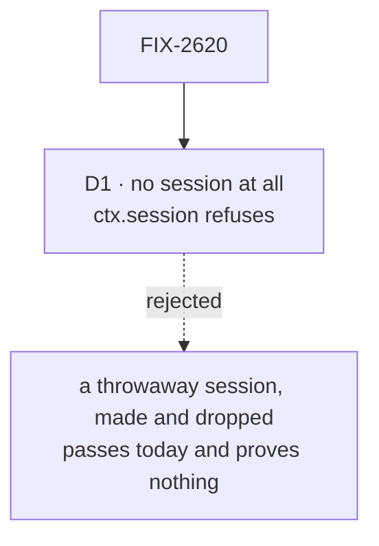

# FIX-2620 · Decisions

[Spec](SPEC.md) · **Decisions**

One decision is the sign-off surface: what the proof counts as "no session". Everything else
here keeps the proof honest and small.

## The tree

Solid edges are what you're signing. Dashed edges lost, and the label says why.

## D1 · The proof counts only a context with no session at all, not a throwaway one

| | |
|---|---|
| **Instead of** | Running the read on a throwaway session: the ephemeral id `createExecutionContext` already makes, with its record held in memory and dropped |
| **Because** | A throwaway session passes today, so it can't tell the epic anything. Worse, it lets a user-scoped view read session state that means nothing at that scope, and it puts a session back into the one path the epic says has none. The question the build children rest on is whether the context *needs* a session, and only a context without one answers it |
| **Locks in** | A view at user or org scope has no `ctx.session`; reaching for it is a named error, so a block written for a session can't be installed at user scope by mistake. If the strict path is refuted, the fallback is a server-owned session per caller, found or made the way [O3](../../epics/FIX-2618/DECISIONS.md#o3)'s write sessions are, not the throwaway one |

It comes down to what a pass means: a throwaway session passes on today's code.

**What would change my mind:** the strict context needing a large change while the
per-caller fallback costs more than the throwaway. Then the throwaway is the cheaper honest
answer, and FIX-2623 specs it with the session-state refusal added on top.

## Decided, not asked

- **Engine level only.** The POC calls the path with `userId` and `orgId` as arguments. The
  route, the verified principal ([ER-3](../../epics/FIX-2618/DECISIONS.md#who-owns-what)) and
  the client call are FIX-2623's and FIX-2624's.
- **The POC lives under this issue**, at `specs/issues/FIX-2620/poc/no-session-read/`, and
  merges with its implementation PR. The Linear description said the epic's `poc/`; the issue
  owns the experiment, and the epic owns the four-line result.
- **The result goes in the epic's DECISIONS** in four lines (built · see it · showed ·
  changed), in the same PR when the verdict confirms the plan. A refuted verdict changes the
  epic's design, so it goes as its own epic amendment PR for the owner's approval.
- **It reuses the read-only store wrappers** from `runRead` rather than a second set: a write
  inside the POC fails the same way a write inside a read does.

## Considered and dropped

| Alternative | Why not |
|---|---|
| Prove it end to end through a new route and the client | Builds FIX-2623's surface before its spec exists; the claim is about the context |
| Skip the proof and let FIX-2623 find out | The point of [D2](../../epics/FIX-2618/DECISIONS.md#d2): a refuted premise after approval redraws approved specs |

## Settled

- **A view at user or org scope can run with no session at all: CONFIRMED, past a small change**
  (2026-11-10, [`poc/no-session-read/`](poc/no-session-read/README.md)). Today's `runRead` with
  no session id fails inside session birth; with a 61-line opt-in no-session mode in
  `createExecutionContext` and execution metadata, one read block reads a user and an org
  collection, a write throws `read_only`, `ctx.session` throws `NoSessionError`, and the session
  store is never called. Resolved with evidence; don't reopen it without a run that says
  otherwise. Not covered: generators in a view (their history reaches for the session) and the
  request record's leftover session id label, both named for FIX-2623.

## Analysis

2026-11-09 · watermark 2026-11-08 (the epic's analysis) · **Right approach.** Run over the
whole set by the spec-set author; see the set PR.

1. **Reuse** — composed from `runRead` and its store wrappers; nothing new in a package.
2. **Prior art** — Convex queries and Firebase security-rule reads run against an identity,
   not a session; the claim is ordinary elsewhere, which is why it is worth a day to check here.
3. **Other shapes** — a throwaway session (D1); a per-caller server session (the fallback).
4. **New factors** — none since the epic's analysis.
5. **Necessity** — earns its place: two build children rest on it.
6. **Ergonomics** — n/a for a proof.
7. **Concerns** — none.

## How it got here

- **Draft (2026-11-09)** — written in the stage-1 spec set; the ephemeral session id found in
  `createExecutionContext` while drafting, which is why D1 exists.

**Open: none.**
