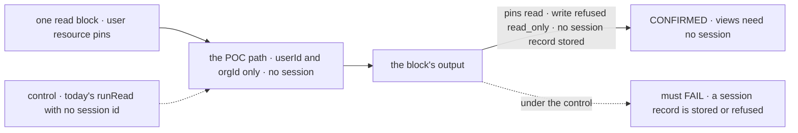

# FIX-2620 · Proof of concept: a user-scoped view answers with no session

**Spec** · [Decisions](DECISIONS.md)

## Four people, before and after

| Someone who… | Today | After |
|---|---|---|
| **specs views** ([FIX-2623](https://linear.app/fixpoint-labs/issue/FIX-2623)) | Must assume a read can run with no session, though `runRead` takes a `sessionId` and builds the full action context | Specs against a recorded verdict: it can, and at what cost, or it can't, and what to build instead |
| **specs direct user and org reads** ([FIX-2624](https://linear.app/fixpoint-labs/issue/FIX-2624)) | The same assumption, for the same context | The same verdict, and the context it showed |
| **shows a user's pins today** (a lab) | Makes a session only to read (`ownSession("pins")`), because every read route takes one | Nothing yet. This proves the premise the change rests on; FIX-2623 and FIX-2624 ship it |
| **owns the epic** | Approved a division that rests on an unchecked claim ([D2](../../epics/FIX-2618/DECISIONS.md#d2)) | Reads four lines in the epic's decisions that say whether the claim held |

`runRead` (`packages/engine/src/execution/runRead.ts`) runs a read through
`createExecutionContext`, the same context an action gets, and that context loads or makes a
session record. `client.flow(kind).read` and its route require a session id. Every view the
epic plans at user or org scope, and every direct read, rests on that changing.

## The goal, and how we'll know it's met

**We know, from code that runs, whether a view at user scope can answer with no session at
all, and the stage-2 specs say which answer they are built on.**

| Is it the right goal? | |
|---|---|
| **The real need** | [FIX-2618 D2](../../epics/FIX-2618/DECISIONS.md#d2): three build children rest on claims nobody has checked; "a view can run with no session" is the first |
| **Smaller, and rejected** | "A read runs with a made-up session id." The engine already makes an ephemeral id when none is passed, so this passes today and proves nothing about whether the context needs a session ([D1](DECISIONS.md#d1)) |
| **Bigger, and not this issue's** | The view route, the principal on it, and the client call. FIX-2623 and FIX-2624 build them; ER-3 is FIX-2624's |
| **Not done if** | The test passes because a session record was written somewhere · the block could reach session state and the test never tried · the verdict is not recorded in the epic before FIX-2623 is specced |

The check reads the stores after the run, not the block's output alone: a session that was
made and dropped is the failure it exists to catch.

| How we verify | |
|---|---|
| **The proof** | `specs/issues/FIX-2620/poc/no-session-read/`: a rough engine path and one vitest file, run with the POC's own config, outside default discovery ([`spec-poc`](../../../.agents/skills/spec-poc/SKILL.md)). Run by the implementer; the verdict lands in the epic's [What the end-state POC showed](../../epics/FIX-2618/DECISIONS.md#what-the-end-state-poc-showed) |
| **Signal** | All four hold on one run: the block reads a user-scoped resource it was not seeded with · a write to it throws `read_only` · `ctx.session` refuses with a named error rather than returning a session · the session store holds no new record after the run |
| **Input** | A pins-shaped user resource with two entries. An org-scoped resource must pass too |
| **Anti-game** | Don't count a pass where the context made an ephemeral session and the read-only stores swallowed its write. Assert on the session store, not on the absence of an error |
| **Control that must fail** | Today's `runRead` called with no session id: it must fail the *no session record* signal (it makes or refuses one). The POC's test shows that FAIL before its PASS counts |

## What each verdict changes

| Verdict | What the epic does |
|---|---|
| **CONFIRMED** | FIX-2623 specs `scope: "user" \| "org"` views on this context; FIX-2624's direct reads use the same one. The POC's size is the estimate |
| **CONFIRMED, past a small change** | The same, and the change it needed (which store, emitter or registry) is named as FIX-2623's first piece of work |
| **REFUTED** | A user or org view runs on a server-owned session per caller, found or made the way [O3](../../epics/FIX-2618/DECISIONS.md#o3)'s write sessions are (O3's are per resource; a view spans several, so this one is per view). The client still makes no session, so the goal's "no session made only to read" holds; FIX-2623's and FIX-2624's specs say so, and an epic amendment rewords "with no session" as "with no client session" wherever the epic says it |

## What stays as it is

- `runRead` and the read route on `main`. The POC is retained beside this spec, never imported.
- Session-scope reads: a transcript still has its session address.

## What's already here, and the debt

| Already here | What this does with it |
|---|---|
| `runRead` and its read-only stores ([FIX-2286 D1](../FIX-2286/DECISIONS.md#d1)) | **Builds on.** The POC reuses the store wrappers that refuse writes; only the session half is new |
| The ephemeral session id `createExecutionContext` makes when none is passed | **Tested against.** It is the shortcut [D1](DECISIONS.md#d1) refuses to count as a pass |
| The principal resolver the push topics use | **Leaves alone.** The POC takes user and org as arguments; the route and principal are FIX-2624's |

| Adds | Existing piece considered | Why it doesn't fit / how composed |
|---|---|---|
| A retained POC under `poc/no-session-read/` | `runRead`; `createExecutionContext` | Composed from both; nothing is added to a package |

| The debt | |
|---|---|
| **Removes** | Nothing; it is a proof |
| **Adds** | A retained experiment, outside every build and discovery |
| **Leaves** | The four own-session helpers; FIX-2624 deletes them |

**Net: flat.** A proof adds no package code.

## Sign off

**[The goal](#the-goal-and-how-well-know-its-met), at that size:** a verdict from running code,
recorded before FIX-2623 is specced. If wrong: views are specced on a guess and redrawn later.

**[The debt](#whats-already-here-and-the-debt), net flat:** a retained experiment, nothing
shipped. If wrong: a POC someone imports.

1. **[D1](DECISIONS.md#d1) · The proof counts only a context with no session at all, not a
   throwaway one.** If wrong: we reject a cheap path that would have served.

**Open: none.**

Prototype · `engine` (POC only) · small · epic [FIX-2618](../../epics/FIX-2618/SPEC.md) stage 1
