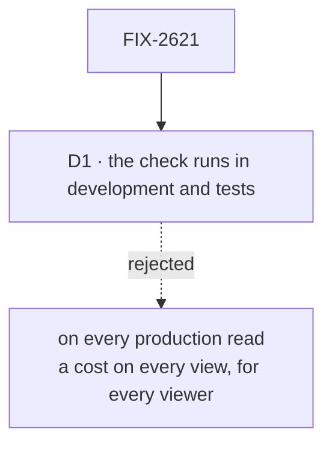

# FIX-2621 · Decisions

[Spec](SPEC.md) · **Decisions**

One decision is the sign-off surface: where the check runs. The verdict itself is input to the
epic's [O2](../../epics/FIX-2618/DECISIONS.md#o2), which stays the owner's.

## The tree

Solid edges are what you're signing. Dashed edges lost, and the label says why.

## D1 · The check runs in development and tests, never on every production read

| | |
|---|---|
| **Instead of** | Recording every view run in production and warning or failing when it touches something it didn't declare |
| **Because** | A view runs once per watcher per change, so a check in production is paid on every screen refresh by every viewer. Drift is a property of the code, not of the data, so a test that runs the view once on realistic data catches it where it is written |
| **Locks in** | A view's tests are what keep `dependsOn` honest: a view with no test that runs it is unchecked. Drift that only some production data reaches (a branch no test takes) ships. The proof measures the cost, so this can be revisited with numbers |

It comes down to who pays: in production, every viewer pays on every refresh.

**What would change my mind:** the measured cost being negligible. Then recording in
production is nearly free, and FIX-2623 should weigh inferring `dependsOn` outright, which
removes the drift instead of catching it.

## Decided, not asked

- **Touches are recorded per resource, collection and board, not per key.** `dependsOn`
  declares resources; keys are FIX-2625's and wait for [O4](../../epics/FIX-2618/DECISIONS.md#o4).
- **Two real reads, not a toy.** The board's read reaches data through a capability, which is
  the path most likely to hide from a recorder.
- **The POC lives under this issue**, at `specs/issues/FIX-2621/poc/dependency-check/`. The
  Linear description said the epic's `poc/`; the issue owns the experiment, the epic the
  four-line result. A refuted verdict goes to the epic as its own amendment PR.
- ~~**The recorder is the read-only wrapper's twin**, not a second interception layer: one proxy
  shape over the stores, so FIX-2623 can merge the two if it builds both.~~ Superseded by the
  POC ([Settled](#settled)): a store-level recorder sees what the read's context loads, not
  what the view reads. The recorder belongs inside the engine's context.

## Considered and dropped

| Alternative | Why not |
|---|---|
| Check `dependsOn` statically, from the block's source | Can't see through a capability or a helper; the same blind spot the proof exists to measure |
| Infer dependencies now and skip the declaration | FIX-2623's call, and only worth weighing once the cost is known; this proof measures it |

## Settled

**The POC: `dependsOn` is checkable, cheaply, but only from inside the engine's context.
CONFIRMED on that condition, with the gaps named.** [`poc/dependency-check/`](poc/dependency-check/README.md),
run with `bash specs/issues/FIX-2621/poc/dependency-check/run.sh`. Resolved; don't reopen
without a new run.

- **Caught.** On the board's `listTasks_tasks`, the lab's `listPins` and a `taskBoard()`
  handle's `listTasks`, every control with one dependency left out fails, naming it. The
  board's obvious declaration, `[tasks]`, fails too: the read also reaches the plan ledger,
  the roster and the session's state, through the board's resolver.
- **Not at the store.** The store-level twin of the read-only wrapper reports everything the
  read's context loads (scope records, the request list, the flow's eager resources), so it
  can't tell a view's reads from its flow's loading.
- **Not from outside the engine.** A scope's `state` is a non-configurable getter, so a
  recorder that keeps the context's identity can't see it. A proxy can, but code keys state
  by the session object's identity, and behind a proxy the board skips its plan ledger: it
  misses a dependency and changes the run. A read one block down is unseen by both, because
  the engine builds each block's context. FIX-2623 records inside the engine's context: the
  state getter, the resource registry, and wherever each block's context is built. Not
  exercised: projected collections, and handles held outside `ctx`.
- **Cost.** At most 0.3 ms per run (under 1% of the read) for the identity-safe recorders,
  measured as the median of paired differences in a rotated order. An earlier fixed-order run read the proxy's
  skipped branch as the recorder being 9–12% faster.

## Analysis

2026-11-09 · watermark 2026-11-08 (the epic's analysis) · **Right approach.** Run over the
whole set by the spec-set author; see the set PR.

1. **Reuse** — composed from the read-only store wrappers; nothing new in a package.
2. **Prior art** — Convex records a query's read set at run time and needs no declaration;
   MobX and Vue track dependencies the same way. Recorded for FIX-2623 as the verdict's
   "cheap enough for production" row.
3. **Other shapes** — static checking; inference (both above).
4. **New factors** — none since the epic's analysis.
5. **Necessity** — earns its place: O2's answer rests on it.
6. **Ergonomics** — the failure must name the missing entry, or developers turn it off.
7. **Concerns** — a capability that reads through a handle the context never sees.

## How it got here

- **Draft (2026-11-09)** — written in the stage-1 spec set. The verdict table gained the
  "cheap enough for production" row from the epic's analysis finding on Convex.
- **POC** — the recorder moved from the stores to inside the engine's context, because the run
  showed the store-level twin reports what the context loads, and a recorder outside the engine
  either can't see a scope's state or, as a proxy, changes the run.

**Open: none.**
