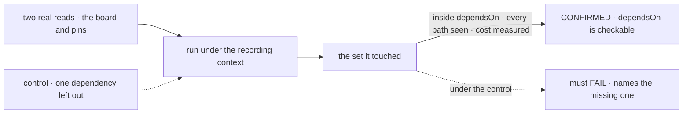

# FIX-2621 · Proof of concept: a view's declared dependencies can be checked against what it reads

**Spec** · [Decisions](DECISIONS.md)

## Four people, before and after

| Someone who… | Today | After |
|---|---|---|
| **writes a view** (once [FIX-2623](https://linear.app/fixpoint-labs/issue/FIX-2623) ships one) | Would list `dependsOn` by hand, and a list that misses one resource silently stops the screen updating when it changes | Nothing yet. This proves whether a test can catch the missing entry, which is what makes the list safe to ask for |
| **specs views** (FIX-2623) | Must assume declared dependencies can be checked | Specs against a recorded verdict, and the method the proof used |
| **decides [O2](../../epics/FIX-2618/DECISIONS.md#o2)** (the owner) | Weighs "views replace reads" on a check nobody has seen run | Reads what the check caught, what it missed and what it cost |
| **owns the epic** | Approved a division that rests on this claim ([D2](../../epics/FIX-2618/DECISIONS.md#d2)) | Reads four lines in the epic's decisions saying whether it held |

The epic names the risk in O2: "`dependsOn` is declared by hand and can drift from what the
block really reads, and a drifted view silently misses changes." The name "view" is earned
only if that drift fails a test.

## The goal, and how we'll know it's met

**We know, from code that runs, whether a test can fail a view that reads something it did
not declare, on the real read paths, at a cost a developer would keep on.**

| Is it the right goal? | |
|---|---|
| **The real need** | [FIX-2618 O2](../../epics/FIX-2618/DECISIONS.md#o2) and the epic's *Not done if*: "a view reads something it did not declare and no test fails" |
| **Smaller, and rejected** | "The check catches a missing resource in a toy block." A toy reads through `ctx.resources`, the one path the recorder sees for sure. The risk is the paths it might not: a capability's own handle, a board, a store call |
| **Bigger, and not this issue's** | Building the check into `defineView` and inferring dependencies instead of declaring them. FIX-2623's design, informed by this result |
| **Not done if** | Both reads pass only because the recorder sees `ctx.resources` · a path the recorder can't see is found and not listed · the cost is not measured |

The check reads what the run touched, not what the block's code mentions: a read hidden behind
a capability is the failure it exists to catch.

| How we verify | |
|---|---|
| **The proof** | `specs/issues/FIX-2621/poc/dependency-check/`: a rough recording context and one vitest file, outside default discovery ([`spec-poc`](../../../.agents/skills/spec-poc/SKILL.md)). Run by the implementer; the verdict lands in the epic's [What the end-state POC showed](../../epics/FIX-2618/DECISIONS.md#what-the-end-state-poc-showed) |
| **Signal** | For each read, with its full `dependsOn`, the test passes; with any one entry removed, it fails and names that entry. Every path the reads took to data is listed as seen or unseen. The added time per read run is measured |
| **Input** | The board's `listTasks` through `taskToolReads` (`packages/orchestration/src/skills/task-tools-capability.ts`) and a pins read over a user collection. A third read through a capability's own handle must pass too, or be listed unseen |
| **Anti-game** | Don't declare dependencies by reading the block's source, and don't stub the board: a stubbed board reads through the path the recorder already sees |
| **Control that must fail** | Each read with one dependency removed: the test must fail on *names the missing one*. The POC's test shows each FAIL before the PASS counts |

## What each verdict changes

| Verdict | What the epic does |
|---|---|
| **CONFIRMED** | [O2](../../epics/FIX-2618/DECISIONS.md#o2)'s recommendation stands. FIX-2623 builds the check into development and tests ([D1](DECISIONS.md#d1)), on this method |
| **CONFIRMED, and cheap enough for production** | The same, and FIX-2623 weighs inferring `dependsOn` from the recording instead of declaring it (the Convex shape the epic's analysis recorded). That changes FIX-2623's design, not O2's answer |
| **REFUTED: paths it can't see** | Each unseen path is named. FIX-2623's spec either routes it through the context, named as work, or O2's mind-changer fires and the owner weighs keeping "read" with a scope |
| **REFUTED: too costly** | O2's mind-changer fires as written: views without a checked `dependsOn` are reads with a scope |

## What stays as it is

- Flow `reads` on `main`, and the read-only context that refuses writes. The recorder is a
  second wrapper of the same shape, retained beside this spec and never imported.
- FIX-2367's notices and topics. The proof checks a declaration; it notifies nobody.

## What's already here, and the debt

| Already here | What this does with it |
|---|---|
| The read-only stores `runRead` wraps around a read ([FIX-2286 D1](../FIX-2286/DECISIONS.md#d1)) | **Builds on.** The recorder is the same shape: a wrapper that sees every store call, recording instead of refusing |
| `taskToolReads`, the board's read | **Uses as input.** The hardest real read: it reaches the board through the task tools' capability |
| Anything that already records what a block reads | **None.** Searched `packages/` for `record`, `touched`, `track` and `dependsOn` around resource access; tracing records spans, not reads |

| Adds | Existing piece considered | Why it doesn't fit / how composed |
|---|---|---|
| A retained POC under `poc/dependency-check/` | The read-only store wrappers | Composed: the same proxy shape, recording; nothing is added to a package |

| The debt | |
|---|---|
| **Removes** | Nothing; it is a proof |
| **Adds** | A retained experiment, outside every build and discovery |
| **Leaves** | Scope `derived`, which declares nothing; FIX-2623 folds it into views |

**Net: flat.** A proof adds no package code.

## Sign off

**[The goal](#the-goal-and-how-well-know-its-met), at that size:** a verdict on the real read
paths, with the cost measured. If wrong: O2 is answered on a check that only works on toys.

**[The debt](#whats-already-here-and-the-debt), net flat:** a retained experiment. If wrong:
a POC someone imports.

1. **[D1](DECISIONS.md#d1) · The check runs in development and tests, never on every
   production read.** If wrong: drift that only production data triggers goes uncaught.

**Open: none.** The verdict feeds the epic's [O2](../../epics/FIX-2618/DECISIONS.md#o2), which stays the owner's.

Prototype · `engine`, `orchestration` (POC only) · small · epic [FIX-2618](../../epics/FIX-2618/SPEC.md) stage 1
