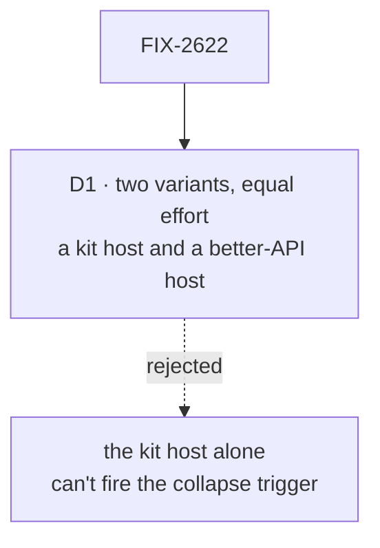

# FIX-2622 · Decisions

[Spec](SPEC.md) · **Decisions**

One decision is the sign-off surface: what the proof builds. Whether FSD should have kits is
the epic's [O1](../../epics/FIX-2618/DECISIONS.md#o1), and what they are called is
[O5](../../epics/FIX-2618/DECISIONS.md#o5); both stay the owner's.

## The tree

Solid edges are what you're signing. Dashed edges lost, and the label says why.

## D1 · The proof builds the better-API host beside the kit host, with equal effort

| | |
|---|---|
| **Instead of** | Rebuilding the host on a kit alone and counting what went, as the Linear issue first described it |
| **Because** | The claim is a comparison. The epic's collapse trigger and O1's mind-changer both ask whether *a better workforce install API* removes the wiring without a new unit. A kit host alone credits every removed line to the kit, including lines a workforce fix would remove just as well, so it can confirm kits and never refute them |
| **Locks in** | Roughly twice the proof's work, and a workforce API sketch that is retained beside the kit sketch. If kits win, that sketch is evidence for O1; if it wins, it is the start of the workforce fix the collapse files. Either way the owner answers O1 on a table both sides had a fair shot at |

It comes down to refutability: the kit host alone can confirm kits but never refute them.

**What would change my mind:** reading the host shows the callback and the casts trace to one
workforce signature that a one-line change removes. Then variant B is a line, not a host, and
the proof is the kit host plus that line.

## Decided, not asked

- **Attribution, not totals.** Each wiring line and cast gets one row: removed by both
  variants, A only, B only, or neither. The two read-only flows are credited to views
  (FIX-2623) and the harness-block casts to neither, unless a variant really removes them.
- **Parity is checked on the flows served, not only on the host tests.** The four host tests
  never list or invoke the served flows, and the contract test drives three workers but never
  lists the flows or touches `workforce-roster`, so the POC adds a throwaway parity check: the
  same ids `GET /api/flows` returns today (one copy per worker flow `hireWorkforce` registers,
  plus `workforce-roster`, `harness-readiness` and `lab-context`), and one action per flow,
  a `hire` and a roster read on the roster flow. A variant that
  dropped wiring along with a flow would otherwise be credited with removing it.
- **Lines moved into a package are not removed.** The count is what the host author still
  writes, plus what the variant adds to a package, stated separately.
- **The coder routing stays as it is.** Merging teammates' `coder.ts` routing with
  claude-code-style's is FIX-2627's shared coding worker flow, and a proof that did it would
  credit that merge to the kit.
- **"Kit" is the working name, and flows are imported** in variant A. The proof lists which of
  the host's flows a user would configure, as input to O1's copied half, and decides neither O1's
  split nor [O5](../../epics/FIX-2618/DECISIONS.md#o5).
- **The POC lives under this issue**, at `specs/issues/FIX-2622/poc/kit-or-api/`. The Linear
  description said the epic's `poc/`; the issue owns the experiment, and the epic the four-line
  result. A verdict that fires the collapse trigger goes to the epic as its own amendment PR.

## Considered and dropped

| Alternative | Why not |
|---|---|
| A third variant, a kit with slots designed for two consumers | Slots meet their second consumer in FIX-2627, by design; designing them here freezes them early, which O1 warns against |
| Rebuild claude-code-style's host instead | Its wiring is smaller and its adapter is the larger problem; teammates is where the circular callback lives |

## Analysis

2026-11-09 · watermark 2026-11-08 (the epic's analysis) · **Right approach.** Run over the
whole set by the spec-set author; see the set PR. One finding folded: D1.

1. **Reuse** — both variants are composed from `createWorkerInstallation`, `hireWorkforce`,
   `defineFlow` and `createFlowState`; nothing is added to a package.
2. **Prior art** — Fastify plugins and NestJS modules (the epic's analysis) are the kit's
   shape; Django's `INSTALLED_APPS` is the better-API shape: a list, no slot.
3. **Other shapes** — the better install API, now a built variant (D1).
4. **New factors** — none since the epic's analysis.
5. **Necessity** — earns its place: it decides whether two build children exist.
6. **Ergonomics** — the comparison is what the owner reads; the table is the deliverable.
7. **Concerns** — a variant B built with less care than A. The anti-game row names it.

## How it got here

- **Draft (2026-11-09)** — written in the stage-1 spec set. Variant B added: the Linear issue
  described the kit host alone, which can't fire the collapse trigger it exists to test.

**Open: none of this issue's own.**
