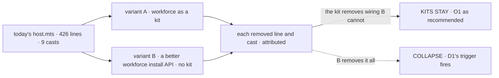

# FIX-2622 · Proof of concept: the teammates host rebuilt with workforce installed as a kit

**Spec** · [Decisions](DECISIONS.md)

## Four people, before and after

| Someone who… | Today | After |
|---|---|---|
| **decides [O1](../../epics/FIX-2618/DECISIONS.md#o1)** (the owner: should FSD have kits?) | Weighs a new public unit on an estimate, with the mind-changer ("the pain is workforce's own API") untested | Reads two rebuilt hosts side by side, with every removed line and cast counted and attributed to what removed it |
| **wires workforce into a host** (the teammates lab) | Writes `let flows = {}`, passes `workerFlows: () => flows as never`, fills `flows` afterwards, spreads the copies and two read-only flows into `createFlowState` by hand, and casts nine times | Nothing yet. This proves which change takes that away; FIX-2626 and FIX-2627, or a workforce fix, ship it |
| **specs kits** ([FIX-2626](https://linear.app/fixpoint-labs/issue/FIX-2626), [FIX-2627](https://linear.app/fixpoint-labs/issue/FIX-2627)) | Would design slots against one host and a sketch | Specs against a host that ran on a rough `defineKit`, or doesn't spec at all because the collapse trigger fired |
| **owns the epic** | Holds a collapse trigger nobody has run ([D1](../../epics/FIX-2618/DECISIONS.md#d1)) | Reads four lines saying whether it fired |

`labs/teammates/host.mts` is 426 lines. The pain the epic names is concrete: a circular
callback at line 345, a hand-spread flows map, nine `as never` casts, and two flows
(readiness and lab context) that exist only to answer a read.

## The goal, and how we'll know it's met

**We know, from two rebuilt hosts that run, whether a unit above a flow removes wiring that a
better workforce install API cannot, so the owner answers O1 on counts, not on an estimate.**

| Is it the right goal? | |
|---|---|
| **The real need** | [FIX-2618 D1](../../epics/FIX-2618/DECISIONS.md#d1)'s collapse trigger and [O1](../../epics/FIX-2618/DECISIONS.md#o1)'s mind-changer: "a better `hireWorkforce` fixes it" |
| **Smaller, and rejected** | "Rebuild the host on a kit and count what went." It can't fire the trigger: without the better-API host beside it, every removed line looks like the kit's ([D1](DECISIONS.md#d1)) |
| **Bigger, and not this issue's** | The slot contract, the client half, the copied half, and merging teammates' coder routing into one coding worker flow. FIX-2626 and FIX-2627 |
| **Not done if** | A count is estimated rather than read off the diff · a removed line is credited to the kit when views or a workforce fix would remove it too · either variant serves a different set of flows than today's host, or fails the host-parity check or the lab's host tests |

Both variants pass the host-parity check and the lab's host tests unchanged; the verdict is read off the attribution
table, not off which host is shorter.

| How we verify | |
|---|---|
| **The proof** | `specs/issues/FIX-2622/poc/kit-or-api/` with `a-kit/` and `b-api/`, each a rebuilt `host.mts` and what it needs, built with equal effort ([`spec-poc`](../../../.agents/skills/spec-poc/SKILL.md) → variants), outside default discovery. Run by the implementer; the verdict lands in the epic's [What the end-state POC showed](../../epics/FIX-2618/DECISIONS.md#what-the-end-state-poc-showed) |
| **Signal** | One attribution table: each of today's wiring lines and casts, and which variant removes it: both, A only, B only, or neither. Lines the two read-only flows cost are credited to views (FIX-2623), and the three harness-block casts to neither, unless a variant really removes them. The verdict reads off the "A only" row. Also recorded: each variant's host against [FIX-2152 ER-1](../../epics/FIX-2152/DECISIONS.md#who-owns-what)'s 300-line config cap |
| **Input** | Today's `labs/teammates/host.mts` on the proof's base commit, and three checks each variant runs: **(1) the host-parity check** the POC adds, `poc/kit-or-api/parity.test.ts`. It opens the host in process, lists the served flow ids (`GET /api/flows`), requires them to equal today's set (one copy per roster worker, `harness-readiness`, `lab-context`), and invokes one action per flow: `read` on the two read-only flows, and one scripted-model turn on each worker copy, enough to show it is wired. **(2) `test/contract/contract.test.ts`**, the real-adapter column, which drives chief-of-staff, researcher and cursor end to end but never lists the served flows, reads the two read-only flows only where the adapter does, and never touches the other copies. **(3) the four host tests** (`checks`, `drain-budget`, `run-timeout`, `working-folder`), which cover the host's helpers and its drain, not which flows it serves. Throwaway, beside the variants, never shipped |
| **Anti-game** | Don't count lines moved into the kit or the workforce package as removed: count what the host author still writes, plus what the variant adds to a package. Don't give B less effort than A |
| **Control that must fail** | Today's host against the same table: every row "neither". And removing any one served flow from a variant fails the parity check: the POC shows that failure once, on a variant with `lab-context` removed, and records the red output beside the variants |

## What each verdict changes

| Verdict | What the epic does |
|---|---|
| **The kit removes wiring B cannot** (the "A only" row holds the callback, the spread or the casts) | O1's recommendation stands with numbers. FIX-2626 and FIX-2627 are specced in stage 2; the kit variant's slots are their starting sketch |
| **B removes it all** (the "A only" row is empty) | [D1](../../epics/FIX-2618/DECISIONS.md#d1)'s collapse trigger fires: FIX-2626 and FIX-2627 leave for a follow-up epic, FIX-2628 narrows to views and direct reads, FIX-2629 drops leg b, and the workforce fix is filed. An epic amendment for the owner |
| **Mixed** | The owner answers O1 on the table. The trigger is the owner's to pull; the proof only lays out what each would cost |

## What stays as it is

- `labs/teammates/host.mts` on `main`, and every workforce export. Both variants are retained
  beside this spec and never imported.
- The [O1](../../epics/FIX-2618/DECISIONS.md#o1) library/copied split and the
  [O5](../../epics/FIX-2618/DECISIONS.md#o5) name. The proof uses "kit" as the working name and
  imports its flows; it records which flows a user would configure, and decides neither.

## What's already here, and the debt

| Already here | What this does with it |
|---|---|
| `createWorkerInstallation` and `hireWorkforce` (`packages/workforce/src/workers/`) | **Extended in variant B** (a better install API), and **wrapped in variant A** (the kit installs through them) |
| `createFlowState({ flows })` | **Builds on.** Variant A adds a rough `kits: [...]` beside it, in the POC only |
| `defineCapability` | **Considered.** It installs into one block and can't add flows or views (`define-capability.ts`), so it can't be the unit |
| [FIX-2152 ER-1](../../epics/FIX-2152/DECISIONS.md#who-owns-what): an app is configuration, UI and small flows | **Builds on.** It is the bar both variants are measured against |

| Adds | Existing piece considered | Why it doesn't fit / how composed |
|---|---|---|
| A retained POC: a rough `defineKit`, two rebuilt hosts, and the host-parity check | `defineCapability`, `createWorkerInstallation`, `defineFlow` | Composed from them; nothing is added to a package. Whether `defineKit` is genuinely new is what the proof answers |

| The debt | |
|---|---|
| **Removes** | Nothing; it is a proof |
| **Adds** | Two retained host variants and their parity check, outside every build and discovery |
| **Leaves** | Teammates' 1,788-line `adapter.ts` and its coder routing; out of this epic and FIX-2627's, respectively |

**Net: flat.** A proof adds no package code.

## Sign off

**[The goal](#the-goal-and-how-well-know-its-met), at that size:** O1 answered on counts from
two hosts that run. If wrong: a new public unit adopted, or dropped, on an estimate.

**[The debt](#whats-already-here-and-the-debt), net flat:** two retained variants. If wrong:
a POC someone imports.

1. **[D1](DECISIONS.md#d1) · The proof builds the better-API host beside the kit host, with
   equal effort.** If wrong: twice the proof's work, for a trigger that was never close.

**Open: none of this issue's own.** The verdict feeds the epic's [O1](../../epics/FIX-2618/DECISIONS.md#o1).

Prototype · `workforce`, teammates lab (POC only) · medium · epic [FIX-2618](../../epics/FIX-2618/SPEC.md) stage 1
