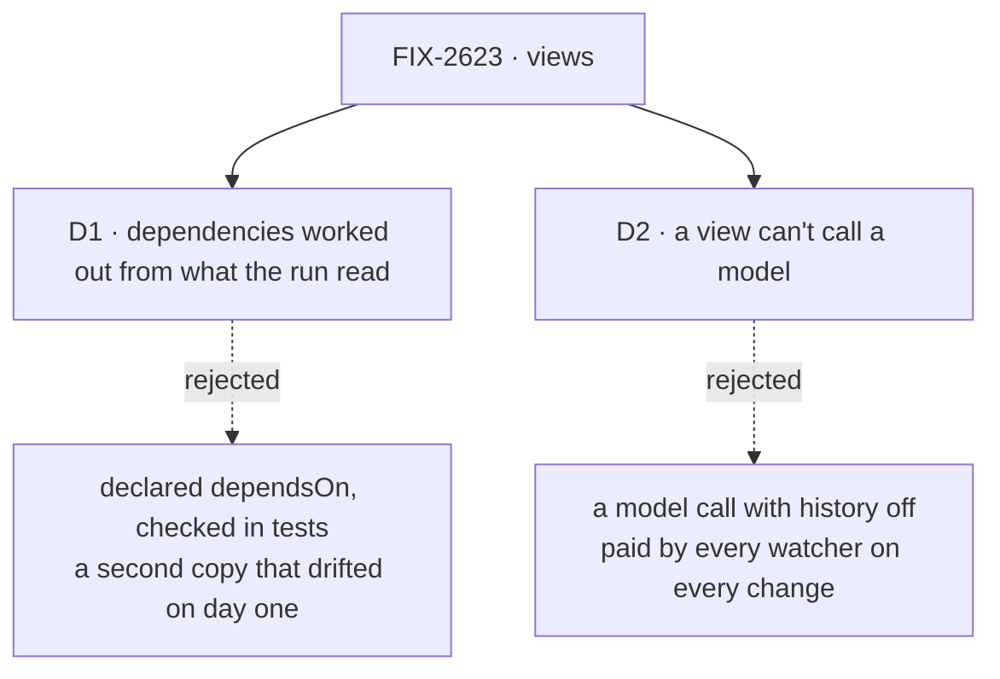

# FIX-2623 · Decisions

[Spec](SPEC.md) · **Decisions**

Two decisions are the sign-off surface. The owner already decided that views replace reads and
`derived` ([epic O2](../../epics/FIX-2618/DECISIONS.md#o2), ER-1); what is left is how a view
knows what it depends on, and what it may do. The rest holds the direction for the implementer.

## The tree

Solid edges are what you're signing. Dashed edges lost, and the label says why.

## D1 · A view's dependencies are worked out from what it read, not declared by its author

| | |
|---|---|
| **Instead of** | `dependsOn` declared on each view and checked in development and tests: O2 as worded, with [FIX-2621 D1](../FIX-2621/DECISIONS.md#d1) |
| **Because** | The engine records what a view reads either way: for the check, and to name the session topics a run actually reached, which a list written in advance can't. FIX-2621 measured that recording at under 1% of a read, which is the mind-changer O2 and FIX-2621 D1 both named. Once it runs on every view, a declared list is a second copy that can drift, and the board's obvious one missed three of its four dependencies. Recorded per run, the watch list is right on every branch in production, not only the ones a test takes. Missing a change is the failure; an extra notice is allowed ([FIX-1506](../FIX-1506/DECISIONS.md#decided-not-asked)) |
| **Locks in** | `defineView` has no `dependsOn`; adding an optional one later is additive, removing one would not be. The recorder runs on every view in production. A flow that declares a view publishes a notice for every resource change, as a scope with `derived` does today. O2's wording, the epic's *not done if* line, `examples/view.md`, the concept doc and the View glossary entry change to match, the epic ones in an amendment from `main` before implementation |

![D1, how a view knows what it depends on. Chosen: worked out from what each run read. Instead of: dependsOn declared by the author and checked in tests. It comes down to whether the list can be wrong: recorded, it is what the run read, on every branch in production; declared, the board's obvious list missed three of four and a test catches only the branches it takes. Price: the recorder runs on every view, under 1%, and a flow with a view publishes every resource change. Locks in no dependsOn on defineView, addable later. Flips if the extra notices load a cross-process bus, or the engine's recorder misses a path a probe reaches](figures/d1-inferred.svg)

It comes down to whether the list can be wrong: declared, it was wrong on the first real view.

**What would change my mind:** the extra notices measurably loading the Postgres bus, or the
engine's recorder missing a path FIX-2621's probe reaches. **If you keep declared:** `dependsOn`
goes on `defineView`, the same recorder runs only in tests and `fsdev dev` and fails a view that
read what it didn't list, and only listed resources publish. The wire and the rest of this spec
are unchanged.

## D2 · A view can't call a model

| | |
|---|---|
| **Instead of** | Allowing a model call in a view, with conversation history off at user and org scope (the gap [FIX-2620](../FIX-2620/poc/no-session-read/README.md) left for this issue) |
| **Because** | A view runs once per watcher per change. A model call there is paid by every viewer on every change, and its answer can differ on each run while the data stays the same, so a screen changes for no reason. A model's answer is work: an action computes it once and stores it, and the view reads what was stored |
| **Locks in** | A model call inside a view is refused at every scope with a named error, at the view runner. No read on `main` holds one: each is a handler or a task tool. A screen that wants a summary has it written by an action first |

It comes down to who pays: allowed, every watcher pays for a model call on every change.

**What would change my mind:** a real screen that needs a model's answer computed for each viewer
at read time, where caching it per input is acceptable.

## Decided, not asked

- **The answer carries its topics.** A view call returns its output and the existing topics its
  run read, and `useView` listens to those through FIX-2551's live read. No view topic is added
  ([FIX-2367 ER-2](../../epics/FIX-2367/DECISIONS.md#who-owns-what)); topics are minted as today,
  under the mint's cap.
- **Routes.** `POST /api/flows/:flowKind/views/:name` at user and org scope and
  `/:flowKind/:sessionId/views/:name` at session scope. User and org come from the verified
  principal through the resolver the push mint uses ([ER-3](../../epics/FIX-2618/DECISIONS.md#who-owns-what)).
  A session view can't make a session, as a read can't.
- **No session at user or org.** The no-session mode is the first work, from FIX-2620's patch; a
  block that reaches for `ctx.session` gets `NoSessionError`; execution metadata and the request
  record carry no session id.
- **Types.** A view's block must declare an output schema, refused at define time without one,
  so `ViewOutput` is never `unknown`. Client code never imports a view's block at run time: the
  handle `useView` takes is client-safe (a type import, or a leaf ref as resources have, BP-019).
- **Keys.** `key` is optional; with it the answer is a list and `useView` keeps rows by key.
  Re-reading only some keys is FIX-2625's, which closes the concept doc's open question by adding
  keys to the call beside the input.
- **The convergence point** for "a view writes nothing and every read it makes is recorded" is
  the one view runner, `runRead`'s successor, with the read-only stores. Every view runs through
  it: flow `views`, `taskToolViews`, harness-manager's `changes`, and later a kit's. The recorder
  sits where the engine builds each block's context (the state getter, the resource registry, a
  board handle), so a child block reached by a step or a capability is seen.
- **No alias.** `reads` and a scope's `derived` are refused loudly at `defineFlow`, naming views
  (FIX-2447, BP-030). The glossary's "read" retire and its check land here (ER-9), with `derived`
  retired the same way.
- **Pins and dismissals** become user views if this lands before FIX-2624; FIX-2624 then replaces
  pins with a direct read.
- **A view ends like a read:** side chains drain and request-end hooks run.

## Considered and dropped

| Alternative | Why not |
|---|---|
| A topic per view, the server mapping resource notices onto it | FIX-2367 ER-2 allows no new topic, and the server would keep a map per watcher |
| The client works out topics from the view's declared list | The client must then know dependencies and sessions, which O2 removes |
| Keep `derived` for values the snapshot carries | Two hooks again (ER-1) |
| A throwaway session for user and org views | Passes today and proves nothing ([FIX-2620 D1](../FIX-2620/DECISIONS.md#d1)) |
| Record at the stores, or from outside the engine | Over-reports, or blind to `state` and child blocks ([FIX-2621](../FIX-2621/DECISIONS.md#settled)) |

## Settled

- **A user or org view runs with no session: CONFIRMED, past a small change**
  ([FIX-2620](../FIX-2620/DECISIONS.md#settled)). Not covered there: generators, now [D2](#d2);
  the record's session id label, now in *Decided, not asked*.
- **`dependsOn` is checkable, under 1% of a read, only from inside the engine: CONFIRMED**
  ([FIX-2621](../FIX-2621/DECISIONS.md#settled)). Its finding that a recorder inside the engine
  closes all three gaps was reasoned, not run. The implementer runs FIX-2621's three reads and
  its probe under the engine's recorder before building on it; if the probe stays unseen, D1's
  mind-changer has fired and the spec returns to the owner.
- **No factual-base checker.** The counts here are the proofs' and FIX-2551's, cited; the few
  this spec read off the code (two `derived` values, the board in three flows) are named by file.

## Analysis

2026-11-11 · watermark 2026-11-08 (the epic's analysis) · **Right approach, one fold.** Run in
line by the author; this worker had no sub-agent to dispatch.

1. **Reuse** — every *Adds* row extends or composes an existing piece
   ([Builds on / Adds](SPEC.md#whats-already-here-and-the-debt)).
2. **Prior art** — Convex queries and Replicache's `subscribe` record their read set per run;
   TanStack Query's hand-written keys drift, as React's dependency arrays do. Folded into D1.
3. **Other shapes** — a view topic, client-side topics: dropped above.
4. **New factors** — the two proofs; FIX-2656 and FIX-2643, left as debt.
5. **Necessity** — the epic's read half.
6. **Ergonomics** — one hook, no list to keep.
7. **Concerns** — FIX-2656's growth would show in views first. Recorded: the implementer reruns
   FIX-2621's long run on views and reports it there.

## How it got here

- **Draft (2026-11-11)** — framed as the epic's read half on the two proofs; the first draft
  declared `dependsOn` as O2 worded it, and moved to recording when the session-topic problem
  and FIX-2621's cost made the declared list a second copy (D1).

**Open: none.**
