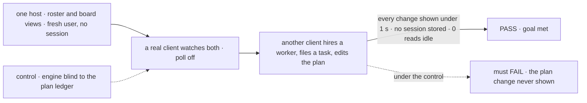
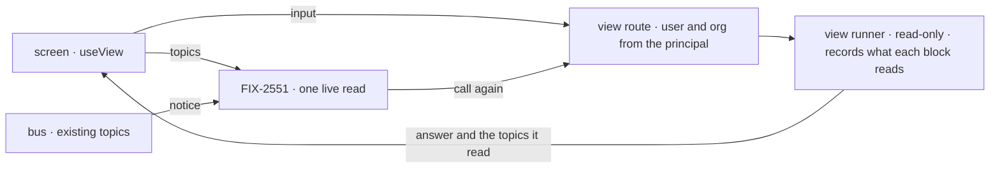

# FIX-2623 · Views replace flow reads: a computed answer with a scope, its dependencies and keyed rows

**Spec** · [Decisions](DECISIONS.md)

## Six people, before and after

| Someone who… | Today | After |
|---|---|---|
| **shows a user's or org's computed data** (the roster, a dashboard) | Finds or makes a session only so a read can run, then hand-types its answer | Calls the view at user or org scope. No session is loaded or made, and the answer is typed by the view |
| **keeps that screen current** | Learns which topics to watch and which notices may matter (three hand-written copies) | Watches the view. Its answer names the topics it read, and the client listens to those |
| **adds a resource a view reads** | Must remember to make the screen hear it; forgetting leaves the screen stale with no error | Nothing to remember: a run that read it is woken by its change ([D1](DECISIONS.md#d1)) |
| **watches a conversation's board** (Shift Manager, Teammates) | Calls a read with a session id and filters board notices itself | Watches the board view; the rows come typed and keyed by task |
| **wants a model's answer on a screen** | Could put a model call in a read, paid on every poll | Is refused: a view can't call a model. An action computes it once and the view reads it ([D2](DECISIONS.md#d2)) |
| **maintains the framework** | Two hooks compute a screen's answer: flow `reads` and a scope's `derived` | One, the view. The glossary refuses "read" as its name |

[FIX-2286 D1](../FIX-2286/DECISIONS.md#d1) made a read the one hook for watching a computed answer.
It still needs a session, knows nothing of what it depends on, and answers in one untyped piece.
The owner decided views replace it ([epic O2](../../epics/FIX-2618/DECISIONS.md#o2)); the two
stage-1 proofs say how ([FIX-2620](../FIX-2620/SPEC.md), [FIX-2621](../FIX-2621/SPEC.md)).

## The goal, and how we'll know it's met

**A screen gets every answer the server computes for it from one hook, the view: at the scope
its data lives in, with no session at user or org scope, typed by the view, and current without
the app naming a topic, because a change to anything the view read reaches its watchers.**

| Is it the right goal? | |
|---|---|
| **The real need** | The epic's *maintains the framework* and *keeps a screen current* rows: "one hook, the view"; "watches a view" ([FIX-2618](../../epics/FIX-2618/SPEC.md#five-teams-before-and-after)). Its kits ([FIX-2627](https://linear.app/fixpoint-labs/issue/FIX-2627)) package these views |
| **Smaller, and rejected** | "`reads` renamed to views, with a scope." It passes the export inventory while every screen still names topics, hand-types rows, and the board and roster stay where they are, leaving the kits nothing to package |
| **Bigger, and not this issue's** | Re-reading only the rows a notice names ([FIX-2625](https://linear.app/fixpoint-labs/issue/FIX-2625)). Direct reads, writes through `runBy`, deleting the own-session helpers ([FIX-2624](https://linear.app/fixpoint-labs/issue/FIX-2624)). Kits installing views (FIX-2626, FIX-2627) |
| **Not done if** | `reads`, `ReadConfig`, `runRead`, a scope's `client.derived` or `flow().read` is still exported · a user or org view loads or makes a session, or its request record names one · a screen passes topics to stay current with a view · a change to something a view read misses its watcher with the poll off · a view's answer is `unknown` on the client · the glossary's "read" check passes a planted `reads:` |



The check reads what the watching client reported and how often its fetcher called, never the
bus. The control blinds the engine to one path the board reaches, so a missed dependency shows.

| How we verify | |
|---|---|
| **Goal check** | `goals/views/a-screen-watches-a-view/`, shaped like `goals/realtime/app-views-read-on-notice/` · model n/a · run by the implementer at completion · verdict in the implementation PR |
| **Signal** | `a:no-session`: the roster view answers a user who never had a session, equal to today's roster for the same data, and the session store lists the same before and after · `b:within-1s`: a hire, a filed task and a plan edit each reach the watching client under 1000 ms · `b:idle-0-reads`: 0 view calls in 10 s idle · `c:inventory`: no removed name on any root, and the "read" check fails a planted `reads:` |
| **Input** | One `serve()` host, workforce's roster and a coordinator flow, one user behind a bearer token. A second user's changes must reach no one watching the first |
| **Anti-game** | Don't assert on a view's in-process output or on `publish` calls. Keep the client's poll off, or a timer hides a missed dependency |
| **Control that must fail** | `GOAL_CONTROL=blind-path`: the recorder skips the plan ledger. Must FAIL `b:within-1s` on the plan edit. Today's `main` must FAIL `a:no-session` |

## What changes


Read across each row: everything an app hand-writes today moves into the view's answer.

**What a person writes:**

```diff
  defineFlow({
    kind: "coordinator",
-   reads: taskToolReads(CONVERSATION_LEDGER_ID, readResolver),
+   views: taskToolViews(CONVERSATION_LEDGER_ID, readResolver),   // session scope
  });

+ export const roster = defineView({
+   scope: "user",                       // no session
+   key: (row) => row.id,
+   block: rosterBlock,                  // its outputSchema is ViewOutput<typeof roster>
+ });
+ defineFlow({ kind: "workforce-roster", views: { roster } });

  // a screen
- const sessionId = await ownSession("roster");
- const rows = await fsd.flow("workforce-roster").read<RosterEntry[]>("list", {}, { sessionId });
- fsd.subscribe([topic.user()], { onChange: (n) => mayBeRoster(n) && reread() });
+ const { data } = useView(roster);      // typed, current, no topics

  // kitchen-sink
-   session: { client: { derived: { modeStatus: (ctx) => ({ /* … */ }) } } },
+   views: { modeStatus: defineView({ scope: "session", block: modeStatusBlock }) },
```

**Docs:** the changeset carries views' specifics to `/release-docs` (FIX-2626's carries the kit
story), which **adds** a *Views* page under Core → Fundamentals after `fundamentals/actions` and
**updates** `fundamentals/flows`, `configuration/flow`, `fundamentals/state-and-scopes`,
`resources/client-access`, `client/react`, `api/core`, `orchestration/harness-manager` and seven
READMEs. In this PR: `flows-and-actions.md` § Reads becomes § Views, `derived` leaves
`resources-and-client-data.md`, the concept doc and the View glossary entry are updated, and
`mechanisms.yaml` gains a `view` row.

## How an answer reaches a screen



The client never learns what a view depends on: the answer carries the topics, and FIX-2551's
live read listens. No topic is added ([FIX-2367 ER-2](../../epics/FIX-2367/DECISIONS.md#who-owns-what)).

## What stays as it is

- Topics, the notice shape, `client.subscribe` and the push mint. A view's topics are ordinary ones.
- Session items, streams and the transcript, still addressed by session.
- A scope's `expose` and a resource's client projection: direct-read territory, FIX-2624's.
- Actions. Anything that changes state is still one.

## What's already here, and the debt

| Already here | What this does with it |
|---|---|
| Whatever computes a screen's answer today | **Two hooks, both replaced:** flow `reads` and scope `client.derived`, plus client-side joins (workforce's `readRoster`, the lab adapters). `mechanisms.yaml` has no row for the job (searched *read*, *derived*, *view*). After: one way |
| Flow `reads` ([FIX-2286 D1](../FIX-2286/DECISIONS.md#d1)) | **Amended by O2:** the rule is kept; renamed, with scope, keys and a watch list. Moves: the workforce board (three flows), harness-manager's `changes`, the lab's pins and dismissals, Shift Manager's and Teammates' board calls |
| `runRead` and its read-only stores | **Builds on:** becomes the view runner, the one convergence point |
| [FIX-2620](../FIX-2620/DECISIONS.md#settled)'s no-session mode and [D1](../FIX-2620/DECISIONS.md#d1) | **Builds on, kept:** its patch is this issue's first work; a user or org view has no `ctx.session` |
| [FIX-2621](../FIX-2621/DECISIONS.md#settled)'s recorder findings and [D1](../FIX-2621/DECISIONS.md#d1) | **Builds on; D1 superseded** by [D1](DECISIONS.md#d1): its mind-changer (negligible cost) fired |
| [FIX-1506](../FIX-1506/DECISIONS.md#decided-not-asked)'s publish rule for `derived` scopes | **Amended:** a flow with a view publishes every resource change; over-notifying stays allowed, missing doesn't |
| `watchRoster` ([FIX-2412 D1](../FIX-2412/DECISIONS.md#d1)) | **Amended:** reads the roster view through FIX-2551; its roster session leaves the read path (FIX-2624 removes the rest) |

| Adds | Existing piece considered | Why it doesn't fit / how composed |
|---|---|---|
| `defineView`, flow `views`, the view route and client call, `useView`, `ViewOutput` | `flow` · `ReadConfig`, `runRead`; `client.derived` | **Extends** reads; removes `derived`. Not a second definer |
| No-session mode of the execution context | `execution` · the ephemeral session id | A throwaway session passes today and proves nothing (FIX-2620 D1). FIX-2624 reuses the mode |
| The engine's read recorder | `execution` · `readOnlyStores` | A store recorder over-reports; recorders outside the engine are blind or change the run (FIX-2621) |
| Topics on a view's answer | `change-bus` · `WireTopic`; `push-delivery` | **Composed:** existing topics, minted as today |
| `taskToolViews` | `task-board` · `taskToolReads` | **Replaces** it |

| The debt | |
|---|---|
| **Removes** | `reads`, `ReadConfig`, `runRead`, the read route, `flow().read`; scope `client.derived` and its two engine branches; `taskToolReads`; the roster's client-side join and read session; hand-typed outputs at the board's app callers |
| **Adds** | A no-session mode through the execution context and a recorder on every view run: permanent by design. Flows with views publish every resource change ([D1](DECISIONS.md#d1)), accepted; [FIX-2625](https://linear.app/fixpoint-labs/issue/FIX-2625) narrows the re-reads. The lab's pins and dismissals as user views until FIX-2624 replaces pins ([FIX-2624](https://linear.app/fixpoint-labs/issue/FIX-2624)) |
| **Leaves** | Per-read slowdown over a process ([FIX-2656](https://linear.app/fixpoint-labs/issue/FIX-2656)), which views multiply by watchers; server memory growth ([FIX-2643](https://linear.app/fixpoint-labs/issue/FIX-2643)); `expose` and projections served beside direct reads (the epic's one-route follow-up); three coalescer copies until [FIX-2551](https://linear.app/fixpoint-labs/issue/FIX-2551) |

**Net: down.** Two hooks become one and a client read path goes; one context mode and a recorder are added.

## Sign off

**[The goal](#the-goal-and-how-well-know-its-met), at that size:** one hook, no session at user
or org, typed, current without topics, with the board and roster moved. If wrong: a rename that
leaves every screen hand-wiring topics and types, and kits with nothing to package.

**[The debt](#whats-already-here-and-the-debt), net down:** `reads` and `derived` go; a
context mode and a recorder are added. If wrong: a second mode through the execution context
that only views use.

1. **[D1](DECISIONS.md#d1) · A view's dependencies are worked out from what it read, not
   declared.** Revises O2's "declared `dependsOn`". If wrong: more notices on the bus, and a
   declared list added back later, which is additive.
2. **[D2](DECISIONS.md#d2) · A view can't call a model.** If wrong: a screen that wants a
   summary has it written by an action first.

**Open: none.** D1 is the one to weigh.

Feature · `core`, `engine`, `client`, `react`, `orchestration`, `workforce`, `harness-manager` · large · epic [FIX-2618](../../epics/FIX-2618/SPEC.md) stage 2
