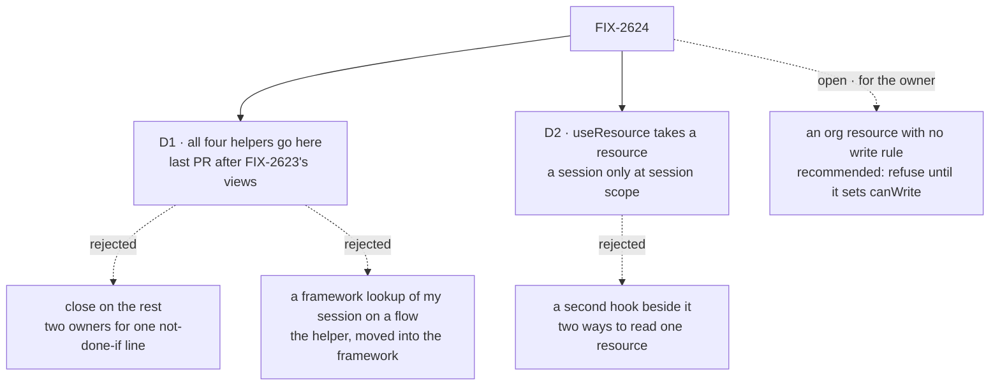

# FIX-2624 · Decisions

[Spec](SPEC.md) · **Decisions**

Two decisions and one open fork are the sign-off surface: when the helpers go, the shape of
`useResource`, and who may write an org resource that sets no write rule. The epic decided the rest ([O3](../../epics/FIX-2618/DECISIONS.md#o3), [ER-3, ER-4](../../epics/FIX-2618/DECISIONS.md#who-owns-what)).
What follows them is recorded so the implementer doesn't decide it again.

## The tree

Solid edges are what you're signing. Dashed edges lost, and the label says why; the one dashed
edge from the issue itself is the open fork.

## Open · An org resource with no write rule: refuse to start until it sets one, or let every member write?

**Plain terms.** A shared org resource, say a project's settings, can be marked "plain data" so
any screen writes it in one line. The design doc says that, with no extra rule, every member of
the org may then write it. An app author who adds the marker and forgets a rule has given the
whole org write access without choosing to. The alternative: the app refuses to start until the
author writes the rule, even if the rule is "everyone".

**The trade-off.** Refusing costs one line on every org resource marked this way, and it changes
what the design doc says. Allowing costs nothing to write, and it means the safe setting is the
one you have to remember. Personal (user) resources aren't affected either way: they belong to
their owner.

**My recommendation: refuse to start until the rule is written.** Relaxing it later is not
breaking; tightening it once apps rely on open access breaks them. One line is the cheapest this
will ever be.

**What would change my mind:** org resources are mostly shared scratchpads where everyone writing
is the point, and you'd rather the plain case stay one line.

**What being wrong costs:** low if we refuse (an extra line, removable later); higher if we allow
and an app ships org-wide write access nobody chose.

It comes down to the author who forgets: a startup error, or org-wide write access found later.

## D1 · All four helpers go in this issue, in its last PR, after FIX-2623's views land

| | |
|---|---|
| **Instead of** | Closing this issue on direct reads, writes and identity, and leaving the helpers' read-by-action uses to FIX-2623 · or a framework lookup ("my session on flow X") so the helpers can go now |
| **Because** | Seven of the helpers' uses run an action to compute an answer (harness readiness twice, the lab context, a repository check, the project setup, the routines list, usage), so they are views, not resource reads ([inventory](poc/helper-inventory/)). One owner keeps the epic's "no helper survives" line from falling between two issues. A framework lookup is the helper itself, moved into the framework: a session made only to read, which the epic removes |
| **Locks in** | This issue's last PR is blocked by FIX-2623; the PRs before it are not. That PR changes three apps (claude-code-style, teammates, Shift Manager) and takes two of [FIX-2556](https://linear.app/fixpoint-labs/issue/FIX-2556)'s three views (usage, schedules); FIX-2556 keeps delegates. If this issue's first PR lands before FIX-2623, the lab's pins and dismissals reads are gone before `reads` is removed, so FIX-2623 has none of them to move |

It comes down to ownership: split, the line counts as done only when the second issue lands.

**What would change my mind:** FIX-2623 slipping weeks past this issue's mechanism. Then the
seven uses move to FIX-2623 by name, and this issue closes on the other twenty-six.

## D2 · `useResource` takes a resource or a collection and needs a session only at session scope; the old form goes with no alias

| | |
|---|---|
| **Instead of** | A second hook beside today's `useResource(session, ref)` (`useScopedResource`, or a two-form overload) |
| **Because** | One job, one hook: read one resource and write it, and `fsd.resource(ref)` is the same handle outside React. A second hook is a second way to read a resource. No app in the repository calls `useResource` (only `useResourceContent` wraps it), we're before 1.0, and FIX-2447 removes old forms with no alias. The epic's examples already name `useResource(pins)`. A collection is accepted too, so an org collection has a session-free hook |
| **Locks in** | A breaking change to a published, documented hook, in a minor changeset with a one-line migration: `useResource(session, "soul")` becomes `useResource(soul, { session })`, and its result becomes the value with its setters instead of `{ clientData, fetchContent }`. The three collection hooks beside it stay session-addressed until the epic's follow-up on serving each answer once |

It comes down to the count: a second hook is a second way to read one resource, for good.

**What would change my mind:** an adopter building against `useResource(session, ref)` today. Then
the new hook takes another name, and the old one leaves with the epic's follow-up on serving each
answer once.

## Decided, not asked

- **One principal per resource** (the convergence point for [ER-3](../../epics/FIX-2618/DECISIONS.md#who-owns-what)).
  A direct read, a send and the default write flow's admission all resolve the caller through
  the effective resolver of the flow instance that declares the resource, by the path FIX-2522
  added to route-auth for user-kept files; never the body, query or headers (BP-031). Otherwise a
  resource declared by an authenticated flow could be written through the default write flow
  under the host's development resolver with a claimed user id. When two declarations of one
  shared key disagree on their client config or their resolver, a direct read or send of it is
  refused, naming both flows; registration still succeeds, so no host that runs today stops
  starting (kitchen-sink's `weekly-digest` has its own resolver).
- **What a direct read covers.** A resource reaches the registry the way every resource does,
  through a flow that declares it (a kit, once FIX-2626 lands); the default write flow declares
  none. Only shared cells: a resource with `flowIsolation: true` lives per flow instance, so a
  scope and key don't name it, and it is refused with that reason and read through its session as
  today.
- **One client handle:** `fsd.resource(ref)` reads and writes one resource or collection at any
  scope (a session option at session scope), as `useResource` does in React (D2).
- **The identity read is addressed by flow,** `fsd.flow(kind).identity()`: the user and org the
  server acts as under that flow's sign-in, never the host's fallback. In open mode, the claimed
  user and the default org, as on every route today.
- **The write fence's convergence point is the action route.** A send is that route with the
  resource named where a session id goes; it checks the resource names that flow, then finds or
  makes the session. No route is added. The content routes keep their 501 at user and org until
  FIX-2633; the goal check lists the client routes and fails on a new writer.
- **The write session.** Found or made on the server from tenant, org, user, the flow instance
  and the resource's cell (a collection's, shared by its entries), as a fixed id: create-if-absent,
  and a losing creator adopts the winner (FIX-1068). Never named by a client. Marked as a write
  session; session listings leave it out unless asked, as they do dispatch runs. Deleting it is
  allowed; the next write makes it again, without its history.
- **Versions.** `update`, `set` and `delete` carry the version the client read; the default
  write flow writes at it (`resource-cas`, the `mutate` intent). A stale write is refused with a
  code and the current version. The request records no state (BP-042); the helper re-reads
  through the direct read, under the same client check, and re-runs the updater, three times at
  most, then rejects with the conflict. A lost response is not retried.
- **The default write flow writes only what the client can read.** With `expose` or `exclude`,
  hidden fields are kept as stored; a resource with a computed `client.data` can't take
  `runBy: "default"` (a definition error). Content bodies are not in its first cut;
  [FIX-2633](https://linear.app/fixpoint-labs/issue/FIX-2633) extends it if the skills collection needs them.
- **Its checks, in order:** schema, owner (`ownerWriteRefusal` for owner-keyed collections; the
  cell is the caller's own user cell or org), then `canWrite({ prev, next, userId, orgId })`.
  Its actions keep concurrency `allow`: two quick pin clicks are two writes, ordered by version.
- **Direct reads run no block.** They are the resource handlers' store reads and client
  projection, with `ownerKeyAdmits` for the caller; a projected collection builds its context
  from the principal instead of the session. The no-session execution context is FIX-2623's.
- **Tenant** comes from the existing tenant header, as on every route (FIX-682), and is part of
  the write session's id.
- **Notices:** a write through either flow publishes the resource's change like any action
  write (FIX-2367). `useResource` stays current on [FIX-2551](https://linear.app/fixpoint-labs/issue/FIX-2551)'s live read ([ER-7](../../epics/FIX-2618/DECISIONS.md#who-owns-what)), with no poll of its own.
- **The lab's pins and dismissals move here,** onto user resources with `runBy: "default"`: they
  are O3's worked example and the goal check's plain write. Their first read falls back once to
  the old user-state lists (BP-030); FIX-2628 moves the declarations into the app's kit and
  removes the fallback. This lands in the first PR, before FIX-2623 removes `reads`, so FIX-2623
  has no pins or dismissals reads to turn into views.
- **Workforce's roster reads go to FIX-2623's roster view;** this issue takes the roster session
  off the five roster writes (`runBy: { flow }` on the workers collection) and the org lookup
  for worker session ids (the identity read).
- **Glossary** ([ER-9](../../epics/FIX-2618/DECISIONS.md#who-owns-what)): *Direct read* and *Default
  write flow* land in the PR that ships them. The retire for `ownSession`, `labSession` and
  `readerSessionId` lands with D1's PR, scoped to apps and labs: the engine's and orchestration's
  `ownSession` options mean a run's own session.

## Considered and dropped

| Alternative | Why not |
|---|---|
| A direct write route with a declared rule, beside `runBy` | The owner rejected it in [O3](../../epics/FIX-2618/DECISIONS.md#o3): the validators would live in two paths |
| Address direct reads through the declaring flow (`fsd.flow(kind).resource(...)`) | A shared user or org resource belongs to no one flow; the registry already resolves declarations by key for the index writer |
| Client-derived write session ids, as workforce's worker sessions are | The client would need its org first and every flow a create check; the server already has both |
| Return the new state from each write | Recorded on every request, unbounded for a large resource (BP-042) |
| Run direct reads on FIX-2620's no-session context | Nothing to run: resource routes build no execution context |
| The identity read as a host route (`fsd.identity()`) | In an app where only a flow signs callers in, a host route falls back to the development check: FIX-2522's bug class |
| Merge field patches and `set` on the server (Replicache's and Convex's shape) | Only an updater run on the client fits every write; a server merge would be a second conflict rule beside the version. Recorded for the implementer |

## Settled

- **The four helpers have 33 functional uses: 14 direct reads, 9 writes through a flow, 3 org
  lookups and 7 reads by action** (2026-11-11, `main` at `f0b34c52`, [`poc/helper-inventory/`](poc/helper-inventory/README.md)),
  plus 31 lines of the helpers themselves and 22 that pass their ids along. The checker
  classifies every line the search finds and fails on one it can't; its planted control
  (`POC_PLANT=1`) fails as it must. Re-run it before D1's PR: it should find only *unrelated*.

## Analysis

2026-11-11 · watermark 2026-11-08 (the epic's analysis) · **Right approach, with changes.** A
forked `analysis` pass, its reuse review its own (no sub-agent tool); it read `packages/`, the
mechanism list, `main` since the watermark and FIX-2623's draft.

1. **Reuse** — the [*Adds*](SPEC.md#whats-already-here-and-the-debt) verdicts hold. Missed:
   FIX-2522's governing-flow check (now built on), and four hand-built fixed-id sessions around
   `ensureSessionRecord`, which the write session would make five.
2. **Prior art** — Firestore runs the update on the client and retries on a version conflict, this
   shape; Replicache and Convex re-run a named change on the server.
3. **Other shapes** — FIX-824's flow address wins for the identity read, loses for reads.
4. **New factors** — FIX-2522 and FIX-824 merged; FIX-2623's draft and the epic's FIX-2620 entry
   claim the no-session context for direct reads; "row" retired for a resource entry.
5. **Necessity** — earns its place; each smaller goal leaves the helpers.
6. **Ergonomics** — two entry points, four concepts for a pin; five surprises, folded below.
7. **Concerns** — the identity read as a host route; org write access by default.

| Finding | Disposition |
|---|---|
| Identity read as a host route (FIX-2522's bug class) | **Folded:** addressed by flow |
| `fsd.resource` beside `fsd.resources`; `client.userId` beside the identity read | **Folded:** one handle; the others in *Leaves* |
| The hidden declaration; no session-free collection hook | **Folded:** a line and the diff; D2 takes collections |
| Org resource writable by any member by default | **Open:** [the fork above](#open-org-canwrite) |
| Registration refusal could stop a host; `flowIsolation: true`; "row"; pins as stopgap views | **Folded:** refused per request; isolated resources refused; reworded; pins land first |
| A fifth fixed-id session; server-side merge of patches | **Recorded** for the implementer (a shared helper; FIX-2471 is the next user) |
| The no-session context claimed three ways | **Recorded:** flagged to the coordinator |

## How it got here

- **Draft** — framed as the session half of FIX-2618: direct reads by scope, every write through
  `runBy` on the action route, an identity read, then the helpers deleted; built on the resource
  handlers, `resource-cas`, the create race and FIX-1788's run-by pattern, with the helper uses
  counted by a checker before any of it was argued.
- **Analysis** — the identity read moved from a host route to a flow address, `useResource` took
  collections, and the org write default became an open fork, because the analysis found
  FIX-2522's bug class in a host route and a security default nobody had chosen.

**Open: one,** [the org write rule](#open-org-canwrite).
