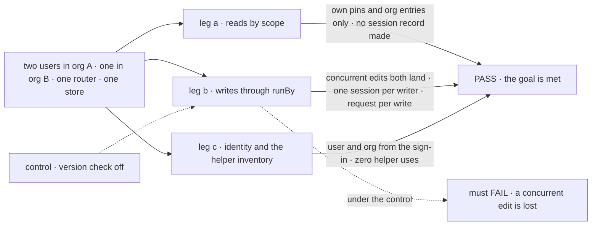
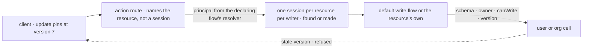

# FIX-2624 · User and org resources are read by scope, and written through the flow that runs them

**Spec** · [Decisions](DECISIONS.md)

## Six people, before and after

| Someone who… | Today | After |
|---|---|---|
| **shows a user's pins or an org's projects** | Finds or makes a session only so a session-addressed route will answer. Four helpers do this (`ownSession`, `labSession`, workforce's roster session, `readerSessionId`) | Reads by scope and key. No session is found or made for a read |
| **pins a thread** | Writes a pins flow by hand: `pin`, `unpin` and a `listPins` read, on that session | Declares `runBy: "default"` on the resource and writes one line. The default write flow checks the schema, the owner and an optional `canWrite`, and records a request |
| **edits an org project with a colleague at the same moment** | Writes through an action someone wrote by hand; whether two edits at once both land depends on how it was written | Each write carries the version it read. A stale one is refused, the helper applies the change again on the current state, and both edits land |
| **needs to know which org they act in** | Opens a session and reads the org off it | Asks for it: user and org, from the verified sign-in |
| **is in two orgs** | Shift Manager's fixed reader id is refused in the second org (session ids don't carry the org), so it falls back to a second id | Each write session is found per org, user and resource on the server, so the two orgs never meet |
| **writes a resource with no `runBy` from a client** | Gets a 501 on a user or org collection's entries, a 400 on a single resource | Is refused, with the reason named. Server flows still write it from inside their actions |

The session half of [FIX-2618](../../epics/FIX-2618/SPEC.md)'s goal: an app reads and writes its
user and org data without a session it made only for that.

## The goal, and how we'll know it's met

**A client reads any user or org resource it may read by scope and key with no session, writes it
only through the flow the resource names (a plain write in one line), and learns its user and org
without a session; the four own-session helpers are gone.**

| Is it the right goal? | |
|---|---|
| **The real need** | The epic's people table, row two, and its *not done if*: "any of the four own-session helpers survives" and "a client can write a user or org resource by scope other than through a flow". [O3](../../epics/FIX-2618/DECISIONS.md#o3): "the simple case needs to feel like editing a file" |
| **Smaller, and rejected** | "Direct reads and the default write flow ship." The mechanism exists while every app keeps its helper, so nothing the epic counts changes. Or "the helpers go except where a view is needed", which keeps three of the four |
| **Bigger, and not this issue's** | Views (FIX-2623) · the skills collection's content writes ([FIX-2633](https://linear.app/fixpoint-labs/issue/FIX-2633)) · serving each answer on one route only (a follow-up epic) |
| **Not done if** | A read creates or loads a session record · the user or org of a read or write can be set from the body, query or headers when a resolver is configured · two concurrent writes from two clients lose one · two first writes make two sessions · a helper survives under another name · a resource with no `runBy` can be written from a client |



The check reads the session and request stores after each leg, not what the helpers return.

| How we verify | |
|---|---|
| **Goal check** | `goals/resources-by-scope/a-pin-is-one-line-and-no-session-is-made-to-read/` · model n/a (access and writes are under test) · real HTTP router, SQLite, a configured resolver · run by the implementer at completion · verdict in the last implementation PR |
| **Signal** | a: Alice and Bob each read their own pins and org A's project; Carol (org B) reads org B's; the session store is unchanged by every read. b: Alice and Bob each `update` org A's project from two clients at once on different fields and both changes are stored; two first writes race to one session per writer; each request names its writer; a resource with no `runBy` is refused; a forged `userId` in the body is ignored. c: the identity read returns the signed-in user and org; the [inventory](poc/helper-inventory/) passes with `POC_EXPECT=gone` (zero helper uses) |
| **Input** | A pins user resource and an org projects collection, both `runBy: "default"`, one with `canWrite`. A dashboard on its own flow must pass leg b too |
| **Anti-game** | Don't assert on the helper's return or on the resource after a single writer. Assert on the stores and on a two-writer race |
| **Control that must fail** | `GOAL_CONTROL=no-version-check` (the default write flow writes without the version): leg b FAILS on *both concurrent changes stored*. `GOAL_CONTROL=principal-from-body`: leg b FAILS on *forged userId ignored*. Today's `main`: legs a and c FAIL |

## What changes

![Two panels. Today: the client finds or makes a session, reads through session-addressed routes, and writes through a hand-written pins flow in that session. After: the client reads by scope and key with no session; a write is an action on the existing action route naming the resource; the server finds or makes one session per resource per writer and runs the default write flow or the resource's own flow, which checks schema, owner, canWrite and version; the identity read answers from the verified sign-in](figures/what-changes.svg)

Read the right panel's two paths: a read reaches the store with no session; a write always
passes through a flow.

**A resource, and the client code that uses it** (names are the implementer's):

```diff
  export const pins = defineResource({
    scope: "user",
    stateSchema: z.object({ pinned: z.array(z.string()).max(50).default([]) }),
    client: { expose: ["pinned"] },
+   runBy: "default",
+   canWrite: ({ next }) => new Set(next.pinned).size === next.pinned.length,
  });
  // Declared on a flow the app hosts, as every resource is; its sign-in check governs reads and writes.
  defineFlow({ kind: "threads", resources: { pins }, /* … */ });

- const session = await ownSession("pins");                       // found or made, only to read
- const { pinned } = await fsd.flow("pins").read("listPins", {}, { sessionId: session });
- await fsd.flow("pins").send("pin", { taskId }, { sessionId: session });
+ const { pinned } = await fsd.resource(pins).state();              // no session
+ await fsd.resource(pins).update((s) => ({ pinned: toggle(s.pinned, taskId) }));
+ const { userId, orgId } = await fsd.flow("threads").identity();   // no session, under that flow's sign-in

- const { clientData } = useResource(session, "pins");
+ const { value, update } = useResource(pins);                      // D2: no session at user or org
```

**Docs:** update `resources/client-access` (reading by scope; the reshaped `useResource`; the
endpoint table), `client/react` and `client/overview` (`fsd.resource`, the identity read); add
`resources/client-writes` after `client-access` in the Resources sidebar (`runBy`, the default
write flow, `canWrite`, versions); update the client, react, core and engine READMEs. Contributor
docs in the same PR: `docs/architecture/resources-and-client-data.md` and `authentication.md`
(the new route subjects). Glossary: *Direct read* and *Default write flow*, retiring own,
lab and reader session ([ER-9](../../epics/FIX-2618/DECISIONS.md#who-owns-what)).

## How a write reaches the store



The client never names a session, and the route is the ordinary action route, so no write path
is added ([ER-4](../../epics/FIX-2618/DECISIONS.md#who-owns-what)).

## What stays as it is

- **Session resources, session state and user or org *scope state*** (`ctx.user.state`): still
  read through a session and its snapshot. Lab pins move off user state onto a resource.
- **The session-addressed resource routes**, user and org included. Serving each answer once is
  the epic's follow-up.
- **Content routes:** session-scope collection writes stay; user and org writes still answer 501
  until [FIX-2633](https://linear.app/fixpoint-labs/issue/FIX-2633).
- **Flow `reads`** until FIX-2623 removes them; the lab's `listPins` and `listDismissed` go here.
- **Open mode** (the development resolver): the user comes from the request and the org is the
  default, as every route treats it today.

## What's already here, and the debt

| Already here | What this does with it |
|---|---|
| Ways a client reads a user or org resource: the session-addressed resource routes, the snapshot, a flow `read`, an action that reads (searched `getPersistedData`, `resources/`, `reads:`, `listCollectionResources` across `packages/`, `labs/`) | **Extends** the resource routes with a scope address. The fifth form is the same handlers without a session; the flow `read` and read-by-action uses move off, to direct reads here and views in FIX-2623 |
| Ways a client writes one: an action in a session; content routes (501 at user and org, `resource-routes.ts`) | **Builds on** the action. The default write flow is a stock flow; nothing writes a user or org resource without one |
| Ways a session is found for a caller by a fixed id: workforce's derived worker id ([FIX-1788](../FIX-1788/SPEC.md)), Shift Manager's `readerSessionId` | **Replaces** the second; the runBy session reuses the first's idea server-side, keyed by org and tenant too |
| The create race (`ensureSessionRecord`, create-if-absent, FIX-1068) and `resource-cas` | **Builds on** both: one session per writer, a write at the version the client read |
| The principal resolver and route-auth's subjects ([authentication.md](../../../docs/architecture/authentication.md#the-route-auth-subject)), and FIX-2522's check of a user-kept file under the flow that keeps it, with FIX-824's flow-addressed upload | **Extends** that path: a scope-addressed read is checked under the declaring flow's sign-in, and the identity read is addressed by flow. A host route with no flow behind it would fall back to the development check, the bug FIX-2522 fixed |
| [FIX-1788](../FIX-1788/DECISIONS.md) (a worker run by the flow it names) | **Generalized**, as the epic's O3 says |
| [FIX-1945 D1](../FIX-1945/DECISIONS.md#d1) (the rules record allows client reads only) | **Kept.** It takes no `runBy` |
| [FIX-2286 D1](../FIX-2286/DECISIONS.md#d1) and FIX-2466 (the lab's pins read through a flow read) | **Superseded for pins and dismissals:** a direct read |
| `useResource(session, ref)`, published and documented | **Replaced** by [D2](DECISIONS.md#d2) |
| The no-session execution context ([FIX-2620](../FIX-2620/poc/no-session-read/README.md)) | **Not used.** A direct read runs no block: it is a store read and the client projection (the resource routes build no execution context). The context is FIX-2623's, for views. The epic's FIX-2620 entry says otherwise; flagged for its amendment |

| Adds | Existing piece considered | Why it doesn't fit / how composed |
|---|---|---|
| `runBy` and `canWrite` on resource definitions | `client` config; FIX-1788's worker | Composed: one field names the writer; `canWrite` runs inside that flow |
| The default write flow | The labs' pins and dismissals flows; `resource-cas` | **Reuse:** a stock flow on the action path, replacing the labs' hand-written ones |
| A resource address on the action route | `execute_action` with an optional `sessionId` | **Extends:** the same route and run, with the session derived on the server |
| Scope-addressed reads | The session-addressed resource handlers, `ownerKeyAdmits` | **Extends** them with a principal in place of a session |
| `fsd.resource(ref)`, `fsd.flow(kind).identity()`, the reshaped `useResource` | `fsd.resources` (session-addressed), `client.userId`, `useResource` | **Extends** the client: one handle and one hook for one resource at any scope ([D2](DECISIONS.md#d2)). `fsd.resources` and `client.userId` stay (below) |

| The debt | |
|---|---|
| **Removes** | The four helpers (31 helper lines, 22 lines that carry their ids, [inventory](poc/helper-inventory/)); the lab's pins and dismissals flows; Shift Manager's second-org fallback; `useResource(session, ref)` |
| **Adds** | A request row per plain write, and one session per resource per writer: permanent by design ([O3](../../epics/FIX-2618/DECISIONS.md#o3)). A one-time read of the lab's old pins off user state (BP-030), removed by FIX-2628. User and org resources readable two ways, by session and by scope, until the epic's follow-up |
| **Leaves** | For the epic's follow-up on serving each answer once: the session-addressed `fsd.resources` API and the three collection hooks beside `useResource`; `client.userId`, the user a client claims, beside the identity read. Shift Manager reads other user and org data through the user's real sessions (manifests); its remaining adapter is a follow-up epic too. The skills collection's content-write grants, refused at 501 ([FIX-2633](https://linear.app/fixpoint-labs/issue/FIX-2633)) |

**Net: down.** Four helpers, two flows and a fallback go; one stock flow, one field and two
address forms come.

## Sign off

**[The goal](#the-goal-and-how-well-know-its-met), at that size:** direct reads, one write path,
an identity read, and zero helper uses. If wrong: the mechanism ships and every app keeps its
helper.

**[The debt](#whats-already-here-and-the-debt), net down:** four helpers and two hand-written
flows go; a stock flow and a scope address come. If wrong: two read forms for one resource
outlive the follow-up epic.

**Open, for the owner: [an org resource with no write rule](DECISIONS.md#open-org-canwrite).**
The [concept doc](../../../docs/internal/design/reading-writing-installing.md#writes-through-the-resources-flow)
lets every member of the org write it. I recommend it refuse to start until it sets `canWrite`,
since relaxing later is free and tightening later breaks apps. If wrong: one extra line per org
resource, or org-wide write access nobody chose.

1. **[D1](DECISIONS.md#d1) · The helpers go in this issue's last PR, after FIX-2623's views
   land.** Seven uses read by running an action, so they need a view. If wrong: this issue closes
   a few weeks later than it could.
2. **[D2](DECISIONS.md#d2) · `useResource` takes a resource or a collection and needs a session
   only at session scope; the old form goes with no alias.** If wrong: adopters on the old hook
   rewrite a call site each.

**Open: one,** the org write rule above, and it is the one to weigh: it sets a security default.

Feature · `core`, `engine`, `client`, `react`, `workforce`, `shift-manager`, two labs · large ·
epic [FIX-2618](../../epics/FIX-2618/SPEC.md) stage 2
