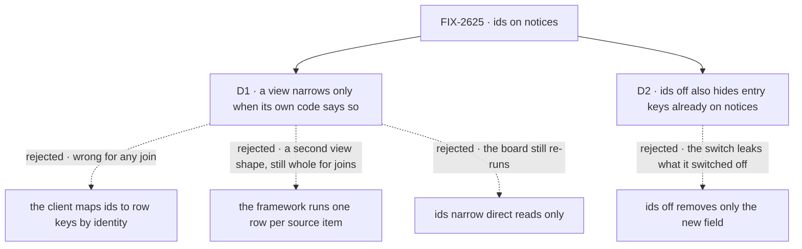

# FIX-2625 · Decisions

[Spec](SPEC.md) · **Decisions**

Two decisions are the sign-off surface. The owner already decided that a notice may carry ids,
the hour after revocation accepted, with a per-scope opt-out ([epic O4](../../epics/FIX-2618/DECISIONS.md#o4));
what is left is who maps an id to a row, and what the opt-out covers. The epic's
[ER-10](../../epics/FIX-2618/DECISIONS.md#who-owns-what) is built here; ER-2, ER-7 and FIX-2367's
ER-2 and ER-3 are obeyed.

## The tree

Solid edges are what you're signing. Dashed edges lost, and the label says why.

## D1 · A view answers for just some rows only when its own code says so

| | |
|---|---|
| **Instead of** | The client turning a notice's ids into row keys by identity (task 42 → row 42), as the concept doc's open question leaned · or a second view shape where the framework runs one row per item of a declared source · or no view narrowing at all, ids used by direct reads only |
| **Because** | Only the view's author knows which rows an id touches. A row that shows its parent task's title changes when the parent does, so identity re-reads the parent's row and leaves the child stale: the missed change [FIX-1506](../FIX-1506/DECISIONS.md#decided-not-asked) calls the failure. A per-row shape is checkable but adds a second way to define a view, and a view that joins two sources still answers whole. Direct reads alone leave the board, the cost the issue names, re-running whole. Opt-in keeps every view that says nothing exactly as safe as today |
| **Locks in** | The view call carries the notice that woke it (topic, kind, ids), never row keys, amending FIX-2623's *Keys* bullet. A view's block sees it and may return a partial answer (rows to place by key, keys to remove); anything else is whole. A partial answer never reorders rows and never shrinks the topics the screen listens to. In `fsdev dev` and tests, each partial answer is compared with a whole run and a difference names the view. The board view opts in here |

![D1, who decides which rows a change touches. Chosen: the view's own code, opt-in. Instead of: the client by identity. It comes down to joins: a row that shows another item's data is missed under identity, while opt-in leaves a silent view whole and safe. Price: an author who narrows wrongly shows a stale row until the next whole read, which development and tests catch. Tie: either way the board stops re-running whole. Locks in the call carries the notice, never row keys. Flips if real views turn out to be one row per item with no joins](figures/d1-view-opts-in.svg)

It comes down to joins: identity misses the row that shows another item's data.

**What would change my mind:** the framework's and the apps' views turning out to be one row per
item with no joins once FIX-2627 and FIX-2628 build them. Then identity mapping, with the view
declaring its source, is safe and asks nothing of authors.

## D2 · Turning ids off for a scope also hides the entry keys notices already carry

| | |
|---|---|
| **Instead of** | Turning off only the new `ids` field, leaving the entry path [FIX-1506](../FIX-1506/DECISIONS.md#decided-not-asked) already puts on a collection entry's topic |
| **Because** | That path is an id. An org member hears `licenses/ada` today (`scope-notices.test.ts:186`), and a removed member keeps hearing it for up to an hour. A switch that removes the field and keeps the path promises the owner's opt-out and leaks the same keys |
| **Locks in** | With ids off for a scope, the push edge sends no `ids` on that scope's notices and sends a collection entry's notice to a scope-wide subscription on the bare scope topic, as an owner-private row's goes today (`noticePathFor`). A subscription narrowed to that exact entry keeps it, since its client named the key. The setting is per topic scope (session, user, org), on by default, declared once on the app and read by every push edge. Every resource watcher in that scope reads whole on any entry's change |

![D2, what turning ids off hides. Chosen: the new ids and the entry keys already on notices. Instead of: only the new ids. It comes down to the promise: an entry path is an id, so keeping it leaves a removed member hearing the same keys for up to an hour. Price: in a scope with ids off every resource watcher in it reads whole on any entry change. Tie: no store read per notice either way. Locks in the push edge cuts scope-wide entry paths when ids are off. Flips if the owner wants the switch to cover only the new field](figures/d2-off-hides-paths.svg)

It comes down to the promise: an entry path is an id, so the narrow switch leaks what it switched off.

**What would change my mind:** an owner who wants the switch only for the new field, accepting
that entry keys already reach org members today. Then the push edge strips `ids` alone.

## D3 · The board view hears only its own board notices (the owner's call)

Decided by the owner on 2026-11-13, while the implementation was blocked: the board view on a
user-scope ledger also heard the ledger's own notices on the user topic, which name no task (ids
there would cross orgs), so one task's change answered the whole board.

| | |
|---|---|
| **Instead of** | The board view hearing its ledger's resource notices on the user topic beside its board notices, so every task change answers all of it · or ids on the user topic, which part 1 ruled out |
| **Because** | A board notice names the task that changed; the ledger's user-topic notice can't. Hearing both answers whole every time, which is the cost the issue names |
| **Locks in** | A view's read of a board through its task collection is heard on that board's notices only, on the session each entry's notices go to (its filer, and the running session), and the ledger's own resource notices are not heard. The task collection records that read (`recordBoardRead`) in the one place it wires every write to the board notice (`getOrCreateTaskCollection`'s `onWrite`), so a ledger read any other way stays heard on the user topic |
| **The trade-off** | A ledger write that published no board notice would leave every screen of the board stale, with nothing else to wake it. Closed at the publisher: every write to the ledger goes through the task collection's write paths, each of which publishes the board notice naming its task, and `board-notice.test.ts` checks it at the store for each write the task collection offers. The write paths were audited for this change; none bypasses it |

**What would change my mind:** a write to a task ledger that bypasses the shared publish path.
Then the board hears its ledger's notices again, or the bypass moves onto the path.

## Decided, not asked

### Invariants

- **Three convergence points.** Every notice is built in `publishNotices`, the one queue the
  store wrappers, the scope-state and resource seams, the resource routes and the board seam
  already use; every notice reaches a browser through the push edge (the socket's `hear`, and
  [FIX-380](https://linear.app/fixpoint-labs/issue/FIX-380)'s Ably arm when it lands); every
  reader merges through FIX-2551's one merge function. Each rule below lives at one of the three.
- **No ids beats ids.** Folding or merging a notice with ids and one without gives none. Past
  one cap (a constant shared by the fold and the merge) a notice carries none. Notices that
  differ in topic or kind merge to `null`, as FIX-2551 decided.
- **An id goes out only where every hearer may learn it.** A collection entry notice published
  with no path (owner-private, `noticePathFor`) carries no ids (ER-10). If a board's read hides
  any row from some reader of its session, its notices carry no ids; the implementer checks this
  against the task collection's read before the board publishes them.
- **Every full read stays.** Connect, reconnect, `resync`, a poll tick and a bus that doesn't
  cross processes all reach the reader as `null` already (`push-hub.ts`); nothing narrows them.
- **Ids are hints, never data** (ER-2): opaque ids the publisher already holds, never a field,
  a title or a count.

### Which notices carry ids

- **Board:** the task ids, from the row the seam already publishes for (`get-or-create.ts:175`).
- **Resource, on a collection entry:** the entry's key, beside the path it already names, so a
  reader reads one field. A single resource: none, it is one row.
- **Run:** the session written, on its owner's user topic; the child session, on a parent's.
  **Request:** the request id. Both come from what the store wrapper already holds.
- **Items, state, resync: none.** The session stream already reads from its sequence number, a
  state patch has no rows, and `resync` means read everything.

### Wire and stores

- **An optional field, not a deeper topic path.** A client from before this change ignores a
  field it doesn't know and reads everything; given `board/42` on a topic it narrowed to the
  board, its exact match (`push-hub.ts` `covers`) would drop the notice. Old servers send no ids.
- **The Postgres bus** carries ids in its payload and, past `NOTIFY`'s 8000 bytes, drops the ids
  before it widens the topic, as it does today.
- **The fold** unions ids within one topic, kind and origin in the same turn, where today it
  keeps the last notice.

### Readers and seams

- **`useView`** passes the merged notice to the view call when it has ids and places a partial
  answer by key; FIX-2623's shared read per view and input is kept.
- **A collection direct read** ([FIX-2624](../FIX-2624/SPEC.md)) fetches the named entries and
  places them; no ids, or an entry it can't find, reads the collection.
- **The board view opts in here.** Its partial answer re-runs the rows the ids name and every row that shows one of them (a subtask showing its parent's title); the goal check's control is the identity-only version. The coding board view (harness-manager, built by FIX-2627) opts in by the same rule: it is the board plus each task's harness, so it re-runs the rows the ids name and every row that shows one of them. Other framework views (the roster, harness readiness) may opt in
  where they are built (FIX-2627); app views opt in per view.
- **Changeset:** `minor` for `contracts`, `core`, `engine`, `store-postgres`, `client`, `react`, `orchestration` (the notice payload, the view option, the bus payload and the board's opt-in all ship); the glossary's
  *View* entry gains the partial answer in the implementation PR (ER-9). No new public term.

## Decided during implementation

Settled on the implementation PRs. Each narrows a decision above; none reverses one.

- **The switch is the app's, on `RuntimeConfig`.** `noticeIds: { org: false }` on
  `createFlowState` or `createFlowApiRouter` (`RuntimeConfig.noticeIds`), held on the router's
  push state and read by every socket it opens. Not on `EnablePushDeliveryOptions`: that is per
  host, so a second host (FIX-380's Ably arm) could forget it and leak. A key that isn't
  `session`, `user` or `org`, or a value that isn't a boolean, is refused at construction, so a
  typo can't leave ids on.
- **An entry's id is its storage key**, the same string as the path it already names: the
  direct read places entries by storage key, and the entry route reads by it.
- **With ids off, the push edge cuts every `resource` path for a scope-wide subscription**, not
  only those whose ids mark an entry. A process from before ids (mid-deploy, on a shared Postgres
  bus) sends an entry's path with no ids, and the socket can't tell that path from a single
  resource's name (BP-030; Codex on #5212). A single resource's watchers in that scope read once
  more. A subscription narrowed to the resource keeps the path its client named. The rule lives
  only at the edge: the Postgres bus drops ids, then widens, for size alone.
- **A session's own `run` notice names nothing**: the topic is that one session. Its parent's
  names it.
- **The `run` notice on the owner's user topic names nothing**, narrowing *Which notices carry
  ids*' run row. The user topic is the user's in every org, and the mint grants it by user and
  tenant alone, so a session id there would tell their screen in one org which sessions moved in
  another (an `fsd-write.` id names a storage key too), the same reason `noticePathFor` keeps
  user-scope keys off it (Cursor's security review on #5212). A list of the user's sessions reads
  whole on it, as before this issue. Ids there would need the org on the grant and the topic: a
  follow-up, if a user-topic screen proves worth narrowing.
- **The board's read hides no row from a reader of its session.** `listTasks` lists every row the
  resolved board holds, with no per-reader filter, and the session's stream already carries each
  row's task id (`task-change` items), so a board notice names its task.
- **The cap is 100** (`NOTICE_MAX_IDS`, `contracts/types/push-delivery`), one constant and one
  union rule (`unionNoticeIds`) for the fold and the merge. A hundred 40-byte ids fit `NOTIFY`.
- **One mechanism narrows what a view hears, and delivers [D3](#d3).** A view's answer keeps its
  topics, for clients from before this issue, and adds `hears`: per topic, the kinds of notice
  that may change what the run read and, for a resource, the storage roots a notice's path must
  fall under (the client's one path rule, `mayHold`). A board read is one more kind of read: heard
  as `board` on the board's topic, and it covers its ledger's resource read. So a pin doesn't wake
  the roster's view, a hire's run notices don't, and a task's change wakes the board with its id.
  Topics stay bare scope topics: a narrowed subscription matches a path exactly, and an org or
  session entry's notice names the entry's key, under the root a view read.
- **A user-scope entry's notice names its collection's root**, the static prefix of its pattern,
  never its key and never an id. The user topic spans the user's orgs and the root is the same in
  every one, as a single resource's name already is on that topic. Without it, every resource
  notice on the user topic named no path, every view and direct read of the scope heard it, and
  the client's path rule never ran there. With org ids off, the edge cuts it as it cuts every path.
- **The board read covers the filers' sessions it can see.** A board notice goes to each
  entry's filer. The read records the running session and each listed entry's filer, so a change
  to an entry filed in another session is heard. An entry filed into the same ledger from a session
  with no entry on it yet is heard on that session's topic only, until the view next answers
  whole. No board view in the framework lists such a ledger: the workforce board is partitioned by
  its filing session, and its entries are filed there.
- **A session's collection list holds change signals for a short window, then reads once; it
  never skips a read** (the owner's call on #5232). One change reaches `useResourceCollection`
  twice: its `resourceChanges` entry, then the snapshot's count once the session reads its
  state. Once the license-count view stopped reading on the org `state` notice, the two landed
  in separate renders and the list read twice. Skipping the second read needs proof the first
  covered the change, and the server gives none: the list page carries no revision, and the order
  a client sends reads in is not the order the server serves them, so both skips tried here (a
  count equal to the length read, then a client-side read position) left a stale list. A
  trailing window coalesces without skipping: each signal restarts it, the list reads once after
  the last, and the read starts after every signal it answers. Measured on
  `realtime/scope-changes-reach-other-sessions`, 5 runs, 46 pairs of one change's signals on one
  hook: 0.1 to 14.4 ms apart. Window 50 ms; a cap of 250 ms from the first signal keeps a steady
  stream reading at least that often. The cost is latency: the goal's slowest change shown went
  from 23 ms to 84 ms, under its 1 s bound.

## Considered and dropped

| Alternative | Why not |
|---|---|
| Ids in a deeper topic path (`board/42`), no new field | Old clients drop it (exact match): a missed change for every tab open across the deploy |
| Server-side narrowing: the view runs whole and returns only rows whose keys match the ids | Saves bytes, not the re-run, and is wrong for joins |
| Rows sent only where they changed, the client sending what it holds | Needs no ids, so it answers a different question; saves bytes, not the re-run |
| Re-checking a socket every few minutes instead of the hour | The owner's [O4](../../epics/FIX-2618/DECISIONS.md#o4) rejected it |

## Settled

- **Collection entry keys already ride on notices: CONFIRMED by an existing test.** An org
  collection create publishes `resource: "licenses/ada"` on the org topic every member hears
  (`packages/engine/test/bus/scope-notices.test.ts:186-191`); an owner-private row names no path
  (`:211`). This is D2's premise. Run 2026-11-11: 9 of 9 pass; with `noticePathFor` made to name no collection path, the org-create test and two others go red, so the test reaches the code. No POC: the test pins it on the real publish path.
- **No factual-base checker.** The spec counts nothing; each code fact is cited by file.

## Analysis

2026-11-11 · watermark 2026-11-11 (the wave-A amendment) · **Right approach, one fold.** The author's
own analysis; the stage-2 cross-spec review is the independent pass.

1. **Reuse** — the field extends the notice, the opt-out composes the push edge, the partial
   answer extends the view. The closest entry, the entry path, is kept beside the field.
2. **Prior art** — Replicache and Zero send row-level pokes; Firebase listeners get per-document
   changes; TanStack Query invalidates by key the app writes. All leave the join to the author or
   to a declared query; none maps ids through arbitrary code.
3. **Other shapes** — identity mapping, a per-row view, server-side filtering, row diffs: in the
   tree and *Considered and dropped*.
4. **New factors** — the item paths already on org notices (D2); FIX-380's Ably arm, a seam.
5. **Necessity** — the epic named this the child to cut; the board re-run per task per watcher is
   why it stays, and D1 keeps it small.
6. **Ergonomics** — nothing for a view that says nothing; one branch for one that narrows.
7. **Concerns** — an author's wrong partial answer, caught only on paths development and tests take.

| Finding | Objective | Changes the approach? | Disposition |
|---|---|---|---|
| Entry paths are already ids on org topics; an opt-out that ignores them is hollow | 4 | Yes, the opt-out's reach | Folded into D2 |
| A per-row view would make narrowing checkable | 3 | No, it adds a second view shape | Recorded in D1's mind-changer |

## How it got here

- **Draft** — framed as the read cost views multiply; found entry keys already on notices, which
  set D2; chose an optional field over deeper paths for old clients, and opt-in narrowing because
  only a view's author knows its joins; built on FIX-2551's merge, FIX-2623's views and FIX-2624's
  direct reads.

**Open: none.**
