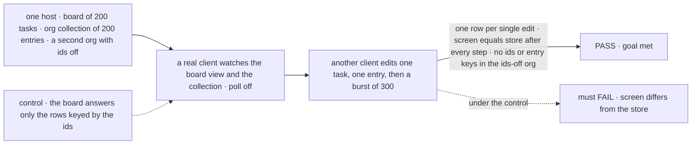
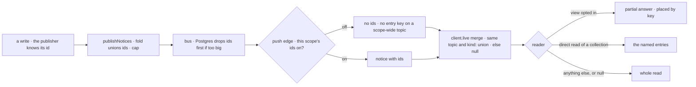

# FIX-2625 · Notices say which ids changed, so a screen re-reads only those rows

**Spec** · [Decisions](DECISIONS.md)

## Six people, before and after

| Someone who… | Today | After |
|---|---|---|
| **watches a busy board** (Shift Manager, Teammates) | Every task a worker touches re-runs the whole board for every open screen | The notice names the task; the board view answers that one row and the screen places it |
| **shows an org's collection** (projects, the roster) through a direct read | Any entry's change re-reads every entry | The entries that changed are re-read, and nothing else |
| **writes a view with keyed rows** | Has no way to answer for less than everything | Gets the ids that changed and may answer just the rows they touch. A view that ignores them answers whole, as today ([D1](DECISIONS.md#d1)) |
| **runs an org where even change timing is sensitive** | Org members already hear which collection entry changed, in the notice's path, for up to an hour after removal | Turns ids off for the org scope: no id and no entry key reaches a browser, and screens read everything ([D2](DECISIONS.md#d2)) |
| **has a tab open from before a deploy** | Gets notices with no ids | Ignores the ids it doesn't know and reads everything: never a missed change |
| **hears a burst of hundreds of writes** | One full read after the burst | The same: past the cap a notice carries no ids and means read everything |

[FIX-2367 D2](../../epics/FIX-2367/DECISIONS.md#d2) made a notice say only *that* a topic
changed, so every notice costs a whole read. Views multiply that by every keyed answer. The owner
amended D2 and [FIX-2428 D2](../FIX-2428/DECISIONS.md#d2) for this ([epic O4](../../epics/FIX-2618/DECISIONS.md#o4)).

## The goal, and how we'll know it's met

**When one row of what a screen shows changes, the screen re-reads only that row (a board one
task, a collection one entry), never misses a change because of it, and a scope that turns ids
off sends a browser no ids and no entry keys.**

| Is it the right goal? | |
|---|---|
| **The real need** | "With views, a whole board re-runs for one task's change … A client re-reads only those" (the issue). The epic's row: "Watches a view. A notice says which rows changed" ([FIX-2618](../../epics/FIX-2618/SPEC.md#five-teams-before-and-after)). O4's price: "a per-scope opt-out" |
| **Smaller, and rejected** | "Notices carry ids." The wire changes and nothing reads less: the board still re-runs whole, which is the cost the issue names. Or "ids narrow direct reads only": it misses the board |
| **Bigger, and not this issue's** | Narrowing every app view for its author. Fewer notices on the bus (ids cut reads, not notices: O2's mind-changer stays with [FIX-2623 D1](../FIX-2623/DECISIONS.md#d1)). Re-checking an open socket's access ([FIX-2428 D2](../FIX-2428/DECISIONS.md#d2), kept) |
| **Not done if** | The board view still answers whole for one task's change · a narrowed screen differs from the store after any burst · an id reaches a browser in a scope that turned ids off ([epic not done if](../../epics/FIX-2618/SPEC.md#the-goal-and-how-well-know-its-met)) · an entry key reaches a scope-wide subscriber there · a client from before the change misses a notice · a notice whose topic drops its resource name carries ids ([ER-10](../../epics/FIX-2618/DECISIONS.md#who-owns-what)) |



The check counts the rows each answer carried and compares the screen with the store; it never
reads the bus. One control breaks correctness, one breaks narrowing, and each must go red.

| How we verify | |
|---|---|
| **Goal check** | `goals/notices/one-change-re-reads-one-row/`, shaped like `goals/realtime/app-views-read-on-notice/` · model n/a · real `serve()` host with push · run by the implementer at completion · verdict in the implementation PR |
| **Signal** | `a:one-row`: one task edit makes the board view answer exactly 1 row; one entry edit makes the direct read fetch exactly 1 entry. `b:equals-store`: after each edit, the burst of 300 and a deleted task, the screen equals a fresh whole read. `c:ids-off`: in the org with ids off, no socket frame carries `ids` and no scope-wide frame names an entry key, while its screens stay equal to the store. `d:old-client`: a client built from today's `main` against the new host passes `b` |
| **Input** | One host, two orgs (one with ids off), a session board of 200 tasks, an org collection of 200 entries. Some board rows show their parent task's title. A change that reorders rows, a parent's rename, and a second view that reads the board but does not opt in must pass `b` too |
| **Anti-game** | Don't assert on the merge function or on `publish` calls. Count rows in the answers the server sent, compare with the store, and keep the poll off, or a timer hides a missed row |
| **Control that must fail** | `GOAL_CONTROL=identity-only`: the board's partial answer re-runs only the rows whose keys equal the ids, so a parent's rename leaves its children stale and FAILS `b:equals-store`. `GOAL_CONTROL=drop-ids`: publishers send no ids; FAILS `a:one-row`. Today's `main` FAILS `a` and `c` |

## What changes

![A notice's path today and after. Today a notice names a topic and a kind; the item path on a collection entry's topic is the only thing that says which row. After, publishers add the ids they already hold: a task on a board notice, an entry key on a collection notice, a session on a run notice, a request on a request notice. The fold and the client's merge union them up to one cap; the Postgres bus carries them and drops them first when too big; the push edge removes them, and scope-wide entry paths, in a scope with ids off. At the end, a view that opts in answers only the rows the ids touch, a direct read fetches only the named entries, and everything else reads whole](figures/what-changes.svg)

Follow a notice left to right: the ids are added where they are already known, and only the
reader decides what they mean.

**What a person writes** (names past the wire field are the implementer's):

```diff
  // the wire notice, in @flow-state-dev/contracts
  type WireNotice = {
    topic: WireTopic; kind: ChangeKind; origin?: { requestId: string };
+   ids?: string[];                    // what changed, never its data. Absent: read everything
  };

  // a keyed view that answers for just the rows a change touches (opt-in, D1)
  export const board = defineView({
    scope: "session",
    key: (row) => row.taskId,
    block: handler({ name: "board", execute: async (input, ctx) => {
+     const changed = ctx.view.changed;          // the notice that woke it, with its ids; undefined on a whole run
+     if (changed?.kind === "board") return ctx.view.partial(await rowsFor(ctx, changed.ids));
      return everyRow(ctx);                      // whole, as today
    }}),
  });

  // a host where org change timing is sensitive (D2)
- createFlowState({ flows });
+ createFlowState({ flows, notices: { ids: { org: false } } });
```

The D2 option's shape above is illustrative. It belongs on an existing settings seam, such as
`EnablePushDeliveryOptions` or `FlowStateSettings`, not a new top-level tree.

**Docs:** update the realtime guide (ids on a notice, turning them off per scope), the Views page
FIX-2623 adds (answering for the rows that changed), `docs/api/client.md` (`WireNotice.ids`) and
`docs/persistence/overview.md` (what the Postgres bus carries); update the client, engine and core
READMEs. No new page. Contributor docs in the implementation PR: `server-and-client.md`'s notice
section, the `change-bus` and `push-delivery` rows of `mechanisms.yaml`, and the glossary's
*View* entry. The same PR retires "keys" for what a notice carries, where the merged FIX-2618 and
FIX-2551 specs and the `coalesce.ts` comment still say it: a notice carries `ids`, and `key` stays a
view row's identity.

## How a change becomes one row



Three points every notice passes, so each rule lives once: the one publish queue, the push edge,
and [FIX-2551](../FIX-2551/DECISIONS.md#decided-not-asked)'s one merge function.

## What stays as it is

- Topics, the mint and its checks, the hour an open socket lives ([FIX-2428 D2](../FIX-2428/DECISIONS.md#d2)).
  No topic is added ([FIX-2367 ER-2](../../epics/FIX-2367/DECISIONS.md#who-owns-what)).
- A collection entry's path on its topic ([FIX-1506](../FIX-1506/DECISIONS.md#decided-not-asked)),
  and which writes publish ([FIX-2623 D1](../FIX-2623/DECISIONS.md#d1)'s host-wide rule).
- Every full read: connect, reconnect, `resync`, a poll tick, a bus that doesn't cross processes.
- `client.live`'s entry point and `useView`'s and `useResource`'s results.

## What's already here, and the debt

| Already here | What this does with it |
|---|---|
| The job, "say which part of a watched thing changed": mechanism `change-bus`'s topic narrowed to a collection entry's path ([FIX-1506](../FIX-1506/DECISIONS.md#decided-not-asked), `scope-changes.ts` `noticePathFor`, pinned by `scope-notices.test.ts:186`), and `streaming`'s sequence number for items. Searched `ids`, `keys`, `changed`, `narrow`, `resource:` across `packages/` | **Kept, beside one optional field.** Entry paths stay: they route a notice to a subscriber narrowed to that entry. A deeper board path instead of a field would make a tab from before the deploy, narrowed to the board, drop notices it can't match. The overlap is recorded under *Adds* |
| [FIX-2367 D2](../../epics/FIX-2367/DECISIONS.md#d2) (no rows) and [FIX-2428 D2](../FIX-2428/DECISIONS.md#d2) (the hour) | **Amended by the owner** in [O4](../../epics/FIX-2618/DECISIONS.md#o4), reasons kept: ids, never rows; no check per notice |
| [FIX-2551](../FIX-2551/DECISIONS.md#decided-not-asked)'s merge: "FIX-2625 changes only this function, to union keys with a cap" | **Built as written:** same topic and kind union, else `null`. No second entry point |
| [FIX-2623](../FIX-2623/DECISIONS.md#decided-not-asked)'s *Keys* bullet: "adding keys to the call beside the input" | **Amended:** the call carries the ids heard, not row keys. Only the view knows which rows an id touches ([D1](DECISIONS.md#d1)) |
| [FIX-2624](../FIX-2624/DECISIONS.md#decided-not-asked)'s `useResource` on the live read | **Builds on:** a collection direct read fetches the named entries |
| The Postgres bus payload (topic and kind only; widened past 8000 bytes, `store-postgres/src/bus.ts:366`) | **Extended:** carries ids, and drops them before widening |
| Epic [ER-10](../../epics/FIX-2618/DECISIONS.md#who-owns-what) | **Built** here |

| Adds | Existing piece considered | Why it doesn't fit / how composed |
|---|---|---|
| `ids` on the notice and the wire | `change-bus` · the topic's `resource` path | **Extends** the notice with an optional field; a deeper path breaks old clients' exact match (`push-hub.ts` `covers`) |
| The per-scope opt-out | `push-delivery` · the socket's frame (`socket-session.ts` `hear`) | **Composed:** one app setting, applied per delivery at the push edge, so no store read |
| A view's partial answer | FIX-2623's view runner and `key` | **Extends** the view; a view that ignores it is unchanged |

| The debt | |
|---|---|
| **Removes** | A whole board re-run per task change, per watcher; a whole collection re-read per entry change |
| **Adds** | One optional wire field, one setting, one view option: permanent by design. An entry is named twice, by its path and its id: permanent by design, since the path routes the notice and the id is what a reader reads |
| **Leaves** | App views that don't opt in still answer whole. Fewer notices on the bus is not this issue's (O2's mind-changer) |

**Net: flat.** Reads go down where it matters; the wire gains a field and a second way to name an entry.

## Sign off

**[The goal](#the-goal-and-how-well-know-its-met), at that size:** the board re-runs one row, a
collection reads one entry, nothing is missed, and ids off means none reach a browser. If wrong:
ids on the wire that nothing reads less with, or a privacy switch that leaks the same keys.

**[The debt](#whats-already-here-and-the-debt), net flat:** whole re-reads go; a field, a setting,
a view option and a second way to name an entry come. If wrong: two names for one entry that drift
apart, which one publisher writes both of.

1. **[D1](DECISIONS.md#d1) · A view answers for just some rows only when its own code says so.**
   The one to weigh. If wrong: a view author's mistake shows a stale row until the next whole read.
2. **[D2](DECISIONS.md#d2) · Turning ids off also hides the entry keys notices already carry.**
   If wrong: a scope with ids off reads more than it needs, or keeps leaking what it switched off.

**Before implementation starts:** FIX-2551, FIX-2623 and FIX-2624 are built; this is the last of
the four on the live read.

**Open: none.**

Feature · `contracts`, `core` (the view option), `engine`, `store-postgres`, `client`, `react`, `orchestration` · medium (one
wire field, three convergence points, one view option, the board opting in) · epic
[FIX-2618](../../epics/FIX-2618/SPEC.md), stage 2
