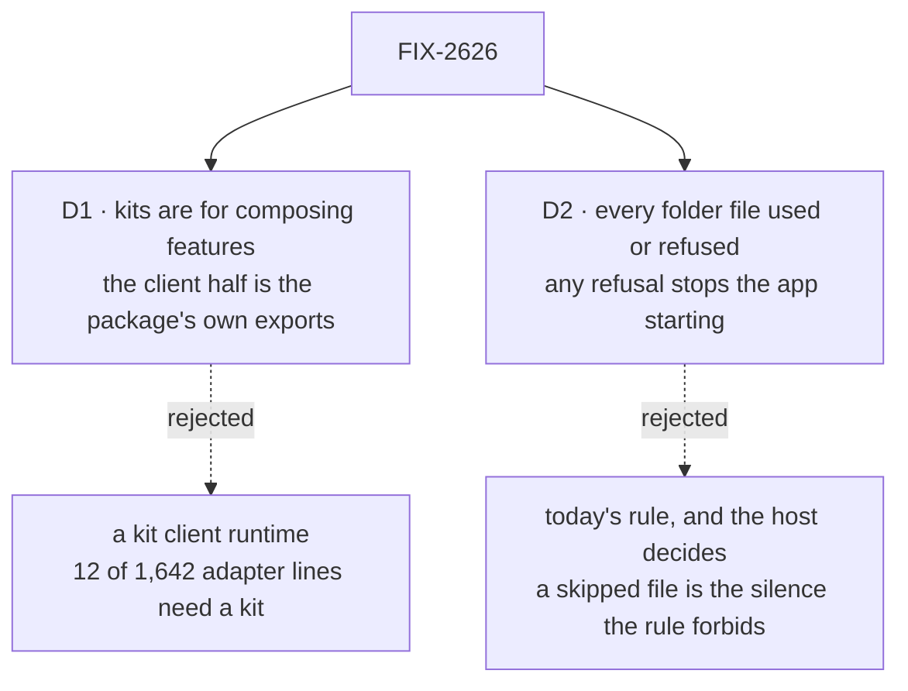

# FIX-2626 · Decisions

[Spec](SPEC.md) · **Decisions**

Two decisions are the sign-off. That there are kits, their shape, where each piece lives, folders
side by side and the harness shape are the owner's ([FIX-2618 O1](../../epics/FIX-2618/DECISIONS.md#o1));
this spec builds them as decided.

## The tree

Solid edges are what you're signing. Dashed edges lost, and the label says why.

## D1 · Kits are for composing features; a kit's client half is its package's ordinary exports

| | |
|---|---|
| **Instead of** | A client half that is part of the kit: a `client` field on `defineKit` and a manifest sent to the browser, as the epic's sketches show (`client: missionClient`, `mission.useAction`) |
| **Because** | O1's note, run ([the POC](poc/client-half/README.md)): of claude-code-style's 1,642 adapter lines, views and direct reads remove 690, a package export 117, and **12 need a kit**: a task's harness before its run reports one, which joins workforce and harness-manager, and neither depends on the other. At most 129 if every package row went to the kit. Views remove the read model, and packages can ship views; what only a kit does is let one package reach another through a slot. A client runtime is a public surface for 12 lines, and it would put a definition naming a Node-only folder reader into the browser bundle |
| **Locks in** | Screens import a kit's views, hooks and components from its package's browser entry and `/react`. No `client` field. A kit's flow ids are its own constants, so a kit installs once per app. The case for kits becomes composition: O1's *Because* ("only a kit's client half removes the adapters") needs an epic amendment, and FIX-2628 credits the adapter's removal to views and direct reads |

It comes down to the adapter: views remove the read model, so a kit runtime would carry 12 lines.

**What would change my mind:** FIX-2628 finds screen code that needs to know which kits an app
installed, or with what config, and no view can answer. Then a manifest is one field. If you
would rather reopen O1 on this evidence, this is the card: the install half (FIX-2622) and the
client half (here) each remove little a better API or a view can't.

## D2 · Every file in a kit's folder is used or refused, and any refusal stops the app starting

| | |
|---|---|
| **Instead of** | Today: workforce refuses only the shapes its docs name, passes over the rest (a folder's root entries, a stray file in `teams/`), collects its refusals, and leaves start-up to each host. Or warn in development and refuse in production |
| **Because** | A file that loads nothing and says nothing is the silence the owner's rule ends: an author who followed the docs can't find out why. Every host already throws on a refusal (teammates, Shift Manager, claude-code-style), so this makes today's practice the framework's. Warning in one place and refusing in another lets a tree pass in development and fail on deploy |
| **Locks in** | A stray file blocks start-up everywhere, a deploy included, until removed or claimed; the refusal names every file at once. An app with unclaimed files in a kit's folder stops starting: claude-code-style's `workforce/flows/` does, unless FIX-2627's schema claims it. The only pass is `IGNORED_ENTRIES`, the shared list of names that never mean anything |

It comes down to silence: under today's rule a file the docs don't name loads nothing, unreported.

**What would change my mind:** a kit whose folder must hold files it never reads, such as an
author's notes. Then its schema claims them as ignored, by name; the rule stays.

## Decided, not asked

- **Placement.** `defineKit` and slot types in `core`, no Node import; install in the engine;
  the walk primitives on a Node-only engine subpath; the naming rule (`validateSegment`'s pattern
  and reserved names) in `core`'s helpers, because browser-safe workforce code calls it. Only a
  kit's definition module, its server entry, names the walker.
- **`defineKit`'s fields:** `name`, `requires`, `config`, `slots`, `contributes`, `directory`,
  `install`. No `resources` or `views`: both live on blocks and flows (FIX-2623), which the
  install returns.
- **`createFlowState` stays synchronous.** A kit's factory checks its config. Ordering, a missing
  or circular `requires`, an undeclared slot, a fill from a kit that doesn't require the owner and
  a duplicate key throw at construction, as a duplicate flow id does. Folder reads and installs
  run at start-up; a refusal rejects `ready()` and every request.
- **"Used or refused" converges on the walker's claim pass:** readers claim what they consumed,
  the walker refuses the rest after `IGNORED_ENTRIES`. Every reader of a kit's folder goes
  through it: workforce's six directory readers (`readWorkforceDirectory`, `readWorkerSkills`,
  `readTeamsDirectory`, `readResourcesDirectory`, `readReferencesDirectory`,
  `readPackagesDirectory`) and the `fsdev gen` walk (`discover*` in `workforce/src/codegen`).
- **Folders.** A default folder resolves against the app root `createFlowState` takes (the
  working directory unless given); a relative path in config, against the working directory
  (FIX-2622). One per kit, siblings; two kits on one folder are refused.
- **Slots.** Filled by the app or a kit that requires the owner, directly or not. Keyed refuses a
  duplicate, naming both; a list appends in install order (`requires`, then the app's list), the
  app's entries last. The app can drop one kit's contribution; its shape is the implementer's.
- **`init`** copies starter files through `fsdev ui add`'s registry copy-in, never overwriting.
  Workforce's starter set is FIX-2627's.
- **Names.** "Kit" and "slot" are in the glossary. Public names: `defineKit`, `kits`,
  `requires`, `slots`, `contributes`, `directory`; `defineKit` enters FIX-2447's export ratchet.
- **Sequencing.** Nothing here needs views or `runBy` resources. FIX-2623 and FIX-2624 block
  FIX-2627, which ships workforce's views, not this issue.

## Considered and dropped

| Alternative | Why not |
|---|---|
| A kit client runtime | D1: 12 lines need it |
| An async `createFlowState` | Every host's call changes; start-up is already lazy |
| The walker stays in workforce | The kit system would depend on one kit |
| Today's rule: refuse only what the docs name | D2 |
| A `@flow-state-dev/kits` package | The owner placed it in `core` and the engine |
| A new scaffolder for `init` | The registry copy-in already copies files into an app |

## Settled

- **What only a kit removes from a real adapter** (2026-11-11, `main` at `f0b34c529`;
  [`poc/client-half/`](poc/client-half/README.md), `node specs/issues/FIX-2626/poc/client-half/attribute.mjs`).
  claude-code-style's adapter, 1,642 lines and 124 declarations, each credited once: views 630,
  direct reads 60, a package export 117, a kit 12, stays 823. The controls go red: a planted
  declaration and a stale row each stop the table, and moving `boardOf` to the kit moves the
  total by its 30 lines. The premise the client half rested on did not hold; D1 follows.

## Analysis

2026-11-11 · watermark 2026-11-10 · **Right approach, smaller.** Run by the author, not a fresh
agent: this dispatch has no sub-agent tool. One finding folded: D1.

1. **Reuse** — the walker, naming rule and `init` are **reuse**; `kits` **extends** the flow
   registry; `defineKit` and slots are **genuinely new**. Folded: the client half, which views
   and package exports already cover (D1).
2. **Prior art** — [Backstage extension points](https://backstage.io/docs/backend-system/architecture/extension-points)
   are closest to slots (a module reaches a plugin only through points it declares);
   [Eclipse's](https://help.eclipse.org/latest/topic/org.eclipse.platform.doc.isv/guide/runtime_registry.htm)
   add a schema per point; [Mastra](https://mastra.ai/docs) has no unit above its registrations.
   None ships a client runtime with its install unit. Links from memory; no web search.
3. **Other shapes** — a better install API per package: equal on the host (FIX-2622), near-equal
   on the client (D1). D1's mind-changer.
4. **New factors** — 92 team issues updated since the watermark, searched by the job's nouns.
   The keyed `harnesses` slot gives slots three contributors. [FIX-2645](https://linear.app/fixpoint-labs/issue/FIX-2645)
   installs MCP connectors on the host: a second install surface unless it is workforce's kit
   config, as the epic's seam says. FIX-2641 and FIX-2568 curate workforce's exports; FIX-2583
   reshapes the harness value.
5. **Necessity** — earns its place on composition, not on the adapter.
6. **Ergonomics** — two new concepts for the common case. Recorded: "slot" will mean three things
   (FIX-2627 owns workforce's constants); a default folder resolves against the app, a typed path
   against the working directory.
7. **Concerns** — a slot contract with two real consumers at freeze; FIX-2627 is where a third
   would show.

## How it got here

- **Draft** — the install half of the epic's goal, on FIX-2622's sketch and the loader's walk
  primitives. O1's note ran first and moved the client half out of the kit (D1); the open item
  on refused files is answered (D2).

**Open: none.**
