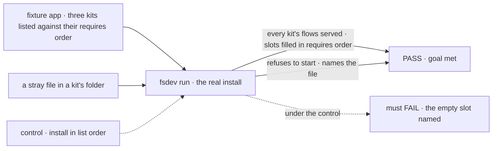
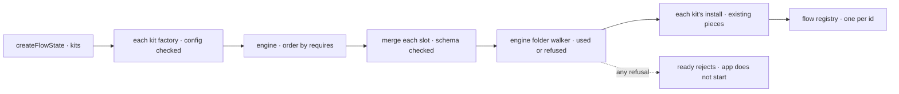

# FIX-2626 · An installable unit above a flow: defineKit with requires, slots and config

**Spec** · [Decisions](DECISIONS.md)

## Five people, before and after

| Someone who… | Today | After |
|---|---|---|
| **packages a feature** (workforce, harness-manager) | Ships setup functions, and docs on how to wire them in order | Defines a kit: config, the kits it requires, the slots it declares, its folder, and an install that returns flows |
| **installs features into an app** | Wires each by hand, in an order they work out, with their own refusal for a bad tree | Lists one config object per kit, in any order. The framework orders them and fills each slot once |
| **adds to another feature** (the coding harness to workforce) | Passes one package's pieces into the other's setup, knowing both. Four hosts rebuild the readiness map, three the coding flow | Contributes into a slot the other kit declares. A duplicate key is refused, naming both kits |
| **puts a file in a kit's folder** | A file the docs don't name loads nothing and says nothing (claude-code-style's `workforce/flows/`, a stray file in `teams/`) | Every file is used or refused by path, and the app won't start until it's fixed ([D2](DECISIONS.md#d2)) |
| **builds a screen on a kit** | Writes an adapter. Workforce's React panels take rows the app builds, so no app imports them | Imports the kit package's views, hooks and components like any export. Views remove the read model: 42 of claude-code-style's 1,642 adapter lines need a kit ([D1](DECISIONS.md#d1)) |

## The goal, and how we'll know it's met

**A feature author ships a feature as a kit, and an app installs several kits in one list, in any
order: each kit gets what the kits that require it put in its slots, and every file in a kit's
folder is used, or the app refuses to start and names it.**

| Is it the right goal? | |
|---|---|
| **The real need** | The epic's FIX-2626 row, "the install half of the goal", and the unit FIX-2627 builds two kits on. O1's note: show what only a kit removes before the slot contract is built |
| **Smaller, and rejected** | "`kits` on `createFlowState` and the walker lifted, with workforce the only kit." Slots shaped for one consumer freeze wrong, and FIX-2622's sketch never ran `requires` ordering or a list merge |
| **Bigger, and not this issue's** | Workforce and harnesses as kits (FIX-2627); claude-code-style on kits (FIX-2628); a kit client runtime ([D1](DECISIONS.md#d1)); a registry ([FIX-147](https://linear.app/fixpoint-labs/issue/FIX-147)'s, canceled; the epic's non-goal) |
| **Not done if** | Breaking `requires` ordering or the list merge fails no test · a relative folder path in config reads against the app's folder, not the working directory · a refusal is only logged · workforce keeps its own walk primitives · a kit's browser entry pulls in `node:fs` · a kit fills a slot of a kit it doesn't require |



The check reads what the running app serves and refuses, never what `defineKit` returns.

| How we verify | |
|---|---|
| **Goal check** | `goals/kits/install-in-any-order/` (new), model `n/a`, run by the implementer with `fsdev run` at completion; verdict on the implementation PR |
| **Signal** | Kit `b` declares a keyed and a list slot and owns a folder; `c` requires `b` and declares a slot of its own, `d` requires `c` and fills it; the app lists `[d, b, c]`. All flows served; `b`'s flow answers with `c`'s and `d`'s keyed entries and the list `[c, d]`, and `c`'s contribution to `b` carries what `d` and the app put in `c`'s slot, less the one `d` entry the app drops. Three refusals, each named: `d` repeating `c`'s key; a stray `notes.txt` in `b`'s folder; a fill by a kit that doesn't require `b`. A relative folder path, run from another directory, reads that directory's folder |
| **Input** | The goal's fixture kits. Also valid: a fourth kit, no folder or slots, listed first |
| **Anti-game** | Assert on what the app serves and refuses. Never list kits in requires order: it hides an install in list order |
| **Control that must fail** | `GOAL_CONTROL=list-order`: `b`'s slot is empty, so the keyed-entries signal fails. `GOAL_CONTROL=skip-unknown`: the app starts beside `notes.txt`, so the stray-file signal fails. `GOAL_CONTROL=requires-first`: `c` contributes before `d` and the app fill its slot, so the chain signal fails |

## What changes


The host stops knowing the order and both packages' internals; the walker leaves workforce so
every kit reads its folder one way.

A host, and the two kits it installs (FIX-2627 writes the real ones):

```diff
- const roster = await readDeclaredRoster(options.tree ?? TEAMMATES_TREE);
- if (roster.problems.length > 0) throw new Error(`the workers did not load: …`);
- const installation = createWorkerInstallation({ standardWorkers: roster.workers, workerFlows: { agent: workerFlow(…) } });
- const copies = hireWorkforce(installation);
- createFlowState({ flows: Object.fromEntries([...copies, readiness, context].map((c) => [c.id, c])), stores });
+ createFlowState({
+   kits: [claudeCode(), harnesses({ workspace }), workforce({ directory: options.tree, model })],  // any order
+   fill: { [harnesses.slots.harnesses]: [codexHarness(), cursorHarness()] },                     // the app's fill, keyed by id
+   flows: [readiness, context],                                                                   // the app's own, by id
+   stores,
+ });
```

```ts
export const workforce = defineKit({
  name: "workforce",
  config: z.object({ model: z.string() }),
  slots: { workerFlows: slot.keyed(workerFlowSchema) },
  directory: { path: "workforce", read: readWorkforceFolder },        // Node-only; FIX-2627's, through the claim pass
  install: ({ config, folder, slots }) => ({ flows: hire(folder, slots.workerFlows, config) }),
});

export const harnesses = defineKit({
  name: "harnesses",
  requires: [workforce],
  slots: { harnesses: slot.keyed(harnessSchema) },                     // filled by claudeCode() and the app
  contributes: ({ config, slots }) => ({ [workforce.slots.workerFlows]: { coder: coderFlow(config, slots.harnesses) } }),
  install: ({ config }) => ({ flows: [readinessFlow(config)] }),
});
```

`readWorkforceFolder` is workforce's folder reader once FIX-2627 lands: today's walk, run through
the walker's claim pass. It replaces `readDeclaredRoster`, the widest entry today, a join over
`readWorkforce` and the directory readers (`packages/workforce/src/loader/read-declared-roster.ts:10,141`),
with no alias.

**`flows` becomes an array** (the owner, on #5064). A flow already names itself: the registry
keys by `flow.id`, which defaults to its `kind` (`packages/engine/src/registry/flow-registry.ts:224,795`),
and `createFlowState` never reads the record's keys (`Object.values(options.flows)`,
`packages/engine/src/flowstate/createFlowState.ts:365`). So `flows: Record<string, FlowInstance>`
(`packages/engine/src/flowstate/types.ts:119`) becomes `flows: FlowInstance[]`, and the keyed
form goes with no alias, as FIX-2447's rule has it pre-1.0. A duplicate id is refused as today.
The call sites move in their own mechanical PR in this issue's work, apart from the kit PR:
245 files outside `specs/` (`git grep -l "createFlowState(" -- '*.ts' '*.tsx' '*.mts' | grep -v ^specs/ | wc -l`
on `main` at `01dcfdc02`). It carries a `minor` changeset for the engine.

**Docs:** create *Kits* in Core → Fundamentals, after *Capabilities*; API reference entries for
`defineKit`, `createFlowState`'s `kits`, and `flows` as an array; the `core` and `engine` READMEs
(the engine's new Node-only folder subpath). Same PR: `docs/architecture/kits.md`, the package roles in
`overview.md`, a `kit` row in `docs/mechanisms/mechanisms.yaml`. This changeset carries the
epic's shared story to `/release-docs`; workforce's pages are FIX-2627's.



Up to the slot merge runs inside `createFlowState`; the folder reads and installs run before the
first request.

## What stays as it is

- **Capabilities**, the unit a block uses. A kit installs flows, which carry theirs.
- **The flow registry behind `createFlowState`'s `flows`**. Installs add to it; only the option's
  shape changes, to an array.
- **Resources and views**, declared on blocks and flows. A kit holds them through its flows.
- **`hireWorkforce` and `createWorkerInstallation`**, public until FIX-2627 makes them internals.

## What's already here, and the debt

| Already here | What this does with it |
|---|---|
| **The job: put a feature's pieces into an app.** `capability` (one block), `workforce`, `worker-loader`; the engine's `flows`. Searching `packages/*/src` for `install*`, `create*Installation`, `mount*`, `*Plugin` found only `createWorkerInstallation` | **Builds on** `flows`, the closest: the third way to do the job, beside `flows` and a block's `uses`, composed on the first |
| [FIX-2618 O1](../../epics/FIX-2618/DECISIONS.md#o1), [ER-5](../../epics/FIX-2618/DECISIONS.md#who-owns-what) | **Builds** both. **Amends** O1's *Because* ([D1](DECISIONS.md#d1)), by an epic amendment not made here |
| [FIX-2622 Settled](../FIX-2622/DECISIONS.md#settled), its `define-kit.ts` | **Builds on** the sketch; **keeps** "a relative override reads against the working directory" |
| Workforce's loader rule: what the docs name is used or refused | **Extends** it to every entry. Today a folder's root entries have no reader, and a stray file in `teams/` is skipped ([D2](DECISIONS.md#d2)) |
| The concept doc's open item on refused files | **Answers** it ([D2](DECISIONS.md#d2)) |
| [FIX-1477 D1](../FIX-1477/DECISIONS.md#d1); [FIX-1655](https://linear.app/fixpoint-labs/issue/FIX-1655)'s registry copy-in | **Keeps** D1 for the library half; **reuses** the copy-in for `init` |

| Adds | Existing piece considered | Why it doesn't fit, or how it is composed |
|---|---|---|
| `defineKit`, slot types (`core`) | `capability` · `defineCapability`; `flow` · `defineFlow` | A capability installs into one block and can't add flows or declare slots. A kit's install returns flows |
| `kits` and install (engine) | The `flows` option and flow registry | **Extends:** the same registry, which refuses a duplicate id as today |
| `flows` as an array (engine) | The `flows` record | **Replaces** it: the registry keys by `flow.id`, so the record's keys were never read |
| Slots, keyed or list | `createWorkerInstallation`'s `workerFlows`; FIX-2622's sketch | New, as a contract across packages; the sketch is the start |
| The folder walker (Node-only engine subpath) | `worker-loader` · `openRoot`, `classify`, `openStructuralDirectory`, `refusedSymlink`, `unreadable`, `IGNORED_ENTRIES` | **Reuse**, lifted. It adds one pass: what no reader claimed is refused |
| The folder naming rule (`core` helpers) | `validateSegment`, `isWindowsReservedName` | **Reuse:** pure, and browser-safe workforce code calls it |
| `init` for a kit's folder | `fsdev ui add` (FIX-1655) | **Reuse:** starter files are registry items aimed at the folder; never overwrites |

| The debt | |
|---|---|
| **Removes** | Workforce's own walk primitives (moved, no alias, BP-034). The keyed `flows` record, no alias, and its keys at 245 call sites. Each host's tree read and refusal, once FIX-2627 lands. The two places a file is skipped silently |
| **Adds** | Kits and slots, a concept and a contract, permanent by design. A third way to do the job, which shrinks when `hireWorkforce` goes internal (FIX-2627). A Node-only engine subpath. Kit flows register at start-up, so `meta.flowKeys` lists them only after `ready()` |
| **Leaves** | The three adapters (follow-up epics). Workforce's folder constants (`RESOURCES_SLOT`, `PACKAGES_SLOT`), a third "slot": FIX-2627 owns that schema |

**Net: up, by one concept,** which the epic accepted; FIX-2627 pays the host side down.

## What FIX-2627 and FIX-2628 must agree with

| Issue | Must |
|---|---|
| **FIX-2627** | Claim the entries in workforce's folder that workforce configures, `workforce/flows/` included, and only those: an app's own resources and flows go in its own kit or in `flows:` · replace `readDeclaredRoster` with `readWorkforceFolder`, and route every reader and the `fsdev gen` walk through the claim pass · import the walk primitives from the engine, dropping them from `./loader` · declare the slots, with harnesses' keyed `harnesses` slot of `{ id, agent, readiness, pass, usage, models }` filled by two or more packages · views and hooks on a browser entry, components on `/react` · workforce's starter files · the third "slot" · take the lab's own flows out of `workforce/flows/` (below) |
| **FIX-2628** | Build claude-code-style's kit on this `defineKit` · credit its adapter's removal per [the POC](poc/client-half/README.md), confirming or refuting the 42 kit-only lines · delete `user-marks.mts` with FIX-2624's fallback (below) |

claude-code-style's `labs/claude-code-style/workforce/flows/` holds five files on `main`: `pins.mts`
and `dismissals.mts`, which FIX-2624 deletes; `harness-thread.mts`, which FIX-2627 merges into
the one coding worker flow; and `projects.mts` and `user-marks.mts`, which are the app's.
`projects.mts` is the app's project flow (`defineProjectBlocks`). It moves to the lab's own
folder, listed in the host's `flows:` beside the readiness flow, before workforce's claim pass
reaches the lab; FIX-2628 may then move it into the app's kit. `user-marks.mts` is the user state
pins and dismissals share, and FIX-2624's one-read fallback still reads it, so FIX-2627 moves it
out with `projects.mts` and FIX-2628 deletes it with that fallback. Then the folder holds only what workforce
claims, and the lab starts under [D2](DECISIONS.md#d2).

## Sign off

**[The goal](#the-goal-and-how-well-know-its-met), at that size:** several kits, any order, slots
filled across kits, every folder file used or refused. If wrong: a slot contract frozen on one
consumer, or ordering nobody ran.

**[The debt](#whats-already-here-and-the-debt), net up by one concept:** kits and slots added; a
private walker and each host's refusal removed. If wrong: a permanent contract only two kits use.

1. **[D1](DECISIONS.md#d1) · Kits are for composing features; a kit's client half is its
   package's ordinary exports, with no kit client runtime.** Decided: the owner merged #5064 as
   written. Reopens if FIX-2628 finds screen code that needs to know which kits an app installed,
   or with what config, and no view can answer.
2. **[D2](DECISIONS.md#d2) · Every file in a kit's folder is used or refused, and any refusal
   stops the app starting.** Decided: the owner merged #5064 as written. Reopens if a kit's
   folder must hold files it never reads, and claiming them as ignored, by name, can't serve it.
3. **`flows` as an array.** The owner's direction on #5064; built as given.

**Open: none.**

Feature · `core`, `engine`, `workforce` (walker moves out), `fsdev` (`init`) · M · epic
[FIX-2618](../../epics/FIX-2618/SPEC.md) stage 2 · [Linear](https://linear.app/fixpoint-labs/issue/FIX-2626)
