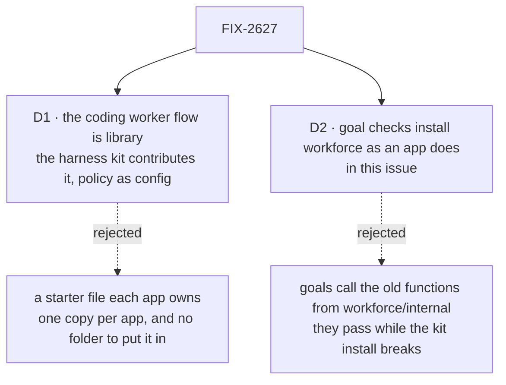

# FIX-2627 · Decisions

[Spec](SPEC.md) · **Decisions**

Two decisions are the sign-off. Which kits, their shape, the harness value, folders side by side
and "projects is not a default" are the owner's ([FIX-2618 O1](../../epics/FIX-2618/DECISIONS.md#o1));
this spec builds them as decided.

## The tree

Solid edges are what is signed. Dashed edges lost, and the label says why.

## D1 · The one coding worker flow is library: the harness kit contributes it, with its policy as config

| | |
|---|---|
| **Instead of** | A starter file the app owns and edits, `workforce/flows/workers/coder.mts`: [FIX-2583](https://linear.app/fixpoint-labs/issue/FIX-2583)'s "coding flow template (editable defaults)", and the shape Shift Manager's own coding flow already has |
| **Because** | One copy instead of one per app, which is the duplication this issue removes (three today). And there is nowhere to put a starter file: the harness kit has no folder, and a kit that requires another never puts files in that kit's folder ([O1](../../epics/FIX-2618/DECISIONS.md#o1) § Folders). FIX-2583's aim still holds: the pull-request rules leave harness-manager's mechanism and become this flow's options, which an app sets or turns off |
| **Locks in** | Review, pull-request wait and project checks are the harness kit's config. An app that wants a rule the config doesn't offer writes its own worker flow from harness-manager's exported blocks and switches the kit's `coder` off, as Shift Manager does. FIX-2583 lands its policy as options on this flow, not as a template |

It comes down to copies: a starter file is one per app, and drifts by design.

**What would change my mind:** apps routinely editing pull-request rules, so most hosts end up
with their own flow anyway. Then the flow becomes a starter file in the app's own folder (FIX-2628's
app kit is the first), and the kit ships only the blocks.

**What being wrong costs:** medium. An app that needs a rule we didn't offer writes about 200
lines from blocks that already exist; adding an option later is additive.

## D2 · Goal checks install workforce the way an app does, in this issue

| | |
|---|---|
| **Instead of** | Moving the goals' calls to `@flow-state-dev/workforce/internal`, the subpath that already exists for "goals and scripts", and converting them to kits later, as each goal is next touched |
| **Because** | A goal proves what a user gets ([philosophy](../../../docs/philosophy.md) tenet 7). On the internal path, 72 goal folders pass while the kit's install, its claim pass and its slot merge are broken, because none of them runs it. The conversion is mechanical: a goal's tree becomes `workforce({ directory })`, and a custom flow fills `workerFlows` |
| **Locks in** | 90 goal files ([callers](poc/claim-census/README.md)) change in this issue, in their own mechanical PR after the kits land, as FIX-2626 moved `flows` to an array. `hireWorkforce` and `createWorkerInstallation` are exported nowhere, `internal` included |

It comes down to what a passing goal proves: the kit install, or a path no app uses.

**What would change my mind:** you would rather FIX-2627 ship sooner and smaller. Then the goals
take the internal subpath now, and a follow-up issue converts them, filed before this merges.

**What being wrong costs:** low to medium. About a week of mechanical work in this issue; the
other way, a stretch where the goals don't cover the install every app uses.

## Decided, not asked

- **The claim set** is workforce's published shapes (`test/published-tree-surface.test.ts`) plus
  the generated `workforce.gen.ts`. `flows/` holds only `flows/workers/`; a helper module beside
  it is the app's and moves out. `readWorkforceFolder` and the `fsdev gen` walk run the one claim.
  It is the convergence point for "used or refused": every reader is internal behind it.
- **The order that keeps three apps starting** (the census's 7 files). The PR that turns the
  claim pass on moves every file the census lists, in the same PR, and the census reads 0 on its
  head. It waits on FIX-2624's first PR, which deletes the lab's pins and dismissals flows.
  In that PR: claude-code-style's `projects.mts` moves to `labs/claude-code-style/flows/`, listed
  in `flows:`; `harness-thread.mts` is deleted and its workers name `coder`; anything of
  `pins` or `dismissals` still there moves with `projects.mts`, and so does `user-marks.mts`;
  FIX-2628 deletes it. Nothing reads old marks from it: FIX-2624 has no fallback ([amended](../FIX-2624/DECISIONS.md#how-it-got-here)). kitchen-sink's `workforce/hire.ts` goes with its move to `kits`. Shift
  Manager's fixture `flows/piece.mts` moves to the fixture's own folder.
- **claude-code-style's host moves onto `kits` here,** since its calls go internal and the claim
  pass reaches it. FIX-2628 owns its adapter and its app kit, and may move `projects.mts` into it.
  Until FIX-2628, the host keeps its project: `coder`'s project options set (`needsProject` and
  the project workspace capability, as `harness-thread` has them), `projectSourceCapability({ workspace })`
  in workforce's `uses`, and `projects.mts` in `flows:`. FIX-2628 removes all three.
- **Workforce adds the consult capability itself.** `consultSessionsCapability(installation)` is
  workforce's own, over its installation, and only a worker whose file picks
  `consultSessions: [consult]` is offered it. Both hosts add it to the agent flow today. So the kit
  adds it there, its model and budget in config, and `uses` stays a plain list. No builder form
  of `uses` is built: the only capability that would need one is consult, and the kit adds that.
- **The source-only capability.** `projectSourceCapability`'s tool body
  (`packages/workforce/src/projects/project-source.ts`) lifts into `sourceReadCapability({ workspace })`:
  the same three reads over a `WorkspaceHost`'s run source and read view, naming no project to
  the model and installing no project resources. `projectSourceCapability` becomes that
  capability plus the project resources. A non-coding worker in an app with no projects
  (FIX-2628) takes the source-only one.
- **App-declared session fields:** one workforce config option, `sessionFields`, a schema per
  field the app declares on the agent and coordinator sessions. Server-written only: a flow on the
  server sets it (FIX-2628's open action), never a request body, a task's input or the client
  (BP-031). It generalises `workProjectId`, which the work-project action writes today.
- **Workforce's slots:** `workerFlows`, keyed, filled by builders that receive the installation
  (today's `workerFlow(…)`), so no flow closes over a variable filled later; `uses`, a list of
  capabilities added to the agent and coordinator flows workforce builds. The agent and
  coordinator flows' options are config. The `harness:` setting rides the coding flow's own
  settings, and usage readers ride the harness value, so neither needs a workforce slot.
- **A contribution sees its own kit's merged slots.** The coding flow needs every harness, so
  slots merge dependents first and `contributes` receives `{ config, slots }`. FIX-2626's amendment
  (#5085) states it, from the cross-spec review.
- **The harness kit** is `harnesses` (the name `harnessManager` is the block's), from
  `@flow-state-dev/harness-manager/kit`, `requires: [workforce]`. Only that subpath imports
  workforce; there is no cycle (workforce never imports harness-manager).
- **The harness value** is the owner's `{ id, agent, readiness, pass, usage, models }` plus an
  optional `label` (a readiness row shows "Claude Code", as `HarnessReadinessSlot.label` does),
  defaulting to `id`. `codex` and `cursor` export one each; `claude-code` exports `claudeCode()`,
  a kit that installs its collections and fills the slot. A duplicate id is refused; the app can
  switch one off.
- **A stub is a harness value whose `agent` is scripted** (harness-manager's scripted harness),
  swapped in per id by the host: it switches off that id's entry and fills the scripted value
  under the same id. The run takes the same slot, coding worker flow and board view as the real
  one; no harness package carries a stub mode.
- **Readiness** is one view in harness-manager, read from the slot, installed by the kit. This
  issue is blocked by all of FIX-2624, so FIX-2624 has always written it; this issue feeds it from
  the slot instead of a host map.
- **The coding board view** answers a task's harness from its worker's `harness:` setting until
  its run reports one: FIX-2626 D1's 42 kit-only lines. A package that depends on both serves the
  join, so no client runtime and no slot are needed. The task row gains no field (FIX-2152 ER-9).
  Its rows are keyed by task id, and it answers for some rows as [FIX-2625 D1](../FIX-2625/DECISIONS.md#d1)
  allows: a notice's task ids re-run those tasks' rows; a worker's id re-runs every row of a task
  assigned to that worker, whose harness it may change. Other views it installs stay whole.
- **The views each kit installs:** workforce, the roster (FIX-2623's), worker sessions and turns;
  harness-manager, readiness, the coding board and a run's work (FIX-2623 moves `changes`). These
  are the rows claude-code-style reads ([FIX-2628](https://linear.app/fixpoint-labs/issue/FIX-2628)'s
  list); FIX-2628 names their columns. No projects view (owner, O1).
- **The coding worker flow needs no workforce project.** It runs where the harness kit's
  `workspace` says, over whatever `source` the app gives it. `needsProject`, project checks and
  the project workspace capability are options, off unless set; claude-code-style sets none once
  FIX-2628 moves it to repositories.
- **Surfaces.** `./loader` exports `readWorkforceFolder` and its types only; the walk primitives
  come from FIX-2626's engine subpath; `RESOURCES_SLOT`, `CODE_SLOTS` and the rest become
  `*_FOLDER`, internal. Views on `./browser`; React hooks and components on `./react`, React an
  optional peer. `@flow-state-dev/react/workforce` goes with no alias (BP-034).
- **Starter files:** `init` scaffolds one team with one worker on the built-in agent flow,
  `TEAM.md` and `WORKER.md`, through FIX-2626's copy-in. No flow file ([D1](#d1)).
- **Projects:** no projects flow and no `checkRepository` in workforce's config (owner, O1).
- **The workers collection:** FIX-2624 declares `runBy: { flow }`; the kit installs it as is.
- **Names.** A new name for the registered code checkout says *repository* (owner, 2026-11-11,
  FIX-2592); `workspace` stays the host type's name. *Harness* gets a glossary entry. New
  public names: `workforce`, `harnesses`, `claudeCode`, `codexHarness`, `cursorHarness`,
  `readWorkforceFolder`, `Harness`, `sourceReadCapability`, `sessionFields`; each enters FIX-2447's export ratchet.
- **Changesets:** `minor` for workforce, harness-manager, claude-code, codex, cursor and react.

## Decided during implementation

Settled on the implementation branch (`claude/fix-2627-impl`). Each narrows a decision above;
none reverses one.

- **Where the kits are imported from.** `workforce` from `@flow-state-dev/workforce/kit`, beside
  `harnesses` at `@flow-state-dev/harness-manager/kit`: both read the file system at start, so
  neither sits on a package root a browser bundle reaches.
- **The workforce kit's config carries what a host passed to the hire.** `agent`, `coordinator`,
  `consult`, `routines`, `taskChainLimit`, `messages`, `projectCoordinator`, and `generated`, the
  app's `workforce.gen.ts` imported whole. GitHub's service flow, which needs the installation, is
  `github` in config: the kit builds it. The kit adds the routine tools to the flows it builds as it
  adds consult, for the same reason (a capability over its own installation), and an entry keyed
  `agent` or `coordinator` in `workerFlows` replaces its own, which is then refused in config.
- **Every reader problem refuses the start.** `readWorkforceFolder` throws on any problem the
  readers report, every one named, as an unclaimed file does: an app is never started short.
- **The `Harness` type lives at harness-manager's root** (type only); Codex and Cursor take a
  type dependency on it. Its `agent` is harness-manager's `HarnessSlot`, so no feeds type moves.
- **Claude Code's plan mode is a second harness**, `claude-code-plan`, which `claudeCode({ plan: true })`
  fills. The coding worker flow takes no per-harness worker settings, so claude-code-style's two
  plan workers say `harness: claude-code-plan` instead of `permissionMode: plan`.
- **The coding worker flow is claude-code-style's `harness-thread` with teammates' policy as
  options.** Its door talks to the run's session; checks run only on a run that changed files;
  readiness is checked before a task starts on any app; `review`, `pullRequests`, `judge`,
  `checks`, `project` and `runTimeoutMs` are the kit's config, and a worker's `review:` line wins
  over the kit's. `codingDrainBudgetMs(config)` gives a host the shutdown wait.
- **The start-up readiness log is the kit's, opt-in** (`logReadiness`), since the hosts no longer
  hold a readiness read; FIX-2391's goal grades it.
- **Teammates reads its workers' delegates with `readWorkforceFolder`** for its context view: the
  roster view (FIX-2623's, installed unchanged) carries no delegates.
- **A third workforce slot, `flows`** (the coordinator's call, 2026-11-13, in place of a config
  option): keyed builders handed the installation, whose flows the kit serves beside its worker
  flows. An app's flow built on the installation (Shift Manager's projects and workstreams flow)
  fills it, and a host that needs the installation afterwards keeps the one its builder was
  handed. Workforce fills it with nothing: projects stays the app's (O1).
- **A check that perturbs worker records edits a copy of the folder.** The kit reads files, never
  records, so kitchen-sink's coordinator controls and the DevTeam Lab's record options
  (`documentOverrides`, `skills`, `mutateSkills`, `coderHarness`, the tool filters, an unserved
  Error Reporter) write a temporary copy of the tree the kit then reads. A skill shared from a
  team or the org can't change for one worker (a skill name reaches a worker from one level
  only), so that edit is refused.
- **A worker flow keyed `agent` or `coordinator` in the generated module replaces the kit's
  own**, as one filled in `workerFlows` does.
- **A host reads its own tree with `readWorkforceFolder` and a claim that does nothing** where it
  needs the declared records before start (the DevTeam Lab's EM and coder, Teammates' delegates).
  The kit's own read is the one that claims the folder.
- **The tree's documents are the installation's.** The kit passes the folder's documents and
  references to the installation, so the agent and coordinator flows declare them as a host
  that passed `documents` did; Shift Manager's ask-lab test now finds the asker's listing among
  others rather than alone.
- **The DevTeam Lab's readiness is the harness kit's.** The Lab installs `harnesses` with its
  `coder` switched off (its own coder flow is its policy, D1) and fills the slot with Claude Code,
  whose check `startHarness` supplies. The `readiness` view moves from the projects flow to the
  kit's `harnesses` flow, and the start-up table is the kit's `logReadiness` log, written once the
  check answers rather than awaited before the Lab listens.
- **A control's copy of the tree goes with the app.** The DevTeam Lab removes its copy when it is
  disposed; kitchen-sink's, which the app reads for as long as it runs, when the process exits.
- **The planted stray is named by its folder.** With nothing else under `workforce/flows/`, the
  claim pass names `flows`, the topmost entry no reader used; the goal check asserts that.

## Considered and dropped

| Alternative | Why not |
|---|---|
| A starter coding flow per app | [D1](#d1) |
| Goals on `workforce/internal` | [D2](#d2) |
| `coordinatorTools` and `boardFields` slots (the issue's list) | No contributor today; a slot nobody fills freezes an unchecked contract |
| `checkRepository` in workforce's config (the issue) | Projects is not a workforce default (owner, O1) |
| Codex and Cursor as kits | They install nothing; a plain value is what a third party implements (owner, O1) |
| A workforce slot for the task's harness | The coding board view serves it once harness-manager depends on workforce |
| Shift Manager on the shared flow | Its flow splits feature work from answers; that is its policy ([D1](#d1)) |
| Partial readers kept public | A reader of part of the folder can't claim the whole of it |
| A builder form of `uses` that receives the installation | One capability needs it, consult, and it is workforce's own: the kit adds it |

## Settled

- **7 files would stop their app or goal starting** (2026-11-11, `main` at `2a68dc263`,
  [`poc/claim-census/`](poc/claim-census/README.md), `node specs/issues/FIX-2627/poc/claim-census/census.mjs`).
  46 workforce folders, 235 files, each classified once; every `WORKER.md` sits in a walked
  folder. Unclaimed: kitchen-sink's `workforce/hire.ts`, claude-code-style's five
  `workforce/flows/*.mts`, Shift Manager's fixture `flows/piece.mts`. The control plants four
  strays in a copy of teammates' tree and fails unless each is reported, and nothing else.
- **122 files outside workforce call what goes** (same commit, `callers.mjs`): 90 in goals
  (72 goal folders), 21 in apps, labs and Shift Manager, 8 in other packages, 3 in scripts and
  docs. The control plants one caller per entry and fails unless each is counted once.

## Analysis

2026-11-11 · watermark 2026-11-11 · **Right approach.** Run by the author, not a fresh agent:
this dispatch has no sub-agent tool, as FIX-2626's wasn't.

1. **Reuse** — the kits **compose** `createWorkerInstallation`, `hireWorkforce`, `workerFlow(…)`
   and harness-manager's blocks; the coding flow **merges** two; the harness value **replaces**
   three shapes. Genuinely new: the coding board view.
2. **Prior art** — Backstage's extension points and Eclipse's schema per point, as in FIX-2626.
   Links from memory; no web search.
3. **Other shapes** — the starter-file flow ([D1](#d1)). A projects kit, deferred by the owner.
4. **New factors** — FIX-2583 (the template wording, D1); FIX-2628 drafting now (the seam on the
   host); FIX-2626 merged with `contributes({ config })` only (a requirement, above).
5. **Necessity** — the epic's goal needs both kits; `hireWorkforce` going internal is its line.
6. **Ergonomics** — one config object per kit. The app fill's spelling is FIX-2626's.
7. **Concerns** — D2's size; a harness value fixed by three harnesses.

## How it got here

- **Draft** — the epic's two kits on FIX-2626's `defineKit`, under the owner's harness shape. The
  census and the callers count ran first and set the order of the claim pass and D2's size.

**Open: none.**
