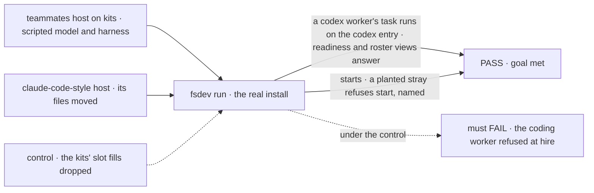
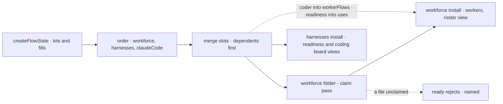

# FIX-2627 · Workforce and the coding harnesses install as kits, with one shared coding worker flow

**Spec** · [Decisions](DECISIONS.md)

## Six people, before and after

| Someone who… | Today | After |
|---|---|---|
| **installs workforce into an app** (a lab, kitchen-sink, Shift Manager) | Reads the `workforce/` folder, writes the refusal, builds the installation on a `workerFlows: () => flows` callback, hires, spreads the copies into `createFlowState` and casts | Lists `workforce({ … })` in `kits`. No callback, no hire, no cast |
| **gives workers a coding harness** | Copies a coding worker flow (claude-code-style 346 lines, teammates 213) and builds a readiness map and a readiness flow (four hosts) | Lists the harness kit and its harnesses. A worker's `harness:` line picks one, as today |
| **ships a harness** (Claude Code, Codex, Cursor, a third party) | Exports five pieces each host assembles by hand: an agent, a readiness check, a pass list, a usage reader, a model list | Exports one harness value. Claude Code, which installs collections of its own, ships a small kit that fills the same slot |
| **puts a file in `workforce/`** | A file beside `flows/workers/`, or at the folder's root, loads nothing and says nothing: 7 such files today, in claude-code-style, kitchen-sink and a Shift Manager fixture | Every file is used or refused at start, by path ([FIX-2626 D2](../FIX-2626/DECISIONS.md#d2)). Those 7 move first |
| **builds a screen on workforce** | Imports panels from `@flow-state-dev/react/workforce` that take rows the app builds, and assembles worker sessions, turns and a task's harness by hand | Imports the views (roster, worker sessions, turns, coding board, readiness) from each package's `/browser`, and components bound to them from `@flow-state-dev/workforce/react` |
| **writes a goal check on workforce** | Calls `hireWorkforce`, as no app will once this ships | Installs workforce as an app does ([D2](DECISIONS.md#d2)) |

## The goal, and how we'll know it's met

**An app installs workforce and the coding harnesses with one config object each, and gets
every worker, the roster view, one coding worker flow and the readiness view, with no host
wiring; no host or goal calls `hireWorkforce`, `createWorkerInstallation` or
`readDeclaredRoster`, and every file in `workforce/` is used or refused.**

| Is it the right goal? | |
|---|---|
| **The real need** | The epic's FIX-2627 row: "Two kits, so slots meet a second consumer before they freeze." Its *not done if*: "a host keeps `workerFlows: () =>` or `as never`, or calls `createWorkerInstallation` or `hireWorkforce`." The issue: "Teammates' host and `coder.ts` move onto both kits" |
| **Smaller, and rejected** | "Workforce as a kit; harnesses later." The slots meet one consumer, which is what O1 warns against. Or "the kits ship and hosts keep `hireWorkforce`": two install paths, and nobody moves |
| **Bigger, and not this issue's** | claude-code-style's adapter and its own app kit ([FIX-2628](https://linear.app/fixpoint-labs/issue/FIX-2628)); a projects kit (owner, O1); MCP connectors ([FIX-2645](https://linear.app/fixpoint-labs/issue/FIX-2645)); moving PR policy out of harness-manager ([FIX-2583](https://linear.app/fixpoint-labs/issue/FIX-2583)); teammates' and Shift Manager's adapters (epic follow-ups) |
| **Not done if** | A file outside workforce imports `hireWorkforce`, `createWorkerInstallation`, `readDeclaredRoster` or `@flow-state-dev/react/workforce` · a lab ships its own coding routing flow · a host builds a readiness map or flow · claude-code-style, kitchen-sink or a Shift Manager fixture fails to start under the claim pass · a goal check passes while the kit install is broken ([D2](DECISIONS.md#d2)) · importing `@flow-state-dev/harness-manager` pulls in workforce |



The check reads what the running hosts serve and refuse, never what a kit's install returns.

| How we verify | |
|---|---|
| **Goal check** | `goals/kits/workforce-and-harnesses-install-as-kits/` (new), model `n/a`, run by the implementer with `fsdev run` at completion; verdict on the implementation PR |
| **Signal** | a: teammates on `kits`. Its flows include `coder` from the harness kit and no `teammates-coder` or `harness-readiness`; a task Lead files for a worker with `harness: codex` runs on the codex entry and reaches review; the readiness view has one row per harness filled; the roster view lists Lead for a user with no session. b: claude-code-style starts; a planted `workforce/flows/notes.mts` stops it, named; [the census](poc/claim-census/README.md) reads 0 unclaimed. c: [the callers count](poc/claim-census/README.md) reads 0 outside workforce |
| **Input** | Teammates' and claude-code-style's own `workforce/` trees, harness-manager's scripted harness under each harness id |
| **Anti-game** | Assert on the flows served and the task's run, not on the kits' unit tests. The harness id must come from the worker file: a default harness hides a routing that ignores `harness:` |
| **Control that must fail** | `GOAL_CONTROL=drop-kit-fills`: the engine drops every kit's slot contribution, so `coder` is never registered and the codex worker is refused at hire; leg a fails. `GOAL_CONTROL=skip-unknown` (FIX-2626's): the stray starts; leg b fails |

## What changes


The host stops knowing workforce's internals and stops owning coding routing; the harnesses meet
at one slot.

Teammates' host, and a harness package:

```diff
- const roster = await readDeclaredRoster(options.tree ?? TEAMMATES_TREE);
- let flows: Record<string, unknown> = {};
- const installation = createWorkerInstallation({ standardWorkers: roster.workers, workerFlows: () => flows as never });
- flows = { [AGENT_FLOW]: { flow: defineAgentWorkerFlow({ installation, model, uses: [mem, earlier, harnessReadinessCapability(readiness)] }) },
-           [CODER_FLOW]: coderFlow({ harnesses, defaultHarness, ready: readiness.refusal, workspace, checks }) };
- const readiness = harnessReadiness({ "claude-code": { label, check }, codex: { … }, cursor: { … } });
- createFlowState({ flows: Object.fromEntries([...hireWorkforce(installation), readinessFlow, context].map(…)) } as never);
+ createFlowState({
+   kits: [
+     workforce({ directory: options.tree, agent: { model, uses: [mem, earlier] } }),
+     harnesses({ workspace, defaultHarness: "cursor", review: true, checks }),
+     claudeCode(),                                        // a kit: it installs its own collections
+   ],
+   fill: { [harnesses.slots.harnesses]: [codexHarness(), cursorHarness()] },  // FIX-2626's app fill; its spelling
+   flows: [context],
+ });
```

```ts
export const codexHarness = (options?: CodexAgentOptions): Harness => ({
  id: "codex", label: "Codex",
  agent: (feeds) => codexAgent({ ...options, ...feeds }),
  readiness: (o) => checkCodexReadiness({ env: harnessEnv({ pass: CODEX_PASS }), ...o }),
  pass: CODEX_PASS, usage: readCodexUsage, models: listCodexModels,
});
```

claude-code-style's coding workers change one line, `flow: harness-thread` to `flow: coder`.

**Docs:** update every Workforce page that installs workforce (16 name `hireWorkforce` or
`createWorkerInstallation`), *Workforce → Overview* first with the kit, its folder's claim and its
two slots; *Orchestration → Harness manager*: the harness kit, the harness value, the coding
worker flow's config, readiness; *Workforce → UI*: views from `/browser`, components from
`/react`. READMEs: workforce, harness-manager, claude-code, codex, cursor, react (the subpath
leaves). No new page: *Kits* is FIX-2626's. Same PR: `docs/architecture/workforce-default-worker-flow.md`,
`docs/contributing/architecture-reference.md`, a *Harness* glossary entry.



A kit's contribution is computed after its own slot is merged, so the coder flow sees every
harness ([Decided, not asked](DECISIONS.md#decided-not-asked)).

## What stays as it is

- **Worker files.** `WORKER.md`, `TEAM.md`, the `harness:` line and the tree's shapes. Only
  files beside them that nothing reads have to move.
- **The project blocks.** The workforce kit installs no projects flow (owner, O1).
  claude-code-style and Shift Manager keep calling `defineProjectBlocks` directly.
- **harness-manager's root.** `harnessManager`, `goalJudge`, `commandCheck` and the session
  flow stay, and import no workforce.
- **Shift Manager's coding worker flow.** It splits feature work from answers and stays its
  own; its host switches the harness kit's `coder` off ([D1](DECISIONS.md#d1)).

## What's already here, and the debt

| Already here | What this does with it |
|---|---|
| **The job: put workforce and a harness into an app.** `createWorkerInstallation` and `hireWorkforce` (workforce), `harnessReadiness` (harness-manager), each host's coding flow. `mechanisms.yaml` has no row for it; FIX-2626 adds `kit` | **Replaces** the host-side assembly with two kits on FIX-2626's `kits`, the closest entry. Not a new way: the two calls go internal, so the count stays one |
| [FIX-2618 O1](../../epics/FIX-2618/DECISIONS.md#o1): which kits, the harness shape, folders | **Builds** them as decided |
| [FIX-2626](../FIX-2626/SPEC.md#what-fix-2627-and-fix-2628-must-agree-with)'s FIX-2627 row | **Builds** each line; [the census](poc/claim-census/README.md) names the 7 files the claim pass would refuse |
| [FIX-2623](../FIX-2623/SPEC.md)'s roster view; [FIX-2624](../FIX-2624/DECISIONS.md#decided-not-asked)'s `runBy: { flow }` on the workers collection and its readiness view | **Installs** both through the workforce and harness kits, unchanged |
| [FIX-2152](../../epics/FIX-2152/DECISIONS.md) ER-9: one coding flow per lab, routed by `harness:` | **Kept, raised a level:** one flow for every app |
| [FIX-2583](https://linear.app/fixpoint-labs/issue/FIX-2583): PR policy leaves harness-manager for "the coding flow template" | **Amended in part** ([D1](DECISIONS.md#d1)): the coding flow is library, with the policy as its config |
| FIX-1907's harness session flow (`session-flow.ts`) | **Builds on:** the coding flow composes harness-manager's session door and talk turn, as both labs do |

| Adds | Existing piece considered | Why it doesn't fit, or how it is composed |
|---|---|---|
| The workforce kit (`workforce` package) | `createWorkerInstallation`, `hireWorkforce` | **Composed:** they become its install's internals |
| `readWorkforceFolder` | `readDeclaredRoster`, the six readers, the `fsdev gen` walk | **Replaces** `readDeclaredRoster`, no alias; the readers run through the claim pass |
| Two workforce slots, `workerFlows` (keyed) and `uses` (list) | The `workerFlows` callback; each host's `uses` | **Replaces** both. Not the issue's `coordinatorTools` or `boardFields`: nothing fills them |
| The harness kit, its `harnesses` slot, the harness value | `HarnessReadinessSlot`, `CoderHarness`, the hosts' harness maps | **Replaces** the three shapes with one value |
| One coding worker flow (harness-manager) | claude-code-style's `harness-thread.mts`, teammates' `coder.ts` | **Merges** the two |
| The coding board view: a task's harness before its run reports one | claude-code-style's `harnessOf` and `boardOf` (FIX-2626 D1's 42 lines) | **New:** harness-manager now depends on workforce, so one package serves the join |
| Worker sessions and turns views (workforce) | `createWorkforceClient`'s `listWorkerSessions` and `findWorkerSession`; the lab adapters' turn assembly | **Re-expresses** the client's reads as views, on FIX-2623's `defineView`; the client's reads go, its writes stay |
| `@flow-state-dev/workforce/react` | `@flow-state-dev/react/workforce` | **Moves** it, no alias, bound to the roster view |
| `claudeCode()`, a small kit | `work-collections`, `workspace-collections` | **Composed:** installs them and fills the slot |
| `sourceReadCapability` (workforce) | `projectSourceCapability` | **Extracted:** its tool body over a `WorkspaceHost`, with no project; `projectSourceCapability` becomes it plus the project resources |
| `sessionFields`, one workforce config option | `workProjectId`, which the work-project action writes | **Generalises** it: a session field the app declares, written only on the server |

| The debt | |
|---|---|
| **Removes** | `hireWorkforce`, `createWorkerInstallation` and `readDeclaredRoster` from the public surface, moving 122 caller files ([callers](poc/claim-census/README.md)); two coding worker flows (559 lines); four hosts' readiness maps and two readiness flows; `HarnessReadinessSlot`; workforce's walk primitives and its `*_SLOT` folder names, a third meaning of "slot"; `@flow-state-dev/react/workforce`; 7 silently ignored files |
| **Adds** | Three kits, three slots and the harness value: public contracts, permanent by design. harness-manager depends on workforce, through a subpath only: permanent by design. Three views (coding board, worker sessions, turns), each replacing hand assembly |
| **Leaves** | Shift Manager's own coding worker flow, app policy and permanent by design; FIX-2583's policy moves, now aimed at this flow; teammates' and Shift Manager's adapters (epic follow-ups) |

**Net: down.** Two kits replace five host-side pieces in four hosts; two flows become one.

## Sign off

**[The goal](#the-goal-and-how-well-know-its-met), at that size:** both kits installed by two
hosts, no host or goal on the old calls, every folder file used or refused. If wrong: slots
frozen on one consumer, or a second install path nobody leaves.

**[The debt](#whats-already-here-and-the-debt), net down:** three host-side calls and two flow
copies go; three kits and a harness contract arrive. If wrong: a harness contract that a fourth
harness can't fill.

1. **[D1](DECISIONS.md#d1) · The one coding worker flow is library: the harness kit contributes
   it, with review, pull-request wait and checks as config.** An app that wants other rules
   writes its own worker flow from the same blocks. If wrong: each such app writes about 200
   lines it could have edited.
2. **[D2](DECISIONS.md#d2) · Goal checks install workforce the way an app does, in this
   issue: 90 files in 72 goal folders.** If wrong: about a week of mechanical work a later
   issue could have spread out.

**Open: none.**

Feature · `workforce`, `harness-manager`, `claude-code`, `codex`, `cursor`, `react`, three labs and
apps, 72 goal folders · XL · epic [FIX-2618](../../epics/FIX-2618/SPEC.md) stage 2 · [Linear](https://linear.app/fixpoint-labs/issue/FIX-2627)
