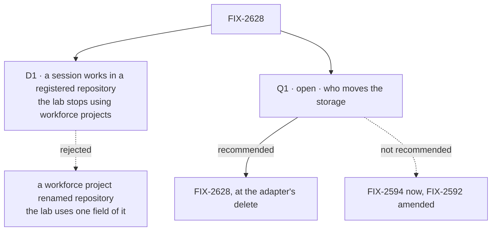

# FIX-2628 · Decisions

[Spec](SPEC.md) · **Decisions**

One decision is the sign-off, and one question is open. Kits, their shape, which kits, views,
`runBy` and the adapter freeze are the epic's ([FIX-2618 O1, ER-1 to ER-8](../../epics/FIX-2618/DECISIONS.md#who-owns-what));
that the lab's "projects" are really repositories is the owner's (2026-11-11). This spec builds
both as decided.

## The tree

Solid edges are what you're signing or what I recommend. Dashed edges lost, and the label says why.

## D1 · A session works in a repository the workspace host registered; the lab stops using workforce projects

| | |
|---|---|
| **Instead of** | Keep a workforce project per repository as the storage, and say *repository* only on screen: [FIX-2592 ER-5](../../epics/FIX-2592/DECISIONS.md#who-owns-what) and FIX-2594's "the workforce Project row stays the storage" |
| **Because** | The owner's naming call, and the code agrees with it. The lab uses one field of a project, its repository: all 9 project identifiers it imports serve "find the repository a run works in" ([POC](poc/lab-inventory/README.md)); no lab screen shows members, project files, MCP servers, workstreams or checks (FIX-2592 keeps them out). [O1](../../epics/FIX-2618/DECISIONS.md#o1): projects is not a workforce default, and harness-manager takes a workspace source a later projects kit could fill. [FIX-2593](../../epics/FIX-2592/DECISIONS.md#who-owns-what) ER-1: the host keeps the one list, and a project only points |
| **Locks in** | Anyone who can use the lab can start a session on any registered repository: admission is the operator's act at the host ([FIX-2592 ER-4](../../epics/FIX-2592/DECISIONS.md#who-owns-what)), not a project's membership. The app supplies the run source, through the harness kit's `workspace`. The lab runs no project checks. `reads-project-files` leg 2 becomes "a session with no repository is refused", not "a non-member is refused". *Repository* is the lab's word in code too, so FIX-2592 ER-5's carve-out ends |

It comes down to what the lab uses: one field of a project, so the rest is weight it never shows.

**What would change my mind:** one lab served to several people who must not share
repositories. Then membership is needed, and it belongs in a projects kit (O1's later
candidate), not back in workforce's defaults.

## Q1 · Open · Which issue moves the lab's storage off workforce projects?

**In plain terms.** FIX-2594, in a sibling epic, puts *repository* on the lab's screens and
builds Settings. It is approved, waits only on FIX-2593, and will ship well before this issue,
which waits on all of stage 2. As approved, FIX-2594 still saves each repository a person adds
as a workforce project. Either FIX-2594 is changed to save no project, or it ships as approved
and this issue moves the storage when it deletes the adapter.

**The options.** *FIX-2628, later (recommended):* FIX-2594 ships unchanged. Each repository added
before this issue lands also leaves a workforce project row; this issue reads those once, so a
session keeps its repository, and the read goes with the adapter. *FIX-2594, now:* FIX-2592's
spec is amended and re-approved, FIX-2594 also changes the run source in `host.mts`, and no
project row is ever made.

**The trade-off.** Later costs a few orphan rows in each operator's local lab database and one
read we delete. Now costs a sibling epic's approval round and a larger FIX-2594, for a screen
that looks the same.

**My recommendation:** FIX-2628, later. The person sees the same thing at the same time, and
the move lands with the code it deletes.

**What would change my mind:** FIX-2594 not started when FIX-2627 merges. Then no rows exist
yet, and the move is this issue's with nothing to read.

**If wrong:** some orphan project rows in local lab databases. Cheap, and reversible.

It comes down to the sibling's approval: the screens are the same, so reopening it buys nothing visible.

## Decided, not asked

- **The session's repository is written by the server when the session opens,** from a
  repository in the host's list, and is read-only after. A task session finds it through its
  filer (`filingSessionId`, set by the board's hand-over). Never from a task's input, the
  request body or a header (BP-031). The **convergence point** is the app's run source: every
  coding run and every source read asks it, and it refuses a repository the host no longer
  lists, with the host's reason. The field's carrier is FIX-2627's `sessionFields` option on
  workforce.
- **Old sessions keep their repository.** A session opened on a project before this lands is
  read once: its project's repository, if the host lists it (BP-030). Otherwise it shows no
  repository and asks. The read goes when the adapter's last caller does.
- **The pins fallback goes.** FIX-2624's one-time read of the old user-state lists is removed,
  as FIX-2624 says, with `user-marks.mts`, which FIX-2627 moved out of `workforce/flows/`. A
  person who never opened the lab between the two loses old pins: a local lab.
- **No "no repository" refusal at filing.** Today the board refuses a coding task in a session
  with no project before it files it. Every session now opens on a repository (FIX-2592 ER-6),
  so the run source's refusal at run start is the one check, and the row shows it.
- **The tests leave the fake.** `test/fake-lab.ts` and the `LabAdapter` seam go
  ([FIX-2152 D4](../../epics/FIX-2152/DECISIONS.md#d4), superseded here as the epic says). Screen
  tests run on the in-process host, as `test/contract/contract.test.ts` does today.
- **Where the lab's files go.** The app kit is one folder of the lab, a sibling of `workforce/`
  ([O1](../../epics/FIX-2618/DECISIONS.md#o1) § Folders). Its flows count as FIX-2152 ER-1's
  small flows; the inventory script classifies by that path.
- **The 42 kit-only lines.** Confirmed, not re-argued ([Settled](#settled)). They arrive as
  the coding board view's harness field; the lab writes none of them.
- **Measure, then report.** The implementation PR's description carries the inventory's
  before and after (adapter, host, flows, kit), replacing the epic's estimates.

## Considered and dropped

| Alternative | Why not |
|---|---|
| Rename only: workforce projects behind the word *repository* | D1 |
| A repositories kit now | O1 lists it as a later candidate; one app needs it today |
| The app's projects flow in `flows:`, as the epic's host example has it | The app kit already holds the app's flows; the flow becomes repositories |
| Keep `projectSourceCapability` under its name | It names a project to the model and installs project resources. The lab takes FIX-2627's `sourceReadCapability`, its tool body with no project |
| Keep the fake lab beside the in-process host | Two ways to test one screen; the contract test already runs the real host |

## Open

- **Q1**, above.

## Settled

- **The kit-only premise holds on today's `main`** (2026-11-11, `aea65f7ba`;
  [`poc/lab-inventory/`](poc/lab-inventory/README.md), `node specs/issues/FIX-2628/poc/lab-inventory/check.mjs`).
  The adapter is byte-equal to `f0b34c529`, FIX-2626's table still totals 42 kit-only lines, and
  neither harness-manager nor workforce depends on the other. The premise held; nothing moved.
- **What "off workforce's project concept" covers** (same run). 9 imported identifiers, 54 token
  uses in lab code, one flow file. `POC_EXPECT=gone` fails on `main` and is the implementation's
  bar. The controls go red: an unknown import, a namespace import, a dynamic import, a stray file
  in `workforce/flows/` and a stale row each stop the check.

## Analysis

2026-11-11 · watermark 2026-11-11 (FIX-2626's) · **Right approach.** Run by the author, not a
fresh agent: this dispatch has no sub-agent tool. One finding folded: the storage move became Q1.

1. **Reuse.** The app kit and source are **composed** of `defineKit` and `RunSource`; the hooks
   are wrappers; the inventory **reuses** the POC. Nothing genuinely new in a package.
2. **Prior art.** The epic's (Backstage, Django apps). Conductor, which FIX-2592 cites, lists
   repositories as the app's own list, with no project above them: the shape D1 takes.
3. **Other shapes.** Rename only (D1's *Instead of*); a repositories kit now (dropped).
4. **New factors.** FIX-2626's alignment (#5078, draft) puts `projects.mts` in `flows:` and names
   FIX-2628 for the later move; this spec agrees on the order. The owner's naming call, 2026-11-11.
5. **Necessity.** The epic's leg a has no other owner.
6. **Ergonomics.** A lab author writes a run source; the epic's examples hid that.
7. **Concerns.** FIX-2627's five seams are the risk. If FIX-2627 bakes a workforce project into
   the coding worker flow, D1 needs a package change it doesn't own. Folded: the storage timing
   is a sibling's scope, so it went to the owner as Q1.

## How it got here

- **Draft** — leg a of the epic, on FIX-2626's `defineKit` and FIX-2627's kits, with the owner's
  naming call made a decision: the lab's working place is the workspace host's repository, not a
  workforce project (D1). FIX-2626's 42 kit-only lines are confirmed on today's `main`.
