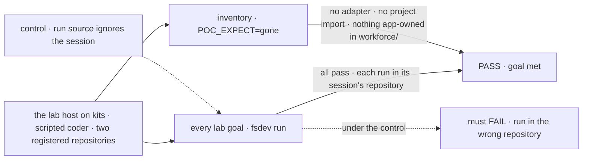
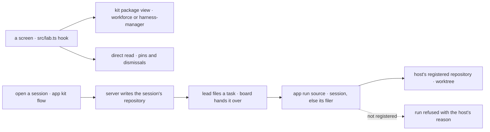

# FIX-2628 · The Claude Code-style lab runs on kits: its adapter becomes a few hooks and its renderer

**Spec** · [Decisions](DECISIONS.md)

## Five people, before and after

| Someone who… | Today | After |
|---|---|---|
| **works in the lab** | Starts a session in a "project", a workforce row that only points at a repository | Starts it on a repository the lab registered. Same screens, same keys; the thread, the board and the pins behave as before |
| **adds a screen need to the lab** | Adds a verb to a 1,642-line adapter, a row type, and the same verb to a 728-line fake | Calls a hook over a kit package's view; the type comes from the view |
| **starts the lab** | Gets a host that wires workforce by hand: a circular callback, `hireWorkforce`, a flows map, three casts | Gets a host that lists three kits, one config object each |
| **reads the lab to learn FSD** | Sees glue the framework should own, and the lab's own flows inside workforce's folder | Sees configuration, screens and one small kit: what this app adds, and nothing else |
| **maintains the framework** | Has the epic's estimates (1,498 → 250 adapter lines) and FIX-2626's 42 kit-only lines, both from reading code | Has both measured, on the first app that runs on kits |

## The goal, and how we'll know it's met

**The Claude Code-style lab installs the workforce and harness kits and its own, reads everything
the server computes through the kit packages' views and direct reads, and calls the place a
session works a repository, the workspace host's, with no workforce project; every lab goal still
passes.**

| Is it the right goal? | |
|---|---|
| **The real need** | The epic's leg a: an app on workforce is configuration, UI and small flows ([FIX-2618 goal](../../epics/FIX-2618/SPEC.md#the-goal-and-how-well-know-its-met), FIX-2152 ER-1). The owner, 2026-11-11: the lab's "projects" are misnamed; the concept is a repository |
| **Smaller, and rejected** | "The adapter shrinks onto views, and *project* is renamed in the UI." The lab still keeps a workforce project per repository, which [O1](../../epics/FIX-2618/DECISIONS.md#o1) says is not a workforce default, and a second list beside the host's ([FIX-2592 ER-1](../../epics/FIX-2592/DECISIONS.md#who-owns-what)) |
| **Bigger, and not this issue's** | Settings, the new-session dialog and the word in the UI (FIX-2594). Teammates' and Shift Manager's adapters (follow-up epics). A projects or repositories kit ([O1](../../epics/FIX-2618/DECISIONS.md#o1)'s later candidate) |
| **Not done if** | `src/adapter.ts` or the fake lab survives · the lab imports any of workforce's 9 project identifiers ([POC](poc/lab-inventory/README.md)) · an app file sits in `workforce/` · the host calls `createWorkerInstallation` or `hireWorkforce`, or casts with `as never` · a lab goal fails · a run lands in a repository other than its session's · the pins fallback (FIX-2624) survives |



The check reads git's worktree list and what the host serves, never a hook's return value.

| How we verify | |
|---|---|
| **Goal check** | `goals/claude-code-style-lab/` (11 goals today) plus one new, `works-in-its-repository`, model `n/a` (scripted coder), run with `fsdev run` at completion; and the lab's inventory script, `POC_EXPECT=gone` promoted from [the POC](poc/lab-inventory/README.md). Verdict on the implementation PR |
| **Signal** | Every lab goal passes on the kit host. `works-in-its-repository`: two repositories registered; a work session on the second files a coding task through its lead; the run's worktree is in the second repository's `git worktree list` and not the first's. The inventory: zero project identifiers and tokens, no `adapter.ts`, no app file in `workforce/` |
| **Input** | Two repositories made per run, each dirty on a branch; a held-out coding prompt. `checks-the-repository-first` and `reads-project-files` are rewritten for repositories, legs kept |
| **Anti-game** | Assert on git and the served answers. Never on `lab.ts`'s hooks or the app kit's unit tests: they pass while a run still finds its repository through a workforce project |
| **Control that must fail** | `GOAL_CONTROL=first-repository`: the app's run source answers the first registered repository, so the run lands in the wrong one. Today's `main`: the inventory fails (9 imports, 54 tokens, the adapter, five files in `workforce/`) |

## What changes


The adapter's read model goes to views, the host's wiring to kits, and the lab's working place
to the workspace host.

The host, and one pane:

```diff
- const installation = createWorkerInstallation({ standardWorkers: tree.workers, workerFlows: () => flows });
- flows = { agent: defineAgentWorkerFlow({ installation, …, uses: [projectSourceCapability({ workspace }), …] }), coordinator: …, [HARNESS_THREAD_FLOW]: { …, needsProject: true } };
- const projects = defineProjectsFlow({ checkRepository })({ id: PROJECTS_FLOW }) as { id: string };
- createFlowState({ flows: Object.fromEntries([...hireWorkforce(installation), projects, pins, dismissals, readinessFlow].map((c) => [c.id, c])), … } as never);
+ createFlowState({
+   kits: [
+     workforce({ model: o.model }),                                          // reads ./workforce
+     harnesses({ claudeCode: {}, codex: {}, cursor: {}, workspace: { root: join(o.data, "runs"), source: repositoryOfRun, setup: o.setup } }),
+     claudeCodeStyle({ utilityModel: o.utilityModel, answerAgain: o.answerAgain }),
+   ],
+   stores, durable: true, models: { default: o.model, intents: { utility: [o.utilityModel] } },
+ });

- const rows = useWatch((on) => adapter.watchTasks(sessionId, on, setStale), [sessionId]);
+ const { value: rows, stale } = useTasks(sessionId);                         // src/lab.ts: useView(codingBoard, { sessionId })

- await adapter.openSession(mode, projectRef(project));                       // then setWorkProject
+ await openSession({ worker: mode.worker, repository: repository.id });       // the app kit's flow writes it, server-side
```

`repositoryOfRun` is the app's run source: the run's session's repository, or its filer's,
looked up in the host's list (FIX-2593). The names are the implementer's; the rule is
[D1](DECISIONS.md#d1)'s.

**Docs:** no `apps/docs` page and no changeset: a private lab. The lab's README is rewritten in
the implementation PR for kits and the inventory table. FIX-2594 owns its *repository* and
Settings sections; if FIX-2594 lands first, this PR keeps them. FIX-2627 publishes the kits.



A screen reads; a run finds its repository from the session that opened it or filed it.

## What stays as it is

- **Every screen and key.** The sidebar, thread, board, sheet and keys behave as FIX-2594 leaves
  them. This issue changes where screens get data, not what they show.
- **The transcript.** It keeps its session address ([FIX-2618](../../epics/FIX-2618/SPEC.md#what-stays-as-it-is)); `entriesOf`, `withStopped` and `ThreadEntry` move unchanged.
- **The workers.** The `WORKER.md` tree stays in `workforce/`, read by the workforce kit.
- **Workforce's project concept, in the package.** Shift Manager and teammates keep it. Only this lab leaves it.

## What's already here, and the debt

| Already here | What this does with it |
|---|---|
| **The job: say where a coding run works.** Mechanism row `workspace` (`localWorkspaceHost`). Searching `packages/*/src` for `RunSource`, `source`, `repository`, `project`: the `RunSource` type (`workspace/src/run-source.ts:100`), its one implementation, workforce's `projectWorkspace()`, and the host's `localRepositories` | **Builds on** `RunSource`, the closest: the app's source is its second implementation, beside `projectWorkspace()` |
| [FIX-2618 O1](../../epics/FIX-2618/DECISIONS.md#o1), ER-1, ER-4 to ER-6, ER-8; [examples/ccs-*](../../epics/FIX-2618/examples/ccs-lab.md) | **Builds** leg a. **Amends** the examples: a repository, not `LabProject`; `projectsFlow` leaves `flows:` |
| [FIX-2626 D1](../FIX-2626/DECISIONS.md#d1) and its [crediting table](../FIX-2626/poc/client-half/README.md) | **Confirms** 42 kit-only lines on today's `main` ([POC](poc/lab-inventory/README.md)). D1 does not reopen: no screen needs to know which kits are installed; the modes list is the app's own config |
| [FIX-2624](../FIX-2624/DECISIONS.md) pins and dismissals on `runBy: "default"`, with a one-time fallback | **Moves** the declarations into the app kit; **removes** the fallback |
| [FIX-2592 ER-1, ER-5](../../epics/FIX-2592/DECISIONS.md#who-owns-what): the host keeps one list; *project* survives inside the adapter and flow files | **Keeps** ER-1. **Ends** ER-5's carve-out: the adapter and the projects flow go |
| [FIX-2152 D4](../../epics/FIX-2152/DECISIONS.md#d4) (fixtures-first adapter), ER-1 (small flows under `workforce/flows/`) | **Supersedes** D4 here, as the epic says. **Amends** ER-1's path for this lab: small flows live in the app kit, since [FIX-2626 D2](../FIX-2626/DECISIONS.md#d2) refuses them in workforce's folder |

| Adds | Existing piece considered | Why it doesn't fit, or how it is composed |
|---|---|---|
| The app kit (`claudeCodeStyle`) | `defineKit` (FIX-2626); `flows:` | **Composed** of `defineKit` and existing flows. It holds pins, dismissals, the repositories flow, two worker settings, the run source |
| The app's run source | `projectWorkspace()`; `RunSource` | **Composed:** a `RunSource` over the host's list and `filingSessionId`. `projectWorkspace()` needs a project, which is what goes |
| The session's repository, written at open | workforce's `workProjectId`; a user resource | **Reuse** of the server-written session field pattern; its carrier is FIX-2627's ([seams](#what-fix-2627-and-the-others-must-agree-with)) |
| `src/lab.ts`'s hooks | The kit packages' hooks | **Thin wrappers** in the app's words, as the epic sketches; no logic |
| The lab's inventory script | FIX-2152 ER-1's script, never built; the POC | **Reuse:** the POC's `gone` mode |

| The debt | |
|---|---|
| **Removes** | `adapter.ts` (1,642 lines) and the fake lab (728) with the `LabAdapter` seam; the host's wiring (callback, `hireWorkforce`, flows map, three casts) and its `listed()` remap; the projects flow and 9 project identifiers, 54 token uses; the pins fallback; FIX-2592 ER-5's carve-out |
| **Adds** | The app kit and `src/lab.ts`, permanent: the app's own. A second `RunSource` beside `projectWorkspace()`, permanent by design: the source is where an app says where its runs work ([O1](../../epics/FIX-2618/DECISIONS.md#o1)) |
| **Leaves** | Workforce project rows made before this lands, read once and not deleted (workforce has no delete verb, FIX-2592's *Leaves*). A project's checks: the lab runs none, as today in practice |

**Net: down.** About 2,400 lines of adapter, fake and wiring go; an estimated 350 come back as `src/lab.ts`, the app kit and its source, which the inventory measures.

## What FIX-2627 and the others must agree with

| Issue | Must |
|---|---|
| **FIX-2627** | **Moves the lab's own files out of `workforce/flows/`** in the PR that turns on workforce's claim pass, unchanged, into the lab's `flows:` (assumed; if its spec says otherwise, FIX-2628's first PR does it, unblocked) · the harness kit's `workspace` takes an app `source`, and the coding worker flow needs no workforce project (`needsProject`, `projectChecks`, `projectWorkspaceCapability` are config, not built in) · a source-read capability for a non-coding worker that asks the host's source with no project resources (today's `projectSourceCapability`'s job) · an app's server-written session field on the agent and coordinator flows, through their settings slots · the views this lab reads: worker sessions, turns, the coding board (with the harness before a run reports, the 42 lines), a run's work, readiness |
| **FIX-2594 / FIX-2592** | Own the word in the UI, Settings and the dialog. Which issue moves the storage is [Q1](DECISIONS.md#q1) |
| **FIX-2593** | The host's list is the one list; a session whose repository was removed gets the host's refusal at run start |
| **FIX-2629** | Leg a reads this issue's inventory script and `works-in-its-repository` |

## Sign off

**[The goal](#the-goal-and-how-well-know-its-met), at that size:** the lab on three kits, every
server-computed read through views, a repository not a project, every lab goal green. If wrong:
a lab that sheds its adapter but still keeps a project per repository.

**[The debt](#whats-already-here-and-the-debt), net down:** about 2,400 lines go; an estimated 350
come back. If wrong: a second run source every app on repositories copies.

1. **[D1](DECISIONS.md#d1) · The lab's working place is a repository the workspace host
   registered; the lab stops using workforce projects.** The owner's direction; this is its shape.
   If wrong: the lab loses per-project membership it would need if served to several people.

**Open: 1.** [Q1](DECISIONS.md#q1) · which issue moves the storage, FIX-2628 or FIX-2594. I
recommend FIX-2628.

Feature · `labs/claude-code-style`, `goals/claude-code-style-lab` · M · epic
[FIX-2618](../../epics/FIX-2618/SPEC.md) stage 2 · blocked by FIX-2627 · [Linear](https://linear.app/fixpoint-labs/issue/FIX-2628)
