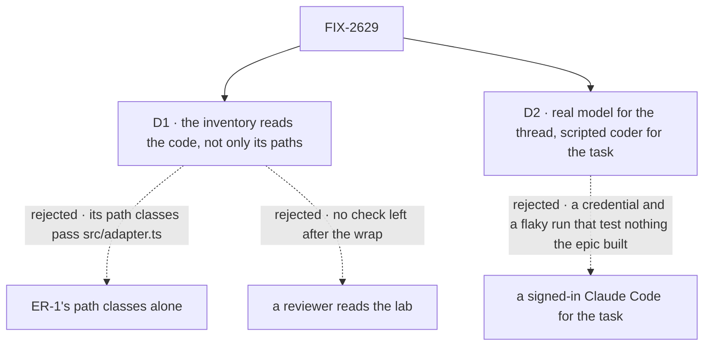

# FIX-2629 · Decisions

[Spec](SPEC.md) · **Decisions**

The plan's four rows are the [closure rule's](../../../docs/contributing/orchestration.md#the-closure-issue-every-epic-ends-in-qa)
and its legs are the [epic's](../../epics/FIX-2618/SPEC.md#the-goal-and-how-well-know-its-met).
Two calls are this spec's: what the inventory reads, and what runs the coding task. Three
children are still being specced; what this plan assumes of each is [below](#what-this-plan-assumes-of-fix-2625-fix-2627-and-fix-2628).

## The tree

Solid edges are what you're signing. Dashed edges lost, and the label says why.

## D1 · The inventory reads the code, not only its paths

| | |
|---|---|
| **Instead of** | FIX-2152 ER-1's inventory as written: every file classed by path as config, UI or a small flow · or a reviewer reading the lab for logic the packages should own, as ER-1 leaves it |
| **Because** | ER-1 classes every `src/**/*.ts` as UI, so its path classes pass `src/adapter.ts` (1,642 lines, 3 subscribes, 10 flow calls, 9 row types). The [POC](poc/end-state-inventory/README.md) ran it: L1 green on `main`. ER-1's caps (L2) fail today's lab, but only on flow count and size, so once the flows shrink, nothing in ER-1 refuses the adapter or a renamed one, and the epic's control "the inventory refuses `adapter.ts`" can't fail for that reason. Two content rules close it: no UI file imports a client value (only `createClient`, in the entry) or calls `.subscribe(` or `.flow(`; and every exported object type in a non-component `src/` module is on the app's list of screen-computed types ([ER-6](../../epics/FIX-2618/DECISIONS.md#who-owns-what)). The POC passes the epic's proposed lab and fails a planted `src/glue.ts` |
| **Locks in** | claude-code-style reaches the server only through package hooks and views, checked by a test in the lab that keeps running after the wrap, so its adapter can't grow back ([ER-8](../../epics/FIX-2618/DECISIONS.md#who-owns-what)). The two content rules join FIX-2628's lab inventory: FIX-2628 owns that one test file and adds both rules and the app-types list to it, and this closure ships no second lab inventory script (the POC here is spec evidence only). In that
test L1 classes a flow by the app kit's folder ([FIX-2628](../FIX-2628/DECISIONS.md#decided-not-asked)'s
*Where the lab's files go*), not ER-1's `workforce/flows/`, which the claim pass refuses.
`src/lab.ts` holds no client either: it reads through `useView`, `useResource` and the session
feed, and sends an action through a package hook (`useAction`, or a kit package's own), never
`client.flow(…)` or `.subscribe(`. A new app type goes on the list in a reviewed PR. Teammates is not held to the content rules: it keeps its adapter until the follow-up epic |

It comes down to today's adapter: by path it is UI, so only a content rule fails it.

**What would change my mind:** FIX-2628 putting every server-facing call in one named module
that a path rule can refuse. Then L3 and L4 reduce to "that module is absent".

## D2 · The thread runs on a real model; the coding task on the scripted coder

| | |
|---|---|
| **Instead of** | A signed-in Claude Code (or Codex) running the delegated task for real |
| **Because** | The epic's goal is how the app reads, installs and writes: views, kits, `runBy`. A real harness tests none of that and adds a credential (`ANTHROPIC_API_KEY`), minutes per attempt and a run that fails for reasons outside the epic. The scripted coder (`CLAUDE_CODE_STYLE_HARNESS=stub`) runs through the same harnesses kit, coding flow and board view, and the lab's goals already use it. The thread keeps the real model, because a model choosing to delegate is the path the epic's leg a names |
| **Locks in** | The closure proves no real harness run on the kits. That run is FIX-2627's own check and the lab's `session-mode-script` signal 6, re-run in row 3 where a key is present and reported CAN'T TELL where it is not |

It comes down to what a red run means: on the scripted coder, only a defect in what the epic built.

**What would change my mind:** the harnesses kit routing the scripted coder somewhere the real
harnesses don't go (a separate flow, a bypass of the `harnesses` slot). Then leg a needs one
real harness, and the run waits on its key.

## The plan in full

| # | What runs | PASS means |
|---|---|---|
| 1 | Legs a, b and w ([the signal](SPEC.md#the-signal)) | Each green; each control red where named |
| 2 | One journey per team whose *after* row 1 doesn't walk. *Builds an app* is leg a; *installs workforce into a host* is leg b. **j2** *shows user- or org-level data*: Shift Manager, one user in two orgs, opens Projects, Usage and Schedules in a browser: each renders; no session was made only to read (`j2:no-read-session`, leg a's rule); reading Usage and Schedules adds 0 requests (`j2:read-writes-nothing`, the part of FIX-2556 that FIX-2624 takes); the org shown is the identity read's (`j2:identity`). **j4** *keeps a screen current*, on leg a's lab: when the task's status changes, the board's re-read carries that one row, not the board (`j4:one-row`, FIX-2625 on a real app), and no socket frame carries a row's values (`j4:no-rows`, ER-2). The ids-off scope ([O4](../../epics/FIX-2618/DECISIONS.md#o4)) is FIX-2625's own check, in row 3. **j5** *maintains the framework*: `reads`, `ReadConfig`, `runRead`, a scope's `client.derived` and `flow().read` are not exported, and the glossary's check fails a planted `reads:` (`j5:one-hook`); FIX-2551's copy count passes `--after` (`j5:one-live-read`); a model call planted in a view is refused at session, user and org scope (`j5:no-model`) | Each green |
| 3 | Every child's goal check with its controls, read from Linear at run time and printed: FIX-2551, FIX-2623, FIX-2624, FIX-2625, FIX-2626, FIX-2627, FIX-2628, and any child that joins later. Then both labs' own goals under `goals/claude-code-style-lab/` and `goals/teammates-lab/`, since FIX-2627 and FIX-2628 rewrote what they drive. The proofs FIX-2620 to FIX-2622 are not re-run: they patch code the build has since moved, and their claims are graded by FIX-2623's and FIX-2626's checks | Each PASS beside its documented FAIL |
| 4 | The gap sweep. Each [coordination seam](../../epics/FIX-2618/DECISIONS.md#coordination-seams) from both sides, with these checks among them: a pin written through the default write flow reaches a view in another flow that reads it within 1 s (O2's host-wide publish, FIX-2623 against FIX-2624); harness readiness is one view in `harness-manager` and no host defines a readiness flow; no call site passes `createFlowState` a keyed `flows` record; no walk primitive is left in `packages/workforce/src/loader`; `defineView`, `useView`, `fsd.resource` and `defineKit` are in FIX-2447's export ratchet; no host or lab keeps a copy of the shared coding worker flow (Shift Manager's own flow is FIX-2627 D1's named exception, with its host's kit `coder` off; if FIX-2627 D1 changes before merge, this check follows it); every goal and test that called `createWorkerInstallation` or `hireWorkforce` still typechecks and runs. The contributor docs the set wrote (the concept doc, `flows-and-actions.md` § Views, `kits.md`, `resources-and-client-data.md`) followed as written. Each epic *not done if* state checked absent. The named leftovers confirmed as named: the content routes still answer 501 at user and org scope (FIX-2633); FIX-2556 holds only the delegates read; no `readerSessionId` is left, so FIX-2326 has nothing to fix | Every seam two-sided; every leftover as named |

**Must be green first:** every other child merged with its goal's PASS and its controls'
FAIL. At drafting none has: the owner has put all implementation on hold. FIX-2551, FIX-2623,
FIX-2624 and FIX-2626 have merged specs; FIX-2625, FIX-2627 and FIX-2628 have open spec PRs
(#5082, #5083, #5080), none approved.

## What this plan assumes of FIX-2625, FIX-2627 and FIX-2628

They are specced in parallel, each on an open spec PR, none approved. Each line below says what the
closure needs; where the child's in-flight draft (on its spec PR, unreviewed) already
says the same, that is noted. The closure asserts on behaviour, not names, and re-reads each
merged spec at run time. A merged spec that contradicts a line makes that line stale, and the
run updates it, as the closure rule says.

- **FIX-2625 (ids on notices, gated).** A notice may carry the ids of changed rows; no ids
  means read everything; a scope can turn ids off. j4 needs the first; its own check grades
  the opt-out. *Draft:* the same, with `goals/notices/one-change-re-reads-one-row/`. If the
  owner cuts FIX-2625 (the epic names it the one to cut), `j4:one-row` drops and `j4:no-rows`
  stays.
- **FIX-2627 (workforce and harnesses kits).** Two kits: workforce, and harness-manager as the
  harnesses kit with one keyed `harnesses` slot that Claude Code, Codex and Cursor fill. The
  scripted coder is a harness value whose `agent` is scripted, swapped in per id by the host:
  it switches that id's entry off and fills the scripted value under the same id, so the task
  takes the real harness's slot, coding flow and board view. One shared coding worker flow, replacing teammates' `coder.ts` and
  claude-code-style's `harness-thread.mts`. Readiness is one view, and no host builds a
  readiness flow. No file outside workforce calls `createWorkerInstallation` or
  `hireWorkforce`, Shift Manager's DevTeam host included. The teammates host moves onto both
  kits. Workforce installs no projects flows. *Draft:* the same, with
  `goals/kits/workforce-and-harnesses-install-as-kits/`. **If its merged spec leaves DevTeam's
  host out**, the epic's "a host" rule still names it, and the closure puts that to the owner
  before it runs, not as a finding after.
- **FIX-2628 (claude-code-style on kits).** The host installs workforce, harnesses and the
  app's own pieces. `src/adapter.ts` and the fake lab are deleted (ER-8, the owner's word);
  `src/` keeps hooks named in the app's words and its thread renderer; types for server rows
  come from `ViewOutput`; pins are a user resource on `runBy: "default"`; a session works in a
  repository, with no workforce project (FIX-2592's word). It ships a lab inventory. *Draft:*
  the same, its inventory at `poc/lab-inventory/` (`POC_EXPECT=gone`), promoted to a lab test
  that takes D1's two content rules and its list of app-computed types.

## Decided, not asked

- **Today's `main` is `2a68dc263`,** the parent of the first stage-2 implementation merge
  while everything is on hold. If an implementation merges before the closure's PR, the
  control moves to that merge's parent.
- **The blind-recorder control blinds the whole coding-board view, not one of its paths.**
  Under host-wide publish, the board's other reads can wake it on their own topics, so a
  one-path blind can pass ([FIX-2623's note](../FIX-2623/SPEC.md#the-goal-and-how-well-know-its-met)).
  The one-path case is FIX-2623's probe, re-run in row 3.
- **"Within 1 s" is 5 samples, none retried,** from the store's change to the page showing
  it, each latency printed, as in FIX-2368. The scripted coder steps every 2 s, so a status
  never changes faster than the page can be sampled.
- **Retries:** up to 3 fresh runs, only when the model gave nothing to grade (no task filed),
  as FIX-2153's script does. A filed task whose row never changes is graded at once.
- **`w:recorded` reads the store.** Each user or org resource's versions written during the
  run, matched to request rows by resource and time. No counter inside the framework.
- **`w:routes` reads the router's route table at run time** and probes each write method at
  user and org scope. A new route added later is covered without editing the goal.
- **The inventory becomes a test in the lab** (`pnpm test` runs it), so it gates every PR
  that touches the lab. The browser goal runs on demand after the wrap, one verdict-log row
  per run, never a CI gate.
- **Words on screen are not asserted.** "Project" becomes "repository" in the lab under
  FIX-2592; the run reads data attributes and server records, so either word passes.
- **Leg b has no browser.** The epic's leg b is about the host: its kits, its coding flow and
  its folder. Teammates' own browser goals run in row 3.

## Considered and dropped

| Alternative | Why not |
|---|---|
| Re-run the children's checks and stop there | None draws the lab from kit views (the smaller goal); row 3 re-runs them anyway |
| FIX-2624's helper inventory as the whole static check | It counts helpers only; the adapter could stay with no helper in it |
| A real harness run in leg a | D2 |
| Grading Shift Manager's whole adapter | A follow-up epic, by the epic's own scope; j2 grades only what FIX-2624 removes from it |

## Analysis

Nov 11, at `2a68dc263`. **Right approach, one fold.** Run in this dispatch by the author,
since the worker can't start a fresh sub-agent; the coordinator can dispatch a fresh
`analysis` pass for an independent one.

- **Reuse:** every *Adds* item is the goal and its test. The host, controls, browser and
  report reuse `goals/claude-code-style-lab/lab.mts` and `goals/lib`; two children's POCs are
  reused as row 4 checks. **Reuse X** on ER-1's inventory was considered and refused (D1).
- **Others' shapes:** a release QA; FIX-2368's shape.
- **Should it exist:** required by the closure rule.
- **What is new since the epic:** FIX-2624 found the no-session context is views-only, and
  FIX-2623 that a one-path recorder blind can pass on the board. Both shaped the controls.
- **Major concern, folded:** the epic's must-fail control rests on an inventory that doesn't
  exist and, as specified, would pass the adapter. Became D1 and the epic amendment.

## How it got here

- **Draft** — the epic's legs a, b and its write fence on one commit, FIX-2368's closure
  shape kept. Found: ER-1's path inventory passes `src/adapter.ts` today and was never built
  (D1, with a POC); a one-path recorder blind can pass on the board, so the control blinds the
  board's view. DevTeam's host falls under the epic's "a host"; FIX-2627's draft moves it, so
  it is an assumption, not an ask.

## Notes from review

None yet.

**Open:** none.
