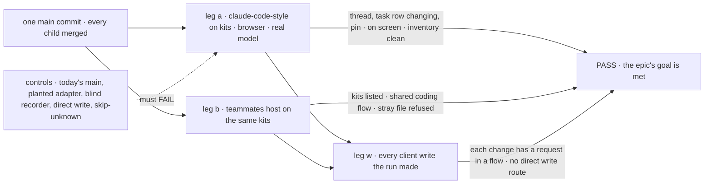

# FIX-2629 · Closure: an app on workforce is configuration, UI and small flows

**Spec** · [Decisions](DECISIONS.md)

## Five teams, before and after

| A team that… | Today | After this closes |
|---|---|---|
| **decides whether the epic is done** | Each child green on its own commit; nothing uses the set the way an app builder meets it | One report on one `main` commit: the lab in a browser on a real model, the teammates host on the same kits, every check beside its control's FAIL |
| **builds an app on workforce** (claude-code-style) | 1,642 lines of adapter, 5 flows, 9 hand-written row types, a host with `as never` | A thread, a delegated coding task, its row changing and a pin, all on screen, with no file that reaches the server itself |
| **installs workforce into a host** (teammates) | A circular `workerFlows` callback, `hireWorkforce`, 8 cast or wiring lines, its own coding flow | One config object per kit; its coding worker runs on the shared coding flow; a stray file in `workforce/` stops it starting |
| **shows user- or org-level data** (Shift Manager) | Opens reader sessions; Usage and Schedules write a request row on every read | Reads with no session made to read, and reading Usage or Schedules writes nothing |
| **keeps a screen current or maintains the framework** | Three coalescers, two hooks for a computed answer, notices that name no rows | One live read, one hook, and a notice that names the rows that changed, or none where a scope turned ids off |

## The goal, and how we'll know it's met

**On one `main` commit with every other child merged, claude-code-style runs on the workforce
and harnesses kits with no adapter: in a browser, on a real model, a person starts a thread,
has it delegate a coding task, sees the task's row change and pins it, and every write the
client makes is a request in a flow; the teammates host installs the same kits; and each
team's journey, each child's check and the gap sweep pass beside controls that fail.**

| Is it the right goal? | |
|---|---|
| **The real need** | [The epic's goal](../../epics/FIX-2618/SPEC.md#the-goal-and-how-well-know-its-met) on the assembled set: "an app on workforce is configuration, UI and small flows", proved where the children meet ([closure rule](../../../docs/contributing/orchestration.md#the-closure-issue-every-epic-ends-in-qa)) |
| **Smaller, and rejected** | "Re-run every child's check and the lab's own scripts." Each child proves its piece on a fixture host; none draws the lab's screen from kit views, so a screen still assembling rows, a pin written outside a flow, or a view that never hears the default write flow passes them all. Or "ER-1's inventory passes": its caps fail today's lab, but its path classes call `src/adapter.ts` UI, so a lab that met the caps would pass with the adapter in place, or renamed ([D1](DECISIONS.md#d1)) |
| **Not done if** | [The epic's list](../../epics/FIX-2618/SPEC.md#the-goal-and-how-well-know-its-met), plus: a check ran on another commit · a check passed on a fixture host where the epic names the lab · the thread ran with no model · a control was skipped or passed · a planted file passed the inventory · a finding is open |



Legs a and b run on the same commit; leg w reads the writes both of them made, so a write
that skipped a flow in either app fails it.

| How we verify | |
|---|---|
| **Goal check** | `goals/kits/an-app-is-config-ui-and-small-flows/`, new · real model for the thread (the lab's default through the AI Gateway), harness-manager's scripted coder for the coding task ([D2](DECISIONS.md#d2)) · run by the closure worker on one `main` commit · the report is the closure PR's body. Its static half, the end-state inventory, joins FIX-2628's lab inventory as a test in the lab, so it keeps running after the wrap |
| **Signal** | Every `<leg>:<assertion>` in [the signal table](#the-signal) passes. The plan's other rows are [in DECISIONS](DECISIONS.md#the-plan-in-full) |
| **Input** | A held-out ask that has the main session file one coding task against a fresh `file://` repository, chosen at run time; one user, a fresh data folder per leg; Chromium through `goals/lib/playwright.mts` |
| **Anti-game** | Assert on the rendered page, the server's records (requests, sessions, the resource's versions) and the source tree, never on a view's output, a kit's unit tests or the lab's fakes in `test/`. Keep the client's poll timer off, or a timer hides a missed dependency |
| **Control that must fail** | **Today's `main`** (`2a68dc263` at drafting, the parent of the first stage-2 implementation merge): `a:inventory`, run, red ([POC](poc/end-state-inventory/README.md)) · `GOAL_CONTROL=planted-adapter` (`src/glue.ts` with a client import, a subscribe and a row type): `a:inventory` · `GOAL_CONTROL=blind-recorder` (the view recorder records nothing for the coding board's view): `a:row-changes` · `GOAL_CONTROL=direct-write` (a content route writes a user-scope collection instead of answering 501): `w:routes` and `w:recorded` · `GOAL_CONTROL=skip-unknown` (FIX-2626's: the walker skips an unclaimed file): `b:folder` |

### The signal

| Assertion | Passes when |
|---|---|
| `a:thread` | In a new session on a repository, your line and the main session's reply show in the thread |
| `a:delegate` | The main session files a coding task; its row shows in the pane, and the session's board on the server lists it |
| `a:row-changes` | The task moves from running to `completed` on the scripted coder; the row shows each status within 1 s of the store's change; in 10 s idle, the page sends 0 view reads |
| `a:pin` | *Pin* on the task shows it pinned, and still pinned after a reload; the store holds it; exactly one new request, in a session owned by this user, on the default write flow |
| `a:no-read-session` | Every session the run made has a request, a task or a run in it. A session with none was made only to read, and fails |
| `a:inventory` | The [end-state inventory](poc/end-state-inventory/README.md) passes: every file classed by path, flows and config within ER-1's caps, no UI file reaching the server itself, no hand-written type for a row a view returns, no host wiring, no own-session helper |
| `b:installs` | The teammates host lists the workforce and harnesses kits and passes the inventory's host rule; its own coding flow is gone, and `goals/teammates-lab/a-coding-task-waits-for-your-review/` passes on the shared one |
| `b:folder` | A file planted in its `workforce/` tree that no reader claims stops the host starting, naming the file |
| `b:one-home` | No flow is both scaffolded into a kit's folder and importable from a package |
| `w:routes` | Of the router's client routes that can change a user or org resource, each is the action route, except `client.content.*` create, update and delete, which answer 501 at user and org scope (exempt by name until [FIX-2633](https://linear.app/fixpoint-labs/issue/FIX-2633)) |
| `w:no-runby` | A client write to a resource with no `runBy` is refused, by the action route and by a content route |
| `w:recorded` | Every user or org resource version written during legs a and b matches a request in a flow session, attributed to the signed-in user |

A failure becomes a child of FIX-2618 blocking this issue, and the plan runs again as the
closure rule says.

## What changes


Before, each piece is proved where it was built; the closure proves them together, in the
apps the epic was for, and leaves the inventory behind as a test.

The inventory is the part that keeps running. It reads the tree the way an app builder would
count it:

```diff
+// labs/claude-code-style/test/inventory.test.ts (shape from the POC; the closure's to place)
+expect(classes(LAB)).not.toContain("other");             // ER-1, by path
+expect(uiFilesThatReachTheServer(LAB)).toEqual([]);      // D1: no client import, subscribe or .flow( in src/
+expect(rowTypesNotOnTheAppList(LAB)).toEqual([]);        // D1: server-computed rows come from ViewOutput
+expect(hostWiring(["labs/*/host.mts"])).toEqual([]);     // no callback, no as never, no hireWorkforce
```

**Docs:** no documentation impact. The closure writes no page; it follows the contributor
docs the set wrote ([gap sweep](DECISIONS.md#the-plan-in-full)). User pages are written at
release by `/release-docs` and graded there.

**Stays as it is:** all product code; every child's check as it is on `main`; the lab's
existing goals, which the closure re-runs rather than replaces.

## What's already here, and the debt

| Already here | What this does with it |
|---|---|
| The epic's legs, signal rows and must-fail rows | **Builds** them. One correction: under ER-1 the inventory can't refuse `adapter.ts`, so D1 gives the closure's inventory content rules ([epic amendment, below](#sign-off)) |
| [FIX-2152 ER-1](../../epics/FIX-2152/DECISIONS.md#who-owns-what), the lab inventory, owned by [FIX-2153](../FIX-2153/DECISIONS.md) | **Amended in part, for claude-code-style.** Its path classes and caps are kept as L1 and L2. It was specced, never built: no inventory script under `labs/`, `scripts/` or `packages/fsdev/` |
| The children's goals: `live-read/one-loop-every-watcher`, `views/a-screen-watches-a-view`, `resources-by-scope/a-pin-is-one-line-and-no-session-is-made-to-read`, `kits/install-in-any-order`, and FIX-2625's, FIX-2627's and FIX-2628's once specced | **Composed.** Re-run in row 3; two controls reused (`skip-unknown`, the recorder blind) |
| `goals/claude-code-style-lab/lab.mts` (`startLab`, planted controls, the board through the public client) and `session-mode-script` (FIX-2153) | **Reused** for leg a's host, its controls and its retry rule |
| `goals/lib/playwright.mts`, `verdict.mts`, `module-patch.mjs`, `model.mts` | **Reused** for the browser, the tagged report, the engine patches and the model |
| FIX-2628's lab inventory (in its draft spec: no `adapter.ts`, no workforce project identifier, nothing app-owned in `workforce/`) | **Extended:** D1's two content rules join it, so the lab keeps one inventory |
| FIX-2624's [helper inventory](../FIX-2624/poc/helper-inventory/README.md), FIX-2551's [copy count](../FIX-2551/poc/copy-count/check.mjs) | **Reused** as row 4 checks, `--after` and `POC_EXPECT=gone` |
| [FIX-2368](../FIX-2368/SPEC.md), the last required closure | **Kept** its shape: tagged assertions, controls per assertion, the plan's four rows |
| Anything else grading the set | **None.** Searched `goals/` for `defineKit`, `useView`, `runBy`, `adapter.ts`, `ownSession` |

| The debt | |
|---|---|
| **Removes** | Nothing |
| **Adds** | One goal on the lab and the teammates host, and an inventory test in the lab. The goal runs on demand after the wrap, as FIX-2368's does |
| **Leaves** | Teammates' and Shift Manager's remaining adapters, and one route per answer: the epic's follow-up epics, filed at wrap. The FIX-2633 exemption. FIX-2556's delegates read |

**Net: up, a little.** One goal and one test, for a promise that spans seven children.

## Sign off

**[The goal](#the-goal-and-how-well-know-its-met), at that size:** the lab on kits in a
browser with a real model, teammates on the same kits, every write through a flow, on one
commit. If wrong: the epic wraps on children that each passed on a fixture host.

**[The debt](#whats-already-here-and-the-debt), net up a little:** one goal and one test. If
wrong: a slow goal nobody re-runs; the test still guards the adapter.

**Open: none.** D1 is the one to weigh.

1. **[D1](DECISIONS.md#d1) · The inventory reads the code, not only its paths:** no UI file
   reaches the server itself, and no hand-written type for a row a view returns. If wrong: a
   lab passes with its adapter renamed, or fails on a type a reviewer would call the app's.
2. **[D2](DECISIONS.md#d2) · The thread runs on a real model; the coding task on the scripted
   coder.** If wrong: the epic wraps without one real harness run through the harness kit.

**Epic amendment, for the coordinator:** the epic's control row says "the inventory refuses
`adapter.ts`". Under ER-1 it can't ([POC](poc/end-state-inventory/README.md)); it should name
this inventory. Before the run: FIX-2625, FIX-2627 and FIX-2628 have no approved spec, and no
child's implementation has merged ([Must be green first](DECISIONS.md#the-plan-in-full)).

Improvement · closure (QA) · `goals/` and one lab test · large, repeats per finding · epic
[FIX-2618](../../epics/FIX-2618/SPEC.md), closure · required · runs after every other child
merges (FIX-2551, FIX-2623, FIX-2624, FIX-2626 specs merged; FIX-2625, FIX-2627, FIX-2628
specs in flight) · Linear [FIX-2629](https://linear.app/fixpoint-labs/issue/FIX-2629)
