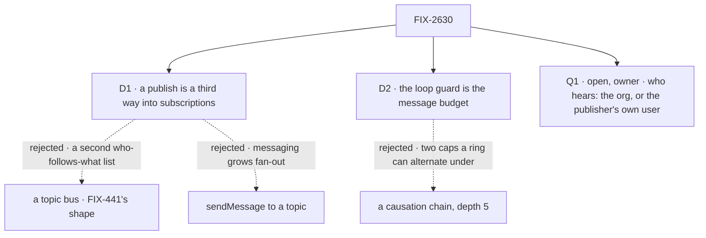

# FIX-2630 · Decisions

[Spec](SPEC.md) · **Decisions**

Two decisions and one owner fork are the sign-off.

## The tree

## D1 · A publish is a third way into subscriptions, not a bus beside them

| | |
|---|---|
| **Instead of** | A topic bus with its own subscriber list (FIX-441's `.notify` and `NotificationFlow`) · `sendMessage` with a topic in place of `to` |
| **Because** | Subscriptions already route an event to the sessions that follow a thread, once each, through screens, cursor, cap and the routine list. A bus is a second list of who follows what, and a third routine trigger (flips FIX-2614 D1). A topic on `sendMessage` makes messaging route |
| **Locks in** | `publishEvent`; thread keys `internal:<topic>`; provider `internal`; sender `service:internal`. A publish enters through the dispatch seam, and the host routes it as `service:internal` in the sender's org: no `RequestHost` verb (FIX-2534 D2) |

It comes down to the list of who follows what: a bus is a second one.

**What would change my mind:** a subscriber that is not a session, such as a flow that must
run a block. That is FIX-825's reactor, not this.

## D2 · The loop guard is the message budget, not a new causation chain

| | |
|---|---|
| **Instead of** | A causation chain on the event with its own depth cap of about 5 (the issue's recommendation) |
| **Because** | The hop count (`messages/hop.ts`) already stops a ring of messages at `DEFAULT_MESSAGE_BUDGET` 6 (`messages/message-limits.ts`). A publish is a send: it pays one place, however many hear it, and its delivery lands at the event's hop plus 1, not the owner run's. A second cap lets a ring alternating message and publish stay under both |
| **Locks in** | An optional `hop` and `chain` on the event, set only by the publish (absent reads 0 and no chain, BP-030). Delivery lands **in the publisher's chain** at the event's hop plus 1, so every subscriber's later sends and publishes pay places in that one chain's row (amended 2026-11-11, below). Past the budget a publish is refused with the budget's reason. The limit is `messageLimitsOf(installation).budget` (`hireWorkforce`'s `messages.budget`): 6, not 5 |

It comes down to a mixed ring: two caps let it run under both.

**Amended 2026-11-11 (Codex, after merge of #4968).** Carrying only `hop` keeps each path
short but not the whole exchange. A send pays its place in its chain's row
(`messages/send-message.ts`, `payPlace`), and service delivery today takes the owner run's
chain or a fresh one (`exemptPlace`). So each subscriber a publish wakes would start its own
budget, and a topic with k followers that each pass it on grows as k to the power of the
depth, which is what [FIX-1989](../FIX-1989/DECISIONS.md)'s whole-exchange rule exists to stop.
The publish now carries its chain too, and delivery wakes the subscriber in that chain. The
delivery itself stays exempt (a publish pays one place, however many hear it), and what the
woken turns send next all pays into the one row. An exchange then holds at most `budget` paid
places, and each publish wakes at most the owner-run cap (`DEFAULT_MAX_OWNER_RUNS`), so
growth is linear in the budget, not exponential in the depth.

The row is the boundary. Chain rows live in the user's scope (`messageChainsCollection`,
`scope: "user"`). A subscriber who is the publisher's user pays into the same row. A teammate
cannot reach it: org-wide delivery would need a chain row in the org's scope for the chains a
publish carries across users, a new store beside the new door. That cost now sits on
[Q1](#q1)'s org-wide side, and the recommendation there moves.

## Open

### Q1 · Who hears an internal event: anyone in the org who follows the topic, or only the publisher's own user?

- **In plain terms:** a worker of yours announces "deploy failed". Org-wide, a teammate's
  routine on that topic hears it too. Own-user, only your routines do.
- **The trade-off:** org-wide needs one new server door: your announcement starts runs as
  teammates, only through routines they saved. GitHub's events do this today; a user's request
  never has. Own-user needs no door (it delivers as you, as polling does), but a team's
  deploy reaches one person.
- **What org-wide now also costs (amended 2026-11-11):** the shared budget ([D2](#d2)) needs
  a chain row every teammate's run can pay into, so org-wide adds an org-scoped chain store
  beside the door. Own-user pays into the publisher's own row, which exists today.
- **My recommendation: own-user first** (was org-wide). No app has more than one person per org
  this quarter (Shift Manager is one person on a laptop), which was this question's own flip
  condition, and org-wide now costs a store as well as a door. The event carries its chain, so
  org-wide later adds the org row and the door without changing what a routine saves.
- **What would change my mind:** a multi-person app that needs a teammate's routine to hear an
  announcement this quarter. Then org-wide now, with the org-scoped chain row.
- **If wrong:** org-wide, a teammate's model-written text wakes your session up to 30 times an
  hour, marked as information. Own-user, the door comes later and a topic's audience
  changes under existing routines.

It comes down to a team's deploy: own-user tells only the deployer.

The figure is the fork as first drawn, with org-wide recommended. Since the amendment, org-wide
also costs an org-scoped chain row, and the recommendation is own-user first.

<b>Decided, not asked</b> — engineering calls

## Decided, not asked

- **Topics are declared** (the owner's recommendation): topic to `{ kinds, data, description }`.
  Publish and subscribe refuse an undeclared topic or kind, listing the declared ones. No
  wildcards; kinds narrow. Free-form lost on typos: a misspelt subscription waits forever.
- **The sender is the server's (BP-031):** the publishing session, its worker or flow kind,
  role `member`, from the dispatch's stamp. The input is strict and has no sender.
- **`canRead` is org membership:** a declared topic; owner runs never leave the org
  (`parseOwnerRun`). Events are `private`, so it is asked per delivery. `self` is the
  subscribing session, so `own` drops its own events. No topic ACL until a topic needs one.
- **`data` is checked by the topic's schema and rendered into the text** (4,000 characters).
  No `data` field on the event (ER-6).
- **One object at version 0,** its id kept in request state, so a repeat after a crash is one
  event. The result is `{ published }` or `{ refused }`, never who heard.
- **Delivery is FIX-2534's, unchanged.** No task (ER-2). Internal threads never close. Push only.
- **Convergence point:** the publish verb is the only writer of `hop`; tool and function share
  it. GitHub's normalize and the poll never set it.

## Considered and dropped

| Alternative | Why not |
|---|---|
| One `dispatcher()` per receiver (FIX-1637 D3) | The publisher names each receiver: the problem |
| A `RequestHost` verb that routes | FIX-2534 D2 locks it out; the seam is already the server's |

## Settled

None built. Read in the code: the dispatch seam is a function the engine installs on a block's
context (`core/src/types/dispatch.ts` ~691), so the route is host code. That it can hand an
envelope to `routeServiceEvent` is the implementer's first check; if not, D1 is amended.

## Analysis

2026-11-09 · watermark 2026-11-08 (the epic's amendment) · **Right approach, with changes.** Run
by the authoring worker, which has no sub-agent tool: not independent.

1. **Reuse** (`reuse-review` on Adds): four reuse or extend; the verb and topic map are new.
   The issue's causation chain was a second loop guard: folded into [D2](#d2).
2. **Prior art** (from memory): Inngest and EventBridge declare event names with schemas.
3. **Other shapes:** a bus, a topic on `sendMessage` ([D1](#d1)); own-user ([Q1](#q1)).
4. **New factors:** 88 issues updated since; 4 on the nouns. FIX-2614's `trigger.event` takes
   a topic unchanged.
5. **Necessity:** no committed consumer. Build after FIX-2539, outside the closure. FIX-2535
   is not a dependency: this route is the dispatch seam's.
6. **Ergonomics:** two entries. "Outside content" on an inside event is kept: the text can
   carry what the publisher read outside.
7. **Concerns:** the door ([Q1](#q1)).

| Finding | Changes the approach? | Disposition |
|---|---|---|
| The hop count already bounds rings | Yes | Folded, D2 |
| FIX-2535 not a dependency; after the closure | No | Recorded; for the coordinator |
| "Outside content" wording | No | Recorded |
| The door is the first of its kind | Owner | Open, Q1 |

## Notes from review

| Finding | Changes the approach? | Disposition |
|---|---|---|
| Codex P2 on #4968 (after merge): carrying only `hop` lets a fan-out start a budget per subscriber | Yes | Folded, [D2](#d2) amended; [Q1](#q1)'s recommendation moves to own-user |

## How it got here

- **Draft** — framed as the issue's problem (the sender must know who cares); the approach is a
  third way into FIX-2534's subscriptions, with the loop guard moved onto the message budget
  and the audience left to the owner.
- **Amendment, 2026-11-11** — a publish carries its chain as well as its hop, so a fan-out
  shares one budget; org-wide's cost grows by an org-scoped chain row, and Q1 now recommends
  own-user first.
