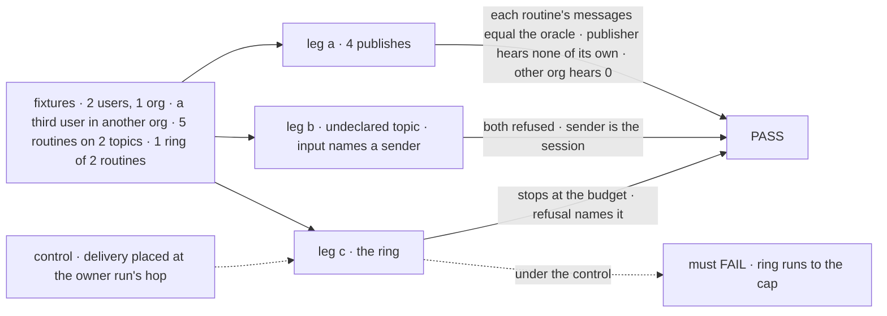
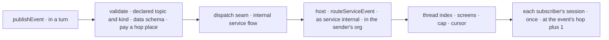

# FIX-2630 · Internal service flow: sessions publish events, routines subscribe to them

**Spec** · [Decisions](DECISIONS.md)

## Six people, before and after

| Someone who… | Today | After |
|---|---|---|
| **finishes a deploy in a worker's turn** | Names each session that cares, or tells no one | Publishes once on `deploy.finished` |
| **wants "when a deploy fails, draft the incident note"** | Can't: nothing inside the app can be followed | An event routine on `internal:deploy.finished`, kind `failed` |
| **mistypes a topic** | n/a | Refused at publish and subscribe, the declared topics listed |
| **builds two routines that announce to each other** | n/a | The ring stops at the message budget, 6 ([D2](DECISIONS.md#d2)) |
| **is a teammate, or in another org** | n/a | A teammate on the topic hears it if [Q1](DECISIONS.md#q1) is org-wide; another org never |
| **maintains the framework** | Push and poll into subscriptions | A third way in; no bus or sender kind ([D1](DECISIONS.md#d1)) |

The epic ([FIX-2471](../../epics/FIX-2471/SPEC.md)) gives this ER-2, ER-4 and ER-5; FIX-2534
([spec](../FIX-2534/SPEC.md)) the routing; FIX-2614 ([spec](../FIX-2614/SPEC.md)) the routine.

## The goal, and how we'll know it's met

**A session that learns something announces it once, by a declared topic, and every routine
that follows the topic hears it once, as information, without the publisher knowing who
listens, and without the announcement becoming a way to assign work or start a loop.**

| Is it the right goal? | |
|---|---|
| **The real need** | The issue's *"a session can only dispatch to a known worker or message a known session. The sender has to know who cares"* (owner, 2026-11-09) |
| **Smaller, and asked** | Only the publisher's own routines hear it: no new host door, half the need ([Q1](DECISIONS.md#q1)) |
| **Bigger, and not this issue's** | Wildcards · a topic ACL · polling · FIX-825's reactors · filing a task (FIX-2538) |
| **Not done if** | An undeclared topic is taken · the input names the sender · a session hears itself · a ring passes the budget · another org hears, or a session twice · a publish files a task, asks a reply, or learns who heard |



| How we verify | |
|---|---|
| **Goal check** | `goals/internal-events/announce-once/` · no model · the real dispatch seam and `routeServiceEvent` · verdict on the implementation PR |
| **Signal** | (a) Each routine's messages equal the oracle. (b) 0 to the publisher. (c) 0 to the other org. (d) Undeclared topic refused twice; an input `sender` fails the schema. (e) The ring refused at hop 6, naming the budget. (f) 0 task rows, 0 reply requests, no recipient in the result |
| **Anti-game** | Assert on message-log rows and refusals, not on route calls |
| **Control that must fail** | `owner-run-hop` (delivery at the owner run's hop, as GitHub's): (e). `free-topic`: (d). Today's `main`: (a) |

## What changes


One new way in, and everything after it is FIX-2534's routing, unchanged.

```diff
 // the app
+const internal = internalServiceFlow({
+  installation,
+  topics: {
+    "deploy.finished": { kinds: ["succeeded", "failed"], data: z.object({ service: z.string(), sha: z.string() }) },
+    "report.ready": { kinds: ["weekly"], data: z.object({ url: z.string() }) },
+  },
+});
-const routines = routineTools({ providers: [github] });
+const routines = routineTools({ providers: [github, internal.provider] });

 // a worker's turn (the tool), or a block in any flow (the function)
+publishEvent({ topic: "deploy.finished", kind: "failed", title: "api deploy failed", text: "…", data: { service: "api", sha: "4f2c" } })
+// → { published: "evt_…" }, or { refused: "no_topic: … You can publish: deploy.finished, report.ready." }

 // a person's or a worker's routine (FIX-2614)
+saveRoutine({ trigger: { event: { provider: "internal", thread: "internal:deploy.finished", kinds: ["failed"], interest: "draft the incident note" } } })
```

Names are illustrations except `publishEvent`, the `internal:<topic>` thread key and the
`service:internal` sender, which [D1](DECISIONS.md#d1) locks.

**Docs.** In the change: `mechanisms.yaml`'s `subscriptions` row widens to publish. At release
(`/release-docs`): a *Topics your sessions publish* section on FIX-2614's
`workforce/routines.md`; the workforce README; the one-to-many line beside `dispatcher()` in
*Inbound transports* (FIX-1637 D3). No new page.

## How a publish reaches a routine



**Stays:** everything after the route, and `subscribe` and `unsubscribe` as the only writers (ER-5).

## Why this is not a third path

| | Board dispatch | Session messaging | Publish |
|---|---|---|---|
| **Has a recipient** | A worker or board | A named session | None; subscribers chose |
| **Expects** | A completion | Maybe a reply | Nothing |
| **Who decides to act** | The filer | The sender | The subscriber |
| **Lands as** | A task row | A message | A message from `service:internal`, marked information |

A publish names no recipient, asks no reply, files no task (ER-2), and learns nobody who
heard. A one-follower topic still works as an address; the publisher gets nothing back from it.

## What's already here, and the debt

| Already here | What this does with it |
|---|---|
| **The job, "tell whoever follows a thing that it happened".** `subscriptions` closest; `change-bus` (screens, never what), `event-actors` (tasks, one run), `dispatcher`, `worker-messages` (a named recipient). `publish(`, `.notify(` in `packages/`: bus and vendor hits | **Not a new way:** a third ingestion into `subscriptions` |
| FIX-2534's routing, screens, cursor (`subscriptions/service-flow.ts`) | **Builds on**, unchanged |
| The hop count (`messages/hop.ts`; budget 6 in `messages/message-limits.ts`) | **Reuses** as the loop guard ([D2](DECISIONS.md#d2)) |
| FIX-441's `.notify(topic)` (Canceled Aug 2026, for Relay) | **Not revived:** its subscriber was a flow running a block, on a bus |
| FIX-1197 Relay (Canceled Sep 2026; FIX-1302 replaced it) | **Answered:** it ruled out fan-out because "an unaddressed message has nowhere to run". A subscription row names where |
| FIX-825, in-session topic reactors (Backlog) | **Left apart:** blocks in one session, not sessions hearing each other |

| Adds | Existing piece considered | How composed |
|---|---|---|
| The internal service flow | `defineSubscriptionServiceFlow` | **Reuses** it, with an `internal` provider |
| The `internal` provider | `SubscriptionProvider` (`subscribe.ts` ~40) | **Reuses** the interface: `canRead` is a declared topic; `self` is the session |
| Declared topics | Webhook bindings' schemas | **New:** one config map, read by publish and `canRead` |
| `publishEvent`, tool and function | `sendMessage`, `dispatcher()` | **New verb** over the dispatch seam: no `to` |
| The seam's service route | FIX-2535's webhook service route; `routeServiceEvent` | **Extends** the dispatch seam with the same route |
| `hop` on the event | FIX-2535's `addressed` | **Extends** the event by one optional, server-set field |

| The debt | |
|---|---|
| **Adds** | One verb, one config map, one optional event field. One seam rule, the first routing a user's request starts: permanent by design, security-sensitive (FIX-2534 D2 foresaw it) |
| **Removes** | Nothing |
| **Leaves** | A one-follower topic as an address: permanent by design. FIX-825's topics, if built, name theirs apart |

**Net: up, by one verb and one seam rule.** No store, sender kind, bus or cap is added.

## Sign off

**[The goal](#the-goal-and-how-well-know-its-met):** announce once; followers hear once, as
information. If wrong: a broadcast nobody listens to, or one that assigns work.

**[The debt](#whats-already-here-and-the-debt): up, one verb and one seam rule.** If wrong:
the seam rule becomes the door other "act as a teammate" features copy.

1. **[D1](DECISIONS.md#d1) · A publish is a third way into subscriptions, not a bus beside
   them.** The one to weigh. If wrong: a second who-follows-what list, and a third routine
   trigger.
2. **[D2](DECISIONS.md#d2) · The loop guard is the message budget, not a new causation
   chain.** If wrong: a ring that alternates messages and publishes outruns both caps.

**Open, owner:** [Q1](DECISIONS.md#q1) · who hears: anyone in the org who follows the topic
(recommended), or only the publisher's own user.

Feature · workforce, engine · medium: one verb, one config map, one seam rule, one event field · epic FIX-2471 · after FIX-2614
