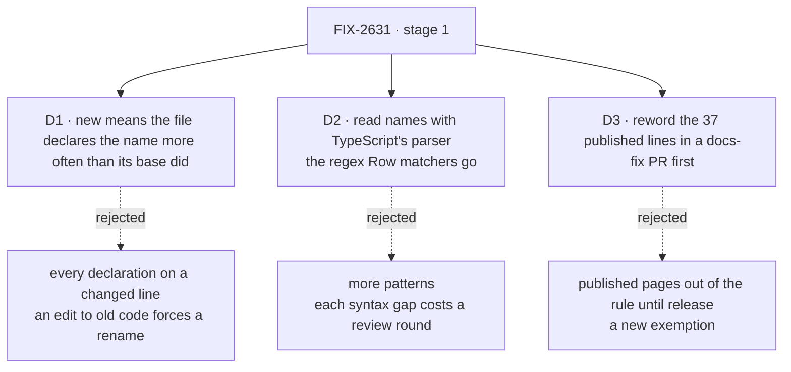

# FIX-2631 · Decisions

[Spec](SPEC.md) · **Decisions**

What was considered, what was chosen, why, and what each choice locks in. The owner's staging
(2026-11-09) is settled input, not reopened here: stage 1 only, the whole-tree type-parameter
and phrase rule, the new-code-only rule for `row` names outside the kept paths, and "entry" or
the resource's own name as the replacement.

## The tree

Solid edges are what you're signing. Dashed edges lost, and the label says why.

## D1 · A name counts as new when a changed file declares it more often than its base version did

| | |
|---|---|
| **Instead of** | Every row-named declaration on a line the diff marks as added |
| **Because** | A diff marks an edited line as added. With 2,169 existing declarations in 539 files, line-based would make every touch of old code a forced rename, which is FIX-2632 pulled forward one edit at a time. Counting per file is the ratchet the export check already runs |
| **Locks in** | Per file, the number of row names can only fall. A change that deletes one `row` and declares another in the same file passes. A file moved with git's rename detection keeps its names; a copy of one does not |

It comes down to editing old code: line-based makes every touched line a forced rename.

**What would change my mind:** FIX-2632 renaming faster than code is edited. Then each clean
package reads every line anyway, and the slack in this rule stops mattering.

## D2 · Names are read with TypeScript's parser, which replaces the regex Row matchers

| | |
|---|---|
| **Instead of** | More regular expressions beside the four Row matchers |
| **Because** | The regex Row matcher took four review rounds on FIX-2479, one per syntax gap: export lists, plurals, an unbounded lookbehind, destructuring, leading comments. Local names add more: parameters, class fields, `for…of`, and a call's type argument that looks like a type parameter. The parser reads them as the compiler does, and tells a declaration from a use. Measured: 3,939 in-scope files in 4.5 s, about 1 ms a file ([census](poc/census/census.mjs)) |
| **Locks in** | The guard needs installed dependencies, so its CI steps move to a job that installs, and a fresh clone runs `pnpm install` before the guard (the hook's `pnpm lint` already needs it). A full run takes a few seconds more |

It comes down to syntax nobody listed: each gap in a pattern cost FIX-2479 a review round.

**What would change my mind:** a parse that costs more than the lint step it runs beside. It
measured 4.5 s for the whole tree, and the added-names reach parses only changed files.

## D3 · The 37 published lines are reworded in a `docs-fix` PR that lands before the guard

| | |
|---|---|
| **Instead of** | Keeping published pages out of the phrase rule until the next `/release-docs` pass |
| **Because** | A normal PR may not edit published pages, and the done-when allows no new exemption. The lines describe released features with the retired word, which is what `docs-fix` is for |
| **Locks in** | The site says "entry" or the resource's name as soon as the `docs-fix` PR merges, before a release note says so. The guard PR waits for one more review |

It comes down to the exemption: waiting for release needs one, and the done-when forbids it.

## Decided, not asked

- **The convergence point is the glossary's resource entry**, read by one guard. Every writer
  passes through `check-retired-terms.mjs`: the pre-push hook, the CI steps, `--control`, and
  the goal check. No second script reads these words.
- **CI's base is `HEAD^1`**, in the export-check job (depth 2, installs), on PRs and on pushes to
  `main`. A base passed with `--added-since` that does not resolve exits 1: CI never skips.
- **The hook's base is the merge base with `origin/main`** (FIX-2571's fix), and the head is
  `HEAD`, not the working tree: the hook checks what is pushed. With no `origin/main` the hook
  says the new-names check was skipped and still runs the whole-tree rules. FIX-2571 is absorbed.
- **A row name** has `row` or `rows` as a word part: `row`, `rows`, `taskRow`, `rowId`, `ROW_ID`;
  not `arrow`, `narrow`, `throw`. **Declarations only**: variables, parameters, destructured
  bindings, function and class names, property signatures and class fields, type parameters.
  A read (`entry.row`) and an object key (`{ row }`) are uses of a name declared elsewhere.
- **Type parameters read the whole tree.** None outside the kept paths on main
  (`8188d793f`), and none added by the five FIX-2471 branches. The issue's "about 4" are not on
  main.
- **The phrases**: `subscription`, `schedule`, `poll`, `task`, `worker` or `project`, with or
  without `'s`, then `row` or `rows`, any case, on every line of every in-scope file: code
  (comments, strings, test names) and pages. 222 lines in 141 files today: 180 in code, 37 on
  published pages, 5 in other docs. The existing "collection row" prose stays pages-only: in code
  it would reach the released messages FIX-2479 D4 keeps.
- **The kept paths keep the phrases too.** 47 lines in store adapters and UI list modules stay;
  some mean a resource, and FIX-2632 renames them with their package. A phrase meaning a
  rendered row outside the kept paths is reworded ("the worker's line on the roster"), never
  exempted.
- **`--control` stays in memory**: plants with a base text given in memory, no git. A separate
  test drives the real git path in a temporary repository.
- **Sequencing against FIX-2471**: the guard PR lands after #4969 to #4973 merge. Measured on
  their branches: #4972 adds 7 phrase lines, and four add new `row` declarations (a rough grep
  finds about 17). If one is still open when the guard is ready, the guard lands and that PR
  renames on rebase.
- **FIX-2632's whole-tree reach per package** is a list of paths FIX-2632 adds to the entry.
  Not built here.

## Considered and dropped

| Alternative | Why not |
|---|---|
| An ESLint rule (`id-denylist`, or one beside `no-tracker-ids`) | Lints whole files. New-code-only needs a baseline of 2,169 entries, a second list beside the glossary, which FIX-2601 made the one source |
| A committed baseline file, ratchet style | A generated file every PR touches and conflicts on. The per-file base comparison is the same ratchet with no file |
| Whole-tree local names now | 2,169 declarations in 539 files. The owner staged it as FIX-2632 |
| Bring back the base-branch fetch step s6 removed | `HEAD^1` at depth 2 already carries the base, as three jobs use it |
| Patterns for type parameters | Can't tell `<TRow>` declared from `foo<TaskRow>()` passed or `<TaskRow />` rendered |

## Settled

- **The parser reads every shape the regex matcher needed rounds for, and no use** —
  **CONFIRMED** by [`poc/census`](poc/census/census.mjs) `--control`: destructuring with rename
  and rest, array patterns, a leading comment, class fields and a private name, a property
  signature, a type parameter, `for…of`, and `throwRow` are read; `arrow`, `narrow`, a property
  read, an object key and a string are not. The premise held; nothing changed.
- **The counts this spec rests on** — re-derived by `poc/census` over every tracked file
  through the guard's own areas (8,655 tracked, 0 unscoped, 3,939 in-scope code files, each
  parsed): 0 Row type parameters, 2,169 row declarations outside the kept paths, 222 phrase
  lines outside them, 47 inside. Whole-tree parse 4.5 s.

## Analysis

2026-11-09 · watermark 2026-11-09 (the owner's staging) · **Right approach.** Run by the
author: this dispatch had no sub-agent tool, so no fresh analyst read the draft. Say so if
that weighs on approval.

1. **Reuse** — both Adds rows compose existing pieces. See [Builds on / Adds](SPEC.md#whats-already-here-and-the-debt).
2. **Prior art** — per-file ratchets (betterer, the repo's export check) and diff-filtered
   linting (reviewdog). D1 takes the first.
3. **Other shapes** — an ESLint rule and a committed baseline; dropped above.
4. **New factors** — FIX-2632, filed today, shapes the per-package note.
5. **Necessity** — earns its place: FIX-2471's 400 uses came in through locals.
6. **Ergonomics** — the refusal names the word to use.
7. **Concerns** — epic ER-6 says the resource rule reads the whole tree; the added-names
   reach amends it in part, and the epic should record that. Open for the epic.

## How it got here

- **Draft** — framed as stage 1 of the owner's staging; one rule, two reaches; the added reach
  is the export check's per-file ratchet against a passed-in base, and names are read with the
  parser.

**Open: none.**
