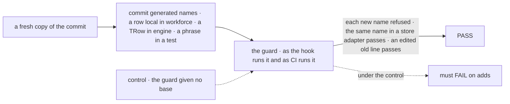
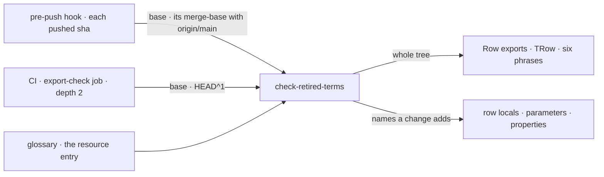

# FIX-2631 · Retire "row" for resource entries beyond what the guard checks

**Spec** · [Decisions](DECISIONS.md)

| Someone who… | Today | After |
|---|---|---|
| **adds `const row = await board.getTask(id)` in Workforce** | Passes. The next reader copies the word | Refused at push and in CI: say `entry`, or the resource's own name |
| **edits an old line that already declares `row`** | Passes | Still passes: the file declares no more row names than before ([D1](DECISIONS.md#d1)) |
| **adds a `row` in a store adapter or a UI list module** | Passes | Still passes: there a row is a row |
| **writes "the subscription row" in a comment, a test name or a contributor doc** | Passes. Only "collection row" is caught, and only on pages | Refused, on any line of the tree |
| **declares a type parameter `TRow`** | Passes | Refused, on any line of the tree |
| **pushes from a clone with no `origin/main`** | n/a | The push says the new-names check was skipped; CI runs it |

FIX-2471's PRs added about 400 such uses before review caught them: people and agents copy the
word from nearby code. This is stage 1 of the owner's staging (2026-11-09). Stage 2,
[FIX-2632](https://linear.app/fixpoint-labs/issue/FIX-2632), renames the existing local names.

## The goal, and how we'll know it's met

**A change that names a resource "row" in new code, or in one of the six phrases anywhere, is
stopped before it merges, while store adapters and UI list modules keep their rows.**

| Is it the right goal? | |
|---|---|
| **The real need** | "New code stops picking up row" (owner's staging on [FIX-2631](https://linear.app/fixpoint-labs/issue/FIX-2631)); epic [FIX-2600](https://linear.app/fixpoint-labs/issue/FIX-2600): one word per thing, enforced by CI |
| **Smaller, and rejected** | "The guard catches `TRow` and the phrases." Every new `row` local still passes, and locals are where FIX-2471's 400 uses were |
| **Bigger, and not this issue's** | "No `row` local anywhere outside the kept paths." 2,170 declarations in 539 files; FIX-2632 owns it, package by package |
| **Not done if** | The rule fires only in the in-memory `--control` and never on a real commit · it fires on an edited old line · CI goes green because the base was missing and the rule skipped · a phrase is cleared by a new exemption |



The check commits real names to a real copy and reads what the guard reports on both paths,
not the in-memory plants alone.

| How we verify | |
|---|---|
| **Goal check** | `goals/vocabulary/resource-names/new-code-says-entry/` · model-free · the implementer at completion · verdict in the implementation PR |
| **Signal** | `open`: the guard on HEAD reports 0 under the resource entry. `adds`: each committed name is reported on both the hook's base and CI's `HEAD^1`, and the run exits 1. `keeps`: the same `row` in a store adapter and in a `components/` file, and an edit to a line that already declares `row`, report nothing |
| **Input** | Names generated at run time, so no list knows them; packages chosen at random from those outside the kept paths. Any other package must fail the same way |
| **Anti-game** | Don't assert on the in-memory plants or a mocked diff: both pass while the git path reads nothing. `adds` floors on the number of names committed |
| **Control that must fail** | `GOAL_CONTROL=no-base`: the guard runs with no base. Must FAIL on `adds`. And `--at` today's `main`: FAIL on `open` (the phrases) and on `adds` |

## What changes


Two reaches of one rule. The top one reads every line; the bottom one reads only what a change
adds, because 2,170 existing declarations stay until FIX-2632 renames them.

**Where the base is passed, the two files a contributor would read:**

```diff
  # .husky/pre-push
  pnpm lint
  node scripts/check-retired-terms.mjs
+ while read -r _ sha _ _; do                       # git passes each pushed ref on stdin
+   [ "$sha" = 0000000000000000000000000000000000000000 ] && continue   # a deletion
+   base=$(git merge-base origin/main "$sha") || continue               # no base: CI checks it
+   node scripts/check-retired-terms.mjs --added-since "$base" --head "$sha"
+ done

  # .github/workflows/ci.yml, export-check job (depth 2, installs)
+ - name: No retired Workforce term
+   run: node scripts/check-retired-terms.mjs --added-since HEAD^1
```

The hook checks each pushed commit, not `HEAD`. Both CI steps move to export-check, which installs.

**Docs:** no reader-facing page changes for the guard. The 37 published lines go through a
`docs-fix` PR ([D3](DECISIONS.md#d3)); the glossary entry and guard header change with the code.

## Where it runs



The glossary owns the words; the guard reads them. The base is passed in, never guessed.

## What stays as it is

- The kept paths, the released quotes FIX-2479 D4 keeps, and the `CollectionItem` and `State` rules.
- `specs/` is history, so the FIX-2471 specs are out of reach.
- Existing local names, until FIX-2632.

## What's already here, and the debt

| Already here | What this does with it |
|---|---|
| `scripts/check-retired-terms.mjs`, the whole-tree guard | **Extends.** One more reach, for names a change adds |
| The glossary's resource entry, `collection-row` | **Extends.** Type parameters, six phrases, and added names; still the one source |
| The four regex Row matchers and their pattern helpers in `glossary.mjs` | **Replaced** by parser reads ([D2](DECISIONS.md#d2)) of at least their names: type aliases, interfaces, enums, classes, functions, variables, export-list and aliased-import names. `--control` plants one per kind and must refuse each |
| `store-adapter-rows`, `ui-list-rows` | **Builds on**, unchanged. They keep the phrases in their files too |
| The export check, `check-root-exports.mjs`: a ratchet against `HEAD^1`, read in place | **Builds on.** The same shape: a change may not add a name; names already there don't fail. Same base, same job |
| `scripts/mechanism-exports.mjs`: `gitReader` (files at a ref), `overlayReader` (planted files), and `typescript` | **Builds on.** The base file is read with `gitReader`; the parser is the same root devDependency |
| Whatever already refuses a retired word in a change | The guard, the one-word-per-thing sweep, the `no-tracker-ids` lint rule. Closest: the guard. No second check |
| FIX-2600 ER-6: the resource rule reads the whole tree | **Amended in part**, local names only, by the owner's staging. Every rule ER-6 covers still reads the whole tree |
| FIX-2479 s6: the added-lines mode and its CI base fetch removed | **Kept.** No base fetch returns; the new reach diffs no working tree and reads no hunks |
| FIX-2571: the hook should diff against the merge base | **Absorbed.** Each pushed sha is checked against its own merge base |

| Adds | Existing piece considered | Why that doesn't fit, or how this is composed from it |
|---|---|---|
| A reach for names a change adds (`--added-since <ref>`) | The export check's ratchet; the removed added-lines mode | Composed from the export check's ratchet: same base, `gitReader` for the base file. Unlike the removed mode it reads no diff hunks, so an edited line is not new ([D1](DECISIONS.md#d1)) |
| Name reading with the parser | The regex matchers; `mechanism-exports.mjs`'s parser use | Composed: the same dependency. Replaces the regex matchers instead of sitting beside them |

| The debt | |
|---|---|
| **Removes** | The four regex Row matchers and their export-list and destructuring helpers |
| **Adds** | A second reach in the guard, for local names, until FIX-2632 turns each package to the whole tree. The guard now needs installed dependencies ([D2](DECISIONS.md#d2)) |
| **Leaves** | 2,170 existing row declarations (FIX-2632). 47 phrase lines in kept paths, some meaning a resource (FIX-2632) |

**Net: flat.** One reach is added and paid down package by package by FIX-2632; the regex
matchers go.

## Sign off

**[The goal](#the-goal-and-how-well-know-its-met), at that size:** new code, not the existing
tree. If wrong: the word keeps teaching itself from the 2,170 old names until FIX-2632 runs.

**[The debt](#whats-already-here-and-the-debt), net flat:** a second reach is added, the regex
matchers go. If wrong: the added-names reach outlives FIX-2632 as a permanent second mode.

1. **[D1](DECISIONS.md#d1) · A name counts as new when a file declares it more often than its
   base did.** If wrong: a contributor swaps one `row` for another and it passes.
2. **[D2](DECISIONS.md#d2) · Names are read with TypeScript's parser, which replaces the regex
   Row matchers.** If wrong: the guard can't run before `pnpm install`, and a push waits ~5 s more.
3. **[D3](DECISIONS.md#d3) · The 37 published lines are reworded in a `docs-fix` PR that lands
   first.** If wrong: the site changes words before a release says so.

**Open: none.** D1 is the one to weigh. Reasons and what lost: [DECISIONS.md](DECISIONS.md).

Improvement · scripts + glossary, ~180 comment and doc lines reworded, 37 published lines via
`docs-fix` · medium · epic [FIX-2600](https://linear.app/fixpoint-labs/issue/FIX-2600)
