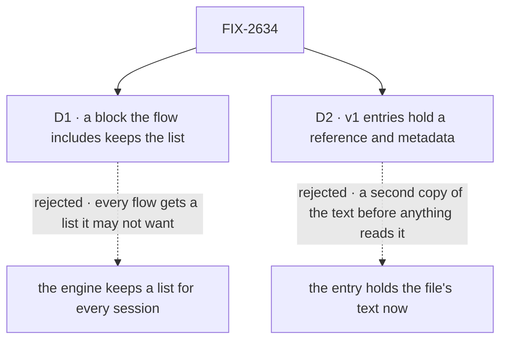

# FIX-2634 · Decisions

[Spec](SPEC.md) · **Decisions**

The epic settled where bytes live ([D2](../../epics/FIX-2516/DECISIONS.md#d2)), the reference
format ([D4](../../epics/FIX-2516/DECISIONS.md#d4)) and that bytes never enter a resource
([ER-2](../../epics/FIX-2516/DECISIONS.md#who-owns-what)). FIX-824 and FIX-2517 settled that the
action route claims a turn's files and that a block reads them from its context. Two calls are
this issue's.

## The tree

Solid edges are what you're signing. Dashed edges lost, and the label says why.

## D1 · A block the flow includes keeps the session's list of files; the engine keeps claiming

| | |
|---|---|
| **Instead of** | The engine writing the list for every session, from the claim in the action route |
| **Because** | The owner's framing: the block is where a flow decides what to do with a turn's files, and the list is the first of those decisions. A block's resources bubble into the flow that includes it (`state-and-scopes.md` → Resource Declaration Bubbling), so the flow writes one line. An engine-written list would put a collection in every flow, wanted or not, and the next decision (a summary, what history carries) would need a flow option anyway (tenet 2: one primitive, a block, covers it) |
| **Locks in** | `recordAttachments` in `@flow-state-dev/core/attachments`, and the session collection `attachments` (pattern `attachments/*`, keyed by blob id), both public names. A flow without the block has no list; its files are still claimed, on the user line, sent to the model and deleted with the session. The block never claims: an unclaimed upload expires after a day, so claiming can't depend on a flow remembering a block |

It comes down to who decides: an engine-written list gives every flow one it didn't ask for.

**What would change my mind:** every flow we ship including the block. Then the engine should
keep the list and the block should go.

## D2 · v1 entries hold the reference and metadata; text, summaries and what history carries are FIX-2636

| | |
|---|---|
| **Instead of** | The entry's content holding the file's text now: a text file's text, a PDF's extracted text (the issue's first sketch) |
| **Because** | Nothing in v1 would read it. The readers are the history build choosing per file and the model fetching on request, and both are [FIX-2636](https://linear.app/fixpoint-labs/issue/FIX-2636). Copying the text now puts a second copy beside the blob store's (FIX-2520 D1), needs a new way for a block to read a file's text through the one resolver (ER-1), and amends ER-2, all before the first reader exists |
| **Locks in** | An entry's state: the `fsd-blob:` reference, file name, media type, the request that sent it, and when. No content, no size. A person in a chat sees no change until FIX-2636: older documents are still named, not re-sent, past FIX-2517 D1's window |

It comes down to the reader: with no v1 reader, the text is a second copy for nothing.

**What would change my mind:** wanting the model to read an older document in this epic. Then
FIX-2636's tool half moves here, and the text comes with it.

## Decided, not asked

- **The block only records, after the claim.** It reads the turn's claimed attachments from its
  context (FIX-2517) and writes one entry each. A turn with no files writes nothing. It is a
  `.tap` (BP-012): its output is the input it was given.
- **The convergence point is the block.** It is the one writer; the collection refuses block
  writes to an existing entry (`writable: false`), so a model's `resourceTools` or another block
  can't edit or delete an entry. A retried turn finds the key and writes nothing, so no file is
  listed twice. FIX-2636 flips `writable` when a summary is written.
- **Readable by the app, not the model, in v1.** `client.state.read: true`; `llmReadable` stays
  off until FIX-2636 gives the model a reason to read it.
- **No size on an entry.** `FileContent` has no size, and the one shape (ER-1, epic D4) gets no
  second. A reader that needs it asks the blob store, when FIX-2636 adds a read.
- **Deletion is the session's.** Entries are session resource state, so `handleDeleteSession`
  and `purgeStaleResourceState` take them with the blobs. No delete path of its own.
- **Session scope, not lineage.** A background child session has its own turns and its own list.
- **Only the session's files.** A task's files are claimed into the board's scope (ER-7) and
  never enter this list.
- **No app includes it in this epic.** No app shows a file list or reads one yet; adding it is
  one line when FIX-2636 or an app needs it. The closure's *builds a flow on FSD* journey
  includes it and reads the list after its restart (FIX-2565).
- **Glossary:** no entry. *Attachment* is not a glossary term, and the block coins no new one.

## Considered and dropped

| Alternative | Why not |
|---|---|
| A capability, `uses: [attachmentsCap]` | A capability adds context and tools to a generator; it doesn't run once per turn. FIX-2636 may add one for the model's read |
| The list as a query over the user lines' file parts | No new storage, but no room for a summary, and a page-at-a-time read of the whole conversation |
| The block claims the turn's files | A flow without it would lose its files after a day; claiming stays where every flow passes |
| Bytes in the entry, as FIX-367 proposes | ER-2. A reference reaches the bytes through the read route's session check |

## Settled

- **No POC.** The premises are shipped behaviour: block resources bubble into the flow
  (`state-and-scopes.md`), `writable: false` leaves a new key's `create` open
  (`resource-collection.ts`), and collection reads are client routes today.
- **No counted facts, so no checker.** The spec rests on no enumeration.

## Analysis

2026-11-09 · watermark 57bbd786 (the spec set merged, #4941) · **Right approach, with one
change.** Run by the author, not a fresh sub-agent: this worker has no sub-agent dispatch. A
reviewer should weigh it as such.

1. **Reuse** — `handler`, `defineResourceCollection`, block-resource bubbling, the session
   cascade and the client list route are all reused; the only new pieces are the block, its
   collection and a subpath. Verdict per Adds row: genuinely new, composed.
2. **Prior art** — Claude.ai projects keep a list of files beside the conversations, and the
   model reads from it on request. Confirms a list separate from the transcript.
3. **Other shapes** — engine-kept list (D1), a query over user lines, a capability: in the tree
   and *considered and dropped*.
4. **New factors** — the owner moved this issue into the epic on Nov 9; FIX-2636 filed.
5. **Necessity** — a list with no reader is the risk. **Changed:** the text and history half went
   to FIX-2636, filed as this list's reader, and the debt row names removal if it is never built.
6. **Ergonomics** — one `.tap` line; one hook to read.
7. **Concerns** — two records of a session's files that could drift; one writer and the same
   claimed references keep them equal.

## How it got here

- **Draft (Nov 9)** — a session list of the turn's claimed files, kept by a block a flow includes
  (the owner's framing); claiming stays in the action route; text, summaries and history choice
  split to FIX-2636. Built on FIX-824's references and FIX-2517's block context. The same PR adds
  FIX-2634 to the epic and corrects FIX-2517 D1's line on upload-once.

**Open: none.**
