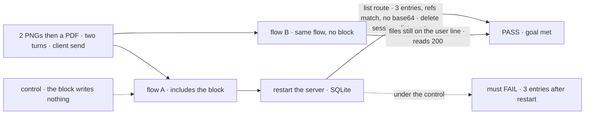
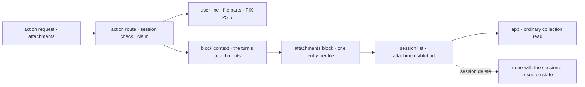

# FIX-2634 · Attachments block: a flow includes it to decide what to do with a turn's files, starting with a session list of uploads

**Spec** · [Decisions](DECISIONS.md)

## Five people, before and after

| Someone who… | Today (after FIX-824 and FIX-2517) | After |
|---|---|---|
| **builds a flow and wants the files a session was sent** | Walks every user line's file parts, paging back through the whole conversation | Includes one block; the session gets an `attachments` list, one entry per file, with no other wiring |
| **builds an app that shows "files in this chat"** | Has nothing to list | Reads the list like any resource list: name, type, reference, the turn that sent it |
| **sends three files over two turns, then reloads or restarts the server** | The files show on their lines | The same, and the list still holds three entries, references only, no bytes |
| **deletes the session** | The files go with it (FIX-824) | The list goes in the same step |
| **runs a flow that doesn't include the block** | Files are claimed, shown, sent to the model | Unchanged: claiming stays in the action route ([D1](DECISIONS.md#d1)) |

This is the start of the owner's idea: a block where a flow decides what to do with a turn's
files. v1 is the list. What a model call carries per file, and the model reading an older file on
request, are [FIX-2636](https://linear.app/fixpoint-labs/issue/FIX-2636) ([D2](DECISIONS.md#d2)).

## The goal, and how we'll know it's met

**A flow that includes the attachments block gets, with no other wiring, a list of every file
its session's turns sent: one entry per file with its reference, name, media type and turn, read
by the app like any resource list, kept through a reload and a restart, holding no bytes, and
deleted with the session.**

| Is it the right goal? | |
|---|---|
| **The real need** | The owner: "a block that we can include … It allows us to decide what to do with an attachment, and including it into the session is part of it." A session list with room to grow |
| **Smaller, and rejected** | "The block writes an entry." Passes on memory stores and through the block's own handle, where a restart or a wrong scope is never seen |
| **Bigger, and not this issue's** | Text and summaries on an entry; history choosing per file; the model fetching a file on request. [FIX-2636](https://linear.app/fixpoint-labs/issue/FIX-2636) |
| **Not done if** | The flow needs a line besides including the block · an entry is lost after a restart · an entry holds base64 · a deleted session leaves entries · a retried turn lists a file twice · a flow without the block loses its files |



The check reads the list through the client's collection route after a real restart, not the
block's handle.

| How we verify | |
|---|---|
| **Goal check** | `goals/attachments/session-file-list/` · model-free · the implementer at completion · verdict in the implementation PR |
| **Signal** | After the restart, flow A's `attachments` list holds 3 entries whose references equal the 3 sent, with the right names, types and request ids, under 5 KB and no base64 run over 1 KB. Flow B builds with no `attachments` resource and its 3 file reads return 200. After a session delete, flow A's list is empty and each read is 404 |
| **Input** | Fresh random PNGs and a small PDF per run, through FIX-824's upload route |
| **Anti-game** | Read through `@flow-state-dev/client`'s collection list, never the block's handle or the store |
| **Control that must fail** | `GOAL_CONTROL=skip-record` (the block writes nothing): FAIL on *3 entries after restart*. Today's `main` fails at upload |

## What changes


Read the right column top to bottom: one turn's files, from the claim to the list an app reads.

**A flow author, and an app:**

```diff
+ import { recordAttachments } from "@flow-state-dev/core/attachments";

  const chat = sequencer({ name: "chat", inputSchema })
+   .tap(recordAttachments)        // declares the session's `attachments` list; nothing else to wire
    .step(assistant);

  // an app that shows the session's files
+ const { items } = useResourceCollectionList(session, "attachments");
```

**Docs:** a *Keep a list of a session's files* section in the guide page FIX-2517 publishes, *A
user turn can carry files*, and the `@flow-state-dev/core/attachments` subpath in the core
README. No other page changes.

## How a turn's files reach the list



The block only records. The claim, the limits and the user line happen before it runs, so a flow
without it loses nothing.

## What stays as it is

- Claiming, the limits check and the user line: FIX-824 and FIX-2517, in the action route.
- What a model call carries: FIX-2517 D1, unchanged until FIX-2636.
- `FileContent`'s published shape ([epic D4](../../epics/FIX-2516/DECISIONS.md#d4)); no bytes in a resource ([ER-2](../../epics/FIX-2516/DECISIONS.md#who-owns-what)).
- No app includes the block in this epic; the closure's *builds a flow on FSD* journey does.

## What's already here, and the debt

The job is *keep a record of the files a session was sent*. This would be the **second** way:
the first is the user line's file parts (FIX-2517), a conversation read a page at a time, not a
list. It is built from the mechanism list's `collection` row. Searched `attachments`,
`FileContent`, `fsd-blob` across `packages/*/src`: no third.

| Already here | What this does with it |
|---|---|
| The user line's file parts (FIX-2517) | **Leaves** them the conversation's record; the list is an index beside them, built from the same claimed references |
| The claim in the action route ([FIX-824](../FIX-824/DECISIONS.md#decided-not-asked), [FIX-2517](../FIX-2517/DECISIONS.md#decided-not-asked)) | **Kept**: the block never claims |
| Block-declared resources that bubble into the flow (`docs/architecture/state-and-scopes.md` → Resource Declaration Bubbling) | **Builds on**: the block declares the list; including it installs it |
| `defineResourceCollection`'s `writable`, `client.state.read`, session scope | **Reuses**, no new option |
| The session delete's cascade (`handleDeleteSession`, `purgeStaleResourceState`) | **Reuses**: entries are session resource state |
| [FIX-367](https://linear.app/fixpoint-labs/issue/FIX-367), binary content in `ContentStore` | **Not needed here, stays open.** An entry holds a reference, not bytes; FIX-367's case can use one the same way |
| The issue's first sketch: the entry's content is the file's text | **Deferred** to FIX-2636 ([D2](DECISIONS.md#d2)) |

| Adds | Existing piece considered | Why it doesn't fit / how composed |
|---|---|---|
| `recordAttachments`, a handler block | Writing the list from the engine's claim | Composed from `handler` and a collection; a flow opts in ([D1](DECISIONS.md#d1)) |
| The `attachments` session collection | The user line's file parts | One read however long the conversation, and room for a summary later |
| `@flow-state-dev/core/attachments` | `contracts/attachments` (FIX-824) | Contracts has no blocks; the subpath keeps core's root unchanged |

| The debt | |
|---|---|
| **Removes** | Nothing |
| **Adds** | A second record of a session's files beside the user line. Accepted: the list is the index FIX-2636 reads; if FIX-2636 is not built, it is the debt to remove |
| **Leaves** | No app shows the list; no model reads it until [FIX-2636](https://linear.app/fixpoint-labs/issue/FIX-2636) |

**Net: up, a little.** One block, one collection, one subpath.

## Sign off

**[The goal](#the-goal-and-how-well-know-its-met), at that size:** a session list a flow gets by
including one block, kept through a restart, references only. If wrong: a block nothing reads,
or one that loses entries.

**[The debt](#whats-already-here-and-the-debt), net up a little:** a second record of a
session's files. If wrong: two records that drift.

1. **[D1](DECISIONS.md#d1) · A block the flow includes keeps the list; the engine keeps
   claiming.** If wrong: flows that want a list have to remember a line.
2. **[D2](DECISIONS.md#d2) · v1 entries hold the reference and metadata; text, summaries and
   history choice are FIX-2636.** If wrong: no person sees a change until FIX-2636 lands.

**Open: none.**

Feature · `core` · small · epic FIX-2516 · blocked by FIX-824, FIX-2517 · blocks FIX-2565
