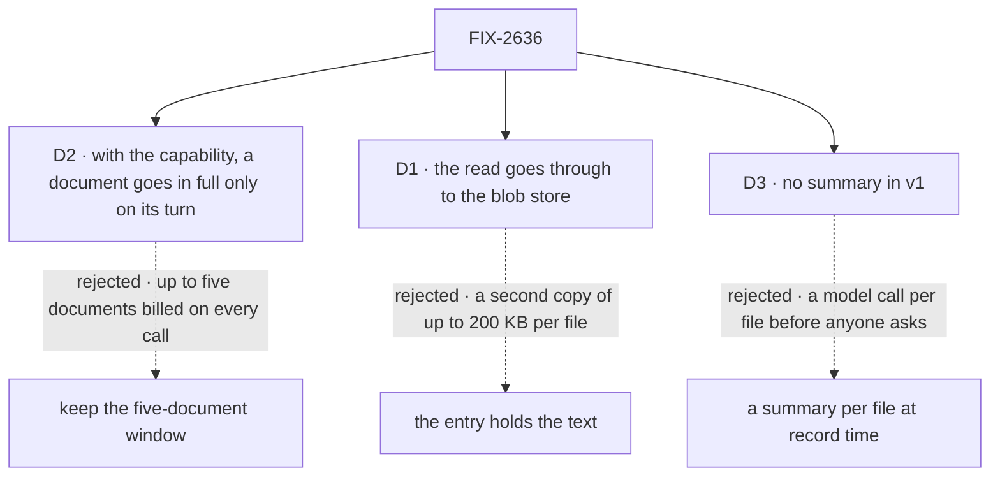

# FIX-2636 · Decisions

[Spec](SPEC.md) · **Decisions**

The epic settled where bytes live ([D2](../../epics/FIX-2516/DECISIONS.md#d2)) and the one
resolver ([ER-1](../../epics/FIX-2516/DECISIONS.md#who-owns-what)). FIX-2517 D1 set the window,
FIX-2520 D1 stored a PDF's text in the blob store, and FIX-2634 D2 left the entry's text, the
history choice and the model's read to this issue. Three calls are this issue's.

## The tree

Solid edges are what you're signing. Dashed edges lost, and the label says why.

## D2 · With the capability, an earlier document goes in full only on the turn it was sent or read; without it, FIX-2517 D1 holds

| | |
|---|---|
| **Instead of** | Keeping FIX-2517 D1's window (newest 5 documents re-sent each call) with the read tool added beside it |
| **Because** | The issue's second outcome: five 50k-token documents ride every call. Once the model can read on request, re-sending is the cost with nothing left to buy. A flow with no read tool keeps the window, because naming a file it can't read would take away what FIX-2517 D1 gave (tenet 2: the capability, not a flag, switches the rule) |
| **Locks in** | One `ItemQuery` key, `earlierDocuments`, `"window"` or `"named"` (default `"window"`, FIX-2517 D1's rule; the capability's `history` preset sets `"named"`). An earlier turn's document becomes one line naming it and its id, and pointing at `readAttachment`. A document read in a turn is resolved in full for that turn's tool loop and named after it. Images keep the window either way |

It comes down to the per-call bill: the window pays for five documents on every call, asked about or not.

**What would change my mind:** transcripts where most follow-ups re-ask about the last document.
Then keep the newest one in full, a one-number change to the same key.

## D1 · The model's read goes through the one resolver to the blob store; no entry holds text

| | |
|---|---|
| **Instead of** | The entry's content holding the text (a text file's text, a PDF's extracted text), read with `resourceTools` |
| **Because** | The text is already stored once, in the blob store, deleted with its file and guarded by the session check (FIX-2520 D1, ER-3). A second copy in resource content is up to 200 KB per file, a second delete path, and an ER-2 that lets file text into a resource. The harness reader seam already returns a file's text for the request's conversation |
| **Locks in** | `readAttachment({ id } or { name })`, a tool whose recorded output is the file's `fsd-blob:` reference and name, never its text (BP-042). The model call resolves it through `readAttachmentText`, as it resolves a user line's file. ER-2 is amended as `SPEC.md` proposes |

It comes down to copies: the entry option stores up to 200 KB again for a read the blob store already serves.

**What would change my mind:** a need to search across a session's files. Then an index belongs
in the blob store's side, not the entry.

## D3 · No per-file summary in v1

| | |
|---|---|
| **Instead of** | A model-written summary per document, at record time or when the document first leaves its turn |
| **Because** | The model already sees what a file is: its name in the line and the list, the person's words on the turn that sent it, and the assistant's own answer about it, which stays in history. A summary costs a model call per file before anyone asks, and FIX-2517 dropped a model-written description for the same reason |
| **Locks in** | Entries stay as FIX-2634 shaped them; `writable: false` does not flip. A flow that wants summaries adds a field and a step later; nothing here blocks it |

It comes down to the per-file model call: paid on every upload, for a choice the name usually makes.

**What would change my mind:** real chats where the model fails to read a file it needed
because the name gave no hint.

## Decided, not asked

- **The capability's three parts.** The `readAttachment` tool, a context entry listing the
  session's files from FIX-2634's list (name, type, id, turn; newest first, capped, with a count
  of the rest and a line saying an older one is read by name), and the `history` preset. It declares the `attachments` collection, so it
  installs it; `recordAttachments` stays the one writer. Same two-halves shape as
  `historySummary` (a capability and a step).
- **The read is scoped by the resolver, not the list.** The tool takes the id from the line or
  the list, or a name matched within the session's list, and reads through the request's seam, bound to the session and the person (ER-3). A
  file not this conversation's answers "not in this conversation"; the id is never a key
  (BP-031).
- **A file outside both windows is read by name.** When a document's turn has left the history
  window and newer files have pushed it off the capped list, the model has no id to pass, and
  the person names the file ("the Q3 PDF"). `readAttachment({ name })` matches the name,
  case-insensitively, against this session's whole `attachments` list (not the capped view in context) and nothing else, then reads the match through the same
  seam. One match reads it; several return their names, ids and turns, capped, without text;
  none answers "no file by that name". Instead of a second, paging list tool: the model would
  page through the list to find a file the person already named. *What would change my mind:*
  people asking for an older file by what it holds, not its name; then the list pages.
- **The convergence point is `history-files.ts`.** `budgetHistoryFiles` makes every per-file
  choice, user lines and read results alike; `resolveHistoryFiles` is the one place a reference
  becomes text. No other writer.
- **Premise for the implementer to prove first.** Every step of a tool loop passes through
  `prepareMessages` (`core/src/models/prepared-model.ts`), so a tool result holding a reference
  can be resolved there. Write that red test before anything else; if it fails, stop and raise
  it on the spec, because D1's *Locks in* rests on it.
- **Documents only.** An image id answers that images are not read on request.
- **Caps hold.** A read over the 200 KB cap is the tool's error, not a failed turn.
- **The seam's internal symbol** drops *harness*; public harness names stay.
- **Glossary:** no entry. *Attachment* is not a glossary term, and nothing coined here is.

## Considered and dropped

| Alternative | Why not |
|---|---|
| The tool returns the text via `mapModelOutput` | The mapped string is persisted on the `tool_output` item: 200 KB per read in the log (BP-042) |
| The new history rule for every flow | A flow with no read tool would lose FIX-2517 D1's re-send and gain nothing |
| A smaller window (newest one or two documents) | Still billed on calls that don't ask about them; kept as the *what would change my mind* of D2 |
| `resourceTools` over the entry | Needs the text in the entry (D1) |

## Settled

- **No POC.** The premises are shipped code (per-call `prepareMessages`, the seam's `text()`,
  the `history` preset); the one unproved step is the implementer's first test, above.
- **No counted facts, so no checker.** The spec rests on no enumeration.

## Analysis

2026-11-11 · watermark 73dba89e · **Right approach.** Run by the author, not a fresh
sub-agent: this worker has no sub-agent dispatch. Weigh it as such.

1. **Reuse** — seam, `readAttachmentText`, `resolveHistoryFiles`, the `history` preset and
   FIX-2634's list reused; each Adds row composed, none a second mechanism. Searched
   `readAttachment`, `prepareMessages`, `resolveAttachment`, `HARNESS_ATTACHMENT_SEAM`,
   `resourceTools` across `packages/*/src`.
2. **Prior art** — Claude.ai projects and ChatGPT keep files beside the chat and read on request.
3. **Other shapes** — in the tree and *considered and dropped*.
4. **New factors** — #5039 put PDF text in the blob store, which makes D1 cheap.
5. **Necessity** — both outcomes are the issue's; FIX-2634's list had no reader without this.
6. **Ergonomics** — one `uses` entry beside FIX-2634's `.tap`.
7. **Concerns** — a follow-up re-reads (D2's price); prompt caching no longer covers it.

## How it got here

- **Draft (Nov 11)** — the model reads an earlier document through the one resolver; a capability
  installs the tool, the file list in context and a narrower history rule; text stays in the
  blob store; no summaries. Built on FIX-2517's history build, FIX-2520's stored PDF text,
  FIX-2519's reader seam and FIX-2634's list.
- **Review round 1 (Nov 11)** — `readAttachment` also takes a file's name, and the goal check
  reads a document outside both the history window and the capped list, because Codex showed
  such a document had no id the model could find.

## Notes from review

Below the bar; for the implementer, not the design.

- **Cursor (round 1), per-request cache:** "If every tool-loop step hits `prepareMessages`,
  resolving the same `fsd-blob:` reference multiple times in one turn could mean repeat blob
  reads. Worth a one-line implementer note here or in the implementation PR: per-request (or
  per-pass) cache unless re-read is intentional."

**Open: none.**
