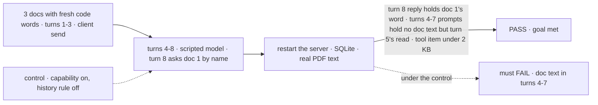
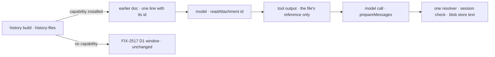

# FIX-2636 · Attachments: the model reads an older file on request, and history stops re-sending every recent document

**Spec** · [Decisions](DECISIONS.md)

## Five people, before and after

| Someone who… | Today (after FIX-2517, FIX-2520, FIX-2634) | After, in a flow that installs the attachments capability |
|---|---|---|
| **asks about a PDF they sent eight turns ago** | The model sees `[document: q3.pdf, not re-sent]` and asks them to attach it again | The model reads it on request, through the same session check, and answers |
| **chats for an hour with five 40-page documents attached early on** | All five documents' text goes with every call, up to ~250k tokens each time | Each document goes in full on the turn it was sent or read; later calls name it in one line |
| **asks about a document whose turn left the history window** | The model has no trace of it | The capability's context lists the session's newest files; one older than the list the model reads by its name |
| **builds a flow and wants this** | Nothing to install | Includes `recordAttachments` (FIX-2634) and adds `attachmentsCapability` to the answering generator |
| **runs a flow without the capability** | FIX-2517 D1: the newest 5 documents and 10 images re-sent | Unchanged, byte for byte ([D2](DECISIONS.md#d2)) |

## The goal, and how we'll know it's met

**In a flow that installs the attachments capability, a person can ask about any document their
session was sent, however many turns back, and the model reads it on request through the one
resolver and answers from it; and no call carries an earlier turn's document text unless the
model read it in that turn.**

| Is it the right goal? | |
|---|---|
| **The real need** | The issue: "the model reads it on request instead of asking for it again", and "does not re-send every recent document's full text on every call" |
| **Smaller, and rejected** | "A read tool exists." Passes with history still re-sending five documents, and with a tool the model can't find a file for once its turn has left the window |
| **Bigger, and not this issue's** | Reading an older *image* on request (FIX-2517 D1's ten-image window stays); a per-file summary ([D3](DECISIONS.md#d3)); a flow-chosen window size |
| **Not done if** | A recorded item or resource holds the text · a read crosses sessions · a flow without the capability changes · the read is lost after a restart · a document outside both the history window and the file list can't be read · an earlier document is re-sent on a later call |



The check reads the prompts the provider was sent and the stored items, not the tool's handle.

| How we verify | |
|---|---|
| **Goal check** | `goals/attachments/read-on-request/` · model-free, a scripted model: turn 5 reads doc 2 by the id the history line names; turn 8 reads doc 1 by the name the person uses, after turn 1 has left the history window (`limit: { turns: 3 }`) and turns 2–3 sent more small files than the list's cap · the implementer at completion · verdict in the implementation PR |
| **Signal** | Turn 8's model input holds doc 1's code word in the tool result, while its history and its file list name doc 1 nowhere; turn 5's holds doc 2's; turns 4–7's inputs hold no word outside turn 5's tool result; every stored `tool_output` and the `attachments` list are under 2 KB with no word; a read naming another session's file returns "not in this conversation". Flow B, same flow without the capability: turn 4's input holds all three words (FIX-2517 D1 kept) |
| **Input** | A fresh random code word per run, inside a `.md`, a `.csv` and a PDF built per run, through the upload route |
| **Anti-game** | Read the prompts at the provider seam (the scripted model's received messages) and the items through `@flow-state-dev/client`, never the block or the store |
| **Control that must fail** | `GOAL_CONTROL=resend` (the capability installed, its history rule off): FAIL on *no doc text in turns 4–7*. `GOAL_CONTROL=name-only` (the tool returns the name, not the text): FAIL on *turn 8 holds doc 1's word*. `GOAL_CONTROL=id-only` (the tool refuses a name): FAIL on the same signal, because doc 1 is in neither window |

## What changes


Read the right column top to bottom: an earlier document, from a one-line name to the text the model asked for.

**A flow author:**

```diff
- import { recordAttachments } from "@flow-state-dev/core/attachments";
+ import { recordAttachments, attachmentsCapability } from "@flow-state-dev/core/attachments";

  const assistant = generator({
    name: "assistant",
    model: "openai/gpt-6-luna",
    history: true,
+   uses: [attachmentsCapability],   // the read tool, the file list in context, and the history rule
  });

  const chat = sequencer({ name: "chat", inputSchema })
    .tap(recordAttachments)
    .step(assistant);
```

**Docs:** a *Let the model read an earlier file* section in the guide page FIX-2517 publishes,
*A user turn can carry files*, beside FIX-2634's list section; the `attachmentsCapability` and
`readAttachment` entries in the core README's `@flow-state-dev/core/attachments` subpath; the
new `ItemQuery` key on the session-items reference page. No new page.

## How a call carries an earlier document



The per-file choice stays in `history-files.ts`, where it is made today. The text exists only
in the call to the provider.

## What stays as it is

The current turn's files go in full; images keep FIX-2517 D1's window; FIX-2634's entry shape,
the 200 KB text cap and `pdf_text_too_large` are unchanged.

## What's already here, and the debt

The job is *give the model a file's content*. Mechanism rows: `resource-tools` (reads a
resource's content) and `capability`. Today there are **two** ways: the history build's file
parts (FIX-2517) and a harness's turn files (`readHarnessTurnFiles`, FIX-2519). The read tool is
the **third**, and it is built on both: the history build's resolution and the harness's reader.

| Already here | What this does with it |
|---|---|
| [FIX-2517 D1](../FIX-2517/DECISIONS.md#d1), the newest-files window | **Kept** as the default; a flow with the capability opts into a narrower rule ([D2](DECISIONS.md#d2)) |
| [FIX-2520 D1](../FIX-2520/DECISIONS.md#d1), PDF text stored beside the PDF | **Builds on**: the read returns it; no second copy ([D1](DECISIONS.md#d1)) |
| [FIX-2634 D2](../FIX-2634/DECISIONS.md#d2) and its *Decided, not asked* | **Amends in part**: the entry stays reference-only, `writable` does not flip, `llmReadable` stays off; the capability's context reads the list |
| [Epic ER-2](../../epics/FIX-2516/DECISIONS.md#who-owns-what) | **Proposes an amendment** (below); the epic's owner applies it |
| `historySummary` (FIX-1613), a capability whose `history` preset narrows reads | **Same shape** |
| The harness reader seam (`core/internal`) | **Reuses** for the read |

**Proposed ER-2 amendment** (the epic's owner applies it; this spec does not edit epic files):
replace "text taken from a file is FIX-2636's call" with "Text taken from a file stays in the
blob store beside it and is read through the one resolver; no resource, item or request holds
it."

| Adds | Existing piece considered | Why it doesn't fit / how composed |
|---|---|---|
| `attachmentsCapability` | `historySummary`'s capability; `resourceTools` | Composed from `defineCapability`: a tool, a context entry, a `history` preset |
| `readAttachment`, a tool block taking an id or a name | `readHarnessTurnFiles`; a second, paging list tool | Reads through the same seam and `readAttachmentText`; returns a reference, not text. A name reaches a file the capped list dropped, without a second tool ([Decided, not asked](DECISIONS.md#decided-not-asked)) |
| One `ItemQuery` key, `earlierDocuments` | A generator option | A query key is what a capability's `history` preset can set; read in `budgetHistoryFiles` |
| Tool-result references resolved in `resolveHistoryFiles` | `mapModelOutput` | A mapped string is persisted on the item (BP-042); a reference is not |

| The debt | |
|---|---|
| **Removes** | FIX-2634's planned `writable` flip and its "list with no reader" debt row: the capability reads it |
| **Adds** | A third way to give the model a file's content, composed from the other two. A second history rule for documents, chosen per generator. Permanent by design: a flow without a read tool must keep the window |
| **Leaves** | Reading an older image on request; per-file summaries ([D3](DECISIONS.md#d3)) |

**Net: up, a little.** One capability, one tool, one query key; one debt row paid.

## Sign off

**[The goal](#the-goal-and-how-well-know-its-met), at that size:** any earlier document read on
request, and no earlier document text re-sent, in a flow with the capability. If wrong: a tool
the model can't find files for, or history that still pays for five documents.

**[The debt](#whats-already-here-and-the-debt), net up a little:** a third reader, built on the
other two; FIX-2634's orphan list gets its reader. If wrong: two document rules in history that
drift.

1. **[D2](DECISIONS.md#d2) · With the capability, an earlier document goes in full only on the
   turn it was sent or read; without it, FIX-2517 D1 holds.** If wrong: a follow-up question
   costs a tool call and the text again. *The one to weigh.*
2. **[D1](DECISIONS.md#d1) · The model's read goes through to the blob store; no entry holds
   text.** If wrong: no grep across a session's files.
3. **[D3](DECISIONS.md#d3) · No per-file summary in v1.** If wrong: the model reads a file
   it didn't need, or misses one it did.

**Open: none.**

Feature · `core`, `engine` · medium · follows FIX-2634 · related FIX-2517, FIX-2520, FIX-2174 · outside epic FIX-2516
