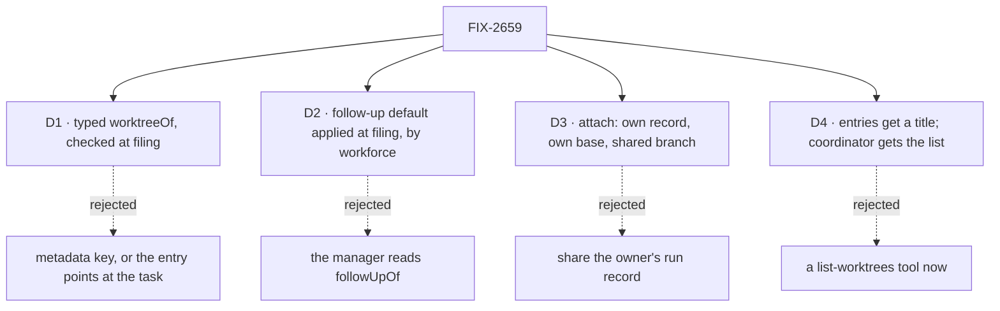

# FIX-2659 · Decisions

[Spec](SPEC.md) · **Decisions**

Architect settled the shape on the issue: the filer chooses, `createTask` carries a typed
field, the harness manager carries it out, no new tool. Jake settled the default: a follow-up
joins its root's worktree on its own. What is left is how each piece honours that.

## D1 · A typed `worktreeOf` on the task, checked when it is filed

| | Typed task field (chosen) | Metadata key | The entry names the task |
|---|---|---|---|
| Who can change it | Nobody after filing | The model, through `updateTask` | The host, at provision |
| Where the choice is made | The filer | The filer | Nowhere: provision already happened |
| Same shape as | `followUpOf`, `session`, `target` | n/a | n/a |

- **Because:** the choice drives where code is written, so it can't sit where a model can patch
  it (`patchMetadata` is model-reachable, BP-031). The entry already points back through
  `owner` and `attached[]`.
- **Value:** a task id, not a worktree key. The filer knows tasks; the manager derives the
  place from the task's identity, never from the entry (the entry is checked, not trusted).
- **Checked in workforce, at filing:** the named task is on the same board and partition, it is
  finished, and the user's worktree list holds a `ready` entry owned by `{ kind: "run", id }` for
  it (or for its owner, one hop). Refused by rule name otherwise
  (`worktree_of_unknown`, `worktree_of_open`, `worktree_of_missing`). Orchestration holds the
  field; it doesn't know what a worktree is. Workforce owns the filer check and the follow-up
  default ([D2](#d2)).
- **Locks in:** `Task.worktreeOf`, `TaskInit.worktreeOf`, the `createTask` tool's input.

## D2 · The follow-up default is applied at filing, by workforce; the manager only attaches

- **Jake's call:** a `followUpOf` task joins its root's worktree automatically. The coordinator
  only names `worktreeOf` for unrelated work.
- **Where:** workforce's filing path, the same place that checks an explicit `worktreeOf`
  ([D1](#d1)). When a follow-up is filed and its root (one hop, as `followUpOf` already
  resolves) owns a `ready` worktree entry for this user, workforce writes `worktreeOf: <root>`
  onto the follow-up. A root with no entry (a chat task, a files-only run) gets nothing written,
  so the follow-up provisions as today, and orchestration's generic follow-up placement never
  learns about worktrees. A filer can't name a different one on a follow-up
  (`follow_up_takes_no_worktree`, workforce's rule).
- **The manager is mechanism:** it reads `task.worktreeOf` and nothing else. Attach if told,
  provision otherwise. It never reads `followUpOf` to choose a place. This keeps the manager on
  the mechanism side of the split FIX-2583 is making (PR lifecycle opinions move out of the
  manager into the coding flow), rather than adding a policy there while that work pulls
  policy out.
- **Rejected, the manager reads `worktreeOf ?? followUpOf`:** one reader and no drift, but it
  is a placement policy inside the harness manager, the direction FIX-2583 reverses
  (Architect, on the spec PR).
- **Rejected, stamping in orchestration's follow-up placement:** it would write a coding fact
  onto every follow-up, chat ones included, and orchestration would need to know what a
  worktree is.
- **Locks in:** a follow-up of a coding task carries its root as `worktreeOf` from the moment
  it is filed. If the root's worktree is removed or lost before the follow-up runs, the run
  refuses by name rather than silently starting over. When FIX-2583's coding flow exists, this
  default is one of the editable defaults it can carry; the manager is unaffected by that move.

## D3 · An attached run keeps its own record and base, and shares the branch

- **Own record:** the run's topic is still its own task's, so its session id, verdict, review
  and pull-request requests stay its own. It records the owner's path and branch, plus
  `attachedTo: <owner task id>`, which the card reads.
- **Own base:** the branch head when the run first opened, pinned on its record so a retry
  keeps it. Its commit count, review diff and judge see its own work, as a session attach's
  turn base does (FIX-2419 D2). Remote and `baseRef` are the owner's, so landing targets the
  same base branch.
- **Shared branch:** accepting lands the branch as it stands, owner's commits included. The
  owner's PR is already open, so FIX-2658's check returns it and pushes the new commits there.
- **Safety, all existing:** the checkout lease is keyed on the path, so turns never overlap;
  `host.attach` adds the run to `attached[]` once and refuses an entry that isn't the user's;
  only the owner removes; a turn that ends on another branch fails the attempt, with the
  message session attach uses.
- **Rejected, sharing the owner's record:** two tasks' verdicts, reviews and request lists
  would overwrite each other.
- **Locks in:** `attachedTo` on the run record; the attached base rule.

## D4 · Entries carry a title; the coordinator reads the list it already could

- **`title`** on the worktree entry, written at provision from the task's title or the session's.
  FIX-2657 already names board-run entries readably; the owner already carries the task id.
- **A `worktrees` capability** in the workspace package declares the resource and one context
  line. Resources live on blocks (CLAUDE.md), so the coordinator needs a declaration, and a
  capability is how one travels. Workforce adds it to the coordinator and desk workers when the
  roster has a coding worker.
- **No tool yet** (Architect): the resource is `llmReadable`. If raw reads prove noisy in the
  lab, one read-only list is a measured follow-up.

## Decided, not asked

- The owner must be finished when an explicit `worktreeOf` is filed. A run held for review would
  otherwise see its diff change under the reviewer.
- A files-only run (no repository) is never an owner; `worktreeOf` naming one is
  `worktree_of_missing`.
- Builds on FIX-2657's names and FIX-2658's existing-PR check; the package PR stacks on FIX-2658.

## How it got here

- Initial draft, 2026-11-10, from the issue, Architect's call and Jake's follow-up default.
- 2026-11-10, Architect's coherence check on the spec PR: D2 moved the follow-up default out of
  the harness manager and into workforce's filing path, so the manager stays mechanism
  (FIX-2583). Jake's default is unchanged.

## Notes from review

None yet.
