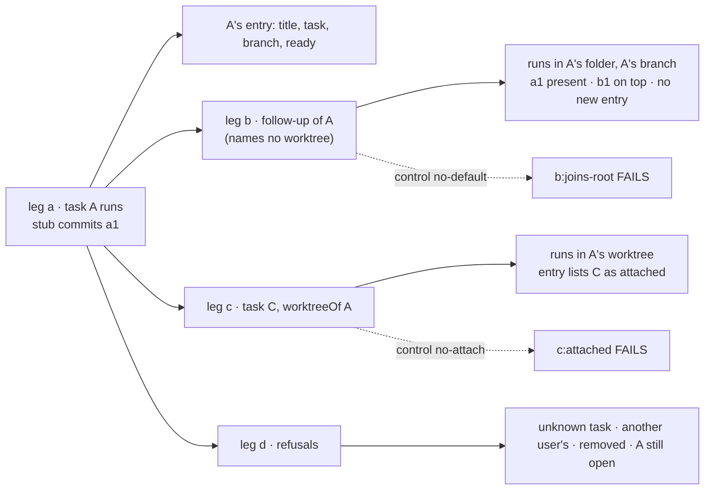
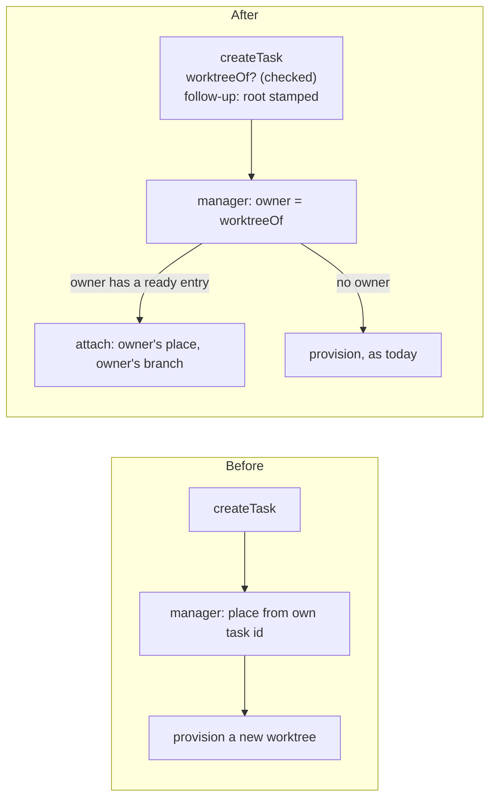

# FIX-2659 · A new coding task can work in an earlier task's worktree

**Spec** · [Decisions](DECISIONS.md)

## Who feels it, before and after

| Someone who… | Today | After |
|---|---|---|
| **asks for a follow-up on a finished coding task** ("also add a test") | The follow-up runs in the same coder session but gets a fresh worktree cut from the base. The earlier commits aren't there, so the coder starts over (FIX-2274) | The follow-up joins its root task's worktree on its own: same folder, same branch, the earlier commits in place. Nobody has to name it |
| **files unrelated coding work that belongs on an existing branch** (a coordinator or main session) | Can't. Every board task provisions its own place from its own id | Files it with `worktreeOf: <task id>`. The task runs in that task's worktree, after the coordinator read the open worktrees for the repo |
| **reads the worktree list** (an agent, or a page) | Board-run entries carry a name and an owner id, but no title, and the coordinator isn't given the list | Every entry carries the title of the task or session it was made for. The coordinator and desk workers can read the list, and are told to check it before filing coding work |
| **watches a lab task** | The card names a branch, but not whether the task made a new worktree or reused one | The card says which worktree the task works in, and, for a reused one, whose it is |
| **owns a worktree another task joined** | n/a | Keeps it. Only the owner removes it. The joining run can't move its branch, and the two never run at once |

## The goal, and how we'll know it's met

**A coding task can continue in an earlier task's worktree, with that task's commits in place:
a follow-up always does, and any other task does when its filer names one.**

- **Smaller, and rejected:** a follow-up that checks out the root's branch in a new worktree. Git
  won't check one branch out twice, and two folders for one branch is the confusion FIX-2419
  removed for sessions.
- **Bigger, and not this issue's:** a "list worktrees" tool (Architect: only if raw reads prove
  noisy); review tasks reading earlier work without attaching (FIX-2361's read half); resuming
  the root's vendor conversation in the follow-up; deciding when a worktree is stale (FIX-2252).
- **Not done if:** a follow-up lands in a fresh worktree; a task can attach to another user's
  worktree or one that was removed; an attached run's branch switch goes unnoticed; or the
  owner's open run and an attached run write at the same time.

**How we verify.**

- **Goal check (new), `goals/harness-manager/follow-up-joins-worktree`**, model-free. A board read
  from the claim, served over HTTP, its manager on the workspace package's local host over a
  scratch repository with a bare remote. The stub harness commits one file per turn and, when
  told, switches branch. Leg **a**: task A runs and settles; its worktree entry carries A's title,
  its task id as owner, its branch, and `ready`. Leg **b**: a follow-up of A, filed with no
  `worktreeOf`, runs in A's folder on A's branch; `git log` shows A's commit with the
  follow-up's on top; the worktree list has no new entry and no new `conductor/` branch; A's entry
  lists the follow-up under `attached`. Leg **c**: an unrelated task filed with
  `worktreeOf: A` does the same. Leg **d**: `worktreeOf` naming an unknown task, another user's
  task, a task whose worktree was removed, or a task still open is refused at filing, naming why;
  an attached run that leaves the worktree on another branch fails its attempt.
- **Controls that must fail:** `GOAL_CONTROL=no-default` drops workforce's follow-up default at
  filing (the manager is untouched); leg b fails
  **`b:joins-root`**. `GOAL_CONTROL=no-attach` provisions instead of attaching; leg c fails
  **`c:attached`**, and leg b fails too. Each control reddens only its own legs.
- **Unit and lab:** the filing rules in orchestration and workforce; the manager's attach path
  (lock shared, owner entry checked, a retry keeps its base); the lab contract tests show the
  coordinator reads `worktrees` and the card's "reused" line.

## What changes

The task names a worktree, or workforce writes the owner of its root's at filing; the manager carries it out. Nothing new is
provisioned for an attached run.

- **A typed `worktreeOf` on the task** ([D1](DECISIONS.md#d1)): orchestration's `Task` and
  `TaskInit` gain `worktreeOf?: string`, a task id, top-level, written once at filing, never
  patched. The `createTask` tool takes it. A filer can't name one on a follow-up
  (`follow_up_takes_no_worktree`), like its other placement settings; workforce writes the
  owner (D2).
- **Workforce checks it at filing** ([D1](DECISIONS.md#d1)): the named task is on the same board
  and finished, and its worktree entry is the user's own and `ready`. It names the owner, never a
  task that itself attached (resolved one hop, as `followUpOf` is to its root).
- **A follow-up joins its root's worktree on its own** ([D2](DECISIONS.md#d2), Jake's call):
  workforce's filing path finds the owner, which is the root, or the root's own `worktreeOf`
  when the root attached. If the owner has a `ready` entry for this user, it writes
  `worktreeOf: <owner>` onto the follow-up. A follow-up whose root neither owns an entry nor
  carries `worktreeOf` (a chat task, a files-only run) gets none and provisions as today. The manager reads only `worktreeOf`, never `followUpOf`.
- **The manager attaches instead of provisioning** ([D3](DECISIONS.md#d3)): when the task
  carries `worktreeOf`, it reads the owner
  task's run record, derives the owner's location from the owner's identity and recorded branch
  (`locationFor` checks the hex, so a record can't point elsewhere), checks the owner's entry
  through `host.attach`, and works there under the same checkout lease. The run keeps its own
  record and topic. Its base is the branch head when it first opened, so its review and commit
  count are its own work; landing pushes the shared branch, where FIX-2658's existing-PR check
  finds the owner's PR. A turn that ends on another branch fails the attempt.
- **Entries carry a title** ([D4](DECISIONS.md#d4)): `title` on the worktree entry (nullable, BP-030),
  written from the task's or session's title at provision.
- **The coordinator can look** ([D4](DECISIONS.md#d4)): a `worktrees` capability in the
  workspace package declares the resource and one instruction line, "before filing coding work,
  check the open worktrees for the same repository". Workforce gives it to the coordinator and
  desk workers on a roster with a coding worker.
- **Apps:** the labs and Shift Manager show the worktree on the task card, with "reused from
  <title>" for an attached run. Second PR.
- **Docs:** workforce, orchestration, workspace and harness-manager READMEs; the coding-tasks
  guide's follow-up section. Written at release.

## What stays as it is

How a new run's place and branch are named (FIX-2657); session attach (`start: { worktreeOf }`);
removal, which only the owner does; a follow-up running in its root's session with its worker;
review tasks, which don't attach.

## What's already here, and the debt

| Piece | What this does with it |
|---|---|
| Session attach (`start: { worktreeOf }`, `host.attach`, `attachToWorktree`) | **Reused**: board runs attach through the same host call and entry list |
| The checkout lease (`acquireCheckout`, `<dir>.lock`) | **Reused**: keyed on the path, so owner and attached runs, and sessions, already exclude each other |
| `followUpOf` and its root resolution | **Reused** by workforce at filing to find the default owner |
| The harness manager's mechanism/policy split (FIX-2583) | **Respected**: the follow-up default is policy and sits in workforce's filing path; the manager only attaches when told. It can move into the coding flow with FIX-2583's other defaults |
| `locationFor` reading a name back from a recorded branch | **Reused** to find the owner's place |
| `worktreesCollection` | **Extended** with `title` |
| Prior design: FIX-2419 [D4](../FIX-2419/DECISIONS.md#d4) | **Kept and extended**: the one way to share a worktree, now for board runs too |
| Prior design: `workspace.ts` "a typed field on the durable task, designed separately" | **Settled** here for attaching; the run's own place stays derived |

**Adds:** one task field and its filing rules (check and follow-up default), one entry field, one capability, an attach branch in
the manager's open step. **Removes:** nothing. **Debt:** two attached runs interleave commits on
one branch (turns never overlap, but the history mixes); the follow-up starts a fresh vendor
conversation in the shared tree. **Net:** small to medium, split between workforce's filing path and the manager's open step.

## Sign off

**Approve by merging.** The call to weigh is [D3](DECISIONS.md#d3): an attached run reviews only
its own commits, but lands the whole shared branch. *If wrong:* the base is one pin on the run
record; switching it to the owner's base changes what review shows and nothing else.

Feature · `orchestration`, `workforce`, `workspace`, `harness-manager`, labs · medium · package
slice in 1 PR stacked on FIX-2658; app adoption in a second · epic FIX-2369
