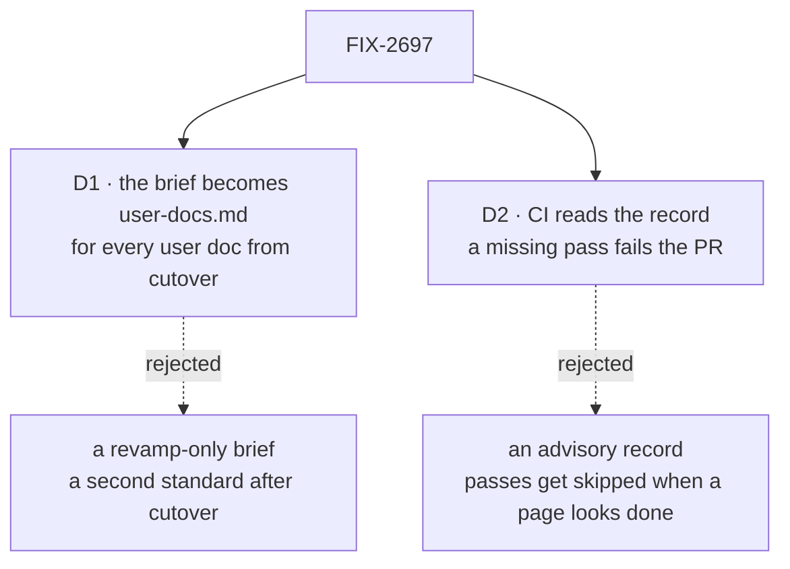

# FIX-2697 · Decisions

[Spec](SPEC.md) · **Decisions**

Two decisions are the sign-off surface. The rest is context for them.

## The tree

Solid edges are what you're signing. Dashed edges lost, and the label says why.

## D1 · The brief's rules become `docs/contributing/user-docs.md`, and hold for every user doc from cutover on

| | |
|---|---|
| **Instead of** | Keeping `WRITING-BRIEF.md` as a brief for the revamp only, beside the voice standard |
| **Because** | After cutover, pages are written at each release by `release-docs`, whose `docs-writer` reads `user-docs.md`. A brief it never reads means the second release after cutover writes pages without types, budgets or the concept/reference contract, and the site drifts back |
| **Locks in** | Every user doc written after cutover has a `type`, its budget and its outline, and the checker runs on every page under `apps/docs/` from FIX-2705 on. A page that doesn't fit a type is a standard change, not an exception |

It comes down to the release after cutover: a revamp-only brief is never read again.

**What would change my mind:** the owner wanting later pages free of types and budgets. Then the
brief stays in the revamp folder and is deleted at cutover.

## D2 · CI reads each page's record, and a record missing a pass fails the PR

| | |
|---|---|
| **Instead of** | A record the script writes and nothing reads |
| **Because** | In the pilots, the passes that found wrong claims were the late ones: the fact check and the cold read. Those are the ones a writer skips when a page already looks finished, and an unread record doesn't stop that |
| **Locks in** | A page edited after its loop closed needs a fresh pass 4 and pass 5 entry before it merges. Small fixes get slower for every writing child, and the owner's pass 10 is recorded as read or not sampled, never left blank |

It comes down to a page that looks done: an advisory record lets its cold read be skipped.

**What would change my mind:** the first twenty pages' records showing passes 5 and 9 never find
anything a page edited after the loop. Then an edit needs pass 4 only.

## Decided, not asked

- **The loop is a Claude Code workflow script in `.agents/workflows/`**, under the existing
  contract and `verify.mjs`. It takes the page id and the writer model as arguments. Like every
  workflow script it reads and writes nothing itself; the agents it dispatches do.
- **The acceptance run is C-07 State and scopes, written by Sonnet.** A page about stored data
  exercises the ownership questions, and one heavy on mechanism exercises the depth pass. The run
  is the epic's open D4 test. Its page and record are kept under this spec's `poc/loop-run/` as
  evidence; FIX-2701 writes the real C-07. Its verdict goes to the owner as the answer to D4.
- **The record lives beside the page** as `<page>.record.md`, next to `<page>.facts.md`. It has
  one section per pass, plus a *Reference rows* section where pass 6 lists each row it moved and
  the R-page it belongs on (the seam in the epic's *Who owns what*).
- **Cold-read questions are written by an agent that has seen no draft**, and the script hands
  them to pass 9 unchanged. A question edited after the draft exists is a new question and is
  recorded as one.
- **The checker's default glob is `docs/contributing/docs-revamp/pages/**/*.md` until cutover.**
  FIX-2705 moves it to `apps/docs/{docs,guides}/**` in the cutover PR. An empty file list fails.
- **The figure lint extends `apps/docs/scripts/lint-brand.mjs`** with `FIGURES.md` rules 6 to
  16, and runs each rule's fixture first, as that lint does today.
- **A page kept from today's site enters the loop at pass 4** (the epic's amended D4). Its record
  says so in pass 1's place.

## Considered and dropped

| Alternative | Why not |
|---|---|
| A skill that lists the passes, instead of a script | A skill is advice; the issue asks that no pass can be skipped |
| One script per page type | The passes are the same for every type; the budget and outline come from the type |
| Check the record with a pre-push hook only | Agents push from containers where hooks may not run. CI is the one place every PR passes |

## Analysis

2026-11-12 · watermark 2026-11-12 (epic merged) · run over the whole spec set by the epic agent,
in its own context. See the spec-set PR body for the set's verdict. For this spec: **right
approach.** Reuse moved two rows to *Extends* (the brand lint, the checker). Nothing open.

## How it got here

- **Draft** in the epic's spec set, from the issue, the epic's D4 and D6, `FIGURES.md` and the
  checker. The acceptance run was tied to the epic's open model question during the set review.

**Open: none.**
