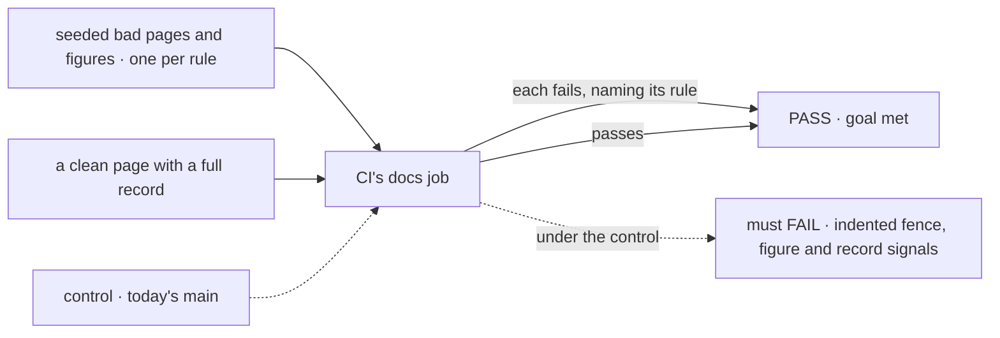
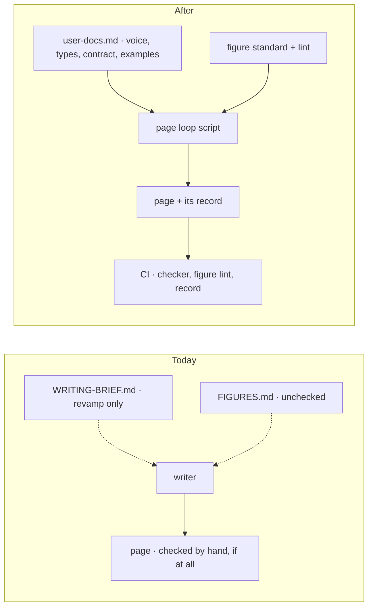

# FIX-2697 · A docs page can't land without the passes, the budget and the figure rules

**Spec** · [Decisions](DECISIONS.md)

## Four people, before and after

| Someone who… | Today | After |
|---|---|---|
| **writes a revamp page** (an agent or a contributor) | Reads a working brief under `docs/contributing/docs-revamp/`, runs the page checker by hand if they remember, and keeps a pass record if they choose to | Reads one standard in `docs/contributing/user-docs.md`, starts the page loop script, and gets a record that lists all ten passes and what each found |
| **opens a PR with an over-budget page** | Merges: nothing runs the checker | CI fails and names the page, its word count and its budget |
| **draws a figure** | Has the rules in `FIGURES.md` and nothing that checks them | Runs the figure lint, which CI also runs; a hex colour, a `<style>` block or a missing key fails |
| **skips the cold read because the page "looks done"** | Nobody notices | CI fails: the page's record has no pass 9 |

Every writing child of FIX-2696 starts after this lands. A rule that lives only in a brief is
applied four ways by four parallel writers.

## The goal, and how we'll know it's met

**A docs page that skips a pass, runs over its budget, or breaks the figure rules cannot merge, and CI says which rule it broke.**

| Is it the right goal? | |
|---|---|
| **The real need** | The epic's [D4](../../epics/FIX-2696/DECISIONS.md) loop "so no pass can be skipped", and one standard every writing child obeys ([ER-3](../../epics/FIX-2696/DECISIONS.md)) |
| **Smaller, and rejected** | "The checker runs in CI." It catches budgets and nothing else; the passes that found the pilots' wrong claims (the fact check, the cold read) stay optional |
| **Bigger, and not this issue's** | Writing any page. FIX-2701 to FIX-2704 write them; this issue's one loop run is evidence, not a page |
| **Not done if** | The checker passes because it was given no files · the figure lint passes because no rule fixture exists for the rule · the record exists but CI never reads it |

The check reads what CI prints and its exit code, never the checker's internals. The dashed path
is today's checker, which counts no indented fence and has no figure lint or record check.

| How we verify | |
|---|---|
| **Goal check** | `goals/docs-pages/fail-what-the-standard-forbids/` · model n/a · run by the implementer at completion · verdict in the implementation PR |
| **Signal** | Each fixture fails with its rule named: over budget, unknown `type`, an untitled indented TypeScript example, no path given, a hex colour, a `<style>` block, no key, a record missing a pass. The clean page passes. 8 of 8 and 1 of 1 |
| **Input** | Fixture pages and figures under the goal's `fixtures/`. A different over-budget page, or a figure with a colour name instead of a hex, must fail too |
| **Anti-game** | Don't assert on the checker's functions or its rule table. Run the command CI runs and read its output |
| **Control that must fail** | Today's `main`. It must FAIL on *indented fence*, *no path given*, every figure signal and *record missing a pass* |

**And the loop itself:** the script runs one page, C-07 State and scopes, through all ten passes
with Sonnet as the writer, and the record it leaves is the epic's open D4 test (which model
writes). The page is evidence kept in this spec's `poc/`, not the published page; FIX-2701 writes
that ([decided, not asked](DECISIONS.md#decided-not-asked)).

## What changes

On the left the rules are advice. On the right a script runs the passes and CI reads the result.

**Docs:** no user-docs impact. Contributor docs change: `user-docs.md` gains the page types,
budgets, the concept outline, the concept/reference contract, the code-example rules and ER-9;
the figure rules move beside it; `docs-revamp/WRITING-BRIEF.md` becomes a pointer; the
`docs-writer` agent's reading list names the new sections.

## What stays as it is

- The voice rules, and the rule that user docs change only at release.
- The retired-terms check and the glossary, which the loop calls unchanged.
- The release-docs pipeline, whose `docs-writer` and `docs-editor` are passes 1 and 7.
- The site's `Figure` component and `page.css`.

## What's already here, and the debt

| Already here | What this does with it |
|---|---|
| `scripts/check-docs-page.mjs` (budget, banned words, code titles; rejects an unknown `type`) | **Extends.** Counts indented fences, refuses an empty file list, gains a default glob |
| `apps/docs/scripts/lint-brand.mjs` (rules 1 to 5 of `FIGURES.md` for site figures, with fixtures) | **Extends.** Pointed at revamp figures, and given rules 6 to 16 |
| `WRITING-BRIEF.md` and `FIGURES.md` | **Replaces.** Their rules move into the standard; the brief becomes a pointer |
| The workflow-script contract (`.agents/workflows/`, `verify.mjs`) | **Builds on.** The loop is one more script, verified the same way |
| `concept-doc`'s cold read and ownership questions | **Builds on.** Cited by passes 1 and 9, not restated |
| Anything else that runs a fixed sequence of writing passes | **None.** Searched `.agents/workflows/`, `.agents/skills/release-docs/` and `.claude/agents/`. `release-docs` runs writer then editor, with no record |
| Epic [D4](../../epics/FIX-2696/DECISIONS.md) and [D6](../../epics/FIX-2696/DECISIONS.md) | **Keeps.** This issue is where they become checks |

| Adds | Existing piece considered | Why it doesn't fit / how composed |
|---|---|---|
| The page loop workflow script | `release-docs`'s writer-then-editor sequence | Composed: passes 1 and 7 are those agents. The other eight passes and the record have no home there, and `release-docs` runs once per release, not per page |
| A per-page record file and its CI check | The fact sheet beside each page | Composed: the record sits beside the fact sheet and names it. A fact sheet is pass 1's output, not a log of ten |

| The debt | |
|---|---|
| **Removes** | The revamp-only brief as a second standard. The by-hand checker run |
| **Adds** | One workflow script and one record format, which every later page pays for in time ([D2](DECISIONS.md#d2)). Permanent by design |
| **Leaves** | `pages/blocks.md` and the pilots predate the contract. FIX-2701 and FIX-2702 bring them to it |

**Net: flat.** A second standard goes; a script and a record arrive.

## Sign off

**[The goal](#the-goal-and-how-well-know-its-met), at that size:** a page that skips a pass,
overruns or breaks a figure rule cannot merge. If wrong: we hold every writer to a loop the owner
would have let them skip for small pages.

**[The debt](#whats-already-here-and-the-debt), net flat:** one standard instead of two, plus a
script and a record. If wrong: a record format someone keeps in step with the loop.

1. **[D1](DECISIONS.md#d1) · The brief becomes `user-docs.md`, for every user doc from cutover on.** If wrong: every release's pages carry a type and a budget the old site never had.
2. **[D2](DECISIONS.md#d2) · CI reads each page's record, and a record missing a pass fails the PR.** If wrong: a one-word fix after the loop costs a re-check.

**Open: none.** Number 2 is the one to weigh.

Improvement · `scripts`, `.agents/workflows`, contributor docs · medium · FIX-2696
