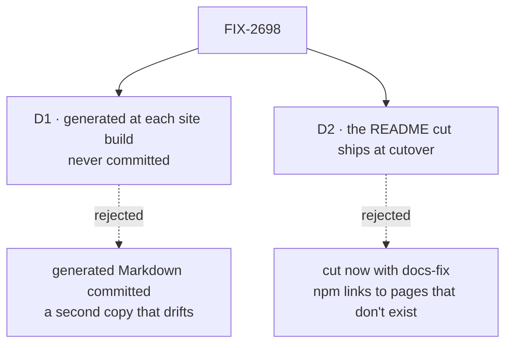

# FIX-2698 · Decisions

[Spec](SPEC.md) · **Decisions**

Two decisions are the sign-off surface. The rest is context for them.

## The tree

Solid edges are what you're signing. Dashed edges lost, and the label says why.

## D1 · Reference is generated at each site build, from the packages' source, and never committed

| | |
|---|---|
| **Instead of** | Running the generator by hand and committing its Markdown under `apps/docs/` |
| **Because** | Committed output is one more copy kept in step, which is the drift this issue removes. Built from source, the reference matches `main`, and the site's deploy gate already holds production until every version on `main` is on npm, so the live reference matches what a reader can install |
| **Locks in** | The docs build builds every published package's types first, so a package whose types don't build stops the docs deploy. Every docs preview reflects unreleased doc comments, which is what previews are for |

It comes down to drift: committed output is a second copy, and it lags the first.

**What would change my mind:** the docs build passing ten minutes on Vercel with the types step
in it. Then the output is generated in CI and committed by a bot, with a check that it is current.

## D2 · The README cut ships with the cutover, not before

| | |
|---|---|
| **Instead of** | Cutting the READMEs now, in a `docs-fix` PR |
| **Because** | A README is read on npm, against the version a reader installs. Cut now, it links to a reference section that doesn't exist until cutover, and the long README is the only reference npm readers have in the meantime |
| **Locks in** | This issue writes the cut READMEs as files FIX-2705 moves into place, under `docs/contributing/docs-revamp/readmes/<package>.md`. The long READMEs stay through one more release, and a README edit at that release must land in both copies |

It comes down to the link: cut now, an npm reader's link leads nowhere.

## Decided, not asked

- **TypeDoc with its Markdown plugin is the starting point**, because the site renders Markdown
  and FIX-2700 serves every page as Markdown. The implementer may pick another generator that
  reads the published `.d.ts` and doc comments, and says why in the PR.
- **`contracts` has no section of its own.** `core` re-exports it, and a reader imports from
  `core`; its exports read under `core`.
- **Twenty-seven sections**, the sitemap's list. `ui` is a registry, not an import, so its
  reference is R-36 (FIX-2699).
- **Nothing generated is published before cutover** (the epic's D2 and ER-2). Until then the
  generator runs in CI into a scratch folder, and the goal check reads that build. FIX-2705 adds
  the section to the sidebar.
- **An export with no doc comment is listed by the build, not failed on.** The list goes in the
  implementation PR with a count per package; failing on it is a later rule once the count is
  near zero.
- **The cut READMEs are run through `scripts/check-root-exports.mjs` before cutover.** It counts
  a README mention as a use of a root export, so the cut removes that evidence for any export a
  long README was the only one to name. This issue lists them in its PR; the cutover PR
  (FIX-2705) carries each one's fix: a real use, or off the root.
- **A generated page links to the hand-written row** (FIX-2699) where an export has behaviour
  beyond its signature, by the doc comment's `@see`, not by a hand-kept map.

## Considered and dropped

| Alternative | Why not |
|---|---|
| Keep the seven `api/*` pages and check them against the exports | Still hand-written prose kept in step every release |
| API Extractor's report as the published reference | Built for review of API changes, not for reading; its output is one file per package with no prose |
| A section per entry point (`/host`, `/kit`) | The sitemap's slugs are one per package; a subpath is a heading inside it |

## Analysis

2026-11-12 · watermark 2026-11-12 · run over the whole spec set by the epic agent. For this
spec: **right approach.** Prior art: LangChain and Mastra both publish generated API reference
beside hand-written docs. Reuse: no generator exists in the repo; `check-root-exports.mjs` is
built on, not duplicated. Nothing open.

## Notes from review

Recorded for the implementer, not folded into the design.

- *Second-look review comment, spec-set PR #5180:* Suggestion: make the build-time measurement an explicit first step of the implementation, with the committed-by-bot fallback written as the stated plan B. As written, the implementer could choose it silently.
- *Second-look review comment, spec-set PR #5180:* Cheapest guard: a check that fails if a long README changes without its cut copy changing. Or say outright that README edits are frozen until cutover.
- *Cursor review, spec-set PR #5180:* D1 (generate every build, never commit) trades drift for CI wall clock. Spec acknowledges the cost; when implementing, plan incremental/cache per package *early* rather than only falling back after pain — otherwise small doc fixes under FIX-2697’s record gate will feel brutal.

## How it got here

- **Draft** in the epic's spec set. The README timing was set by the set review, against
  FIX-2705's cutover and the user-docs scope rule that covers `packages/*/README.md`.

**Open: none.**
