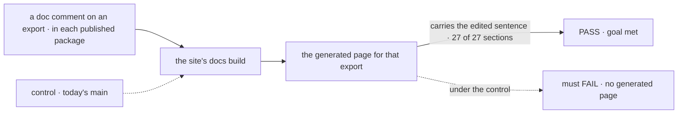
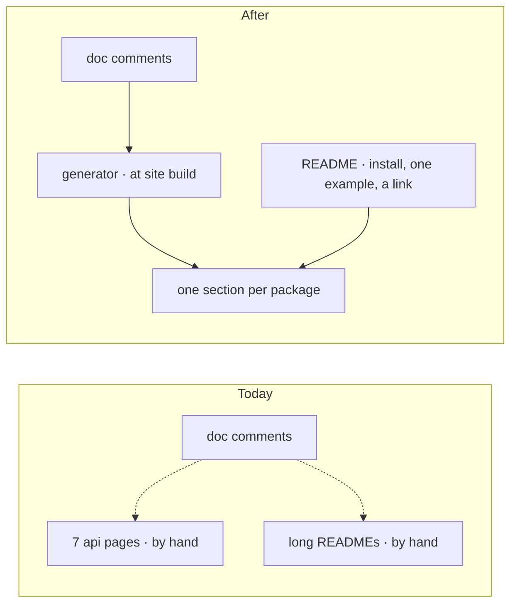

# FIX-2698 · The API reference is the doc comments, and the READMEs point at it

**Spec** · [Decisions](DECISIONS.md)

## Four people, before and after

| Someone who… | Today | After |
|---|---|---|
| **looks up a function's options** | Finds it on one of seven hand-written `api/*` pages (about 20,600 words), in the package README, or in neither, and the two can disagree | Finds one generated section per published package, built from the doc comment on that export |
| **changes an exported function** | Edits the doc comment, then has to remember the `api/*` page and the README at release | Edits the doc comment. The next site build shows it |
| **reads a package on npm** | Scrolls a long README that repeats the docs | Reads an install line, one example and a link to that package's reference |
| **is a coding agent** | Scrapes hand-written prose that lags the code | Reads reference generated from the same source it will import (and, through FIX-2700, as Markdown) |

## The goal, and how we'll know it's met

**A changed doc comment on any published export changes the published reference, with no page edited by hand.**

| Is it the right goal? | |
|---|---|
| **The real need** | Reference that can't drift from the code, and one fewer copy of every fact ([ER-1](../../epics/FIX-2696/DECISIONS.md), epic [D5](../../epics/FIX-2696/DECISIONS.md)) |
| **Smaller, and rejected** | "Generate reference for `core`." The other packages keep their hand-written copies, and the drift this fixes stays everywhere else |
| **Bigger, and not this issue's** | Behaviour that is a state machine or a contract. That is tabular Reference, FIX-2699 |
| **Not done if** | The build generates pages nothing links to · a package is skipped because its build failed and the build stays green · the READMEs are cut before the reference they link to is published |



The check edits a comment, builds, and reads the built page's text. Today's `main` has no
generator, so it builds no page to read.

| How we verify | |
|---|---|
| **Goal check** | `goals/api-reference/follows-the-doc-comment/` · model n/a · run by the implementer at completion · verdict in the implementation PR |
| **Signal** | For one root export of each of the 27 sections (`contracts` reads under `core`), a sentence added to its doc comment appears on its built page. 27 of 27. The build fails, naming the package, when one package can't be read |
| **Input** | A marker sentence added in a scratch copy. A different export, or a type rather than a function, must pass too |
| **Anti-game** | Don't assert on the generator's intermediate JSON or on its config. Read the built HTML |
| **Control that must fail** | Today's `main`, which must FAIL on *carries the edited sentence*, 0 of 27 |

## What changes



The dashed arrows on the left are copies someone keeps in step. On the right there is one copy,
and the README points at it.

**The README, as a package author sees it after cutover:**

```diff
  # @flow-state-dev/core
- (about 2,000 words: concepts, every builder, options tables, examples)
+ Isomorphic builders and type contracts for Flow State apps.
+
+ pnpm add @flow-state-dev/core
+
+ (one example, under 20 lines)
+
+ Reference: the core section of the Flow State API reference (a link)
```

**Docs:** at cutover (FIX-2705), add the generated *Reference › API* section, remove the seven
`api/*` pages, and replace every published package's README with the cut versions this issue writes.

## What stays as it is

- BP-007: every export has a doc comment. This issue makes that rule the reference.
- The hand-written Reference tables. FIX-2699 writes them; the generated pages link to them where
  an export has behaviour beyond its signature.
- Private packages (labs, apps, examples). They get no section and no README change.

## What's already here, and the debt

| Already here | What this does with it |
|---|---|
| Doc comments on exports (BP-007) | **Builds on.** They become the only source |
| The seven `apps/docs/docs/api/*` pages | **Removes**, at cutover |
| Every published package's README | **Replaces**, at cutover, with the cut versions |
| `scripts/check-root-exports.mjs`, which lists each package's root exports and counts a README mention as a use | **Builds on** its list, which is what each section must cover. **Amends** its README rule: a cut README names one example, so an export cleared only by a README mention needs another use or leaves the root ([decided, not asked](DECISIONS.md#decided-not-asked)) |
| Anything that already generates reference | **None.** Searched every `package.json` for `typedoc` and `api-extractor`, and `scripts/` for `.d.ts` readers: nothing |
| Epic [D5](../../epics/FIX-2696/DECISIONS.md) | **Keeps.** This issue picks the generator D5 left open |

| Adds | Existing piece considered | Why it doesn't fit / how composed |
|---|---|---|
| A reference generator in the site build | The hand-written `api/*` pages | Those are the drift being removed. The generator reads the source the packages publish |

| The debt | |
|---|---|
| **Removes** | Seven hand-written pages and about 165,000 README words, each a copy kept in step at release |
| **Adds** | One build-time dependency on the generator, and a site build that now builds the packages' types first ([D1](DECISIONS.md#d1)). Permanent by design |
| **Leaves** | Doc comments that are thin or missing on some exports. The build lists them; filling them is each package's ordinary BP-007 work. Root exports whose only use was a README mention, listed by `check-root-exports.mjs` when the cut READMEs are checked; each gets a use or moves off the root in the cutover PR |

**Net: down.** Two hand-kept copies of every signature go; one generator arrives.

## Sign off

**[The goal](#the-goal-and-how-well-know-its-met), at that size:** every published package, and
the page follows the comment. If wrong: we generate pages for packages nobody looks up, or leave
the drift in the ones they do.

**[The debt](#whats-already-here-and-the-debt), net down:** two hand-kept copies go, one generator
arrives. If wrong: the site build takes longer for everyone.

1. **[D1](DECISIONS.md#d1) · Reference is generated at each site build and never committed.** If wrong: the site build depends on every package's types building.
2. **[D2](DECISIONS.md#d2) · The README cut ships at cutover, not before.** If wrong: npm readers keep the long READMEs for one more release.

**Open: none.** Number 1 is the one to weigh.

Improvement · `apps/docs`, every published package's README · medium · FIX-2696
