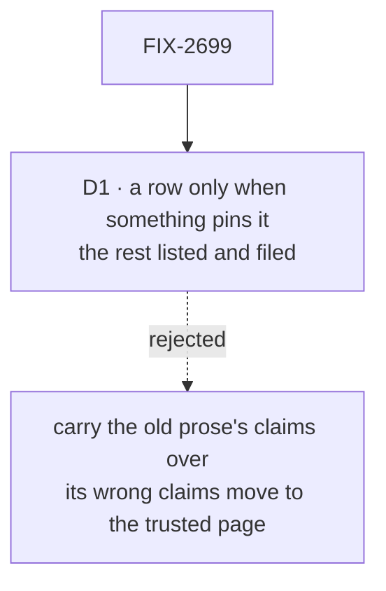

# FIX-2699 · Decisions

[Spec](SPEC.md) · **Decisions**

One decision is the sign-off surface. The rest is context for it.

## The tree

Solid edges are what you're signing. Dashed edges lost, and the label says why.

## D1 · A row is written only when a test or doc comment pins it, or a run on the real path confirms it; anything else is listed and filed

| | |
|---|---|
| **Instead of** | Turning each behaviour today's pages describe into a row |
| **Because** | Pages written from today's sources are wrong in places: the three pilots alone lost four wrong claims to a fact check (the epic's concept-doc pilot). Reference is where a reader, and an agent, stops checking |
| **Locks in** | Reference is smaller than the old prose and every row is backed. A behaviour the old pages claimed that nothing pins is missing from Reference until someone writes the test, and each is a filed issue named in the implementation PR |

It comes down to the wrong claims: carried over, they land on the page readers trust most.

**What would change my mind:** the fact checks on the first five R-pages finding the old prose
right almost every time. Then a row may come from the old page, marked for a later check.

## Decided, not asked

- **Upgrading is one page per release, at `reference/upgrading/<release>`** (sitemap R-40). The
  next release's docs pass writes its page from the changesets and removes the one before (O3).
  This issue adds that step to `docs/contributing/release-docs.md` and the `release-docs` skill.
  The first page, for the kits release, is filled at cutover by FIX-2705 from the changesets
  pending then.
- **Rows the depth pass moves off a writing child's page** reach this issue through that page's
  record (its *Reference rows* section) until the R-page is on `main`; after that the writing
  child adds the row itself, and this issue owns the page's shape. The rule is the epic's
  amended *Who owns what*.
- **R-39 Glossary is generated** from `docs/contributing/glossary.mjs`, grouped by layer. A term
  changed there changes the page with no hand edit.
- **Every R-page runs the loop from pass 1**, like any page: fact sheet, lookups as its cold-read
  questions, draft, checks, fact check. Pass 6 (depth) checks the other way round: a row that is
  internals is cut.
- **The five state figures** are the ones the sitemap names, drawn to `FIGURES.md` with its
  state-figure marks. No other R-page has a figure.
- **Order:** the R-pages the Concepts reading path links to first (R-01 to R-11), so the writing
  children's depth pass has somewhere to send rows early.

## Considered and dropped

| Alternative | Why not |
|---|---|
| Wait for every writing child's depth pass, then write the tables once | Puts this issue last in a set where it can run first, and leaves the writers nowhere to link |
| Keep a cumulative migration page for every release | O3 deletes history older than the current release; package changelogs keep it |
| Generate the tables from tests | Tests pin behaviour but don't name what a user sees; a row needs a sentence a reader can use |

## Analysis

2026-11-12 · watermark 2026-11-12 · run over the whole spec set by the epic agent. For this
spec: **right approach, with one change folded:** the seam with the writing children's depth
pass had no owner for rows that arrive after an R-page is written. It is now the epic's amended
*Who owns what*. Nothing open.

## How it got here

- **Draft** in the epic's spec set. The set review moved the Upgrading page from "one rewritten
  page" to the sitemap's one page per release, which O3 already decided, and found the
  depth-pass seam.

**Open: none.**
