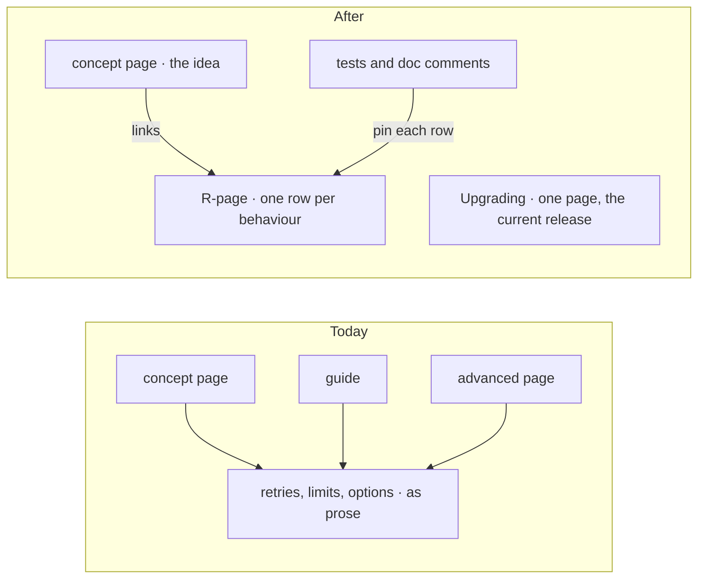

# FIX-2699 · Behaviour a user depends on has one row, in one Reference table

**Spec** · [Decisions](DECISIONS.md)

## Five people, before and after

| Someone who… | Today | After |
|---|---|---|
| **asks "what happens when a task is claimed twice?"** | Reads it narrated on one of nine pages about tasks, each a little different | Reads the row on R-23, the task-board table, beside its state figure |
| **reads a Concepts page** | Wades through retries, limits and option lists in the middle of the idea | Reads the idea, with a link to the table where those live |
| **is a coding agent** | Has to infer behaviour from prose | Answers each page's *lookups* from that page alone |
| **upgrades to the kits release** | Finds migration notes for many past releases spread across pages | Reads one *Upgrading* page for that release, with links to each package's changelog for older ones |
| **writes a Concepts page** (FIX-2701 to FIX-2704) | Has nowhere to put the mechanism the depth pass takes out | Puts the row in that page's record, or straight onto the R-page once it is on `main` |

## The goal, and how we'll know it's met

**Every behaviour a user can observe and depend on has one row in one Reference table, and a reader with only that page can answer its lookups.**

| Is it the right goal? | |
|---|---|
| **The real need** | Concepts pages short enough to build understanding, with the detail still findable (epic [D6](../../epics/FIX-2696/DECISIONS.md), [O3](../../epics/FIX-2696/DECISIONS.md)) |
| **Smaller, and rejected** | "Move the old prose into tables." It carries the old pages' wrong claims into the place readers trust most ([D1](DECISIONS.md#d1)) |
| **Bigger, and not this issue's** | Generated API reference (FIX-2698), and the Concepts pages themselves (FIX-2701) |
| **Not done if** | A table exists and a Concepts page still narrates the same behaviour · a row states what the old page said and nothing confirms it · lookups pass only for a reader who also has the old site |

**No goal check fits.** This is docs: no runtime path changes. What proves it is pass 9 of the
loop (FIX-2697) run on each R-page: two or more fresh agents with only the page answer its
*lookups* from the sitemap, graded against the page's fact sheet, and most readers get every
lookup right. The control that must fail is the same readers given today's source pages for
R-07, R-17 and R-23, which narrate those behaviours across several pages. The one-home half is
FIX-2705's closure check over the sitemap's one-home table.

## What changes

On the left the same behaviour is told three times. On the right it is told once, as a row that
something in the code pins, and every page that needs it links there.

**Docs:** 43 hand-written Reference pages, R-01 to R-43 in the
[sitemap](../../epics/FIX-2696/SITEMAP/reference.md), written under
`docs/contributing/docs-revamp/pages/reference/` and moved under `apps/docs/` at cutover. The
first *Upgrading* page, for the kits release. Five state figures, the ones the sitemap names.

## What stays as it is

- The sitemap's list of 43 pages and what each holds. Adding or dropping one is an epic amendment.
- `CHANGELOG.md` per package, written by Changesets. *Upgrading* links to them.
- Framework internals and history are cut, not moved (O3). Git keeps them.

## What's already here, and the debt

| Already here | What this does with it |
|---|---|
| Behaviour narrated across `fundamentals/`, `advanced/`, `configuration/`, `streaming/`, `server/` | **Replaces.** Each behaviour a user can depend on becomes one row; the rest goes at cutover |
| `configuration/*` pages, already partly tables | **Builds on.** Their tables are the starting rows for R-05, R-12 and their neighbours |
| Package tests and doc comments | **Builds on.** Each row cites what pins it, in the page's fact sheet |
| `release-docs` and the changesets' `Docs:` lines | **Extends.** Each release's pass writes that release's *Upgrading* page from the changesets and removes the one before (O3) |
| Anything else that holds behaviour as tables | **`docs/architecture/`**, for contributors. Left alone: it explains internals, which user Reference cuts |
| Epic [O3](../../epics/FIX-2696/DECISIONS.md) and [D6](../../epics/FIX-2696/DECISIONS.md) | **Keeps.** This issue is where the rows they keep are written |

| Adds | Existing piece considered | Why it doesn't fit / how composed |
|---|---|---|
| The *Upgrading* page as the one home of migration notes | Package changelogs | Composed: the page is written from the same changesets and links each changelog. A changelog lists every change; the page lists only what a user must do |

| The debt | |
|---|---|
| **Removes** | Migration notes for past releases; narrated races and internals across about 20 pages |
| **Adds** | One step in each release's docs pass: write *Upgrading*. A list of behaviours the old pages claimed and nothing pins, each a filed issue ([D1](DECISIONS.md#d1)) |
| **Leaves** | `docs/architecture/` overlaps some rows for contributors. Not touched here |

**Net: down.** One row replaces two to nine tellings of each behaviour.

## Sign off

**[The goal](#the-goal-and-how-well-know-its-met), at that size:** one row per behaviour, and
lookups answered from the page alone. If wrong: tables nobody can read without the concept page,
or a concept page that still has to explain them.

**[The debt](#whats-already-here-and-the-debt), net down:** two to nine tellings become one row;
each release's pass gains one page. If wrong: an *Upgrading* page that falls behind.

1. **[D1](DECISIONS.md#d1) · A row is written only when a test or doc comment pins it, or a run confirms it; the rest is listed and filed.** If wrong: true behaviour missing from Reference until someone pins it.

**Open: none.** The *Upgrading* page's shape (one per release, the previous one removed) is the sitemap's R-40 and the owner's O3; it is recorded under [decided, not asked](DECISIONS.md#decided-not-asked).

Improvement · contributor-folder pages, moved at cutover · large · FIX-2696
