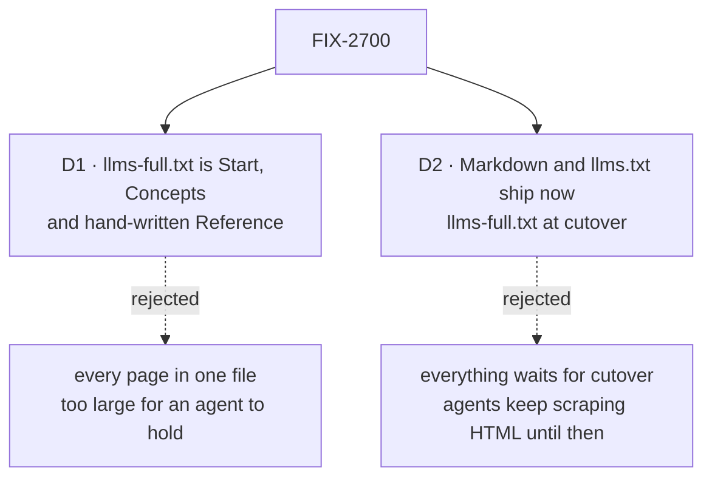

# FIX-2700 · Decisions

[Spec](SPEC.md) · **Decisions**

Two decisions are the sign-off surface. The rest is context for them.

## The tree

Solid edges are what you're signing. Dashed edges lost, and the label says why.

## D1 · `llms-full.txt` holds Start, Concepts and the hand-written Reference, not every page

| | |
|---|---|
| **Instead of** | Every page of the site in one file, generated API sections included |
| **Because** | The file is for an agent to read whole before it writes code. Start and Concepts are planned at 25,900 words and the hand-written Reference is tables; with Catalog, Build and 27 generated API sections it is several times that, past what an agent holds with room left for the task. Mastra skips the full file as too large to help |
| **Locks in** | The contents are a list of sections in the site config. An agent that wants a recipe or a signature follows `llms.txt` to that page's Markdown. Adding a section to the file later is a config line |

It comes down to size: every page in one file is more than an agent can hold and still work.

**What would change my mind:** FIX-2705's agent test passing better with every page than with
these three sections. Then the list grows to every section.

## D2 · Per-page Markdown and `llms.txt` ship on the next deploy, over today's pages; `llms-full.txt` waits for cutover

| | |
|---|---|
| **Instead of** | Holding all three until the new pages publish at cutover |
| **Because** | Agents read today's pages as scraped HTML. The same pages as Markdown are no worse and cost nothing at cutover, because the files are rebuilt from whatever pages exist. A full file of today's 422,000 words is no use to an agent, and its three sections don't exist until cutover |
| **Locks in** | Until cutover an agent reads today's pages, stale store lines and all, in a cleaner form. The *Copy page* control appears on today's site |

It comes down to the meantime: holding the files leaves agents scraping the same pages as HTML.

## Decided, not asked

- **The agent test is FIX-2705's.** The epic's closure issue writes both first-hour goals; this
  issue's check is the build output. The agent test runs with two arms, `llms-full.txt` alone
  and `llms.txt` plus per-page Markdown, and D1's *what would change my mind* reads its result.
  (The epic's analysis line that "FIX-2700 tests both" is amended to say so.)
- **No dependency on FIX-2697.** Linear lists FIX-2697 as blocking this issue; the epic's graph
  does not, and nothing here reads page types. The relation is a leftover to remove.
- **Each MDX component has one text form.** A `Figure` becomes an image link plus its
  description; an admonition becomes a blockquote with its title; tabs become one heading per
  tab. A component with no mapping fails the build, so a new one can't leak JSX.
- **`llms.txt` follows the llmstxt.org layout:** the site title, a one-line summary, then one
  list per sidebar section, each entry a Markdown link with the page's description.
- **The URL is the page's URL plus `.md`**, and the file's path in the build is that URL: the
  Markdown for `/docs/intro` is `build/docs/intro.md`, beside the `intro/` directory, not inside
  it next to `intro/index.html` (Docusaurus writes each page as `<path>/index.html`). A page
  whose URL ends in `/` uses `index.md` in that directory. Any static host then serves it.

## Considered and dropped

| Alternative | Why not |
|---|---|
| Serve Markdown by content negotiation on the same URL | Needs a server; the site is static |
| Ship only `llms.txt` | Its links would lead to HTML |
| A Markdown copy committed beside each source page | A second copy of every page, kept in step by hand |

## Analysis

2026-11-12 · watermark 2026-11-12 · run over the whole spec set by the epic agent. For this
spec: **right approach, with one change folded:** the agent test was claimed by both this issue
and FIX-2705; it is FIX-2705's, and this issue's check is the build output. Prior art:
LangChain and Mastra both serve `llms.txt` and per-page Markdown. Nothing open.

## Notes from review

Recorded for the implementer, not folded into the design.

- *Second-look review comment, spec-set PR #5180:* **FIX-2700: the "Copy page" control is not in the goal.** The goal is "served as Markdown, listed in `llms.txt`". The control is a UI addition in the site theme code, and the spec's Goal check never exercises it. Either drop it or give it a signal. If kept, it's worth a line on why it isn't a separate issue.
- *Cursor review, spec-set PR #5180:* 2% prose match HTML↔Markdown is a hot-path tax. Fine as a one-off goal signal; if wired into every `docs:build` CI check it doubles parsing work across all pages. Prefer proving agents can read the build output via cheaper invariants (`.md` sibling exists, no JSX, listed in `llms.txt`) and generate Markdown from MDX/source rather than rendered HTML.

## How it got here

- **Draft** in the epic's spec set. The set review moved the agent test to FIX-2705 and dropped
  the Linear dependency on FIX-2697 that the epic graph never had.

**Open: none.**
