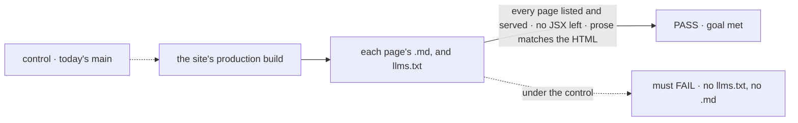
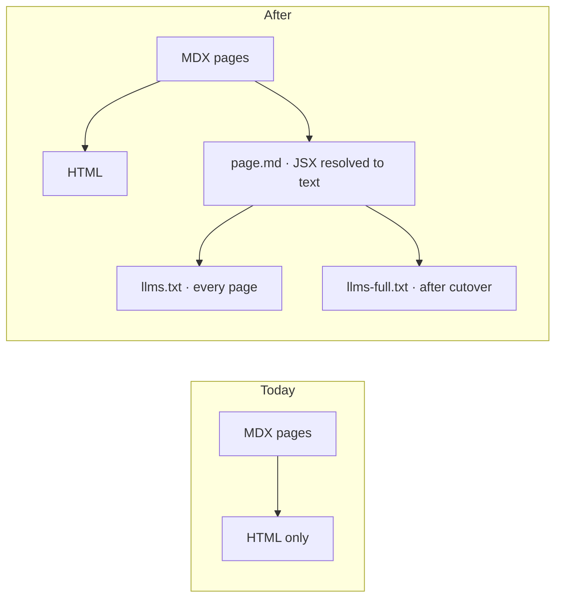

# FIX-2700 · A coding agent can read the docs as text

**Spec** · [Decisions](DECISIONS.md)

## Four people, before and after

| Someone who… | Today | After |
|---|---|---|
| **points a coding agent at the docs** | Hands it an HTML site to scrape, sidebars, scripts and all | Hands it `/llms.txt`, an index of every page with a one-line summary and a Markdown link |
| **wants the agent to read the model in one go** | Has nothing to give it | Gives it `/llms-full.txt`: Start, Concepts and the hand-written Reference as one file, after cutover ([D1](DECISIONS.md#d1)) |
| **wants one page in a chat** | Copies HTML and cleans it up | Clicks *Copy page* and pastes Markdown, or adds `.md` to the page's URL |
| **reads a page with a figure** | Sees the figure | Sees the figure. The Markdown copy carries the figure's description as text |

## The goal, and how we'll know it's met

**Every docs page is served as clean Markdown beside its HTML, and `llms.txt` lists every page, from the next deploy on.**

| Is it the right goal? | |
|---|---|
| **The real need** | The epic's agent reader: "a coding agent writes a flow that runs, without reading source" |
| **Smaller, and rejected** | "Publish `llms.txt`." An index whose links lead to HTML leaves the agent scraping |
| **Bigger, and not this issue's** | Whether an agent given these files writes a flow that runs. That is the epic's agent test, a goal FIX-2705 writes and runs against the new pages ([decided, not asked](DECISIONS.md#decided-not-asked)) |
| **Not done if** | A Markdown page still carries JSX (`<Figure … />`, admonitions, tabs) · `llms.txt` misses pages added after it was written by hand · a page's Markdown differs in its prose from its HTML |

The check reads the built output, the same files the site serves. Today's build produces none.

| How we verify | |
|---|---|
| **Goal check** | `goals/docs-for-agents/serves-every-page-as-markdown/` · model n/a · run by the implementer at completion · verdict in the implementation PR |
| **Signal** | For every HTML page in the build: the file its Markdown URL maps to exists (the page's URL plus `.md`, under `build/`; [decided, not asked](DECISIONS.md#decided-not-asked)), contains no JSX tag, and its prose words match the HTML's main text to within 2%; `llms.txt` lists it. 100% of pages |
| **Input** | Today's built site. After cutover the same check runs on the new pages; a page with a `Figure`, a table and a code tab must pass |
| **Anti-game** | Don't assert on the plugin's config or its list of routes. Walk the build's HTML files and look for each one's twin |
| **Control that must fail** | Today's `main`, which must FAIL on *Markdown file exists*, 0% |

## What changes

One build, one source, two outputs per page. The index and the full file are made from the
Markdown copies, so they can't list a page the site doesn't serve.

**Docs:** no page text changes. A *Copy page* control on every docs page, in the site's theme
code. Start's S-4 points readers at `llms.txt` (FIX-2702).

## What stays as it is

- Every page's source, its URL and its HTML.
- The user-docs rule: this issue touches site code and config only (`apps/docs/src`,
  `docusaurus.config.ts`), which the scope check allows.
- The deploy gate: production deploys as it does today.

## What's already here, and the debt

| Already here | What this does with it |
|---|---|
| The Docusaurus build and its plugins | **Extends.** One post-build step writes the Markdown, `llms.txt` and, after cutover, `llms-full.txt` |
| The site's `Figure` component | **Builds on.** Its description becomes the figure's text in Markdown |
| Anything that already emits Markdown or `llms.txt` | **None.** Searched `apps/docs/` for `llms`, `postBuild`, `.md` outputs; the plugins installed are the docs, redirects and preset plugins |

| Adds | Existing piece considered | Why it doesn't fit / how composed |
|---|---|---|
| A post-build step that writes Markdown per page and the two index files | A community Docusaurus `llms.txt` plugin | Composed if it resolves our MDX components to text; otherwise a short step of our own. The implementer tries the plugin first and says which in the PR |

| The debt | |
|---|---|
| **Removes** | Nothing |
| **Adds** | One build step, and a mapping from each MDX component to text that grows when a component is added. Permanent by design |
| **Leaves** | Today's pages, served as Markdown until cutover, still carry what first-hour part (f) counts. FIX-2638 and the cutover clear it |

**Net: up, slightly.** One build step and a component mapping, nothing removed.

## Sign off

**[The goal](#the-goal-and-how-well-know-its-met), at that size:** every page as Markdown and
listed, checked on the build output. If wrong: we ship files nothing proves an agent can use, or
hold them until the agent test that FIX-2705 runs.

**[The debt](#whats-already-here-and-the-debt), net up, slightly:** a build step and a component
mapping. If wrong: a mapping someone has to extend with every new component.

1. **[D1](DECISIONS.md#d1) · `llms-full.txt` holds Start, Concepts and hand-written Reference, not every page.** If wrong: an agent that needs a recipe has to follow `llms.txt` to it.
2. **[D2](DECISIONS.md#d2) · Per-page Markdown and `llms.txt` ship on the next deploy, over today's pages; `llms-full.txt` waits for cutover.** If wrong: agents read today's pages in Markdown, stale parts included, until cutover.

**Open: none.** Number 1 is the one to weigh.

Feature · `apps/docs` site code · small · FIX-2696
