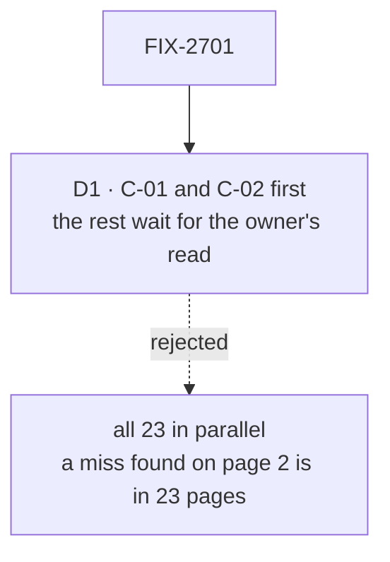

# FIX-2701 · Decisions

[Spec](SPEC.md) · **Decisions**

One decision is the sign-off surface. The rest is context for it.

## The tree

Solid edges are what you're signing. Dashed edges lost, and the label says why.

## D1 · C-01 and C-02 are written first, and the other 21 pages wait for the owner's read of them

| | |
|---|---|
| **Instead of** | Writing all 23 pages in parallel and sampling the owner's read afterwards |
| **Because** | The epic's D4 has the owner read the first two pages of each section. Read after 23 pages exist, a miss in voice, depth or figure style found there is a fix to 23 pages; read before, it is a fix to the brief. Every pilot so far needed such a fix |
| **Locks in** | The section's calendar runs one owner read longer. C-01 and C-02 are the reference pages the other writers are told to match, and the brief absorbs what the read finds before page 3 starts |

It comes down to the cost of a miss: found on page two, it is one fix, not 23.

**What would change my mind:** the owner passing C-01 and C-02 with no change. Then Start,
Catalog and Build, which hold their first two pages for the same read, skip that wait.

## Decided, not asked

- **C-12 Kits and slots runs the loop from the merged `defineKit` surface**, its doc comments,
  its tests and `goals/kits/install-in-any-order/`. If its fact check or cold read shows the
  model contested, it gets a concept doc first, the sitemap's rule for this page. That doc
  settles which model the page teaches; it is never a fact-sheet source, because it lives in
  `docs/internal/design/`, which ER-9 rules out.
- **Which model writes** is the one FIX-2697's acceptance run picks (the epic's D4). No page
  here starts before it reports.
- **Order after the wait** is the sitemap's reading order, with pages in parallel where the
  earlier ones they build on have passed pass 9.
- **The three existing pages enter at pass 4** (the epic's amended D4): their facts are checked
  by pass 5 rather than a new fact sheet, and pass 6 strips their mechanism and "What it won't
  do" sections.
- **Pass 6 rows go to FIX-2699** through each page's record until the R-page is on `main`, then
  straight onto the R-page (the epic's amended *Who owns what*).
- **C-11 and C-12 each say when to pick the other**, the epic analysis's note: a capability adds
  tools and context to blocks; a kit adds flows, folders and slots to an app.
- **Kit snippets are written against FIX-2627's approved spec** and reconciled at FIX-2705
  (ER-8). Codex and Cursor are fills of the harnesses slot, as FIX-2627 decided.

## Considered and dropped

| Alternative | Why not |
|---|---|
| Write the Concepts book through `concept-doc` throughout | The epic's D4 pilot: it costs a 5,000-word doc per page, and cold readers understood its pages least |
| One PR per page | The implementer's split; the spec only fixes the D1 wait |
| Keep the pilots as written and add them as-is | They predate the contract and carry mechanism (the epic's debt list) |

## Analysis

2026-11-12 · watermark 2026-11-12 · run over the whole spec set by the epic agent. For this
spec: **right approach, with one change folded:** a draft card sending C-12 through
`concept-doc` unconditionally conflicted with ER-9 (a concept doc lives in `docs/internal/`) and
with the sitemap's conditional rule; it became a decided line. The capability-or-kit note from
the epic's analysis is carried. Nothing open.

## How it got here

- **Draft** in the epic's spec set, from the sitemap's Concepts entries and the epic's D4 and D6.

**Open: none.**
