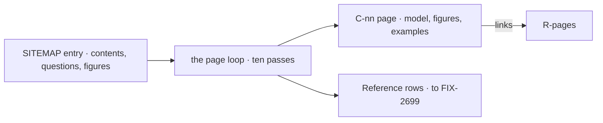

# FIX-2701 · The Concepts book: 23 pages a newcomer reads in order

**Spec** · [Decisions](DECISIONS.md)

## Five people, before and after

| Someone who… | Today | After |
|---|---|---|
| **has run a starter and wants to understand it** | Reads `fundamentals/`, then guides, then `advanced/`, with no end and the same idea told several ways | Reads C-01 to C-23 in order, each page using only what earlier pages taught |
| **reads a page about tasks** | Meets claim races and retry limits in the middle of the idea | Meets the idea, two or more figures, short examples, and a link to R-23 for the races |
| **copies an example** | Gets a fragment with names it never declared | Gets a file with its path, its imports, and code that type-checks |
| **can't tell a capability from a kit** | Finds no page that says when to pick which | Reads it on C-11 and C-12, which each say when to pick the other |
| **knows LangChain or another framework** | Has to work out what differs | Reads one "If you know …" section where our word differs (ER-6) |

## The goal, and how we'll know it's met

**A newcomer who reads C-01 to C-23 in order can answer every page's cold-read questions, and Start plus Concepts is 30,000 words or fewer.**

| Is it the right goal? | |
|---|---|
| **The real need** | The epic's hour: "after an hour, can say what an app, a kit, a flow and a block are and which one to change" ([SPEC](../../epics/FIX-2696/SPEC.md)) |
| **Smaller, and rejected** | "Every page under 1,500 words." A short page can still lose the reader: in the concept-doc pilot, three versions of the same pages scored from 5.5 to 8 of 9 on one cold read |
| **Bigger, and not this issue's** | The whole hour, run cold from S-1 on the published site. That is FIX-2705's goal |
| **Not done if** | Every page passes the checker and its cold read was never run · readers pass with the old site open · the 30,000 holds because pages left their mechanism out instead of moving it to Reference |

**No goal check fits.** This is docs. What proves it is each page's loop record (FIX-2697): pass 9
gives the page and its questions to two or more fresh agents with no tools, and most readers
answer every question right. The word total is the checker's sum over Start and Concepts. The
control that must fail: the same readers, given today's source pages for C-07, C-15 and C-21
and those pages' questions, miss at least one question each.

## What changes

Each page starts from its sitemap entry, runs FIX-2697's loop, and leaves two things: the page,
and the rows its depth pass moved to Reference.

**Docs:** 23 Concepts pages under `docs/contributing/docs-revamp/pages/concepts/`, moved under
`apps/docs/` at cutover (FIX-2705). Their 39 figures. Three existing pages brought to the
concept/reference contract: `pages/blocks.md` (C-02, with its figure redrawn) and the pilots
`tasks-and-boards.md` (C-21) and `workers.md` (C-22).

## What stays as it is

- The sitemap's 23 pages, their order and what each holds. Moving a topic is an epic amendment.
- The writing standard and the loop (FIX-2697). This issue runs them; it doesn't change them.
- The drafting calls the epic recorded: "Flow State", workers introduced as agents, no page
  reprints a file to change one line.

## What's already here, and the debt

| Already here | What this does with it |
|---|---|
| `fundamentals/*`, five guides filed as concepts, `advanced/*` | **Replaces.** Each is a source for one or more pages; FIX-2705 removes them |
| `pages/blocks.md`, `pilot/tasks-and-boards.md`, `pilot/workers.md` | **Extends.** Brought to the contract through passes 4 to 10 |
| The concept-doc skill | **Builds on**, for C-12 only and only if its model proves contested ([decided, not asked](DECISIONS.md#decided-not-asked)) |
| FIX-2697's loop and checker | **Builds on.** Every page runs it |
| Anything else that teaches the model in order | **None.** `fundamentals/overview` is a map, not a path; `guides/anatomy-of-a-flow` merges into C-01 |

| Adds | Existing piece considered | Why it doesn't fit / how composed |
|---|---|---|
| Nothing to any package | | Pages and figures only |

| The debt | |
|---|---|
| **Removes** | The reading path through `fundamentals/`, `advanced/` and concept guides, at cutover |
| **Adds** | Kit names and keys written against the specified surface, reconciled at FIX-2705 (ER-8) |
| **Leaves** | Pages that name kit factories not yet built: C-12, C-22, C-23. Their record says so |

**Net: down.** One path of 22,500 planned words replaces many.

## Sign off

**[The goal](#the-goal-and-how-well-know-its-met), at that size:** every question answered, on
every page, inside 30,000 words with Start. If wrong: a book that passes its own questions but
not the hour FIX-2705 measures.

**[The debt](#whats-already-here-and-the-debt), net down:** one path replaces several; kit names
wait for ER-8. If wrong: three pages rewritten when the kits ship.

1. **[D1](DECISIONS.md#d1) · C-01 and C-02 go first, and the rest wait for the owner's read of them.** If wrong: 21 pages start one owner read later.

**Open: none.** Which model writes is the epic's D4 question,
settled by FIX-2697's acceptance run before this issue's first page.

Improvement · contributor-folder pages, moved at cutover · large · FIX-2696
