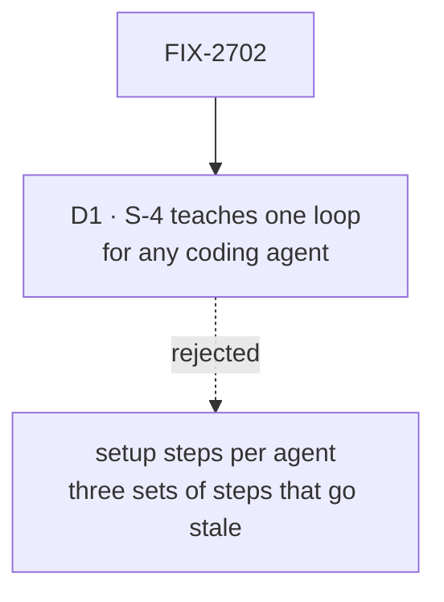

# FIX-2702 · Decisions

[Spec](SPEC.md) · **Decisions**

One decision is the sign-off surface. The rest is context for it.

## The tree

Solid edges are what you're signing. Dashed edges lost, and the label says why.

## D1 · S-4 teaches one loop any coding agent can run, not each agent's setup

| | |
|---|---|
| **Instead of** | A section per agent: Claude Code, Cursor, Codex, each with its own setup steps |
| **Because** | The loop is the same for every agent: read `llms.txt`, write, `fsdev run`, read the NDJSON events, fix. Per-agent setup changes with each agent's release, on a page the reader meets in their first ten minutes, and three sets of steps triple the budget of an 800-word page |
| **Locks in** | S-4 names no agent's settings. A reader who wants their tool's steps follows the tool's own docs. The harness kits on K-14 to K-17 are a different thing, agents running *inside* an app, and S-4 says so in one line |

It comes down to staleness: per-agent steps change with every agent's release.

**What would change my mind:** cold readers on S-4 failing "which two things do you hand the
agent" because they couldn't find where their agent takes them. Then one line per agent, no more.

## Decided, not asked

- **S-1 and S-2 go to the owner before the other three start**, the rule FIX-2701's D1 sets for
  Concepts, so a miss is fixed in the brief, not in every page. If the owner
  passed C-01 and C-02 unchanged, this section skips the wait.
- **Every Start page runs FIX-2697's loop.** S-1, the pilot, skips the draft (the epic's
  amended D4) with the sitemap's fix applied: slot stacking cut to one sentence, the link to C-01 made
  a site path.
- **S-2's install step is one marked block.** Until O2's install ships it is the clone path; the
  page says so in one sentence, and the block is the only thing that changes when it does.
- **S-2's screenshot waits for the Teammates starter's final screens.** The page is written with
  the figure brief and a placeholder; the record marks pass 10 open until the screenshot exists.
- **S-4 points at `llms.txt`** (FIX-2700) and names the skills a starter ships. Until starters
  install outside the monorepo, it names the skills and where they will be (the sitemap's note).
- **S-5 is the one home of the `createFlowState` and Next handler snippet** (the sitemap's
  one-home table). Every other page links to it.
- **The literal run uses a clean container**, never this repo's checkout with its build done,
  because that hides a missing step.

## Considered and dropped

| Alternative | Why not |
|---|---|
| Open Start on a terminal run of one flow, not a starter | O2's fallback, for an install more than a quarter away. Not the case yet |
| Fold S-5 into S-2 as a second path | The integrator never runs a starter; two paths on one 600-word page halve both |

## Analysis

2026-11-12 · watermark 2026-11-12 · run over the whole spec set by the epic agent. For this
spec: **right approach.** The timed run was moved here from "FIX-2705 only" so the pages are
known to run before cutover; FIX-2705's goal remains the closure check. Nothing open.

## How it got here

- **Draft** in the epic's spec set, from the sitemap's Start entries and O2.

**Open: none.**
