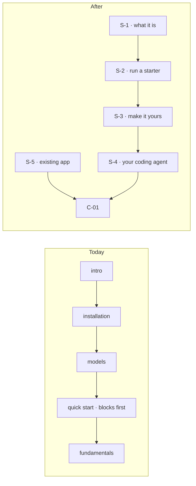

# FIX-2702 · Start: a running app in ten minutes, changed in twenty

**Spec** · [Decisions](DECISIONS.md)

## Five people, before and after

| Someone who… | Today | After |
|---|---|---|
| **lands on the docs wanting an agent app** | Reads five pages and about 5,150 words about blocks, SSE and scopes before anything runs, and never meets a starter | Reads S-1 (650 words), runs the Teammates starter on S-2, and talks to its `researcher` worker |
| **wants to make it theirs** | Has to learn the framework first | Rewrites a worker's brief, adds a worker, and runs one flow from the terminal on S-3 |
| **builds with a coding agent** | Finds `cli/agent-dev-loop`, written for this monorepo | Reads S-4: hand the agent `llms.txt` and the skills, and watch it write, run, read and fix |
| **already has a Next.js or Node product** | Reads the same server wiring on seven pages | Reads S-5, the one page that prints the route snippet, then joins C-01 |
| **hits a worker that doesn't answer** | Searches | Reads S-2's one line on where to look first |

## The goal, and how we'll know it's met

**A reader new to Flow State has a running app in ten minutes, and has changed it in twenty, using only the Start pages.**

| Is it the right goal? | |
|---|---|
| **The real need** | The epic's first half: "a working app in ten minutes" ([SPEC](../../epics/FIX-2696/SPEC.md)) |
| **Smaller, and rejected** | "Five short Start pages." Short pages can still leave the reader without a running app, as today's five do |
| **Bigger, and not this issue's** | The hour, and the timed cold run on the published site. FIX-2705 writes and runs that goal |
| **Not done if** | The pages pass their cold reads and nobody ran the commands · the run works only from inside this repo's checkout with its build already done · ten minutes holds only with the key already set |

**No goal check fits here; FIX-2705's first-hour goal is the check.** This issue proves its
pages two ways before cutover: each page's loop record (FIX-2697), and a literal run: a fresh
agent in a clean container, with only S-2 and S-3 as text and one model key, does exactly what
they say. It records the minutes to a first answer and to the third change, and every place it
had to guess. Pass: under 10 and 20, and no guess. The control that must fail is the same run on
today's getting-started path, which has no starter to reach.

## What changes

Today the path starts at the framework and ends nowhere. After, it starts at an app and ends at
C-01, with S-5 as a second door for an integrator.

**Docs:** five Start pages under `docs/contributing/docs-revamp/pages/start/`, moved under
`apps/docs/` at cutover (FIX-2705). Five figures, one of them a screenshot. S-1 is the pilot,
brought to the contract.

## What stays as it is

- O2, the owner's: lead with starters; until a starter installs in one command, S-2 uses the
  clone path and says so. A one-command install is a requirement before Start publishes.
- The cast: the Teammates starter and its `researcher` worker, on every Start page.
- The epic's drafting calls on S-1: its opening line and the remix line stay.

## What's already here, and the debt

| Already here | What this does with it |
|---|---|
| `getting-started/*`, `intro`, `fundamentals/overview` | **Replaces.** Sources for S-1 to S-3 and S-5; FIX-2705 removes them |
| `cli/agent-dev-loop` | **Replaces** with S-4, minus the monorepo paths |
| `getting-started/existing-project`, `guides/nextjs-setup` | **Replaces** with S-5, keeping "Common pitfalls" |
| `pilot/what-flow-state-is.md` | **Extends**, to the contract: slot stacking cut to one sentence and a link to C-12 |
| The `fsdev run` and `fsdev dev` commands | **Builds on.** S-3 and S-4 teach them as they ship |
| Anything else that gets a newcomer to a running app | **`examples/`'s copy-out recipe**, which O2 names. S-2 uses it if it is shorter than the clone path when the page is written |

| Adds | Existing piece considered | Why it doesn't fit / how composed |
|---|---|---|
| Nothing to any package | | Pages and figures only |

| The debt | |
|---|---|
| **Removes** | Today's five-page path to a first run, at cutover |
| **Adds** | S-2's clone path, which is replaced by one command when O2's install ships. Kit snippets on S-1, reconciled at FIX-2705 (ER-8) |
| **Leaves** | The starter install itself, product work outside the epic |

**Net: down.** Five pages and 5,150 words become five pages and 3,400.

## Sign off

**[The goal](#the-goal-and-how-well-know-its-met), at that size:** running in ten minutes,
changed in twenty, proved by a literal run. If wrong: pages that read well and don't run.

**[The debt](#whats-already-here-and-the-debt), net down:** a shorter path; the clone steps wait
for O2's install. If wrong: S-2 is rewritten when the install ships.

1. **[D1](DECISIONS.md#d1) · S-4 teaches one loop any coding agent can run, not each agent's setup.** If wrong: a Cursor or Codex user finds no steps for their tool on S-4.

**Open: none.**

Improvement · contributor-folder pages, moved at cutover · small · FIX-2696
