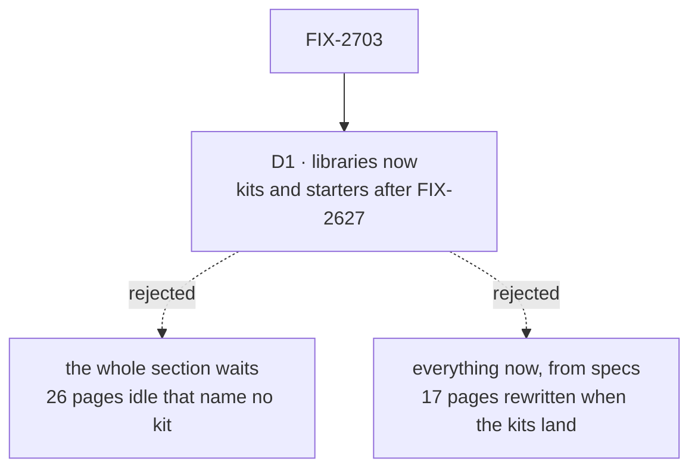

# FIX-2703 · Decisions

[Spec](SPEC.md) · **Decisions**

One decision is the sign-off surface. The rest is context for it.

## The tree

Solid edges are what you're signing. Dashed edges lost, and the label says why.

## D1 · Library pages start when the standard lands; kit and starter pages wait for FIX-2627 to merge

| | |
|---|---|
| **Instead of** | The whole section waiting for FIX-2627, as the issue's relation reads; or every page written now against the specified kit surface |
| **Because** | K-01 and K-18 to K-43 name no kit factory, so nothing about them waits on the kits. The 17 kit and starter pages are mostly install lines, config keys and slots, which are exactly what FIX-2627 builds; written from its spec they would be rewritten when it lands |
| **Locks in** | Two batches, with the kit template proven first on libraries, which drop the two slot headings. The Workforce and Harnesses pages, the ones readers need most, come last in the section |

It comes down to what the kit pages are made of: install lines and keys FIX-2627 hasn't built yet.

**What would change my mind:** FIX-2627 slipping past the point where the kits release would
still carry it. Then kit pages are written from its approved spec under the epic's amended ER-9,
and FIX-2705 reconciles them.

## Decided, not asked

- **The first two pages of this section go to the owner before the rest start**, the rule
  FIX-2701's D1 sets for Concepts, so a miss is fixed in the brief, not in every page. If the owner
  passed C-01 and C-02 unchanged, this section skips the wait.
- **Kept library pages skip the draft** (the epic's amended D4): the patterns, tools and
  memory pages whose audit verdict is *keep*. Their config tables leave in pass 6 for
  `reference/patterns`, `reference/tools` and `reference/memory` (FIX-2699).
- **Codex and Cursor are pages about a fill**, under Harnesses, because FIX-2627's approved spec
  makes them harness values that fill the harnesses slot. The sitemap's open row is amended.
- **K-03, the Claude Code-style starter, is written under a placeholder name.** The name is the
  owner's to give before cutover; the page and its slug change in one edit, and its record holds
  pass 10 open until then. This doesn't hold the spec.
- **"Lab" is dropped from K-04** unless the owner keeps it, the sitemap's open item. A page that
  defines a term for one page only costs the reader a word; restoring it is one edit.
- **`docs/objectives.md` changes in this issue's first PR**, with K-18. The non-goal today lists "publishing, discovery,
  versioning, a registry"; O1 teaches publishing a kit as an npm package, so the line keeps
  discovery, versioning and a registry as non-goals and says publishing to npm is how kits are
  shared.
- **The *what this installs* figure is one layout on every kit page**, the sitemap's convention,
  drawn once and reused, so readers compare kits by eye.

## Considered and dropped

| Alternative | Why not |
|---|---|
| Codex and Cursor as kit pages of their own | FIX-2627 makes them fills; a kit page would describe something that doesn't exist |
| Merge the eight pattern pages into the chooser | Undoes eight *keep* verdicts on pages that are the right size (the epic's sitemap question 1) |

## Analysis

2026-11-12 · watermark 2026-11-12 · run over the whole spec set by the epic agent. For this
spec: **right approach, with one change folded:** FIX-2627, approved since the sitemap was
written, settles Codex and Cursor as fills, so that open row is closed by amendment rather than
left for this issue to guess. Nothing open.

## How it got here

- **Draft** in the epic's spec set. The two-batch split came from reading which pages the
  sitemap's "unsettled" list actually holds.

**Open: none.**
