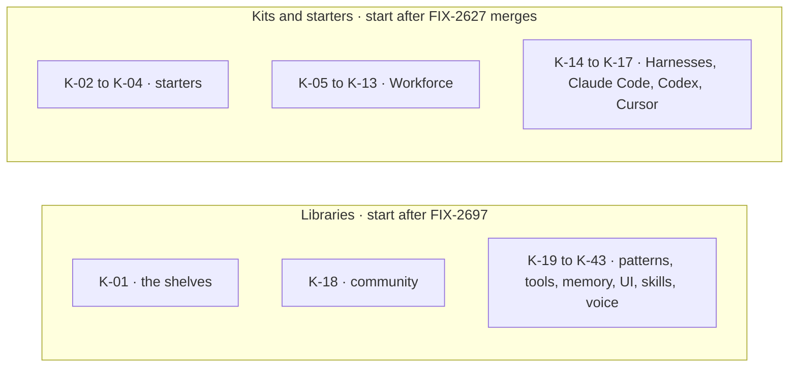

# FIX-2703 · The Catalog: what you can install, one page each

**Spec** · [Decisions](DECISIONS.md)

## Five people, before and after

| Someone who… | Today | After |
|---|---|---|
| **wants a whole app to reshape** | Finds no page about starters | Opens the Starters shelf: Teammates, the Claude Code-style starter, Shift Manager, each on the starter template |
| **wants Workforce or the coding harnesses in their app** | Reads them across many pages, and the on-disk files across five | Reads one kit page each, opening on the same *what this installs* figure, and one *workforce folder* page |
| **compares two kits** | Can't: no two pages share a shape | Reads the same headings in the same order on every kit page, and compares the figures by eye |
| **wants to share a kit they wrote** | Finds nothing, and `docs/objectives.md` lists publishing as a non-goal | Reads the *From the community* shelf: a kit is an npm package, and here is how to get listed (O1) |
| **wants a pattern, a tool or memory** | Reads pages that are mostly the right size, with config tables inside | Reads the same pages on the kit template, with their tables moved to Reference |

## The goal, and how we'll know it's met

**Every starter, kit and library a reader can install has one Catalog page on its template, and a reader can say from the page what it installs and which slots it opens and fills.**

| Is it the right goal? | |
|---|---|
| **The real need** | The epic's kit author and builder: "say what you can install" ([SPEC](../../epics/FIX-2696/SPEC.md), O1) |
| **Smaller, and rejected** | "Move the workforce pages under Catalog." The pages would keep their own shapes, and starters would still have none |
| **Bigger, and not this issue's** | A registry or discovery for community kits (O1 rules it out), and writing a kit (B-04, FIX-2704) |
| **Not done if** | A kit page's install line or config keys were written from a spec and never reconciled · a page passes its cold read while its *what this installs* figure is missing · the community shelf promises listing that doesn't exist |

**No goal check fits.** This is docs. Each page's loop record proves it (FIX-2697): two or more
fresh readers with the page alone answer its questions, which always include *what does this
install* and *which slot does it fill*. The kit pages' install lines are checked against the
shipped surface at cutover (ER-8, FIX-2705). The control that must fail: the same readers on
today's `workforce/` pages answering K-05's questions.

## What changes

Forty-three pages in two batches. The libraries name no kit factory, so they start as soon as
the standard lands; the kit and starter pages wait for the kit surface to be on `main`
([D1](DECISIONS.md#d1)).

**Docs:** 43 Catalog pages, K-01 to K-43 in the
[sitemap](../../epics/FIX-2696/SITEMAP/catalog.md), under
`docs/contributing/docs-revamp/pages/catalog/`, moved under `apps/docs/` at cutover. Their 33
figures. One contributor-doc edit now: `docs/objectives.md`'s non-goal reworded to match O1.

## What stays as it is

- The two templates and the shelves the sitemap fixes.
- O1, the owner's: teach sharing kits as npm packages and promise no registry.
- The pattern, tool and memory pages' substance. Their audit verdict is *keep*.

## What's already here, and the debt

| Already here | What this does with it |
|---|---|
| `workforce/*`, `orchestration/*`, `skills/*`, `shift-manager/*` pages | **Replaces.** Sources for K-04 to K-17 and K-42 |
| Five on-disk workforce pages | **Replaces** with K-11, the workforce folder; their rules move to R-29 (FIX-2699) |
| `patterns/*`, `tools/*`, `memory/*`, `ui/*` pages | **Extends.** Kept pages, moved to the kit template, tables to Reference |
| `ecosystem/overview` | **Replaces** with K-01 |
| FIX-2627's approved spec: Codex and Cursor are harness values that fill the harnesses slot, not kits | **Keeps.** K-16 and K-17 describe a fill; the sitemap's open row is amended to say it is settled |
| Anything else that lists what can be installed | **None** beyond `ecosystem/overview`, which is replaced |

| Adds | Existing piece considered | Why it doesn't fit / how composed |
|---|---|---|
| Nothing to any package | | Pages and figures only |

| The debt | |
|---|---|
| **Removes** | About 40 source pages at cutover, and five on-disk pages in one |
| **Adds** | Kit pages written ahead of the kits release, reconciled at FIX-2705 (ER-8). The community shelf, which starts empty |
| **Leaves** | The Claude Code-style starter's name, the owner's. K-03 is written under a placeholder name and the record holds pass 10 until it is named |

**Net: down.** One shape for 43 pages, from many shapes across more.

## Sign off

**[The goal](#the-goal-and-how-well-know-its-met), at that size:** one page per installable
thing, on its template, and a reader can say what it installs. If wrong: a shelf that lists
things without saying how they fit together.

**[The debt](#whats-already-here-and-the-debt), net down:** one shape replaces many; kit lines
wait for ER-8. If wrong: seventeen kit pages touched again at cutover.

1. **[D1](DECISIONS.md#d1) · Libraries start now; kit and starter pages wait for FIX-2627 to merge.** If wrong: two batches, and the template first proven on pages that open no slots.

**Open: none.** The starter's name and "Lab" are recorded under [decided, not
asked](DECISIONS.md#decided-not-asked); neither holds the spec.

Improvement · contributor-folder pages, moved at cutover · large · FIX-2696
