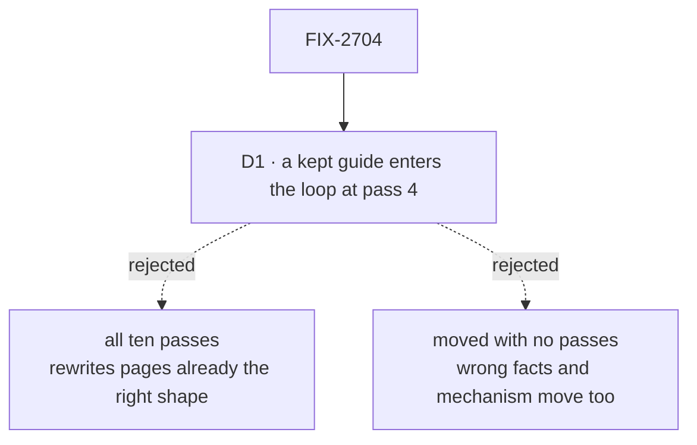

# FIX-2704 · Decisions

[Spec](SPEC.md) · **Decisions**

One decision is the sign-off surface. The rest is context for it.

## The tree

Solid edges are what you're signing. Dashed edges lost, and the label says why.

## D1 · A page kept from today's site enters the loop at pass 4: checks, fact check, depth, editor, revise, cold read

| | |
|---|---|
| **Instead of** | All ten passes from a new fact sheet, as the epic's D4 reads; or moving the twelve recipes over with no passes |
| **Because** | Passes 1 to 3 exist to write a page. These are written, and the epic keeps them because they are the right size. Rewriting them from a fact sheet risks undoing that. Skipping every pass would move their wrong facts and any mechanism with them |
| **Locks in** | A kept page's facts are checked by pass 5 against the code, with no fact sheet listing them. The rule is the epic's, amended in this PR, so it covers the kept pattern, tool and memory pages in FIX-2703 and the pilots too |

It comes down to pages already the right size: a fresh draft is more likely to undo them than improve them.

**What would change my mind:** pass 5 finding wrong facts in more than two of the first five
kept pages. Then kept pages start at pass 1 like the rest.

## Decided, not asked

- **The first two pages of this section go to the owner before the rest start**, the rule
  FIX-2701's D1 sets for Concepts, so a miss is fixed in the brief, not in every page. If the owner
  passed C-01 and C-02 unchanged, this section skips the wait.
- **Where each guide goes is the sitemap's.** A guide whose mapping is wrong is an epic
  amendment, not a decision here.
- **`polish-docs` runs once over Build** after its pages pass the loop, to give each topic one
  home within the section. FIX-2705 runs it again across the whole set.
- **Tutorials are proven by a literal run**: a fresh agent in a clean project follows each step
  and ends with the result running. A step that needed a guess is a defect in the page.
- **B-01 is the one home of the hello-chat app**, linked from S-3 and C-01.
- **The two contributor pages move to `docs/contributing/`** at cutover with the other pages that
  leave user docs. FIX-2705 moves them; the sitemap names their destination.
- **Recipes explain nothing.** Each links to the concept that does; pass 6 moves anything that
  explains a check, a retry or a limit to Reference.

## Considered and dropped

| Alternative | Why not |
|---|---|
| Merge the five deploy recipes into one page | Undoes *keep* verdicts on pages that are the right size (the sitemap's question 1) |
| Make the schedule and webhook recipes tutorials | Each is one task; a tutorial's budget would pad them |

## Analysis

2026-11-12 · watermark 2026-11-12 · run over the whole spec set by the epic agent. For this
spec: **right approach, with one change folded:** the epic's D4 had every page run all ten
passes, which for kept pages meant rewriting them; amended so a kept page enters at pass 4,
across FIX-2701, FIX-2702, FIX-2703 and this issue. Nothing open.

## How it got here

- **Draft** in the epic's spec set, from the sitemap's Build entries and its list of guides that do not become Build pages.

**Open: none.**
