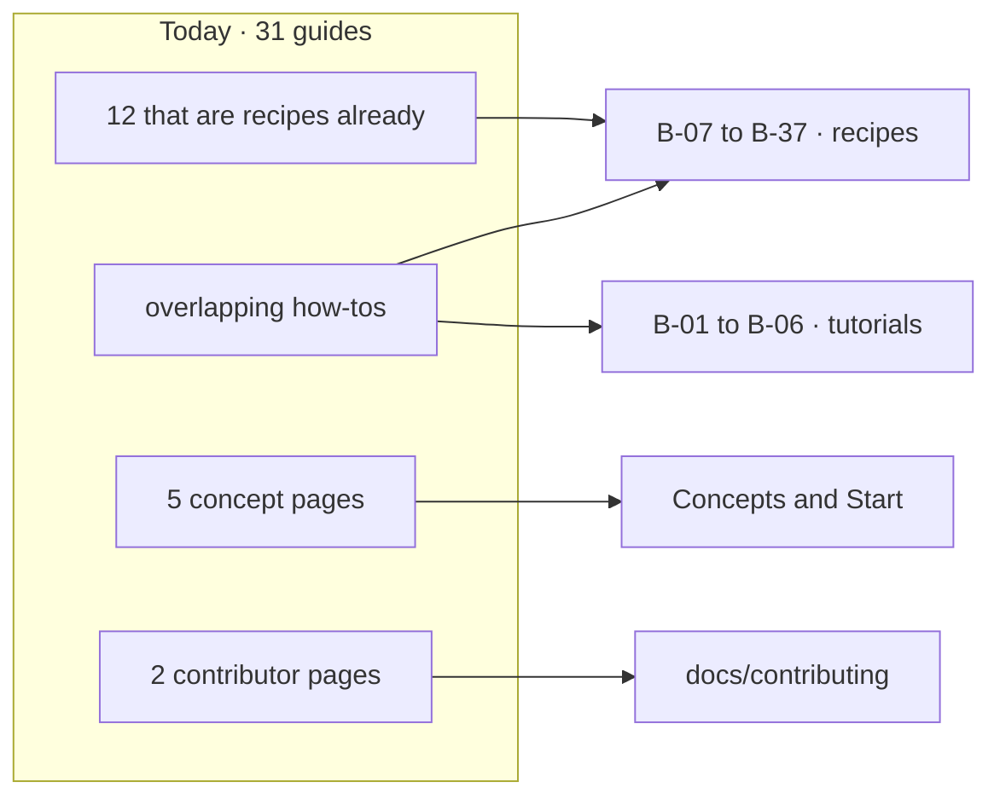

# FIX-2704 · Build: six tutorials and thirty-one recipes, each topic once

**Spec** · [Decisions](DECISIONS.md)

## Four people, before and after

| Someone who… | Today | After |
|---|---|---|
| **wants to build their first flow by hand** | Finds the hello-chat app built four times, about 6,800 words, each a little different | Builds it once, on B-01, a tutorial whose every step ends with something to see |
| **has a task: deploy to Vercel, take a Stripe webhook** | Finds a guide, often a good one, beside a concept page that also explains it | Finds one recipe: a task-shaped title, numbered steps, the finished code, and links for the why |
| **wants to write a kit or ship a starter** | Finds nothing | Follows B-04 or B-05, after the kits release |
| **opens `guides/` looking for a concept** | Finds five concept pages filed as guides, and two pages meant for contributors | Finds those concepts in Concepts, and the contributor pages in `docs/contributing/` |

## The goal, and how we'll know it's met

**Every one of today's 31 guides is a tutorial, a recipe, part of another section's page, or gone, and no Build page explains what a Concepts page explains.**

| Is it the right goal? | |
|---|---|
| **The real need** | The epic's "a fact has one home" (ER-1) for the how-to half of the site, and a builder who can do one task without reading three pages |
| **Smaller, and rejected** | "Rename guides to recipes." The duplication and the concept pages filed as guides would stay |
| **Bigger, and not this issue's** | The one-home check across the whole site. FIX-2705 runs it at cutover |
| **Not done if** | A guide is dropped and its one useful section has no new home · a recipe explains its concept instead of linking to it · a tutorial's code doesn't run end to end |

**No goal check fits.** This is docs. Three things prove it before cutover: a pass over the
[sitemap](../../epics/FIX-2696/SITEMAP/build.md), where each of today's guides is either the
source of a Build page or listed under *Guides that do not become Build pages*, and every
target exists; each page's loop record (FIX-2697); and for each
tutorial, a fresh agent that follows it step by step in a clean project and ends with the
tutorial's result running. The control that must fail: the same pass with one guide's mapping removed
from the sitemap, which must name that guide.

## What changes

Every guide lands in exactly one place. The twelve already in recipe shape keep their text and
enter the loop late ([D1](DECISIONS.md#d1)); the rest are written fresh from their sources.

**Docs:** 37 Build pages under `docs/contributing/docs-revamp/pages/build/`, moved under
`apps/docs/` at cutover. Eight figures. The two contributor pages are moved by FIX-2705 with the
other pages that leave user docs.

## What stays as it is

- The twelve guides that are already recipes, in substance (the epic's *What stays*).
- B-04 and B-05 wait for the kits release (the sitemap).
- `polish-docs` edits presentation, never facts; what is cut was decided by O3 and FIX-2699.

## What's already here, and the debt

| Already here | What this does with it |
|---|---|
| 31 guides in `apps/docs/guides/` | **Replaces.** Each is mapped once in the sitemap |
| The twelve guides already in recipe shape | **Extends.** Moved to the recipe type and run from pass 4 ([D1](DECISIONS.md#d1)) |
| `polish-docs` | **Builds on.** Run across Build once its pages exist, for one home per topic |
| `apps/docs/guides/webhooks-stripe.md` | **Builds on.** The brief's model recipe |
| Anything else that consolidates guides | **None.** `release-docs` writes per release; it doesn't merge pages |

| Adds | Existing piece considered | Why it doesn't fit / how composed |
|---|---|---|
| Nothing to any package | | Pages and figures only |

| The debt | |
|---|---|
| **Removes** | 31 guides at cutover; the four tellings of hello-chat |
| **Adds** | Twelve recipes whose facts get a fact check but no fact sheet ([D1](DECISIONS.md#d1)) |
| **Leaves** | B-04 and B-05's kit surface, reconciled at FIX-2705 (ER-8) |

**Net: down.** 31 overlapping guides become 37 pages with one topic each.

## Sign off

**[The goal](#the-goal-and-how-well-know-its-met), at that size:** every guide accounted for, and
no Build page explaining a concept. If wrong: tidy recipes that still teach the same idea twice.

**[The debt](#whats-already-here-and-the-debt), net down:** 31 guides become 37 single-topic
pages. If wrong: twelve recipes carry an old wrong fact past pass 5.

1. **[D1](DECISIONS.md#d1) · A guide kept as-is enters the loop at pass 4, not pass 1.** If wrong: twelve pages get a fact check but no fact sheet.

**Open: none.**

Improvement · contributor-folder pages, moved at cutover · large · FIX-2696
