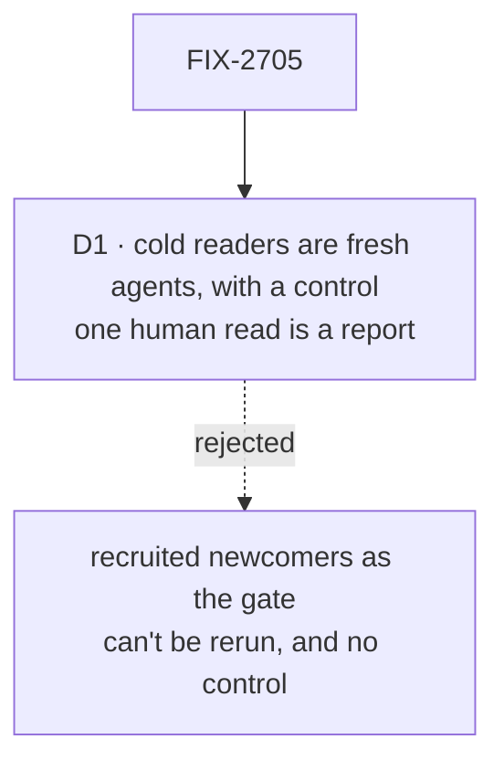

# FIX-2705 · Decisions

[Spec](SPEC.md) · **Decisions**

One decision is the sign-off surface. The rest is context for it.

## The tree

Solid edges are what you're signing. Dashed edges lost, and the label says why.

## D1 · The hour test's cold readers are fresh agents, run with a control; one human newcomer's read is reported beside it, not a gate

| | |
|---|---|
| **Instead of** | Recruiting new developers as the readers whose results close the epic |
| **Because** | A goal is a check someone can run again and watch fail. Agents can read today's site as the control and the new site as the test, the same way, and again at every later release. A recruited newcomer reads once, can't read the old site cold afterwards, and gives one result |
| **Locks in** | The epic closes on what fresh agents with a browser and a shell can do in an hour, which is a proxy for a human. One human newcomer, if the owner names one, reads the cutover preview and reports; a report that contradicts the goal reopens the closure, it doesn't block it |

It comes down to the control: only agents can read today's site cold, and fail it on cue.

**What would change my mind:** the human read and the agents disagreeing on the first-run
minutes by more than half. Then the human leg needs humans, and the goal says how many.

## Decided, not asked

- **The cutover is one release-docs PR**, at the release that carries kits (the epic's D2). The
  pending changesets' `Docs:` lines are folded into the new pages, not the old ones.
- **O2 is checked at cutover.** If one command installs a starter, S-2's marked block becomes that
  command. If it doesn't, the cutover is held and the coordinator asks the owner to reopen O2, as
  O2 says, because O2 makes the install a requirement before Start publishes.
- **ER-8 runs here:** every kit name, config key and import path on every page is checked against
  the shipped surface, and the pilots' named claims (the `README.md` list in `docs-revamp/`) are
  reconciled.
- **Every old URL redirects** to the page that holds its topic, from the sitemap's sources lines;
  a URL whose topic was cut under O3 redirects to its section's first page. None returns 404.
- **The READMEs FIX-2698 wrote are moved into place**, and `scripts/check-root-exports.mjs` runs on
  them; each export it then flags gets a real use or leaves the root, in this PR.
- **The checker's default glob moves to `apps/docs/{docs,guides}/**`** in this PR (FIX-2697).
- **The agent leg runs two arms**, `llms-full.txt` alone and `llms.txt` with per-page Markdown, and
  records both; FIX-2700's D1 reads the result.
- **Contributor-only pages move to `docs/contributing/`**, the list in the sitemap's *Pages that
  leave user docs* and Build's *Guides that do not become Build pages*.
- **`polish-docs` runs once across the set**, after the pages move and before the goals run. It
  edits presentation, never facts.

## Considered and dropped

| Alternative | Why not |
|---|---|
| Cut over in parts, section by section | The epic's D2: readers would see a half-old site |
| Let deleted pages return 404 | The closure measure is that every old URL redirects, and links from outside the site don't update |

## Analysis

2026-11-12 · watermark 2026-11-12 · run over the whole spec set by the epic agent. For this
spec: **right approach.** The set review moved three things here so each has one owner: the
agent test (from FIX-2700), the README move (from FIX-2698) and the checker's glob (from
FIX-2697). Nothing open.

## How it got here

- **Draft** in the epic's spec set, as the closure issue: the epic's goal and measures, made
  into two goals and a list of checks.
- **Review round 1** — the agent leg's model is fixed before its first run and recorded with the
  verdict, and the checker's glob move joined the closure measures, both from review on the
  spec-set PR.

**Open: none.**
