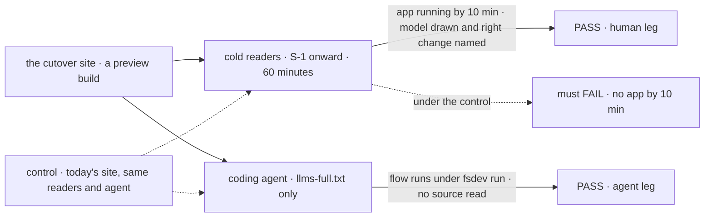
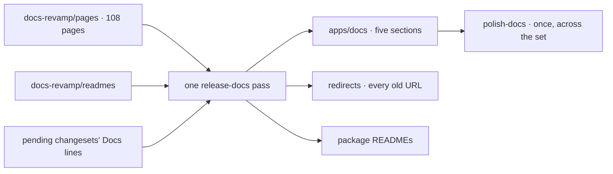

# FIX-2705 · Cutover: the new docs ship at the kits release, and the epic proves its hour

**Spec** · [Decisions](DECISIONS.md)

## Five people, before and after

| Someone who… | Before cutover | After |
|---|---|---|
| **opens the docs site** | Sees today's eleven sidebar groups and 193 pages | Sees five sections, Start, Concepts, Catalog, Build, Reference, and nothing of the old site but redirects |
| **follows an old link** | Reaches the old page | Lands on the page that now holds that topic, or the nearest section page when the topic was cut (O3) |
| **reads a kit page on release day** | n/a | Reads install lines and keys that match what shipped, because each was checked against it (ER-8) |
| **reads a package README on npm** | Scrolls a long README | Reads an install line, one example and a link (FIX-2698's cut, moved into place here) |
| **asks whether the epic worked** | Has the plan's numbers | Has two first-hour goals, each with a control that fails, and the closure measures, each with a result |

## The goal, and how we'll know it's met

**A reader new to Flow State has a working app in ten minutes, and after an hour can say what an app, a kit, a flow and a block are and which one to change; a coding agent with only the docs writes a flow that runs.**

This is the epic's goal, unchanged. The closure issue proves it.

| Is it the right goal? | |
|---|---|
| **The real need** | People can't tell what they can build or where to start ([the epic](../../epics/FIX-2696/SPEC.md)) |
| **Smaller, and rejected** | "The pages moved and the redirects work." True on day one whether or not a newcomer gets anywhere |
| **Bigger, and not this issue's** | A one-command starter install (O2) and a kit registry (O1), both product work outside the epic |
| **Not done if** | The goals pass against the contributor-folder pages but were never run on the published site · the agent passed by reading the repo · the hour test is graded on the reader's summary, not on what they changed |

Both legs read what the reader produced: a running app, a drawing graded against a key, a flow
that runs. The control is the same run on today's site, where the path to a running app is five
pages long.

| How we verify | |
|---|---|
| **Goal check** | `goals/first-hour/runs-a-starter-and-names-the-layers/` and `goals/first-hour/an-agent-writes-a-flow-from-the-docs/` · real model (`openai/gpt-5.4-mini`, the goals default, unless the agent leg's `goal.md` names a stronger one before its first run; the model is not changed after a failing run, the control and both arms use it, and the verdict records it) · run by the implementer on the cutover preview, before the release merges · verdicts in the cutover PR |
| **Signal** | Human leg: of three or more cold readers ([D1](DECISIONS.md#d1)), most have the starter answering within 10 minutes and, at 60, draw app, kit, flow and block in the right order and name the file to change for a given request. Agent leg: the flow it writes from `llms-full.txt` runs under `fsdev run` and returns the asked-for answer, 2 of 3 tasks; the second arm, `llms.txt` plus per-page Markdown, is recorded beside it |
| **Input** | Three held-out requests (a worker that cites differently, a second step in a flow, a new tool). A different request must pass too |
| **Anti-game** | Don't grade the reader's description of what they did; check the running app and the edited file. The agent's sandbox has no repo checkout and no `node_modules` source beyond installed packages |
| **Control that must fail** | Today's published site, same readers and agent. Must FAIL *starter answering within 10 minutes* and, on the agent leg, *flow runs* |

**The closure measures**, each with its result in the cutover PR: no concept page over 1,500
words; Start plus Concepts at 30,000 or fewer; every topic in the sitemap's one-home table
explained only where it names; every old URL redirects; `goals/first-hour/runs-without-store-ceremony`
passes part (f); `scripts/check-docs-page.mjs`'s default glob reads `apps/docs/{docs,guides}/**` and finds pages there (FIX-2697 hands it over).

## What changes

Everything the writing children left in the contributor folder enters the site through one
release-docs pass, with the release's pending changesets folded into the new pages, not the old.

**Docs:** the whole site. New sidebars and navigation for five sections; 108 hand-written pages
and the generated reference under `apps/docs/`; old pages removed; contributor-only pages moved
to `docs/contributing/`; redirects for every old URL; READMEs replaced; the first *Upgrading*
page filled from the pending changesets.

## What stays as it is

- The voice standard and the release-docs process, run once at a larger size.
- The site's drawing system, `Figure` component and redirects plugin.
- Git history: every removed page is still there (O3).

## What's already here, and the debt

| Already here | What this does with it |
|---|---|
| `release-docs` and its gate on the Version Packages PR | **Builds on.** The cutover is one release-docs PR |
| `@docusaurus/plugin-client-redirects` and its redirect list | **Extends** with every old URL |
| `polish-docs` | **Builds on.** Once, across all the new pages |
| `goals/first-hour/` | **Extends** with the epic's two goals |
| `scripts/check-docs-page.mjs` default glob | **Extends** to `apps/docs/{docs,guides}/**`, so CI checks pages where they live (FIX-2697) |
| Today's 193 pages, 11 sidebar groups, seven `api/*` pages | **Removes** |

| Adds | Existing piece considered | Why it doesn't fit / how composed |
|---|---|---|
| Two first-hour goals | `goals/first-hour/runs-without-store-ceremony` | Composed: the same `describe`, new behaviours. That goal checks teaching files; these check a reader |

| The debt | |
|---|---|
| **Removes** | About 330,000 words from the reading path, and 165,000 README words |
| **Adds** | A redirect list as long as today's site, kept until old links stop arriving. Permanent by design |
| **Leaves** | The starter install (O2) and a kit registry (O1), product work outside the epic |

**Net: down**, by most of the site.

## Sign off

**[The goal](#the-goal-and-how-well-know-its-met), at that size:** the epic's goal, proved on the
cutover site with two goals and their controls. If wrong: the epic wraps on moved pages.

**[The debt](#whats-already-here-and-the-debt), net down:** most of the site goes; a long redirect
list stays. If wrong: broken links for readers who bookmarked the old site.

1. **[D1](DECISIONS.md#d1) · The hour test's cold readers are fresh agents, run with a control, and one human read is a report, not a gate.** If wrong: we certify an hour a real newcomer wouldn't have.

**Open: none.**

Improvement · `apps/docs`, every package README · large · FIX-2696 (closure)
