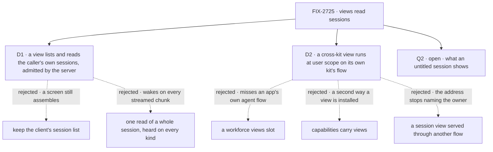

# FIX-2725 · Decisions

[Spec](SPEC.md) · **Decisions**

Two decisions are the sign-off, and one question is open. The owner already decided that these
three screens become views and wait for this issue
([FIX-2627](../FIX-2627/DECISIONS.md#decided-during-implementation), 2026-11-13;
[FIX-2628 Fork B](../FIX-2628/DECISIONS.md#how-it-got-here), 2026-11-15). What is left is what a
view may read of the caller's sessions, where a view that crosses kits lives, and what an untitled
session shows.

## The tree

Solid edges are what you're signing. Dashed edges lost, and the label says why.

## D1 · A view may list the caller's sessions and read their turns; the server decides which

| | |
|---|---|
| **Instead of** | Keeping the session list a client call an app assembles (`listWorkerSessions`, `fsd.sessions.requests`) · or one read of a whole session, heard on every kind of change |
| **Because** | A view has no HTTP client, and its value is that the engine knows what it read (FIX-2623 D1). The read already exists for one session (`sessions.read`, `history`) with one owner rule: same user, tenant and org, else `undefined`, so it is not an existence oracle (BP-031). Listing and turns are the two reads missing. A session's only recorded read today, `ViewDependencies.session`, hears `items` too, so a board that read each run session's flow that way would re-run once per streamed chunk |
| **Locks in** | `RequestSessions` gains `list` (the caller's top-level sessions, filtered at the store by flow and readonly fields, newest first, at most 100 with a `more` flag, each row with its flow, lineage id and updated time) and `turns` (the requests of one session, or of up to 100 at once, filtered at the store by status and action: id, session, action, status, times, source, error code and message; at most 50 a session; no words). `read` also answers the lineage id. A session's flow and lineage change only when the session is deleted or recreated under the same id, which gives it a new lineage; reading them records `run` alone, which both of those publish, never `items`. `read`'s `state` is heard as `run` and `state`. `list` is heard as `run` on the caller's user topic; `turns` as `request` on each session's topic it names. A read that answers nothing (a missing or refused session) records only the caller's own user-topic `run`, alike for both, never that session's topic, so a recreate wakes the view and nothing tells missing from refused. In a view, each answered session also passes the HTTP list's admission (`ownResolverVerdict` for its owning flow, no write sessions). User and session views may use these reads; org views refuse them |

![D1, what a view may read of the caller's sessions. Chosen: list them and read their turns, admitted by the server and heard on the kinds that change them. Instead of: the client's list call. It comes down to who assembles: with the client call every app keeps the per-row reads and its own subscription; with the view the engine records and hears them. Price: two more reads on a public host type. Tie: who may read a session is the same owner rule either way. Locks in list and turns on RequestSessions. Flips if a session list must show other users' sessions](figures/d1-session-reads.svg)

It comes down to who assembles: with the client call, every app keeps the per-row reads.

**What would change my mind:** a screen that lists other people's sessions (a manager's view of
a team). Then a list belongs on an org view with its own read check, not on the caller's reads.

## D2 · No kit adds a view to another kit's flows: a view that reads across them runs at user scope on its own kit's flow

| | |
|---|---|
| **Instead of** | A workforce `views` slot the harness kit fills, merged into the agent and coordinator flows (the issue's example) · capabilities that carry `views`, installed where `uses` lists them · a session view served for a session whose flow is another's, relaxing `assertSessionAdmitted` |
| **Because** | Everything the coding board reads is the caller's own: the conversation ledger is user-scoped "so a task session on another flow reads and settles the row" (`ledger.ts`), and the session reads are D1's. So the view can run on the harness kit's `harnesses` flow, given the conversation's id. A slot reaches only the flows workforce builds: an app whose `agent` entry is its own flow (the kit allows it) would lose the board. Capability views would be a second way a view is installed, through blocks. A relaxed admit check would make a session view's address stop naming the flow that owns it |
| **Locks in** | The worker sessions and session turns views are user views on workforce's roster flow; the coding board is a user view on the `harnesses` flow; recorded work is a session view on the coding worker flow, which the harness kit builds. Each takes a session id in its input, which selects among what the caller may already read and never admits. The board reaches the partition by `conversationLedgerAt` and `filingSessionIdOf` over the admitted read, and its read records the named conversation where a running session would be, so FIX-2625's board notices and partial answers hold, on an empty board too. No slot or capability carries views |

![D2, where a view that reads across kits lives. Chosen: at user scope on its own kit's flow. Instead of: a workforce views slot. It comes down to an app's own agent flow: the slot reaches only flows workforce builds, so an app that replaces agent loses the board, while a user view reads the user's ledger from any flow. Price: the screen addresses the board on another flow and passes the session id. Tie: who may read is the server's owner rule either way. Locks in each view's address. Flips if a cross-kit view needs a session resource of another flow's session](figures/d2-own-flow.svg)

It comes down to an app's own agent flow: a slot never reaches it, a user view does.

**What would change my mind:** a cross-kit view that must read a session-scoped resource of a
session on another kit's flow. The board's pull-request links are such a case, and stay on the
recorded work view, where the run session is the coding flow's own.

## Open

### Q2 · What does the sidebar show for a session before its title is generated?

- **In plain terms.** Today a new session shows the first line of its first message until the
  title model writes a title, seconds later. That line lives in the session's messages, which the
  list view would have to read for every untitled row on every run.
- **The trade-off.** "Untitled" until the title lands costs nothing on the list, but a new session
  reads "Untitled" for a few seconds, and stays so where titling failed. The alternative: the
  server writes the first line onto the session at its first send, as a field the list carries:
  one write per first send and a field kept for good.
- **My recommendation:** "Untitled", and drop the first-line fallback.
- **What would change my mind:** titles that often fail or take long to land. Then the server
  writes the first line.
- **If wrong:** cosmetic, and reversible by adding the field later.

It comes down to the cost on every list: the fallback reads a message per untitled row.

## Decided, not asked

### Invariants

- **One owner rule.** Every read of another session goes through `request-sessions.ts`'s rule
  (the dispatch seam's `resolveExistingSession`): `read`, `history`, `list` and `turns`, in a
  view or an action. **A view's reads also pass the HTTP list's admission** (`session-routes.ts`
  `handleListSessions`): each row must pass `ownResolverVerdict` for its owning flow with this
  request's caller (`?? hostRuleAdmits` when that flow authenticates no one), and write sessions
  are never answered. The roster flow's view lists agent-flow sessions, so a caller the roster
  admits but the agent flow's resolver or pin rejects gets nothing of that flow, the same as the
  HTTP list. A refusal is `undefined` and records only the caller's own user-topic `run`, as a missing session does. The view run carries the request's
  `callerFor`; the action-side `sessions.read` is unchanged. Every read a view makes of a session records through
  `createViewDependencies`, never the raw recorder; `views-dependency-matrix.test.ts` gains a row
  per read, and one for a board read of a named conversation with no entries.
- **Identity is heard on `run` only.** A session's flow and lineage id change only when it is
  deleted, or recreated under the same id with a new lineage; both publish `run` on its topic
  (`publish-writes.ts`, the session store's `set` and `delete`). So reading identity records `run`
  alone, never `items`, and a board watching a deleted or recreated conversation re-checks it and
  picks the new ledger partition. `read`'s `state` getter records as `recordSessionReads` records
  a session handle's. The lineage id is server-only:
  it feeds `filingSessionIdOf`, which digests it into a partition, and is never in a view's answer.
  **Amended by FIX-2773 (2026-11-18): identity is heard on `state`, not `run`.** The store's `set` with
  `"absent"` (a birth, so a recreate too) and its `delete` publish `state` on the session as well, so the
  reasoning above holds; `run` is also published by every turn starting or ending, which made a board
  view that names its conversation read again on each reply (the settled-task goal's 0-reads signal).
  `ViewDependencies.sessionIdentity` (`view-reads.ts`) and `docs/architecture/flows-and-actions.md` say the same.
- **Heard on what changes it.** `list` on the user topic as `run`. Membership changes are full
  session writes, which publish it; a one-key `patchState` (a work project set, `work-project.ts`)
  publishes nothing there until its request settles, and the request's write then does. `turns`
  hears `request` only: a session's state deltas and its child sessions' writes publish `run`, and
  the lab's thread hears `request` alone today. Neither hears `items`. The user topic spans the
  caller's orgs: a notice from another org reads the list again and finds the same rows.
- **Bounded** (BP-042): `list` at most 100 rows a call with a `more` flag; `turns` at most 50; no
  words, no state beyond the readonly fields `read` already crosses.
- **No action runs in a view.** The board reads each task's harness from its worker's `harness:`
  setting until its run reports one (FIX-2627), never by running `harness` in a run session;
  review, landing and error come from the row, read server-side and cut to those fields (BP-015).
- **One copy of each rule.** `listWorkerSessions`' membership rule (`carriesOnly`, `WORKER_ONLY`,
  `byRecent`, the default first) moves to `derive-session-id.ts` beside `CRITERIA_STATE_KEYS`, and
  the client's `findWorkerSession` and the view import it. The route's readonly-field guard
  (`resolveStateFilter`) becomes one helper the route and `list` call.

### The views

- **Worker sessions** (workforce, roster flow, keyed by session id): input a worker; rows as the
  [map](SPEC.md#what-replaces-each-part-of-the-adapter) says, `isDefault` and the default first,
  leaving out a task's, a delegate's, a workstream lead's and a project coordinator's session.
  "A turn runs" is any in-progress request on the session whose action is a turn action, read in
  one `turns` call across the listed sessions, so a newer request of another action (a work
  project set, standing rules) never hides a running reply. Waiting tasks are read only for the
  sessions the list answers (at most 100).
- **Session turns** (workforce, roster flow, keyed by request id): a turn is a request whose action
  runs the session's turn block: `RESPOND_ACTION` (the door), `TASK_SETTLED_ENTRY` (a settled
  task's turn), `MESSAGE_RECEIVED_ENTRY` (a worker's message) and the coordinator's
  `ROUTE_ON_ACTION` (its later rounds). Workforce exports these once as a frozen set next to the
  keys, built from the constants, not copied; both views read it, and an entry that runs a turn
  joins it in the same change.
- **The words stay on the stream.** A view runs whole per notice and a reply publishes `items` per
  stored chunk, so no view carries a thread's words; a screen joins `sessionFeed` and the turns
  view, as FIX-2628 already keeps the transcript on its session address.
- **Coding board** (harness-manager, `harnesses` flow, keyed by task id): the board's own list code
  (`taskListEntriesFor`) and the Inbox rule (`inboxItems`); its block declares
  `conversationLedgerResources`. Partial answers as FIX-2627 set them. Pull requests appear by
  number on the card; their links come from the recorded work view in a task's detail, with no
  watch per card.
- **Recorded work** (harness-manager, coding worker flow, session view): the plan and the pull
  requests (number, link, title), beside `changes`.
- **This issue removes `listWorkerSessions`**, with no alias (BP-034), under the owner's standing
  no-legacy decision ([FIX-2628, 2026-11-15](../FIX-2628/DECISIONS.md#how-it-got-here)). The same PR
  moves the teammates goal `stops-and-re-runs-a-task-from-its-popup`, which reads `isDefault`,
  onto the worker sessions view. `findWorkerSession` stays: it derives the one session a write goes to.
- **Names:** `list`, `turns`, and the views' names are new public names; none is a word the
  glossary retires. **Changeset:** `minor` for `core`, `engine`, `workforce` and
  `harness-manager`. Nothing in `packages/client` changes: `listWorkerSessions` is workforce's.

## Considered and dropped

| Alternative | Why not |
|---|---|
| `turns` as an option on `history` | `history` is the one rule a model's history window reads (settled turns, with words); a screen's every-turn status would fork that rule |
| "A turn runs" from one `turns` read per row | A read per listed session on every run; one batched read across them instead |
| "A turn runs" from the latest request's status | A newer request of another action (a work project set) hides a running reply, and `onTaskSettled` is no door action (Codex on #5290) |
| The worker sessions view counts what waits on the user, dismissals included | Dismissals are the lab's own resource; the view answers ids and attempts, the app subtracts |
| Pull-request links read by the board from each run session | A user view can't read another flow's session resource without a new read; recorded work already runs where they live |
| A peer read of another session's resources | No screen needs it once links come from recorded work |

## Settled

- **The ledger crosses flows; peer reads are admitted by the caller alone.** Read from code on
  `main` at `d3381d6f8`: `conversationLedger` is `scope: "user"` (`ledger.ts:138`);
  `RequestSessions.read` answers only the running principal's sessions (`request-host.ts:349`);
  in a user or org view `guardViewRequestHost` refuses both reads (`view-reads.ts`). No POC: each is
  a direct read of the code, and D2 rests on the first.
- **The user topic hears `run` on session and request writes, never on a state delta.**
  `publish-writes.ts`'s table (lines 28 to 33). D1's list hearing rests on it.
- **An empty board in a user view hears nothing today.** `get-or-create.ts` takes its running
  session from `ctx.session` (none in a user view), and `ViewDependencies.board` returns with no
  sessions. Hence D2's named conversation.
- **No factual-base checker.** The adapter counts are FIX-2628's measured ones, quoted, not
  re-derived; nothing else is counted.

## Analysis

2026-11-15 · three independent passes on #5290 (Gitar's among them), at `ef4d26e70` · **Right
approach; the mechanism under it had four holes, folded.** Each claim below was checked in code
before it was folded.

| Finding | Changes the approach? | Disposition |
|---|---|---|
| The board would read each run session's flow and the conversation's lineage through the one recorded session read, which hears `items`, so it re-runs per chunk; `PeerSessionView` has no lineage id | Yes | Folded into D1: identity unrecorded, lineage id answered |
| A worker-session row can't be built from `list` and `turns` alone: running state needs a read per row, the first-line fallback needs messages | Yes | Folded: running state from one batched `turns` read; the fallback is Q2 |
| An empty board in a user view hears nothing, so a first filing never wakes the board | Yes | Folded into D2 and the FIX-2625 row (*Extends*); a matrix row |
| `listWorkerSessions`' membership rule and the route's state-filter guard are private and would be copied | Yes, the Adds | Folded: each moves to one shared place |
| `listWorkerSessions` has other callers (a teammates goal, a docs page, the lab README, docs-revamp facts), `isDefault` and no row cap | Yes, scope | The view carries `isDefault` and the order; this issue removes the call and moves the teammates goal (no-legacy); the docs page joins the docs line |
| `turns` should hear `request` only; a one-key `patchState` reaches the user topic only when its request settles; record only a found session; the board's `error`; the flows-slot route to the installation; the shared recorded-work mapping; the goal's base | No | Implementer notes, placed in the rows above and in *Notes from review* |

## Notes from review

Recorded for the implementer, from the passes on #5290:

- The `harnesses` flow is built in the harness kit's `install` (`harnesses-kit.ts:109-116`). To
  reach the installation for `harness:` it is built through workforce's `flows` slot, and the
  readiness view moves with it.
- Recorded work extends `readRecordedWork` (`recorded-work.ts:86`) and `readSessionPullRequests`
  (`pull-request-wait.ts:79`) onto one shared mapping; `landedOf` moves from the lab into
  harness-manager.
- `b:quiet` measures the turns view too; `a:equals-store`'s input includes a work-project change.

## How it got here

- **Draft** — framed as the reads a view lacks and where a cross-kit view lives; found the ledger
  is user-scoped, so the coding board runs on the harness kit's own flow and no slot is built;
  extended `RequestSessions` with `list` and `turns` under its owner rule; left the words on the
  session stream.
- **Review round 1** — three passes found the board would re-run per chunk through the one
  recorded session read, an empty board heard nothing, and a list row needed more than two reads.
  A session's identity now records `run` alone (narrowed from "nothing" in round 2, Codex: delete and recreate change it), a list row's running state comes from one batched
  `turns` read over the turn actions (Codex, on the first try's latest-request rule), and the board
  read names its conversation. Who removes `listWorkerSessions` was decided under the standing
  no-legacy decision: this issue. The words-on-the-stream card became an engineering call, so the
  two owner questions fit the sign-off.

## Amendments

- **2026-11-15 · unanswered reads record the caller's own topic** (implementation, #5299; Codex review). "Nothing is recorded" left a view that saw a watched conversation deleted with no topic at all, so its recreation never woke it (the push hub counts an empty set as covered and stops polling). A `read`, or a one-session `turns` or `history`, that answers nothing now records the caller's own user-topic `run`, the dependency `list` records; creating, rewriting or deleting a session publishes `run` on its owner's user topic (state-field deltas and `items` do not), so a recreate wakes the view. It never records the unanswered session's topic, and records the same for missing and refused, so `c:own-only` and the no-oracle rule hold. Engineering call under D1's intent; no owner decision changed.
