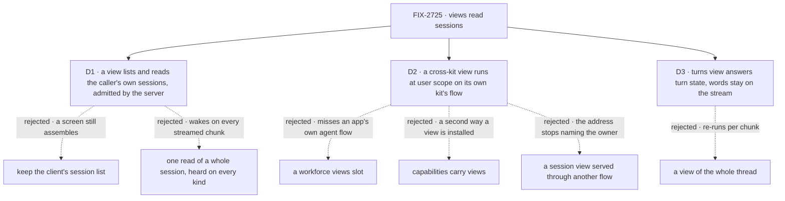

# FIX-2725 · Decisions

[Spec](SPEC.md) · **Decisions**

Three decisions are the sign-off. The owner already decided that these three screens become
views and wait for this issue ([FIX-2627](../FIX-2627/DECISIONS.md#decided-during-implementation),
2026-11-13; [FIX-2628 Fork B](../FIX-2628/DECISIONS.md#how-it-got-here), 2026-11-15). What is left
is what a view may read of the caller's sessions, where a view that crosses kits lives, and how
much of a thread a view carries.

## The tree

Solid edges are what you're signing. Dashed edges lost, and the label says why.

## D1 · A view may list the caller's sessions and read their turns; the server decides which

| | |
|---|---|
| **Instead of** | Keeping the session list a client call an app assembles (`listWorkerSessions`, `fsd.sessions.requests`) · or one read of a whole session, heard on every kind of change |
| **Because** | A view has no HTTP client, and its value is that the engine knows what it read (FIX-2623 D1). The read already exists for one session (`sessions.read`, `history`) with one owner rule: same user, tenant and org, else `undefined`, so it is not an existence oracle (BP-031). Listing and turns are the two reads missing. Hearing every kind of a session would wake the list once per streamed chunk, which is why the adapter today hears `request`, `board` and `resource` and never `items` |
| **Locks in** | `RequestSessions` gains `list` (the caller's top-level sessions, filtered at the store by flow and readonly fields, newest first, at most 100) and `turns` (a session's requests: id, action, status, times, source, error code and message; at most 50; no words). Both keep the owner rule and answer an unknown session as absent. In a view, `list` is heard on the caller's user topic as `run`; `turns` on that session's topic as `request` and `run`. User and session views may use all four reads; org views refuse them. A session id in a view's input only selects among what the caller may already read |

![D1, what a view may read of the caller's sessions. Chosen: list them and read their turns, admitted by the server and heard on the kinds that change them. Instead of: the client's list call. It comes down to who assembles: with the client call every app keeps the adapter's per-row reads and its own subscription; with the view the engine records and hears them. Price: two reads on a public host type, and the user topic wakes the list on every turn of any of the caller's sessions. Tie: who may read a session is the same owner rule either way. Locks in list and turns on RequestSessions. Flips if a session list must show sessions of other users](figures/d1-session-reads.svg)

It comes down to who assembles: with the client call, every app keeps the per-row reads.

**What would change my mind:** a screen that lists other people's sessions (a manager's view of
a team). Then a list belongs on an org view with its own read check, not on the caller's reads.

## D2 · No kit adds a view to another kit's flows: a view that reads across them runs at user scope on its own kit's flow

| | |
|---|---|
| **Instead of** | A workforce `views` slot the harness kit fills, merged into the agent and coordinator flows (the issue's example) · capabilities that carry `views`, installed where `uses` lists them · a session view served for a session whose flow is another's, relaxing `assertSessionAdmitted` |
| **Because** | Everything the coding board reads is the caller's own: the conversation ledger is user-scoped "so a task session on another flow reads and settles the row" (`ledger.ts`), and the session reads are D1's. So the view can run on the harness kit's `harnesses` flow, given the conversation's id. A slot reaches only the flows workforce builds: an app whose `agent` entry is its own flow (the kit allows it) would lose the board. Capability views would be a second way a view is installed, through blocks. A relaxed admit check would make a session view's address stop naming the flow that owns it |
| **Locks in** | The worker sessions and session turns views are user views on workforce's roster flow; the coding board is a user view on the harness kit's `harnesses` flow; recorded work is a session view on the coding worker flow, which the harness kit builds. Each takes a session id in its input. A board read of a named conversation's partition records that conversation where the running session would be, so FIX-2625's board notices and partial answers hold. No slot or capability carries views |

![D2, where a view that reads across kits lives. Chosen: at user scope on its own kit's flow. Instead of: a workforce views slot. It comes down to an app's own agent flow: the slot reaches only flows workforce builds, so an app that replaces agent loses the board, while a user view reads the user's ledger from any flow. Price: the screen addresses the board on another flow and passes the session id. Tie: who may read is the server's owner rule either way. Locks in each view's address. Flips if a cross-kit view needs a session resource of another flow's session](figures/d2-own-flow.svg)

It comes down to an app's own agent flow: a slot never reaches it, a user view does.

**What would change my mind:** a cross-kit view that must read a session-scoped resource of a
session on another kit's flow. The board's pull-request links are such a case, and stay on the
recorded work view, where the run session is the coding flow's own.

## D3 · The turns view answers each turn's state; the words stay on the stream

| | |
|---|---|
| **Instead of** | A view of the whole thread: entries, words and tool calls |
| **Because** | A view runs whole per notice, and a reply publishes `items` per stored chunk, so a thread view would re-run per chunk for every watcher. The session stream already resumes by sequence number and the lab already draws from it ([FIX-2628](../FIX-2628/SPEC.md#what-stays-as-it-is): the transcript keeps its session address). What the adapter adds by hand is the turns' state: running, stopped, failed and retryable |
| **Locks in** | A screen reads a thread from two sources: `sessionFeed` for items and the turns view for state. The words never enter a view's answer (BP-042) |

It comes down to the chunk rate: a whole-thread view re-runs per stored chunk.

**What would change my mind:** items that publish once per turn, not per chunk. Then one thread
view costs a few runs a turn and saves the join.

## Decided, not asked

### Invariants

- **One owner rule.** Every read of another session goes through `request-sessions.ts`'s rule
  (the dispatch seam's `resolveExistingSession`): `read`, `history`, `list` and `turns`, in a
  view or an action. Every read a view makes of a session records through
  `createViewDependencies`, never the raw recorder; `views-dependency-matrix.test.ts` gains a row
  per read.
- **Heard on what changes it.** `list` on the user topic as `run`, which every session write and
  every non-delta request write publishes; `turns` as `request` and `run` on the session's topic.
  Neither hears `items`. The user topic spans the caller's orgs: a notice from another org reads
  the list again and finds the same rows.
- **Bounded** (BP-042): `list` at most 100 rows a call with a `more` flag; `turns` at most 50; no
  words, no state beyond the readonly fields `read` already crosses.
- **No action runs in a view.** The board reads each task's harness from its worker's `harness:`
  setting until its run reports one (FIX-2627), never by running `harness` in a run session;
  review and landing come from the row's output, read server-side and cut to those two fields
  (BP-015).

### The views

- **Worker sessions** (workforce, roster flow, keyed by session id): input a worker; rows as the
  [map](SPEC.md#what-replaces-each-part-of-the-adapter) says. Which sessions count is
  `listWorkerSessions`' rule today (top-level, on the worker's current flow, no task, delegate,
  lead or coordinator session). It opts in to partial answers on board notices
  ([FIX-2625 D1](../FIX-2625/DECISIONS.md#d1)) only if measured worth it.
- **Session turns** (workforce, roster flow, keyed by request id): a turn is a request of a door
  action or a task-settled turn, as workforce names them.
- **Coding board** (harness-manager, `harnesses` flow, keyed by task id): the board's own list
  code (`taskListEntriesFor`) and the Inbox rule (`inboxItems`), on the conversation's partition,
  which the server reaches from the admitted read, never from input. Partial answers as FIX-2627
  set them. The installation it needs for a worker's settings comes through workforce's `flows`
  slot, as any flow built on it.
- **Recorded work** (harness-manager, coding worker flow, session view): the plan and the pull
  requests (number, link, title) `readRecordedWork` reads today, beside `changes`.
- **`findWorkerSession` stays:** it derives the one session a write goes to; `listWorkerSessions`
  goes, with no alias (BP-034).
- **Names:** `list`, `turns`, and the views' names are new public names; none is a word the
  glossary retires. The implementation PR adds the four views to the glossary's *View* entry's
  examples only if it lists examples. **Changeset:** `minor` for `core`, `engine`, `workforce`,
  `harness-manager`, `client` (the workforce client's removal).

## Considered and dropped

| Alternative | Why not |
|---|---|
| `turns` as an option on `history` | `history` is the one rule a model's history window reads (settled turns, with words); a screen's every-turn status would fork that rule |
| The worker sessions view counts what waits on the user, dismissals included | Dismissals are the lab's own resource; the view answers ids and attempts, the app subtracts |
| Pull-request links read by the board from each run session | A user view can't read another flow's session resource without a new read; the recorded work view already runs where they live |
| A peer read of another session's resources | No screen needs it once links come from recorded work |

## Open

None.

## Settled

- **The ledger crosses flows; peer reads are admitted by the caller alone.** Read from code on
  `main` at `d3381d6f8`: `conversationLedger` is `scope: "user"` (`ledger.ts:138`);
  `RequestSessions.read` answers only the running principal's sessions (`request-host.ts:349`);
  in a user or org view `guardViewRequestHost` refuses both reads (`view-reads.ts`). No POC: each is
  a direct read of the code, and D2 rests on the first.
- **The user topic hears `run` on session and request writes.** `publish-writes.ts`'s table (lines
  28 to 33): every write but a delta publishes `run` on the owner's user topic. D1's list hearing
  rests on it.
- **No factual-base checker.** The adapter counts are FIX-2628's measured ones, quoted, not
  re-derived; nothing else is counted.

## Analysis

2026-11-15 · watermark `d3381d6f8` · **Right approach, one fold.** The author's own pass: this
worker had no sub-agent to dispatch, so the independent pass is the PR's review.

1. **Reuse** — both reads extend `RequestSessions` under its owner rule; the hearing rules extend
   `createViewDependencies`; the board view composes the task-list view's code and the Inbox rule.
2. **Prior art** — Firebase and Supabase realtime let a client list its own rows by a query the
   server scopes to the caller; none streams a transcript through the same query.
3. **Other shapes** — a slot, capability views, a relaxed admit check, a thread view: the tree.
4. **New factors** — the user-scoped ledger makes D2 possible; FIX-2625's board notices keep it
   narrow.
5. **Necessity** — the owner deferred the views here and FIX-2628 waits on them.
6. **Ergonomics** — a screen passes a session id to a view on another flow; FIX-2628's hooks hide it.
7. **Concerns** — the list wakes on every turn of every session the caller has; bounded by 100 rows.

| Finding | Objective | Changes the approach? | Disposition |
|---|---|---|---|
| The issue's example, a workforce `views` slot, misses an app's own `agent` flow, and the board's data is user-scoped anyway | 3 | Yes | Folded into D2 |
| `turns` might be a flag on `history` (question 7) | 1 | No | Considered and dropped |

## How it got here

- **Draft** — framed as the reads a view lacks and where a cross-kit view lives; found the ledger
  is user-scoped, so the coding board runs on the harness kit's own flow and no slot is built;
  extended `RequestSessions` with `list` and `turns` under its owner rule; left the words on the
  session stream.
